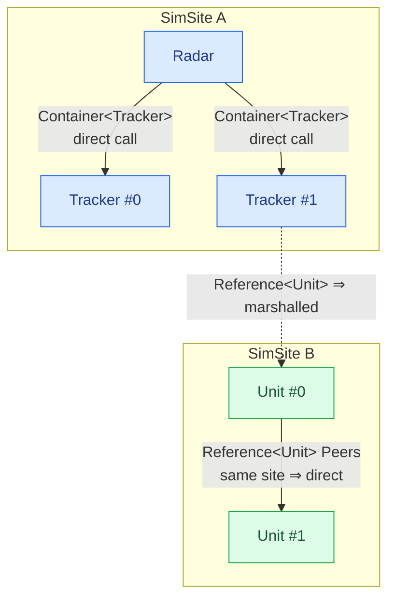
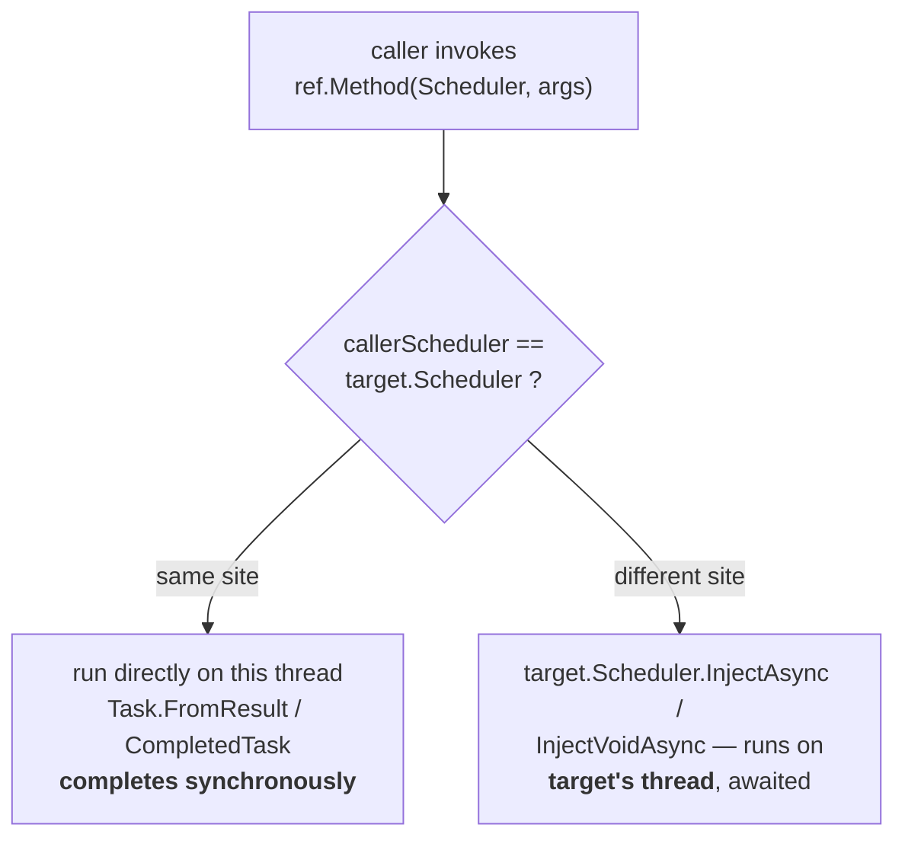
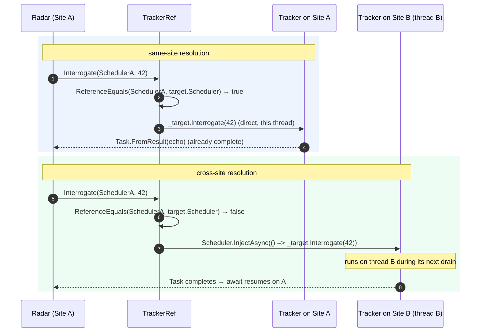

# Associations: containment vs reference

A model rarely stands alone. It **owns** sub-models, and it **links** to other models it does not own. SimulaSharp
gives you two dedicated types for exactly these two relationships — and keeps them separate on purpose, because they
have completely different threading consequences.

| | [`Container<T>`](#/api/type/SimulaSharp.Kernel.Primitives.Container`1) | [`Reference<T>`](#/api/type/SimulaSharp.Kernel.Primitives.Reference`1) |
|---|---|---|
| Relationship | **owns** (containment) | **links** (non-owning) |
| Same subtree / thread? | always — the child *is* in your subtree | maybe — the target may be on another site |
| Call cost | direct, synchronous, lock-free | direct if same-site, else marshalled |
| How you call | plain method call on the model | through a generated `<T>Ref` accessor, `await`ed |
| Decoration | the type itself (no attribute) | the type itself (no attribute) |
| Who populates it | the generated simulator (`Add`) | the generated simulator (`Add`) |

Both are "the type *is* the decoration": you signal ownership vs linkage purely by choosing `Container<T>` or
`Reference<T>` — there is no `[Contained]`/`[Linked]` attribute.

## Why two types at all

The distinction is not bookkeeping — it is the difference between a **free call** and a **cross-thread message**.

- A **contained** model shares your SimSite (see [models & containment](#/guide/models-and-containment)). Calling it is
  a plain synchronous method invocation on the same thread. No marshalling, no `await`.
- A **referenced** model might live in a *different* subtree, on a *different* site, running on a *different* thread.
  You cannot just call it — that would be a data race. The call has to be marshalled onto the target's thread.

If both used one type, every call would have to assume the worst and marshal. By splitting them, containment stays
free and only references pay for what they might cross.



## Declaring a reference

You declare a reference over the **model** type, as an auto-property initialized to `new()` — exactly like a container,
just a different type:

```csharp
public sealed class Radar(IClock c, IScheduler s, ILogger l) : ModelBase(c, s, l)
{
    public Reference<Tracker> Trackers { get; } = new();    // non-owning link to Trackers
}
```

`Reference<T>` is deliberately a **thin, add-only façade**. Its whole public surface is:

- `Add(target)` — called by the generated simulator during assembly wiring. **You never call it.**
- `internal IReadOnlyList<T> Items` — framework-only; used to build the accessor.

Notice what is *missing*: there is no indexer, no `Count`, no enumerator on the developer surface. **You cannot read a
model out of a `Reference<T>` directly** — and that is intentional. A raw model reference would tempt you into an
unmarshalled cross-thread call. Instead, all access goes through a generated accessor.

## The generated `<Type>Ref` — one accessor per member

For **every** type that implements `IModel`, the [`RefGenerator`](#/api/type/SimulaSharp.CodeGen.RefGenerator) emits a
sealed `<Name>Ref` class that wraps one model instance and exposes **one async accessor per public member**:

- **Methods** are surfaced verbatim (same name, same parameters), returning `Task` or `Task<TReturn>`.
- **Properties and fields** are surfaced as `Get<Name>` / `Set<Name>` accessors.
- **Excluded**, never surfaced: `Configure`, `Dispose`, `TimeKeeper`, `Scheduler`, `Logger`, and the `object`
  overrides `ToString`/`Equals`/`GetHashCode`. (Generic methods and by-ref parameters are skipped in v1.)

So for this model:

```csharp
public sealed class Tracker(IClock c, IScheduler s, ILogger l) : ModelBase(c, s, l)
{
    public double Interrogate(int ping) => ping;
    public void Reset() { }
}
```

the generator produces (shape, simplified):

```csharp
public sealed class TrackerRef : IModelRef
{
    private readonly Tracker _target;
    public TrackerRef(Tracker target) => _target = target;

    public Task<double> Interrogate(IScheduler callerScheduler, int ping)
    {
        if (ReferenceEquals(callerScheduler, _target.Scheduler))
            return Task.FromResult(_target.Interrogate(ping));      // same site — synchronous
        return _target.Scheduler.InjectAsync(() => _target.Interrogate(ping)); // cross site — marshalled
    }

    public Task Reset(IScheduler callerScheduler)
    {
        if (ReferenceEquals(callerScheduler, _target.Scheduler))
        {
            _target.Reset();
            return Task.CompletedTask;
        }
        return _target.Scheduler.InjectVoidAsync(() => _target.Reset());
    }
}
```

## Caller-site dispatch — the key idea

Every generated accessor takes the **caller's scheduler as its first argument**, and branches on it:



- **Same site** (`ReferenceEquals(callerScheduler, target.Scheduler)`): the call runs **directly** on the current
  thread and the returned `Task` is *already completed* (`Task.FromResult` / `Task.CompletedTask`). `await`ing it is
  free — no context switch, no allocation-heavy state machine suspension.
- **Different site**: the call is **marshalled** onto the target's site via
  [`InjectAsync`](#/api/type/SimulaSharp.Kernel.Services.IScheduler)/`InjectVoidAsync`. The lambda runs on the
  *target's* thread during its next drain, and your `await` resumes when it completes.

The single accessor shape handles both cases — you write the *same* call either way, and the runtime picks direct or
marshalled from the schedulers. That is why you always pass your own `Scheduler`: it is the caller's identity.

> **Consequence for design.** Correctness never depends on knowing where the target lives — the accessor does the
> right thing. But *performance* does: a reference you happen to resolve same-site is as cheap as a contained call,
> while a genuinely cross-site reference costs a marshal per call. Chatty cross-site references are the thing to notice
> when [choosing a topology](#/guide/choosing-a-topology).

## Calling through a reference

The [`ReferenceAccessorGenerator`](#/api/type/SimulaSharp.CodeGen.ReferenceAccessorGenerator) emits, for each
`Reference<T>` member on a **`partial`** model, a `protected ReferenceAccessor<TRef> _<Member>` and wires it up. So your
`Reference<Tracker> Trackers` gains a generated `_Trackers` of type
[`ReferenceAccessor<TrackerRef>`](#/api/type/SimulaSharp.Kernel.Primitives.ReferenceAccessor`1). You call peers through
it, passing your own `Scheduler` and `await`ing:

```csharp
public partial class Radar(IClock c, IScheduler s, ILogger l) : ModelBase(c, s, l)
{
    public Reference<Tracker> Trackers { get; } = new();
    // generator adds:  protected ReferenceAccessor<TrackerRef> _Trackers;

    public async Task Probe()
    {
        // Pass YOUR Scheduler — the accessor decides direct vs marshalled from it.
        double echo = await _Trackers[0].Interrogate(Scheduler, 42);
        Logger.Trace($"echo={echo}");
    }
}
```

`ReferenceAccessor<TRef>` is itself an `IReadOnlyList<TRef>` — you can index it (`_Trackers[0]`), check `_Trackers.Count`,
and enumerate the `Ref`s. Here is the same pattern from the real `Unit` model, guarding on `Count`:

```csharp
public partial class Unit(IClock c, IScheduler s, ILogger l) : ModelBase(c, s, l)
{
    [Config] public double Rate { get; set; }
    public Reference<Unit> Peers { get; } = new();          // reference to sibling Units

    public async Task<double> PeerRate()
        => _Peers.Count > 0 ? await _Peers[0].GetRate(Scheduler) : 0;
    //                                    ^^^^^^^ generated Get accessor for the `Rate` property
}
```

- **Key point.** `Rate` is a property, so its accessor is `GetRate` (and `SetRate`); a method like `Interrogate` keeps
  its name. Everything returns a `Task`/`Task<T>`, so it is always `await`ed.

## How the two sides get wired

The split is deliberate: **`Reference<T>` is the add-only write side**, **`ReferenceAccessor<T>` is the read-only
access side**, and the generator's explicit
[`IReferenceWiring.WireReferences()`](#/api/type/SimulaSharp.Kernel.Model.IReferenceWiring) bridges them. The simulator:

1. constructs all models,
2. populates each `Reference<T>` by calling its `Add` (from the assembly's link declarations),
3. calls `WireReferences()`, which builds each `_<Member>` accessor via
   [`ReferenceAccessor.From(reference, m => new FooRef(m))`](#/api/type/SimulaSharp.Kernel.Primitives.ReferenceAccessor),
4. *then* calls each model's `Configure()`.

```mermaid
sequenceDiagram
  participant Sim as Generated simulator
  participant R as Reference&lt;Tracker&gt; Trackers
  participant W as WireReferences()
  participant A as ReferenceAccessor&lt;TrackerRef&gt; _Trackers
  Sim->>R: Add(tracker0), Add(tracker1)   %% from the assembly
  Sim->>W: WireReferences()
  W->>A: ReferenceAccessor.From(Trackers, m => new TrackerRef(m))
  Note over Sim: only now → Configure() on every model
```

By the time your `Configure()` runs, `_Trackers` is populated and ready — another reason setup belongs in `Configure`,
not the constructor.

## A reference call, resolved two ways

Same source line, two runtimes — decided entirely by whether the target shares your site:



## Where to go next

- **[Models & containment](#/guide/models-and-containment)** — the owning side, and why a subtree shares one thread.
- **[The assembly](#/guide/the-assembly)** — how you declare links so the simulator calls `Reference.Add`.
- **[Services](#/guide/services)** — the *other* cross-thread partner: a shared capability on its own site, always
  marshalled.
- **[Choosing a topology](#/guide/choosing-a-topology)** — when a link should be a same-site reference vs a cross-site
  one.
