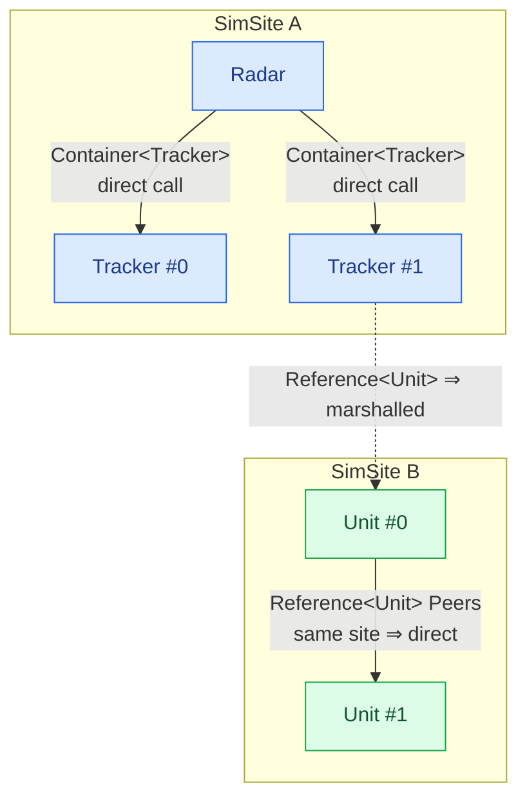
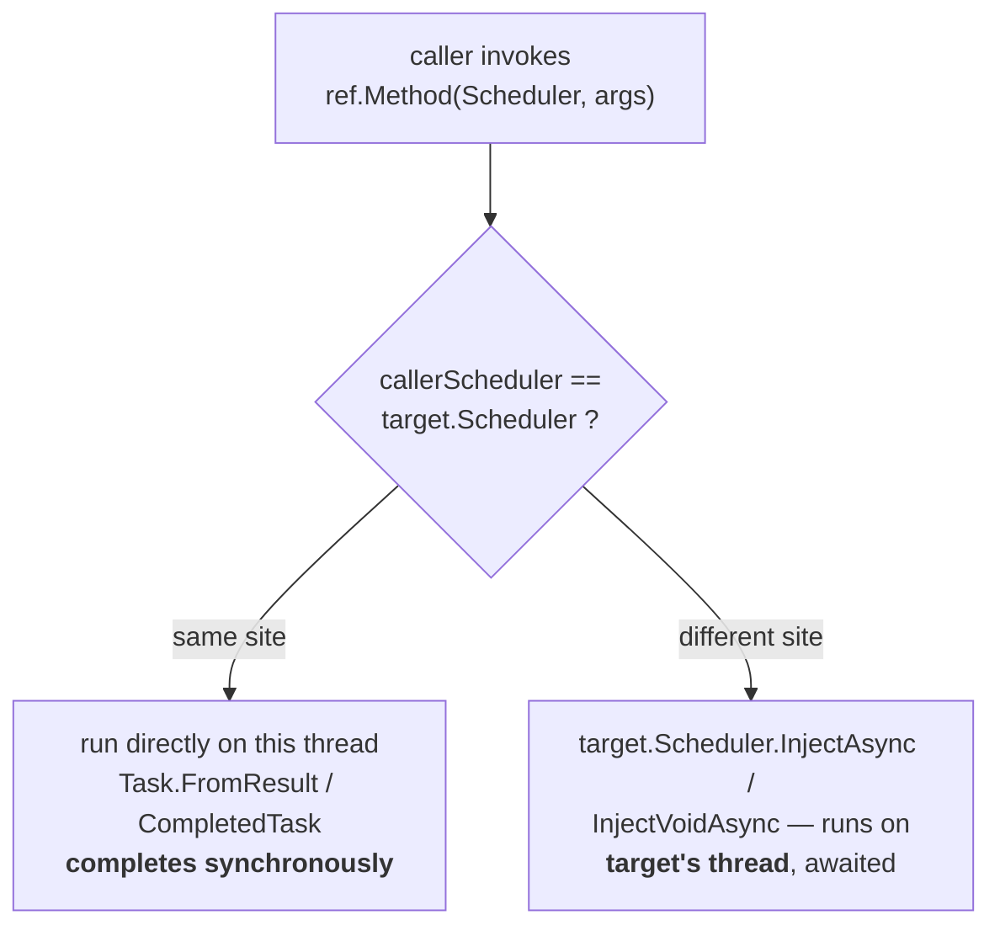
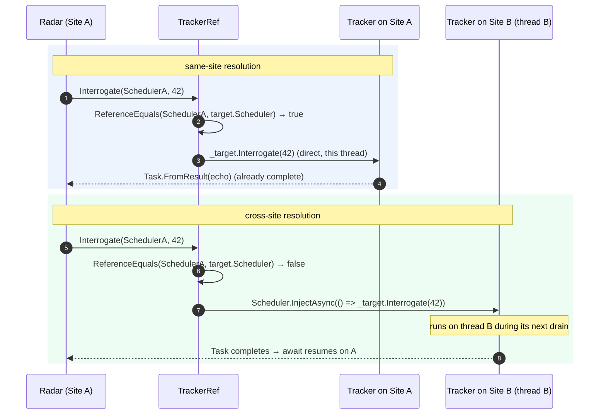

# Associations: containment vs reference

A model rarely stands alone. It **owns** sub-models, and it **links** to other models it does not own. SimulaSharp
gives you two dedicated types for exactly these two relationships — and keeps them separate on purpose, because they
have completely different threading consequences.

| | [`Container<T>`](#/api/type/SimulaSharp.Kernel.Primitives.Container`1) | [`IReference<T>Ref`](#/api/type/SimulaSharp.Kernel.Primitives.IReference`1) |
|---|---|---|
| Relationship | **owns** (containment) | **links** (non-owning) |
| Same subtree / thread? | always — the child *is* in your subtree | maybe — the target may be on another site |
| Call cost | direct, synchronous, lock-free | direct if same-site, else marshalled |
| How you call | plain method call on the model | through a generated `<T>Ref` accessor, `await`ed |
| Decoration | the `[Contains<T>("Name")]` attribute on the model | the `[References<T>("Name")]` attribute on the model |
| Who populates it | the generated simulator (frozen via a factory, handed in through `init`) | the generated simulator (a second wiring pass) |

Both are declared with a decorator — [`[Contains<T>("Name")]`](#/api/type/SimulaSharp.Kernel.Attributes.ContainsAttribute`1)
or [`[References<T>("Name")]`](#/api/type/SimulaSharp.Kernel.Attributes.ReferencesAttribute`1) — and the generator emits
a read-only accessor of that name (a `Container<T>` for containment, an `IReference<T>Ref` for a reference). Neither
needs you to write an `Add`: the generated simulator populates
both while building the tree.

## Why two types at all

The distinction is not bookkeeping — it is the difference between a **free call** and a **cross-thread message**.

- A **contained** model shares your SimSite (see [models & containment](#/guide/models-and-containment)). Calling it is
  a plain synchronous method invocation on the same thread. No marshalling, no `await`.
- A **referenced** model might live in a *different* subtree, on a *different* site, running on a *different* thread.
  You cannot just call it — that would be a data race. The call has to be marshalled onto the target's thread.

If both used one type, every call would have to assume the worst and marshal. By splitting them, containment stays
free and only references pay for what they might cross.



## Declaring a reference

You declare a reference with a **`[References<T>("Name")]`** decorator on the model — the mirror of `[Contains<T>]`.
The generator emits a read-only accessor of that name; there is no field to write:

```csharp
[References<Tracker>("Trackers")]                       // non-owning link to Trackers
public partial class Radar(IClock c, IScheduler s, ILogger l) : ModelBase(c, s, l)
{
}
```

`T` may be a concrete model **or an interface** (there is no `IModel` constraint). The generated `Trackers` accessor is
an [`IReference<TrackerRef>`](#/api/type/SimulaSharp.Kernel.Primitives.IReference`1) — a read-only list of the guarded
`<Type>Ref` accessors. You never get a raw model out of a reference: all access goes through a `Ref`, so a cross-thread
call can never happen unmarshalled.

## The generated `<Type>Ref` — one accessor per member

For **every** type that implements `IModel`, the [`RefGenerator`](#/api/type/SimulaSharp.CodeGen.RefGenerator) emits a
sealed `<Name>Ref` class that wraps one model instance and exposes **one async accessor per public member**:

- **Methods** are surfaced verbatim (same name, same parameters), returning `Task` or `Task<TReturn>`.
- **Properties and fields** are surfaced as `Get<Name>` / `Set<Name>` accessors.
- **Excluded**, never surfaced: `Configure`, `Dispose`, `TimeKeeper`, `Scheduler`, `Logger`, and the `object`
  overrides `ToString`/`Equals`/`GetHashCode`. (Generic methods and by-ref parameters are skipped in v1.)

So for this model:

```csharp
public sealed class Tracker(IClock c, IScheduler s, ILogger l) : ModelBase(c, s, l)
{
    public double Interrogate(int ping) => ping;
    public void Reset() { }
}
```

the generator produces (shape, simplified):

```csharp
public sealed class TrackerRef : IModelRef
{
    private readonly Tracker _target;
    public TrackerRef(Tracker target) => _target = target;

    public Task<double> Interrogate(IScheduler callerScheduler, int ping)
    {
        if (ReferenceEquals(callerScheduler, _target.Scheduler))
            return Task.FromResult(_target.Interrogate(ping));      // same site — synchronous
        return _target.Scheduler.InjectAsync(() => _target.Interrogate(ping)); // cross site — marshalled
    }

    public Task Reset(IScheduler callerScheduler)
    {
        if (ReferenceEquals(callerScheduler, _target.Scheduler))
        {
            _target.Reset();
            return Task.CompletedTask;
        }
        return _target.Scheduler.InjectVoidAsync(() => _target.Reset());
    }
}
```

## Caller-site dispatch — the key idea

Every generated accessor takes the **caller's scheduler as its first argument**, and branches on it:



- **Same site** (`ReferenceEquals(callerScheduler, target.Scheduler)`): the call runs **directly** on the current
  thread and the returned `Task` is *already completed* (`Task.FromResult` / `Task.CompletedTask`). `await`ing it is
  free — no context switch, no allocation-heavy state machine suspension.
- **Different site**: the call is **marshalled** onto the target's site via
  [`InjectAsync`](#/api/type/SimulaSharp.Kernel.Services.IScheduler)/`InjectVoidAsync`. The lambda runs on the
  *target's* thread during its next drain, and your `await` resumes when it completes.

The single accessor shape handles both cases — you write the *same* call either way, and the runtime picks direct or
marshalled from the schedulers. That is why you always pass your own `Scheduler`: it is the caller's identity.

> **Consequence for design.** Correctness never depends on knowing where the target lives — the accessor does the
> right thing. But *performance* does: a reference you happen to resolve same-site is as cheap as a contained call,
> while a genuinely cross-site reference costs a marshal per call. Chatty cross-site references are the thing to notice
> when [choosing a topology](#/guide/choosing-a-topology).

## Calling through a reference

The [`ReferenceGenerator`](#/api/type/SimulaSharp.CodeGen.ReferenceGenerator) emits, for each `[References<T>]` on a
**`partial`** model, a read-only `public IReference<TRef> Name` accessor (backed by a hidden fillable list). So
`[References<Tracker>("Trackers")]` gives a `Trackers` of type
[`IReference<TrackerRef>`](#/api/type/SimulaSharp.Kernel.Primitives.IReference`1). You call peers through it, passing
your own `Scheduler` and `await`ing:

```csharp
[References<Tracker>("Trackers")]
public partial class Radar(IClock c, IScheduler s, ILogger l) : ModelBase(c, s, l)
{
    public async Task Probe()
    {
        // Pass YOUR Scheduler — the accessor decides direct vs marshalled from it.
        double echo = await Trackers[0].Interrogate(Scheduler, 42);
        Logger.Trace($"echo={echo}");
    }
}
```

`IReference<TRef>` is an `IReadOnlyList<TRef>` — index it (`Trackers[0]`), check `Trackers.Count`, and enumerate the
`Ref`s. Here is the same pattern from the real `Unit` model, guarding on `Count`:

```csharp
[References<Unit>("Peers")]                              // reference to sibling Units
public partial class Unit(IClock c, IScheduler s, ILogger l) : ModelBase(c, s, l)
{
    [Parameter(0.0)] public double Rate { get; set; }

    public async Task<double> PeerRate()
        => Peers.Count > 0 ? await Peers[0].GetRate(Scheduler) : 0;
    //                                 ^^^^^^^ generated Get accessor for the `Rate` property
}
```

- **Key point.** `Rate` is a property, so its accessor is `GetRate` (and `SetRate`); a method like `Interrogate` keeps
  its name. Everything returns a `Task`/`Task<T>`, so it is always `await`ed.

**Interface targets are polymorphic.** When `T` is an interface, the generator also mints a companion `<T>Ref`
*interface* declaring the same accessor signatures, and makes every implementing model's Ref implement it. So
`[References<IPowerSource>("Sources")]` yields an `IReference<IPowerSourceRef>` that can hold the concrete Ref of *any*
`IPowerSource` model — you call `Sources[i].GetAvailableW(Scheduler)` without caring which implementation it is.

## How the two sides get wired

The read side is the model's `IReference<TRef>` accessor; the write side is the hidden `FillableReference<TRef>` it is
backed by. The generator's explicit
[`IReferenceWiring.WireReference`](#/api/type/SimulaSharp.Kernel.Model.IReferenceWiring) bridges them. Because a
reference graph can be **cyclic** (A links B, B links A), wiring is a **second pass**, after every instance exists —
it cannot be done at construction the way owned containment can. The simulator:

1. constructs all models (each reference starts empty),
2. for each reference, builds a `RefCollection` of the target `Ref`s — `new <ConcreteType>Ref(target)`, which only the
   simulator can do because only it knows each target's concrete type,
3. calls `WireReference("Name", refs)`, whose generated body downcasts each `Ref` to the reference's element type and
   fills the hidden `FillableReference`,
4. *then* calls each model's `Configure()`.

```mermaid
sequenceDiagram
  participant Sim as Generated simulator
  participant RC as RefCollection
  participant W as IReferenceWiring.WireReference
  participant A as IReference&lt;TrackerRef&gt; Trackers
  Sim->>RC: new TrackerRef(tracker0), new TrackerRef(tracker1)
  Sim->>W: WireReference("Trackers", refs)
  W->>A: downcast each Ref, fill the backing FillableReference
  Note over Sim: only now → Configure() on every model
```

By the time your `Configure()` runs, `Trackers` is populated and ready — another reason setup belongs in `Configure`,
not the constructor.

## A reference call, resolved two ways

Same source line, two runtimes — decided entirely by whether the target shares your site:



## Where to go next

- **[Models & containment](#/guide/models-and-containment)** — the owning side, and why a subtree shares one thread.
- **[The assembly](#/guide/the-assembly)** — how you declare links so the simulator wires each reference.
- **[Services](#/guide/services)** — the *other* cross-thread partner: a shared capability on its own site, always
  marshalled.
- **[Choosing a topology](#/guide/choosing-a-topology)** — when a link should be a same-site reference vs a cross-site
  one.
