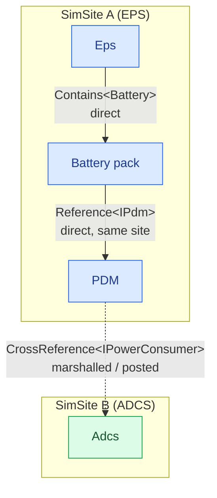

# Associations: containment and references

A model rarely stands alone. It **owns** sub-models, and it **links** to other models it does not own. SimulaSharp
gives you dedicated relationships for each — and keeps them separate on purpose, because they have completely different
threading consequences. There are three:

| | [`[Contains<T>]`](#/api/type/SimulaSharp.Kernel.Attributes.ContainsAttribute`1) | [`[Reference<T>]`](#/api/type/SimulaSharp.Kernel.Attributes.ReferenceAttribute`1) | [`[CrossReference<T>]`](#/api/type/SimulaSharp.Kernel.Attributes.CrossReferenceAttribute`1) |
|---|---|---|---|
| Relationship | **owns** (containment) | **links, same site** | **links, may cross sites** |
| Target `T` | class or interface | class or interface | **interface only** |
| Same thread? | always | **always** (validated) | maybe |
| Call cost | direct, synchronous | direct, synchronous | direct if same-site, else marshalled |
| Accessor | `Container<T>` | `IReadOnlyList<T>` | `IReference<<T>Ref>` (guarded `Ref`s) |
| YAML block | `Models:` | `Refs:` | `CRefs:` |

All three are class attributes, take the accessor name as their argument, and may be repeated on one model (one
attribute per accessor). The generator emits the accessor into your class, so the model must be `partial` (as every
model must — `SIM029`).

The rule of thumb: **`[Contains<T>]`** for what you own, **`[Reference<T>]`** for a co-located collaborator, and
**`[CrossReference<T>]`** only when the link genuinely crosses a thread boundary — because only that last one pays the
cross-thread cost.

## Why the split — a free call vs a cross-thread message

A **contained** model and an **intra-site reference** both share your SimSite (see
[models & containment](#/guide/models-and-containment)): calling them is a plain synchronous method invocation on the
same thread — no marshalling, no `await`, no `Ref`. The difference between the two is only *ownership*: containment owns
the child (its whole subtree is yours); a `[Reference<T>]` is a non-owning link to a sibling that happens to live on the
same site. The generator **validates** that an intra-site reference really is same-site (`SIM017` if a wiring crosses a
site), so you can rely on the direct call.

A **cross-site reference** is the only one that might reach a model on a *different* thread. You cannot just call it —
that would be a data race — so the call goes through a generated guarded `Ref` that marshals onto the target's thread
when needed. Because the target may be anything on the far side of that boundary, `[CrossReference<T>]` requires `T` to
be an **interface** (`SIM018` otherwise): the boundary is expressed as a contract, not a concrete type.



## Intra-site references — `[Reference<T>]`

Declare a same-site link with **`[Reference<T>("Name")]`**. The generator emits a read-only `IReadOnlyList<T>` accessor
holding the **target instances themselves** — no `Ref`, no marshalling. You call them directly:

```csharp
[Reference<IPdm>("Pdm")]                                // same-site sibling, reached directly
public partial class BatteryPack(IClock c, IScheduler s, ILogger l) : ModelBase(c, s, l)
{
    private void Step()
    {
        // Direct, synchronous — Pdm[0] IS the model instance, on this very thread.
        double draw = Pdm.Count > 0 ? Pdm[0].RailDraw : 0;
        // …integrate the battery with `draw`…
    }
}
```

`T` may be a concrete class or an interface (there is no `IModel` constraint). The set is filled in a **second pass**
after construction, so **cyclic same-site references are fine** (A links B, B links A). It is never mutated afterward.

## Cross-site references — `[CrossReference<T>]` and the generated `Ref`

Declare a link that may cross a thread with **`[CrossReference<T>("Name")]`**, where **`T` is an interface**. The
accessor is an [`IReference<<T>Ref>`](#/api/type/SimulaSharp.Kernel.Primitives.IReference`1) — a read-only list of
guarded `Ref`s. For each interface `I` used this way, the [`RefGenerator`](#/api/type/SimulaSharp.CodeGen.RefGenerator)
emits **one** `sealed class <I>Ref` (in `I`'s namespace, so `IPowerConsumer` gets `IPowerConsumerRef`) that wraps an
`I` target and **captures both schedulers at construction** — the target's and the caller's — so no scheduler is passed
per call. Same-site vs cross-site is decided per call by `ReferenceEquals(callerSched, targetSched)`, behind a uniform
surface.

Each member of the interface is routed by a **three-tier taxonomy** you choose by decorating the interface:

| Interface member | Decorate with | On the `Ref` | Cost |
|---|---|---|---|
| `void M(…)` | [`[Triggerable]`](#/api/type/SimulaSharp.Kernel.Attributes.TriggerableAttribute) | `void M(…)` — fire-and-forget | an enqueue (or inline same-site) |
| `T P { get; }` | [`[VolatileAccess]`](#/api/type/SimulaSharp.Kernel.Attributes.VolatileAccessAttribute) | `T P { get; }` — direct read | a memory read |
| method / property | *(none)* | `Task<T> M(…)` / `Task M(…)` / `GetP()`/`SetP(…)` | a marshalled round-trip |

Think **notify / gauge / ask**. You pick per member by intent:

```csharp
public interface IPowerConsumer
{
    // "notify" — fire-and-forget: post the new budget, don't wait for anything.
    [Triggerable] void OnAvailableChanged(double watts);

    // "gauge" — a live scalar read directly, no dispatch, no cache.
    [VolatileAccess] double CurrentDrawW { get; }

    // "ask" — a genuine cross-thread request/response; the Ref exposes it as Task<string>.
    string DescribeState();
}
```

- **`[Triggerable]`** is one-way. Because there is no result, the same-site path is a plain inline call and the
  cross-site path is a `Post` onto the target's dispatcher — both return `void`, so a mixed collection of targets is
  uniform. Use it for propagation (e.g. pushing availability down a power tree). The method **must return `void`**
  (`SIM019` otherwise; the member then falls back to the default tier).
- **`[VolatileAccess]`** is a live gauge: the `Ref` reads `_target.P` directly with no dispatch, no `Task`, no cache — a
  single lock-free memory read from any thread. Its freshness is *producer-side* (the implementing model backs the
  getter with a volatile read of a single-producer field); a gauge read is **not** ordered against `[Triggerable]`
  notifications. The property **must be get-only and of an atomically-readable type** — a word-size primitive, an
  `enum`, or a reference (`SIM021` otherwise; the member then falls back to the default tier). Use it for a
  continuously-changing value that would be wasteful to pull.
- **Default** members are the only ones that pay the async cost: same-site they run inline and hand back a completed
  `Task`; cross-site they marshal onto the target via
  [`InjectAsync`](#/api/type/SimulaSharp.Kernel.Services.IDispatcher)/`InjectVoidAsync`. A method keeps its name and
  wraps its return type: `string M()` becomes `Task<string> M()`, and `void M()` becomes `Task M()`. A property `P`
  becomes `Task<T> GetP()` and, if it has a setter, `Task SetP(T value)`. Declare the interface method with its plain
  result type — a method that already returns `Task<T>` would be wrapped again into `Task<Task<T>>`.

The `Ref` skips generic methods and methods with `ref`/`out` parameters, and it never surfaces members named
`Configure`, `Dispose`, `TimeKeeper`, `Scheduler` or `Logger`, in case the interface inherits model plumbing.

Calling through a cross-reference, using the `IReference<IPowerConsumerRef>` accessor:

```csharp
[CrossReference<IPowerConsumer>("Consumers")]
public partial class Rail(IClock c, IScheduler s, ILogger l) : ModelBase(c, s, l)
{
    private double _available, _limit;

    private async Task Recompute()
    {
        double total = 0;
        foreach (IPowerConsumerRef c in Consumers)
        {
            total += c.CurrentDrawW;             // [VolatileAccess] gauge — direct, synchronous
            c.OnAvailableChanged(_available);    // [Triggerable] — fire-and-forget
        }
        if (total > _limit) { /* … */ await Consumers[0].DescribeState(); }  // default — awaited
    }
}
```

## How the two sides get wired

You declare the targets in the assembly YAML, in the block that matches the reference kind — **`Refs:`** for intra-site
`[Reference<T>]`, **`CRefs:`** for cross-site `[CrossReference<T>]` — each an entry of `{ Name: [full.instance.paths] }`.
A full instance path is the simulator name followed by each model name down the tree (`Sim.Eps.Pdm`). Wiring is a
**second pass**, after every instance exists (so cyclic links work). The generated simulator's constructor:

1. constructs all models (each reference starts empty);
2. for an intra `Refs:` entry, hands the target **instances** to the model's hidden
   [`ILocalReferenceWiring.WireLocalReference`](#/api/type/SimulaSharp.Kernel.Model.ILocalReferenceWiring) seam (no `Ref`);
3. for a cross `CRefs:` entry, builds a `RefCollection` of `new <I>Ref((I)target, targetSched, callerSched)` — capturing
   each target's site scheduler and the referrer's — and hands it to the
   [`IReferenceWiring.WireReference`](#/api/type/SimulaSharp.Kernel.Model.IReferenceWiring) seam.

Only *then*, when the host calls the simulator's `Configure()`, does each model's `Configure()` run.

```yaml
- Name: Bat
  Type: Demo.BatteryPack
  Refs:                       # intra-site [Reference<T>] — same site, direct
    - Pdm: [ Sim.Eps.Pdm ]
- Name: PdmRail
  Type: Demo.Rail
  CRefs:                      # cross-site [CrossReference<T>] — through a Ref
    - Consumers: [ Sim.Adcs, Sim.Sband ]
```

The generator checks the wiring at build time:

| Diagnostic | Meaning |
|---|---|
| `SIM010` | the model has no reference of that name in that block (a `Refs:` key needs a `[Reference<T>]`, a `CRefs:` key a `[CrossReference<T>]`) |
| `SIM011` | a target path names no instance |
| `SIM012` | a target is not assignable to `T` |
| `SIM017` | a `Refs:` target is on a different site |
| `SIM018` | a `[CrossReference<T>]` names a non-interface `T` |
| `SIM019` / `SIM021` | a misused `[Triggerable]` / `[VolatileAccess]` on the target interface |

By the time your `Configure()` runs, both kinds of accessor are populated — another reason setup belongs in `Configure`,
not the constructor.

## Where to go next

- **[Models & containment](#/guide/models-and-containment)** — the owning side, and why a subtree shares one thread.
- **[The assembly](#/guide/the-assembly)** — the `Refs:` / `CRefs:` blocks and how the simulator wires each reference.
- **[Services](#/guide/services)** — the *other* cross-thread partner: a shared capability on its own site.
- **[Choosing a topology](#/guide/choosing-a-topology)** — when a link should be an intra `[Reference]` vs a cross-site
  `[CrossReference]`.
