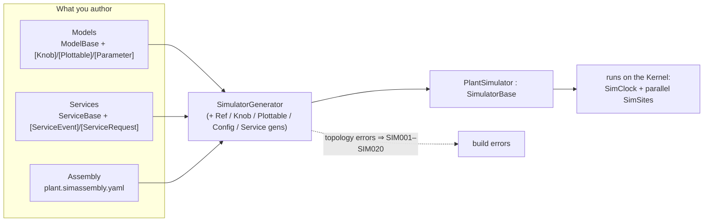
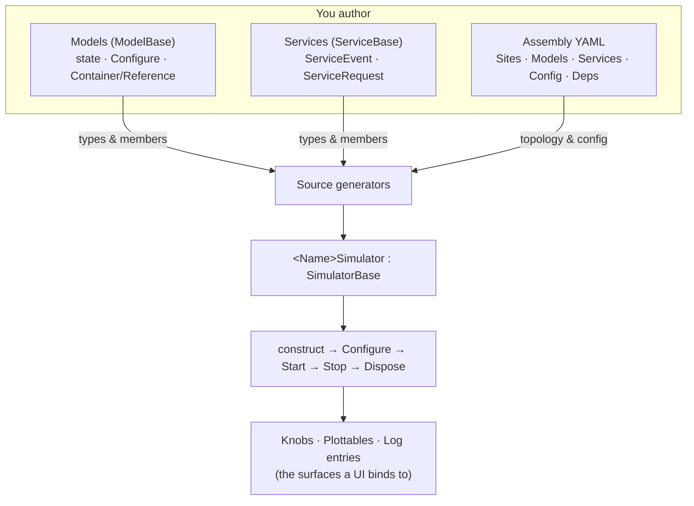

# The authoring model

You build a SimulaSharp simulator out of **three kinds of thing**, and nothing else:

| You write… | It is… | Base type | Lives on |
|---|---|---|---|
| **Models** | a simulated entity — state + behaviour | [`ModelBase`](#/api/type/SimulaSharp.Kernel.Model.ModelBase) | a shared [SimSite](#/guide/simsites-and-actors) with its containment subtree |
| **Services** | a shared capability many models use | [`ServiceBase`](#/api/type/SimulaSharp.Kernel.Model.ServiceBase) | its **own** SimSite (every call cross-thread) |
| **Assemblies** | the topology — who exists, where | a `*.simassembly.yaml` file | build input, not runtime code |

The first two are C#. The third is a small YAML file. A Roslyn **[source generator](#/guide/big-picture)** reads all
three at build time and emits a strongly-typed `<Name>Simulator` that constructs the tree, wires every association,
applies config, and exposes knobs and plottables. There is no reflective engine at runtime — your simulation *is*
compiled code.



This page is the *at a glance* tour: the smallest real example of each artifact, and how they fit. Every section links
forward to the concept chapter that goes deep.

---

## 1. Models — the things being simulated

A **model** is a plain C# class deriving [`ModelBase`](#/api/type/SimulaSharp.Kernel.Model.ModelBase). The framework
injects three collaborators through the constructor — you pass them straight to the base and then live off the three
properties they become:

| Injected | Property | You use it to… |
|---|---|---|
| [`IClock`](#/api/type/SimulaSharp.Kernel.Services.IClock) | `TimeKeeper` | **read** "now" (`TimeKeeper.SimNowUs`) — never advance it |
| [`IScheduler`](#/api/type/SimulaSharp.Kernel.Services.IScheduler) | `Scheduler` | schedule work on this model's SimSite |
| [`ILogger`](#/api/type/SimulaSharp.Kernel.Logging.ILogger) | `Logger` | emit component-scoped log entries |

A model does not run a loop and has no `OnTick`. It **arms scheduled work in `Configure()`**, and the site fires it when
due. The smallest useful model:

```csharp
using SimulaSharp.Kernel.Logging;
using SimulaSharp.Kernel.Model;
using SimulaSharp.Kernel.Services;

public sealed class Heartbeat(IClock c, IScheduler s, ILogger l) : ModelBase(c, s, l)
{
    public override void Configure()
        => Scheduler.AddPeriodicEvent(Beat, periodUs: 1_000_000);   // once a second of real time

    private void Beat() => Logger.Info($"tick @ {TimeKeeper.SimNowUs}us");
}
```

Two things structure everything else you write:

- **Containment** — a parent owns sub-models via [`[Contains<T>]`](#/api/type/SimulaSharp.Kernel.Attributes.ContainsAttribute`1),
  exposed as a read-only `Container<T>`. A root model and its **whole subtree share one SimSite** (one thread), so
  intra-subtree calls are direct and lock-free. See [models & containment](#/guide/models-and-containment).
- **References** — a non-owning link to a model you may not own. Two flavours: an **intra-site**
  [`[Reference<T>]`](#/api/type/SimulaSharp.Kernel.Attributes.ReferenceAttribute`1), exposed as a plain
  `IReadOnlyList<T>` of the actual instances for direct, synchronous access; and a possibly cross-site
  [`[CrossReference<T>]`](#/api/type/SimulaSharp.Kernel.Attributes.CrossReferenceAttribute`1), which targets an
  **interface** and gives you a generated `<I>Ref` accessor that auto-dispatches — synchronous if same-site,
  marshalled if cross-site (schedulers captured at construction). See [associations](#/guide/associations).

> **Consequence for design.** A model that touches any generated member — a knob, a `[Parameter]`, a `[CrossReference<T>]` — must
> be declared **`partial`**, so the generator can weave in its half. A model with none can be `sealed`. When in doubt,
> mark it `partial`; it costs nothing.

Full chapter: [models & containment](#/guide/models-and-containment). Worked build:
[Hello, simulator](#/guide/scenario-hello-sim).

---

## 2. Services — capabilities that belong to no one model

Some things are not *part of* any single model: a shared bus, an environment/blackboard, a comms relay, a shared
resource pool. Those are **services**. A service derives [`ServiceBase`](#/api/type/SimulaSharp.Kernel.Model.ServiceBase)
and — the defining fact — owns its **own SimSite**. It is never in a model's subtree, so **every model↔service call is
cross-thread and marshalled**. There is no same-site fast path.

A service talks to the world through two generator-owned attributes:

- **`[ServiceEvent]`** — a fire-and-forget **publish** channel *out* to models (pub/sub).
- **`[ServiceRequest]`** — a request/response **entry point** *in* from models.

```csharp
using SimulaSharp.Kernel.Attributes;
using SimulaSharp.Kernel.Logging;
using SimulaSharp.Kernel.Model;
using SimulaSharp.Kernel.Services;

[ServiceEvent("RangeUpdated", typeof(double))]        // publish OUT to subscribers
public partial class RangeService : ServiceBase
{
    public RangeService(IClock c, ILogger l) : base(c, l, name: "range") { }

    public override void Configure()
        => Scheduler.AddPeriodicEvent(() => Trigger_RangeUpdated(NextRange()), 100_000);

    [ServiceRequest]                                   // request IN from models
    protected int Handle_Allocate(int want) => want;   // runs on the SERVICE's thread

    private double NextRange() => 0.0;
}
```

The generator emits the plumbing: `RegisterCallback_RangeUpdated(IDispatcher, Action<double>)` and
`Trigger_RangeUpdated(double)` for the event, and a public `Task<int> Allocate(int)` over your `Handle_Allocate`. A
model gets a handle by declaring a `[ServiceRef]` member, which the assembly binds by name. Like a codegen-using model,
a service **must be `partial`**.

There are **two service kinds**. The `ServiceBase` above is *sim-paced* — its site runs on the clock and parks on
pause. A service that owns I/O living **outside** sim time (real hardware, a HIL link) instead derives
[`LooselyCoupledServiceBase`](#/api/type/SimulaSharp.Kernel.Model.LooselyCoupledServiceBase): its site is a clock-ungated
dispatcher, with its own I/O reader thread and inline run-state hooks. The same
`[ServiceEvent]`/`[ServiceRequest]`/`[ServiceRef]` plumbing works on both, and the
assembly declares them identically.

Full chapter: [services](#/guide/services). The *when* — model vs service — is [model vs service](#/guide/model-vs-service).

---

## 3. Assemblies — the topology, in YAML

The two C# artifacts say *what a model is*. The **assembly** says *what exists and where it runs*: it names the sites
(threads), the services, and the model tree, and supplies each model's config. A model never `new`s a child, never calls
fills its containers, never picks a scheduler — the assembly declares it and the generated simulator does all three.

```yaml
Simulator:
  Name: Plant
  MissionStart: 2026-01-01T00:00:00
  Services:
    - Name: Tracker
      Type: Demo.DemoService
  Sites:
    - Name: Main               # one Site == one thread
      Models:
        - Name: Plant1
          Type: Demo.Plant
          Config: { Capacity: 5 }
          Models:
            - Units:                        # fills the Plant's [Contains<Unit>] container
                - Name: UnitA
                  Type: Demo.Unit
                  Config: { Rate: 1.5 }
                  Refs:
                    - Peers: [ Plant.Plant1.UnitB ]   # fills the [Reference<Unit>] reference Peers (same site → intra-site)
                - Name: UnitB
                  Type: Demo.Unit
                  Config: { Rate: 2.5 }
          Deps:
            - Tracker: Tracker              # binds [ServiceRef] Tracker by name
```

The single most consequential thing in this file is the **`Sites:` block** — it is where you set the topology. Every
root model under one `Site` (and its whole containment subtree) shares that site's thread; different `Site` entries run
in parallel. Choosing that partition well is the central design decision:
[choosing a topology](#/guide/choosing-a-topology).

If anything in the YAML doesn't match your real types — an unknown type, a container/element mismatch, a dangling
reference — it is a **compile error** (`SIM001`–`SIM020`), not a runtime surprise. Full chapter:
[the assembly](#/guide/the-assembly).

---

## How the three fit together



- You **write** Models and Services (annotated C#) and an **Assembly** (YAML).
- The **generator** turns them into a runnable `<Name>Simulator` and validates the topology at build time.
- A host walks the simulator through a short [lifecycle](#/guide/simulator-lifecycle) and binds to its
  [knobs and plottables](#/guide/observability).

That is the whole authoring surface. Where to go next:

- **[Choosing a topology](#/guide/choosing-a-topology)** — the central judgement call: how the model tree maps onto
  sites/threads.
- **[Modeling a subsystem](#/guide/modeling-a-subsystem)** — building one stateful model well.
- **[Model vs service](#/guide/model-vs-service)** — deciding which of the two an entity should be.
- **[The assembly](#/guide/the-assembly)** — the full YAML grammar.
