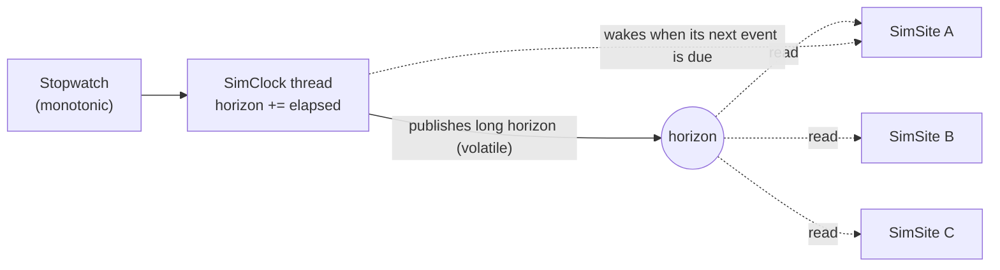
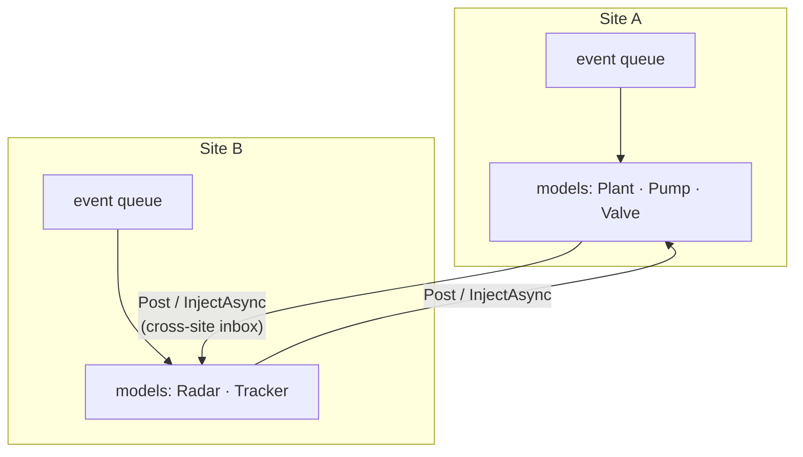
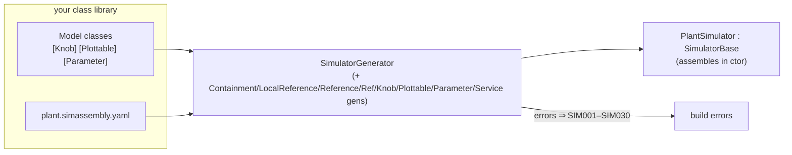
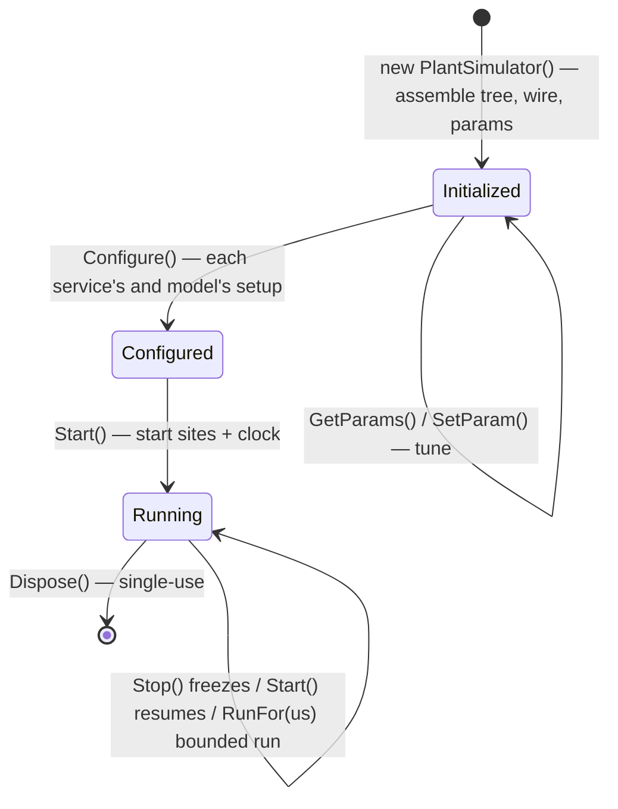

# The big picture

One page for the whole mental model. Everything else in the guide is detail on the pieces named here.

## Time is published, not pushed

At the centre of a running simulation is a single **clock**
([`SimClock`](#/api/type/SimulaSharp.Kernel.Services.SimClock)). It runs on its own thread and does exactly one thing:
it advances **the horizon** — a single number, *elapsed simulation microseconds* — and publishes it. It never runs
your code. Time advances at **1:1 with real time**: after 100 ms of wall clock, the horizon has grown by 100 000 µs.
The clock thread is also the **precise waker**: when the horizon reaches a parked site's next event, the clock wakes
that site.

Because the clock only *publishes* and *wakes*, and never *calls* your code, there is no central scheduler that can
become a bottleneck. Each site reads the horizon and decides for itself what is now due.

## Work runs on SimSites — one thread each

A **SimSite** ([`SimSite`](#/api/type/SimulaSharp.Kernel.Services.SimSite)) is an independent scheduling domain: **one
thread, one event queue**. While the clock is running, a site fires everything now due, then parks until its next event
— the clock wakes it precisely on time (0% CPU while idle). Everything a site does happens on that one thread, so within
a site there is **no concurrency and no locking**. If a piece of work on a site throws, the site catches it, logs it
at *Error* on its logger, drops that work, and keeps running.

Parallelism comes from having **several sites**. A model tree is partitioned into sites (you decide how — see
[choosing a topology](#/guide/choosing-a-topology)); each site runs in parallel with the others.

- **Within a site**, models call each other **directly** — same thread, synchronous, lock-free.
- **Across sites**, calls are **marshalled**: the caller drops a message into the target site's lock-free inbox, which
  the target runs on *its* thread. Nothing blocks the sender.

## You describe a tree; the generator wires it

You author **models** (C# classes deriving [`ModelBase`](#/api/type/SimulaSharp.Kernel.Model.ModelBase)) and, when
you need a shared capability, **services** (each on its own site). You express how models relate with class
decorators — `[Contains<T>("Name")]` for **ownership** (containment, read through a `Container<T>`),
`[Reference<T>]` for **intra-site non-owning links**, and `[CrossReference<T>]` for **possibly cross-site links**.
Any model or service can also publish and subscribe to **[global events](#/guide/events)**. You mark the values an
operator should see or change with `[*Knob]`/`[Plottable]`, and the build-time tunables with `[Parameter]`.

Then you write a small **assembly** (`*.simassembly.yaml`) naming the sites, the services, the global events, and the
model tree. At build time a Roslyn generator reads it and emits a strongly-typed `<Name>Simulator` that constructs
everything, wires the associations and events, applies parameters, and exposes the knobs, plottables, and parameters —
all checked against your real types.

If the topology is wrong — an unknown type, a container/element mismatch, a dangling reference, a bad event handler —
or an attribute is misused, you get a **compile error** (`SIM001`–`SIM030`), not a runtime failure.

## Running it is a short lifecycle

The generated simulator is an [`ISimulator`](#/api/type/SimulaSharp.Kernel.Services.ISimulator). Constructing it
assembles it, then a host walks it through the remaining states and tears it down. It is **single-use**: to start over,
you make a new one.

Along the way the simulator exposes its **knobs** (observe + control), **plottables** (telemetry), and **parameters**
(build-time tunables), and fans **log entries** out to any registered sink. Those are the surfaces a UI binds to.

## Observing and controlling from outside

Two channels reach into a running simulation, both discovered automatically at construction:

- **Knobs** — the unit of *observation and control*: a named readable value, a settable value, or a trigger. Marked
  with the `[*Knob]` attributes; streamed to a UI through an `IKnobChannel`.
- **Plottables** — the unit of *plot telemetry*: a named numeric sample. Marked with `[Plottable]`; the host sweeps
  them with `SamplePlottables()`, one mission-time stamp per sweep.

A third surface acts *before* the run: **parameters** (`[Parameter]`), read with `GetParams()` and overridden with
`SetParam(...)` until `Configure()` runs.

## Packing lets a host load it

A finished simulator is **packed** as a `.nupkg` (via `dotnet pack`). The **Hosting** library loads that pack into a
**collectible `AssemblyLoadContext`**, discovers the simulators inside, creates one, and can **unload and reload** it
without restarting the host — the mechanism a hot-reloading MMI is built on.

---

That's the whole model: a clock publishes time, sites run work in parallel and message each other, you describe the
tree and the generator wires it, a short lifecycle runs it, and knobs/plottables/packing make it observable and
loadable. Next: **[the authoring model](#/guide/authoring-model)** — the three kinds of thing you actually write.
