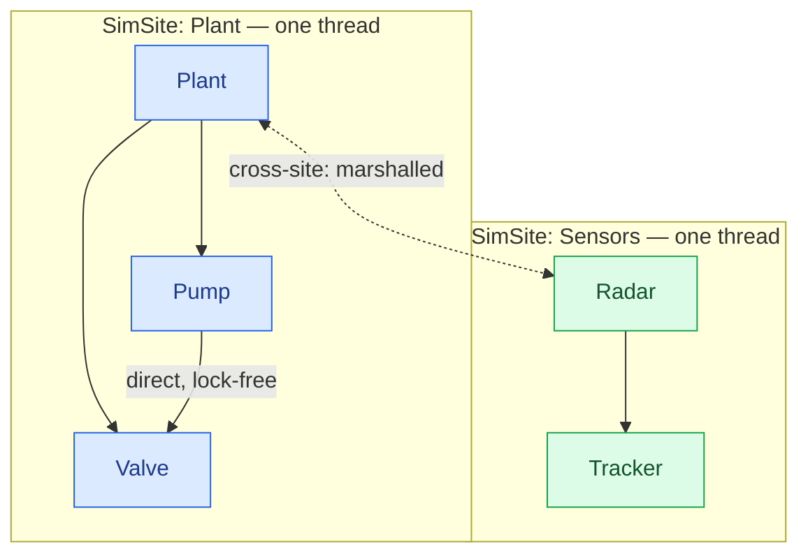
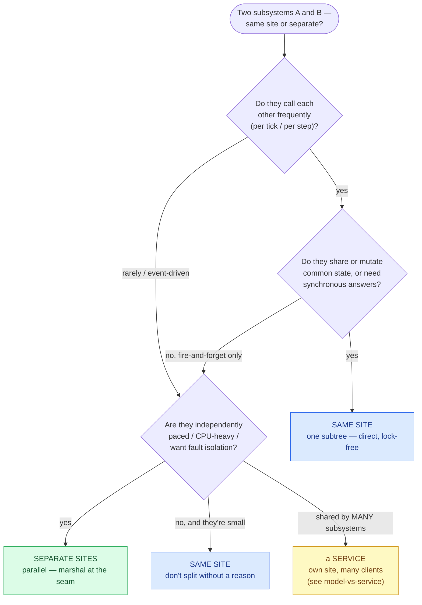
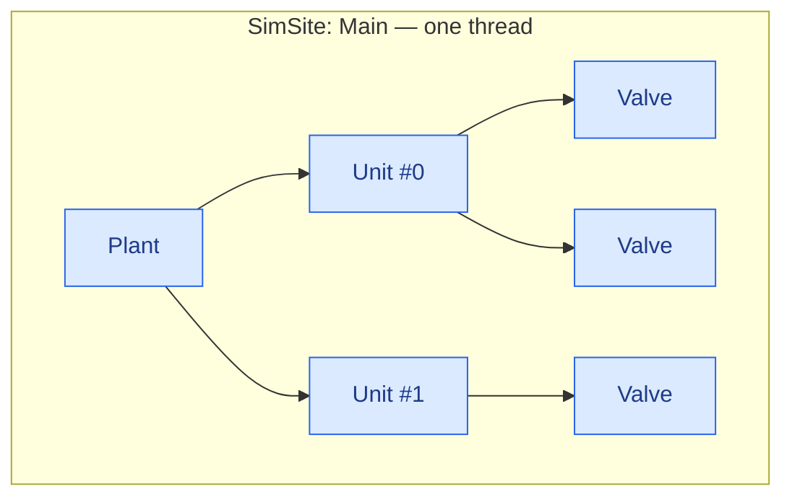
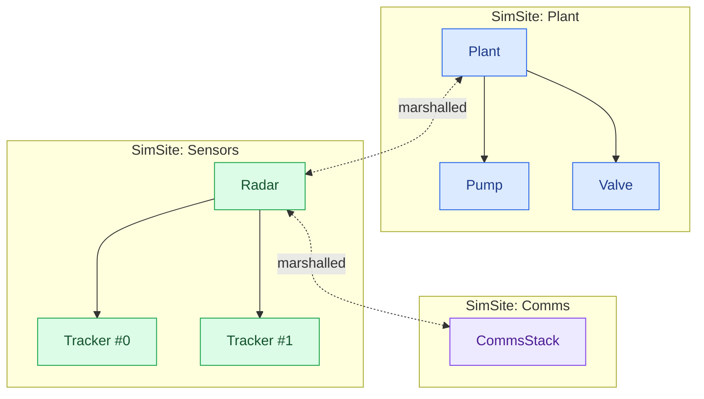
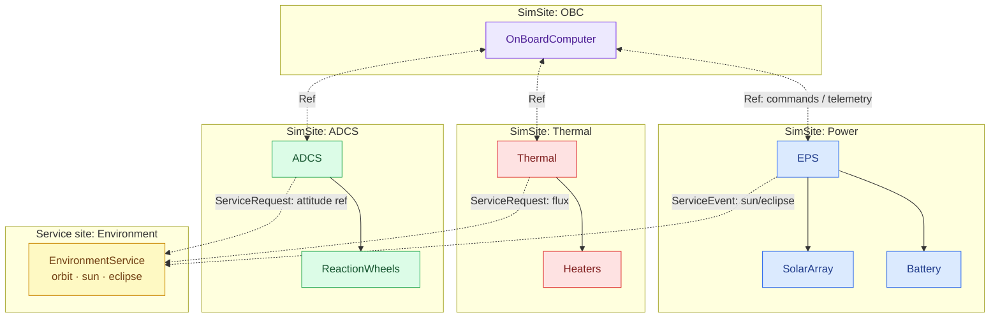

# Choosing a topology

This is the central design chapter. Everything else is detail; this is the decision that shapes how your simulator
*performs* and how simple it is to write.

**A topology is how your model tree maps onto SimSites — and a SimSite is one thread.** You draw that map in the
assembly's [`Sites:`](#/guide/the-assembly) block by choosing where root models go. Draw it well and tightly-coupled
models call each other directly and lock-free while independent subsystems run in parallel; draw it badly and you either
serialize work that could parallelize, or pay a cross-thread marshal on every chatty call.

## The one rule everything follows

> A **root model and its entire [containment subtree](#/guide/models-and-containment) share one SimSite** — one thread,
> one [event queue](#/guide/event-queue-and-scheduling). Different root subtrees are **different sites**, running in
> parallel.

From that rule, two facts:

- **Within a subtree (same site):** models call each other with **direct method calls** — synchronous, lock-free, the
  cost of a call. No message, no marshal, no `await`.
- **Across sites:** calls are **marshalled** — the caller drops a message in the target site's inbox, which runs it on
  *its* thread. You reach across through a generated [`<Type>Ref`](#/guide/associations) (or a
  [service](#/guide/services)), and the reply comes back as a `Task`.

So **the boundaries of your subtrees are the boundaries of your parallelism** — and of your locking story (there is no
locking within a site, ever). Partitioning is not a performance afterthought; it is the primary design act.



## The cost you are trading

| | **Intra-site call** (same subtree) | **Cross-site call** (different site) |
|---|---|---|
| Mechanism | direct method call | message into target's inbox |
| Runs on | caller's (== callee's) thread | target site's thread |
| Latency | a method call — nanoseconds | enqueue + wait for target's next drain |
| Result | return value, immediately | a `Task`, completed later (you `Await` it) |
| Concurrency | none — serialized on one thread | two threads run in parallel |
| Locking | never needed | never needed (inbox serializes) |
| You must | nothing | not block the site — [coroutine `Await`](#/guide/coroutines) |

Neither column ever needs a lock. The trade is **parallelism vs call cost**: a separate site buys you a core running in
parallel, at the price of a marshal (and asynchrony) on every call that crosses the seam. A hot busy-spinning site also
costs a core whether or not it's doing much — so *one site per core-worth of subsystems, not one site per model*.

## The decision: same site or separate?

Ask it for each pair of subsystems. The gist: **couple tightly ⇒ same site; independent ⇒ separate sites.**



**Put on the same site** things that are:

- **chatty** — they call each other many times per step (a `Plant` recomputing all its `Pump`s and `Valve`s),
- **state-sharing** — they read/write a common picture where a stale marshalled copy would be wrong,
- **synchronously dependent** — one needs an *answer* from the other before it can proceed, mid-step.

**Split onto separate sites** things that are:

- **independent** — they advance on their own clocks and only exchange the occasional message,
- **parallelizable** — each is enough work to justify a core, and they can truly run at once,
- **isolation-worthy** — you want one subsystem's stall or heavy step not to hold up the others.

**Reach for a [service](#/guide/services)** instead when the shared thing is depended on by *many* subsystems and isn't
naturally owned by one — a bus, an environment blackboard, a shared resource pool.

> **Consequence for design.** Don't over-split. Every extra running site is a hot core, and every cross-site call is a
> marshal plus asynchrony you have to write around (a coroutine `Await`, a continuation). Start with the *coarsest*
> partition that still parallelizes the genuinely independent subsystems, and split further only when a site is
> demonstrably a bottleneck.

## Three shapes

### A. The monolith — one site

Everything in one subtree, one thread. Perfectly correct, trivially lock-free, and the right starting point for a small
or tightly-integrated model. No parallelism — but nothing to marshal, and nothing to get wrong.



```yaml
Sites:
  - Name: Main
    Models:
      - { Name: Plant1, Type: Demo.Plant, Models: [ Units: [ … ] ] }
```

### B. Parallel subsystems — a few sites

Independent subsystems, each its own root, each its own site, running in parallel and messaging at the seams. This is
the common shape once a simulator has genuinely separable parts.



```yaml
Sites:
  - Name: Plant
    Models: [ { Name: Plant1, Type: Demo.Plant, Models: [ … ] } ]
  - Name: Sensors
    Models: [ { Name: Radar1, Type: Demo.Radar, Models: [ … ] } ]
  - Name: Comms
    Models: [ { Name: Comms1, Type: Demo.CommsStack } ]
```

### C. The satellite shape — a hub, spokes, and a shared service

A realistic multi-subsystem simulator: an OBC/bus hub on one site, each subsystem (power, thermal, ADCS, payload) on its
own site running in parallel, and a shared **environment** (orbit, sun, ground contact) as a [service](#/guide/services)
on its own thread that every subsystem samples. Chatty internals stay inside each subsystem's subtree; the sparse
cross-subsystem traffic marshals through Refs and the service.



This is worked end to end in the [satellite scenario](#/guide/scenario-satellite).

## Watch the seams: chatty cross-site references

A [`Reference<T>`](#/guide/associations) resolves *for free* when the target happens to share your site, and costs a
marshal when it doesn't — but the source line is identical either way, so it's easy to miss. If profiling shows a site
starved on cross-site round-trips, the fix is usually one of:

- **Move the two models into the same subtree** so the reference resolves same-site (direct again), or
- **Batch** — send one coarse message instead of many fine-grained ones, or replace a request/response with a
  fire-and-forget [`[ServiceEvent]`](#/guide/services) push, or
- **Cache** — subscribe to a service event and keep a local copy, instead of requesting the value every step.

> **Consequence for design.** Correctness never depends on the partition — a `Ref` does the right thing wherever the
> target lives. **Performance does.** The topology exists to make the *frequent* calls cheap (same-site, direct) and the
> *rare* calls cross the thread boundary. If your hottest call path crosses a seam, you've drawn the boundary in the
> wrong place.

## Tying it to the assembly

The map lives entirely in `Sites:`. Each `Site` is a thread; each top-level model under it is a root that owns that
site with its whole subtree. To **re-partition**, you move a model between `Site` blocks in the YAML — no C# changes,
because a model never names its own site (it's handed a `Scheduler`). [Services](#/guide/services) get their own site
implicitly and are listed under `Services:`, not under any `Site`.

```yaml
Sites:
  - Name: A          # thread A
    Models: [ … ]    # these roots + subtrees share thread A
  - Name: B          # thread B — parallel with A
    Models: [ … ]
```

## What this means for you

| You want to… | Do this |
|---|---|
| Keep two models synchronous and lock-free | put them in the **same** containment subtree (same `Site`) |
| Run two subsystems in parallel | give each its **own** root under a separate `Site` |
| Share a capability across many subsystems | make it a [service](#/guide/services) (own site, listed under `Services:`) |
| Isolate a heavy/stalling subsystem | split it onto its **own** site |
| Reduce cross-site chatter | move the pair same-site, batch, or switch to event push + local cache |
| Re-partition | move models between `Site` blocks in the YAML — no C# change |

Next: build one model well — **[modeling a subsystem](#/guide/modeling-a-subsystem)** — then wire the talking —
**[interaction patterns](#/guide/interaction-patterns)**.
