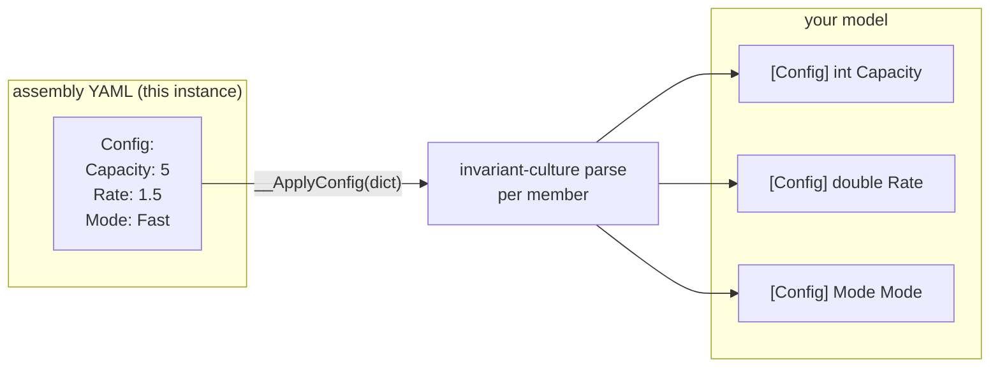
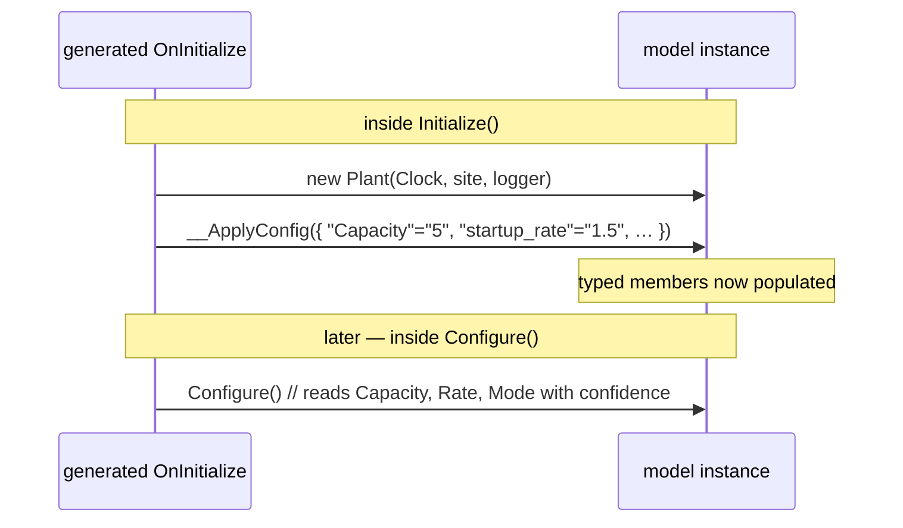
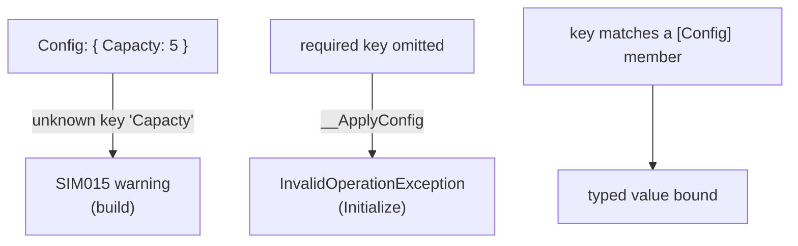

# Configuration

Some values belong in the *model* — behaviour, state, the physics. Others belong in the *assembly* — a capacity, a
rate, a serial number, the things that differ between one deployment of the same model and the next. `[Config]` is how a
model member declares "**fill me from the assembly**", and the generator turns that declaration into strongly-typed,
validated binding — no reflection, no config framework, no runtime surprises.

- **You mark** a settable member with `[Config]`.
- **You supply** a value in that instance's `Config:` block in the assembly YAML.
- **The generator** emits an `__ApplyConfig` that parses the YAML scalar into the member's real CLR type, with
  **invariant culture**, and the simulator calls it **before** `Configure()` runs.



For the whole assembly file — not just the `Config:` block — see [the assembly](#/guide/the-assembly). For the
exhaustive schema, see the [assembly YAML reference](#/guide/assembly-yaml-reference).

---

## Declaring a config member

`[Config]` goes on a **public, settable property or field**. Two options:

- **`key`** (the positional argument) — the YAML key to read. Defaults to the **member's own name** when omitted.
- **`Required`** (named, default **`true`**) — when true, a missing key is a hard error; when `false`, the member keeps
  whatever default it already had.

```csharp
public partial class Plant(IClock c, IScheduler s, ILogger l) : ModelBase(c, s, l)
{
    [Config] public int Capacity { get; set; }                    // key "Capacity", required
    [Config("startup_rate")] public double Rate { get; set; }     // custom key, required
    [Config(Required = false)] public string Label { get; set; } = "unnamed";  // optional, keeps default
    [Config] public Mode Mode { get; set; }                       // enum, required
}

public enum Mode { Idle, Fast, Safe }
```

The matching assembly block, on this instance's node:

```yaml
- Name: Plant1
  Type: Demo.Plant
  Config:
    Capacity: 5
    startup_rate: 1.5
    Mode: Fast
    # Label omitted — Required = false, so it stays "unnamed"
```

> **Consequence for design.** `[Config]` binds a *scalar* from YAML text into a typed member. It is for **leaf
> settings**, not structure. Topology — which models exist, what contains what, what references what — lives in the tree
> and the `Refs`/`Models`/`Deps` blocks, never in `Config`. If you find yourself encoding a list or a wiring in a config
> value, that belongs in the assembly structure instead.

---

## What the generator emits

For every model or service with `[Config]` members, the
[`ConfigGenerator`](#/api/type/SimulaSharp.CodeGen.ConfigGenerator) emits one method on the partial class:

```csharp
internal void __ApplyConfig(IReadOnlyDictionary<string, string?> config)
{
    {
        if (config.TryGetValue("Capacity", out var __value) && __value is not null)
            Capacity = System.Int32.Parse(__value, System.Globalization.CultureInfo.InvariantCulture);
        else
            throw new System.InvalidOperationException("Missing required config 'Capacity' for Plant.");
    }
    {
        if (config.TryGetValue("startup_rate", out var __value) && __value is not null)
            Rate = System.Double.Parse(__value, System.Globalization.CultureInfo.InvariantCulture);
        else
            throw new System.InvalidOperationException("Missing required config 'startup_rate' for Plant.");
    }
    {
        if (config.TryGetValue("Label", out var __value) && __value is not null)
            Label = __value;
        // Required = false → no else branch: a missing key leaves the default untouched
    }
    {
        if (config.TryGetValue("Mode", out var __value) && __value is not null)
            Mode = (Mode)System.Enum.Parse(typeof(Mode), __value, true);
        else
            throw new System.InvalidOperationException("Missing required config 'Mode' for Plant.");
    }
}
```

Key facts baked into that output:

- **Invariant culture.** Every numeric parse uses `CultureInfo.InvariantCulture`, so `1.5` means one-and-a-half on every
  machine, regardless of the build agent's locale. A German build server does not turn `1.5` into fifteen.
- **Required is the default, and it throws.** A missing *required* key raises `InvalidOperationException` naming the key
  and the type — a loud, early failure, not a silent zero.
- **Optional keeps the default.** `Required = false` emits no `else` branch, so an absent key leaves the member's
  field-initializer value in place.
- **Custom keys are honoured** on both the parse (`config.TryGetValue("startup_rate", …)`) and the error message.

### Supported member types

`__ApplyConfig` parses YAML text into these types; anything else is silently skipped (no binding emitted):

| Category | Types | Parse |
|---|---|---|
| Text | `string` | used verbatim |
| Boolean | `bool` | `bool.Parse` |
| Character | `char` | `char.Parse` |
| Integer | `sbyte`, `byte`, `short`, `ushort`, `int`, `uint`, `long`, `ulong` | invariant `Parse` |
| Real | `float`, `double`, `decimal` | invariant `Parse` |
| Enum | any `enum` | `Enum.Parse(…, ignoreCase: true)` — so `Fast`, `fast`, `FAST` all work |

Members that are **get-only, `init`-only, `readonly`, or `const`** are skipped by the generator (they cannot be
assigned), even if you attribute them.

---

## Where it runs in the lifecycle

`__ApplyConfig` is called by the generated `OnInitialize`, **during `Initialize()`**, right after each instance is
constructed and **before any `Configure()` runs**. So by the time your `Configure()` executes, every `[Config]` member
is already populated — you can build on it.



You can see this exactly in the generated output — each instance's construction is immediately followed by its config
application:

```csharp
var __c2 = Register(new global::Demo.Plant(Clock, __c1, CreateLogger("Plant.Plant1")));
__c2.__ApplyConfig(new Dictionary<string, string?> { ["Capacity"] = "5" });
```

> **Consequence for design.** Treat `[Config]` values as **ready in `Configure()`, not in the constructor.** The
> constructor runs before `__ApplyConfig`, so a config member is still at its default there. Do setup that depends on
> config in `Configure()`, which is guaranteed to run after binding.

---

## Build-time validation

The assembly generator cross-checks your `Config:` blocks against the model's real `[Config]` members. If a YAML key has
**no matching `[Config]` member** (by key or member name), you get a **warning**,
[`SIM015`](#/guide/assembly-yaml-reference): *"Config key '…' has no matching [Config] member on '…'."* It is a warning,
not an error, so a stray key does not break the build — but it flags the typo that would otherwise silently do nothing.

The complementary failure — a *required* key you forgot to supply — is not a compile error; it is the
`InvalidOperationException` thrown at `Initialize()`. That is the one config failure you see at run time rather than
build time, and it is deliberately loud.



That is configuration end to end: mark the member, supply the scalar, and the generator binds it with invariant parsing
before your model configures itself. Next: **[the assembly](#/guide/the-assembly)** — the file the `Config:` blocks live
in, and the topology around them.
