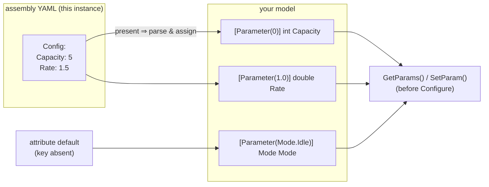
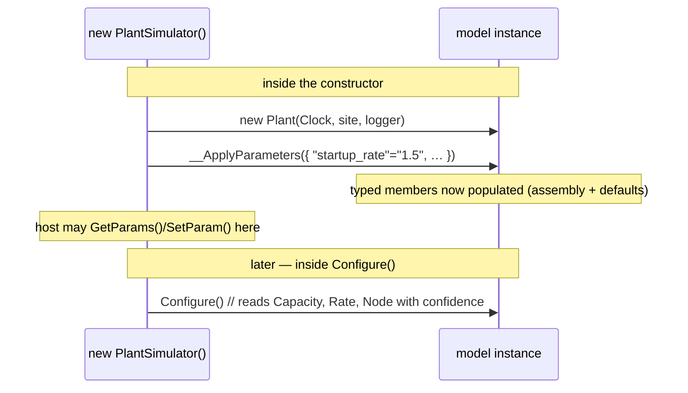

# Parameters

Some values belong in the *model* — behaviour, state, the physics. Others are **parameters** — a capacity, a rate, a
serial number, an endpoint: the things that differ between one deployment of the same model and the next. `[Parameter]`
is how a model or service member declares "**I'm a build-time tunable**", and the generator turns that declaration into
strongly-typed, validated binding plus a programmatic override surface — no reflection, no config framework.

- **You mark** a settable member with `[Parameter(default)]` — the default value lives in the attribute.
- **You (optionally) supply** a value in that instance's `Config:` block in the assembly YAML; omit it and the default
  applies.
- **The generator** binds the value (invariant-culture parse) and exposes the member through
  [`ISimulator.GetParams()`](#/api/type/SimulaSharp.Kernel.Services.ISimulator) so a host can **read or override it
  before `Configure()`**.



> **Naming note.** The concept is a **parameter** and the attribute is `[Parameter]`, but the assembly block that
> supplies values is still called `Config:` (unchanged). One attribute, one YAML block name.

For the whole assembly file — not just the `Config:` block — see [the assembly](#/guide/the-assembly). For the
exhaustive schema, see the [assembly YAML reference](#/guide/assembly-yaml-reference).

---

## Declaring a parameter

`[Parameter]` goes on a **public, settable property or field** of a value type (a number, `bool`, `enum`, `char` or
`string`). It takes:

- **the default** (the positional argument) — the value applied when the assembly omits this parameter. This is why
  parameters are **optional by default**.
- **`Key`** (named) — the YAML key to read; defaults to the member's own name.
- **`Required`** (named, default **`false`**) — when true, a missing key is a hard error instead of falling back to the
  default.

```csharp
public partial class Plant(IClock c, IScheduler s, ILogger l) : ModelBase(c, s, l)
{
    [Parameter(5)] public int Capacity { get; set; }                     // default 5
    [Parameter(1.5, Key = "startup_rate")] public double Rate { get; set; }  // custom key, default 1.5
    [Parameter("unnamed")] public string Label { get; set; }             // default "unnamed"
    [Parameter(Required = true)] public int Node { get; set; }           // no default → must be supplied
}
```

The matching assembly block, on this instance's node — supply only what differs from the defaults:

```yaml
- Name: Plant1
  Type: Demo.Plant
  Config:
    startup_rate: 1.5
    Node: 81
    # Capacity omitted → 5;  Label omitted → "unnamed"
```

> **Consequence for design.** `[Parameter]` binds a *scalar* into a typed member. It is for **leaf settings**, not
> structure. Topology — which models exist, what contains what, what references what — lives in the tree and the
> `Refs`/`Models`/`Deps` blocks, never in `Config`.

---

## Reading and overriding: `GetParams` / `SetParam`

Every parameter is discovered **per instance** when the simulator is constructed, and surfaced on
[`ISimulator`](#/api/type/SimulaSharp.Kernel.Services.ISimulator):

```csharp
var sim = new PlantSimulator();                 // assembled: parameters bound from the assembly + defaults
var ps  = sim.GetParams();                       // IReadOnlyList<ParameterInfo>, one entry per instance member

var cap = ps.Single(p => p.Path == "Plant.Plant1.Capacity");
Console.WriteLine(cap.Read());                   // 5  (the default)
sim.SetParam(cap, 8);                            // override — allowed only BEFORE Configure()

sim.Configure();                                 // parameters are now fixed for the run
// sim.SetParam(cap, 9) here would throw InvalidOperationException
```

Each [`ParameterInfo`](#/api/type/SimulaSharp.Kernel.Parameters.ParameterInfo) carries a **`Path`** (the full dotted
instance path plus member name — the *per-instance* unique key, e.g. `Plant.Plant1.Capacity`), a short **`Name`** (the
member name, which repeats across instances), a **`ValueType`**, boxed `Read()`/`Write()`, and the declared `Default`.
Two instances of the same model each get their **own** parameter with its own path and value — they are never shared.

> `SetParam` throws once the run is configured: parameters are a *build-time* surface. For values an operator changes
> **while the sim runs**, use a [`[Knob]`](#/guide/observability) instead — and a member may be **both** a `[Parameter]`
> and a `[Knob]` (tuned at build, controlled live).

---

## What the generator emits

For every model or service with `[Parameter]` members, the
[`ParameterGenerator`](#/api/type/SimulaSharp.CodeGen.ParameterGenerator) emits two things on the partial class: an
`__ApplyParameters` binder and an explicit `IParameterProvider.CollectParameters` that builds the `ParameterInfo`
binders. The binder for `Capacity` above:

```csharp
{
    if (config.TryGetValue("Capacity", out var __value) && __value is not null)
        Capacity = int.Parse(__value, System.Globalization.CultureInfo.InvariantCulture);
    else
        Capacity = (int)(5);      // the attribute default, applied when the key is absent
}
```

Key facts baked into that output:

- **Optional by default.** An absent key falls back to the attribute default — no `else`-throw unless `Required = true`.
- **Invariant culture.** Every numeric parse uses `CultureInfo.InvariantCulture`, so `1.5` means one-and-a-half on every
  machine, regardless of the build agent's locale.
- **`Required` throws, loudly.** A missing *required* key raises `InvalidOperationException` naming the parameter and the
  type — an early failure, not a silent zero.
- **Custom keys are honoured** on the parse (`config.TryGetValue("startup_rate", …)`).

### Supported member types

Parameters bind these value/constant types; anything else is silently skipped (no binding emitted):

| Category | Types | Parse |
|---|---|---|
| Text | `string` | used verbatim |
| Boolean | `bool` | `bool.Parse` |
| Character | `char` | `char.Parse` |
| Integer | `sbyte`, `byte`, `short`, `ushort`, `int`, `uint`, `long`, `ulong` | invariant `Parse` |
| Real | `float`, `double`, `decimal` | invariant `Parse` |
| Enum | any `enum` | `Enum.Parse(…, ignoreCase: true)` — so `Fast`, `fast`, `FAST` all work |

Members that are **get-only, `init`-only, `readonly`, or `const`** are skipped (they cannot be assigned).

---

## Where it runs in the lifecycle

The simulator is **assembled in its constructor**: each instance is constructed, `__ApplyParameters` binds its values,
and `CollectParameters` registers them — all before you get the object back. So `GetParams()` works immediately, and
`SetParam()` applies right up until `Configure()`.



> **Consequence for design.** Treat parameters as **ready in `Configure()`, not in the constructor of your model.** Your
> model's constructor runs before `__ApplyParameters`, so a parameter is still at its CLR default there. Do setup that
> depends on a parameter in `Configure()`, which is guaranteed to run after binding and after any `SetParam` overrides.

---

## Build-time validation

The assembly generator cross-checks your `Config:` blocks against each type's real `[Parameter]` members. If a YAML key
has **no matching `[Parameter]` member** (by key or member name), you get a **warning**,
[`SIM015`](#/guide/assembly-yaml-reference): *"Config key '…' has no matching [Parameter] member on '…'."* It is a
warning, not an error, so a stray key does not break the build — but it flags the typo that would otherwise silently do
nothing.

The complementary failure — a `Required` key you forgot to supply — is the `InvalidOperationException` thrown while the
simulator is being constructed. That is the one parameter failure you see at run time rather than build time, and it is
deliberately loud.

That is parameters end to end: mark the member with a default, optionally supply a scalar, read or override it before
the run, and the generator binds it with invariant parsing. Next: **[the assembly](#/guide/the-assembly)** — the file
the `Config:` blocks live in, and the topology around them.
