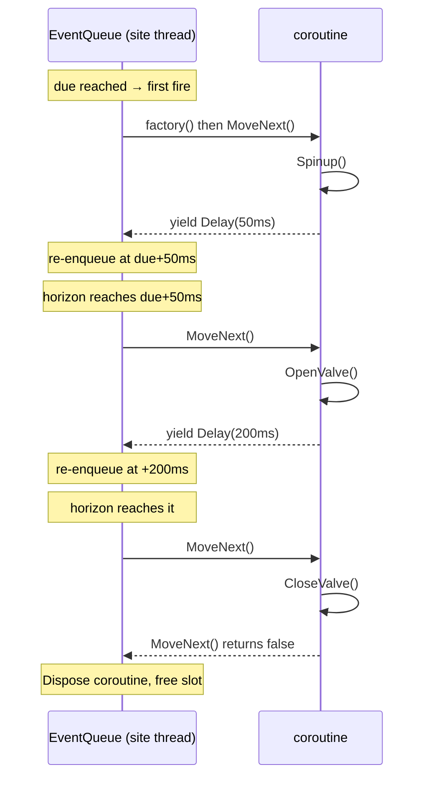
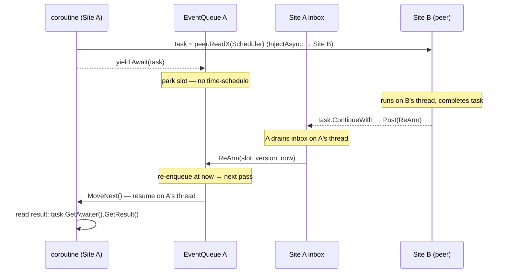

# Coroutines (SimYield)

A one-shot event does a thing and returns. A periodic does a thing on a grid. But a lot of behaviour is a **process** — a
sequence of steps unfolding over simulated time: spin up, wait for pressure, open the valve, hold 200 ms, ask a peer,
wait for its answer, close. Writing that as a pile of one-shot callbacks turns your logic inside out. Writing it as a
**coroutine** lets you write it top to bottom, as a story, with `yield return` marking every point where simulated time
passes.

This is the oldest idea in the framework. The name **SimulaSharp** is a nod to **SIMULA**, the 1960s language that
introduced coroutine-based *process* modelling. A SimulaSharp coroutine *is* that abstraction, expressed with C#'s
iterator machinery.

## What a coroutine is here

A coroutine is an **`IEnumerator<SimYield>`** — an iterator method whose `yield return`s hand back a
[`SimYield`](#/api/type/SimulaSharp.Kernel.Primitives.SimYield) that says *when to resume*. You register it as a factory:

```csharp
Scheduler.AddCoroutine(Behaviour, delayUs: 0);

private IEnumerator<SimYield> Behaviour()
{
    Spinup();
    yield return SimYield.Delay(50_000);   // let 50 ms of sim time pass
    OpenValve();
    yield return SimYield.Delay(200_000);  // hold 200 ms
    CloseValve();
    // falling off the end completes the coroutine — its slot is freed
}
```

Each time the coroutine is due, the [event queue](#/guide/event-queue-and-scheduling) calls `MoveNext()` once. Your code
runs up to the next `yield return`; the `SimYield` you yield tells the queue when to call `MoveNext()` again. Between
yields, **no simulated time passes** and nothing else on the site runs — you're on the site's single thread, so a step is
atomic with respect to everything else there.

> **Key points**
> - A coroutine is `IEnumerator<SimYield>`; one `MoveNext()` per scheduled step.
> - `yield return` is where sim time advances — everything between two yields is instantaneous and uninterrupted.
> - Fall off the end (or `yield break`) and the coroutine is disposed, its slot freed.
> - It runs on the site's thread like any event: **never block it** — yield time instead of sleeping.

## Materialized on first fire

One detail matters for timing. You pass `AddCoroutine` a **factory** (`Func<IEnumerator<SimYield>>`), not an
already-built iterator. The queue holds the factory and **only invokes it when the entry first fires** — at its scheduled
time, not at registration time:

```csharp
if (s.Factory is not null)
{
    s.Coroutine = s.Factory();   // built here, on first fire — not at AddCoroutine()
    s.Factory = null;
}
```

So the coroutine's **body doesn't start** — no field is read, no first line runs — until the delay you scheduled it with
elapses. If you `AddCoroutine(Behaviour, delayUs: 5_000)`, the very first statement of `Behaviour` runs 5 ms from now, on
a horizon that reflects *then*. This keeps deferred processes honest: a coroutine scheduled for the future captures state
at the future instant, not at scheduling time.

## The three yields

`SimYield` has exactly three factories:

| Yield | Meaning | Resumes when |
|---|---|---|
| `SimYield.Immediate` | Zero delay | The **next** processing pass (due == now, so not this pass) |
| `SimYield.Delay(us)` | Wait `us` µs of sim time | The horizon reaches `resumeDue = current due + us` |
| `SimYield.Await(task)` | **Park** on a `Task` | The `task` completes (then resume on this site's thread) |

`Immediate` and `Delay` re-schedule by advancing the slot's due time (`Immediate` is just `Delay(0)`); `Await` is
different — it parks with no time schedule at all. Note that `Immediate` resumes on the *next* pass, never the current
one — that's the [two-phase ProcessDue](#/guide/event-queue-and-scheduling) rule, and it's what stops a `while(true) {
yield return SimYield.Immediate; }` coroutine from starving its site: it yields the thread back every step.

```csharp
long CurrentDue += y.DelayUs;   // conceptually: Immediate/Delay just push the due time out
```

## Stepping through Delays

Here's how a coroutine walks through `Delay` yields, one `MoveNext()` per resumption:



Note the delays are **relative to the slot's current due**, not to "now". If a step's own body runs at a slightly late
horizon, the next `Delay` still measures from the *scheduled* due — the same absolute-grid discipline the periodic events
use, so a chain of delays doesn't accumulate drift.

## Await: parking on a cross-site reply

`SimYield.Await(task)` is how a coroutine waits for something that completes on **another thread** — most often a
cross-site request that returned a `Task` from [`InjectAsync`](#/guide/simsites-and-actors). Crucially, it parks the
*coroutine*, not the *thread*: the site keeps spinning and serving everything else while this one process waits.

When the coroutine yields an `Await`, the queue does **not** put it back on the time-ordered priority queue. Instead it
hands the task to the site via a callback (`OnAwait`), and the site arranges the resume:

```csharp
// In the EventQueue, on the Await branch:
OnAwait?.Invoke(slot, s.Version, awaited);   // park: keep the slot, no time-schedule

// In the SimSite, wired at construction:
_events.OnAwait = (slot, version, task) =>
    task.ContinueWith(
        _ => Post(() => _events.ReArm(slot, version, _clock.SimNowUs)),
        CancellationToken.None,
        TaskContinuationOptions.ExecuteSynchronously,
        TaskScheduler.Default);
```

Read that carefully, because it's the whole mechanism:

1. The coroutine parks. Its slot stays live but is **off** the time queue — nothing will fire it on a schedule.
2. When the `task` completes (on whatever thread), the continuation `Post`s a re-arm **into this site's inbox**.
3. The site drains its inbox on its own thread and calls `ReArm(slot, version, now)`, which puts the slot back on the
   priority queue due at the **current** horizon — so it resumes on the **next pass**, on **its own thread**.
4. The `version` guard means if the slot was freed/reused while parked, the `ReArm` no-ops — a completing task can't
   resurrect a recycled slot.



The coroutine always resumes on **its own site's thread**, so after it wakes it can freely touch its own models with no
locking — exactly as before it parked.

### Read the result *after* resuming

Because the task is guaranteed complete by the time the coroutine resumes, you read its result **after** the `Await`, not
before — the value is sitting there ready:

```csharp
var t = peer.ReadPressure(Scheduler);   // Task<double> from a cross-site InjectAsync
yield return SimYield.Await(t);         // park until it completes; site stays live
double pressure = t.GetAwaiter().GetResult();   // safe: complete by now, won't block
```

`GetResult()` won't block here because the coroutine only woke *because* `t` finished. (If `t` faulted, `GetResult()`
rethrows on your thread — and an unhandled throw in a coroutine step is caught by the queue, which drops and disposes the
coroutine; see [the event queue](#/guide/event-queue-and-scheduling).)

## Coroutine vs periodic event

Both let a model act over time. Reach for the right one:

| | **Coroutine** | **Periodic event** |
|---|---|---|
| Shape | A sequence with state *between* steps | The same stateless-ish action on a grid |
| Local state | Lives in locals across yields — natural | You keep it in fields yourself |
| Timing per step | Variable — each `yield` picks its own delay | Fixed period |
| Waiting on a peer | `SimYield.Await` a `Task`, in-line | Awkward — callback into another event |
| Catch-up on lag | Resumes when due; delays are off the grid | **Bursts** missed ticks (absolute re-arm) |
| Best for | Sequences, handshakes, protocols, one-run scripts | Sampling, integration, heartbeat, control loops |

Rule of thumb: if the behaviour reads like *steps and waits*, or it needs to **await** something, use a coroutine. If it
reads like *do this every N µs, forever*, use a periodic.

## Worked example: work, wait, call a peer, await the reply

A pump controller that runs a startup sequence, then loops: read a sensor on another site, act on it, repeat every 100
ms. `Ref` accessors are the generated cross-site call surface — see [associations](#/guide/associations).

```csharp
public sealed partial class PumpController : ModelBase
{
    // A Reference<Sensor> gives a generated SensorRef with callerSite-aware dispatch.
    private SensorRef _sensor = default!;

    public override void Configure()
    {
        // Start the process 0 µs from now (materialized on first fire).
        Scheduler.AddCoroutine(Control, delayUs: 0);
    }

    private IEnumerator<SimYield> Control()
    {
        Spinup();
        yield return SimYield.Delay(500_000);      // let hardware settle for 500 ms

        while (true)
        {
            // Cross-site request → a Task; on the same site this is a direct read.
            Task<double> reading = _sensor.ReadPressure(Scheduler);
            yield return SimYield.Await(reading);  // park; the site keeps serving others
            double p = reading.GetAwaiter().GetResult();   // complete by now

            if (p > Threshold) OpenRelief();
            else               CloseRelief();

            yield return SimYield.Delay(100_000);  // next sample in 100 ms
        }
    }
}
```

What to notice:

- The **startup** (`Spinup` + settle) and the **steady loop** live in one readable method, with state in locals.
- The `Await` **parks the coroutine, not the site** — every other model on this site keeps running while the reading is
  in flight.
- The reply is read **after** resuming, and resumption is back on **this** site's thread, so `OpenRelief()`/
  `CloseRelief()` touch local state lock-free.
- `while (true)` never starves anything: each iteration yields (a `Delay`, or an `Await`), handing the thread back.

## What this means for you

| You want to… | Do this |
|---|---|
| Write a multi-step, time-spanning process | `AddCoroutine(factory, delay)`; `yield return SimYield.Delay(...)` between steps |
| Yield the thread without waiting | `yield return SimYield.Immediate` (resumes next pass) |
| Wait on a cross-site reply | `var t = peer.Call(Scheduler); yield return SimYield.Await(t); var r = t.GetAwaiter().GetResult();` |
| Defer a process's *start* | `AddCoroutine(factory, delayUs)` — the body first runs at that delay |
| End a process early | `yield break;` (or fall off the end) — it's disposed and its slot freed |
| Do the same thing on a fixed grid | Use a [periodic event](#/guide/event-queue-and-scheduling) instead |

Coroutines close the loop on the runtime model: a [clock](#/guide/time-and-clock) publishes time,
[SimSites](#/guide/simsites-and-actors) run work on one thread each, the [event
queue](#/guide/event-queue-and-scheduling) schedules it, and coroutines let you write behaviour as processes over that
time. Next, how you actually build the model tree those processes live in: **[models &
containment](#/guide/models-and-containment)**.
