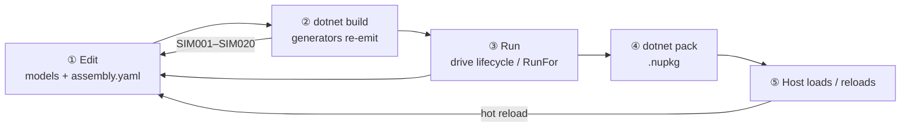

# The dev loop

Authoring a simulator is a tight cycle: **edit → build → run → pack → load**. Because the whole topology is wired
at build time, most mistakes surface as *compile errors*, not runtime surprises — so the loop is fast and the
feedback is honest.



## ① Edit

Change a model (add state, behaviour, a `[Knob]`/`[Plottable]`/`[Config]`), or change the
**[assembly](#/guide/the-assembly)** (add a site, a model, a reference, a service dependency). These are the only
two things you author — see the **[authoring model](#/guide/authoring-model)**.

## ② Build

```powershell
dotnet build
```

The generators re-run and re-emit the `<Name>Simulator` and the binders. **Topology errors are compile-time**: if
you renamed a type, mismatched a `Container<T>`, or pointed a reference at a path that doesn't exist, the build
fails with a specific `SIMxxx` diagnostic and no simulator is emitted. Fix it and rebuild — you never ship a
broken wiring. (Full table: **[Assembly YAML reference](#/guide/assembly-yaml-reference)**.)

## ③ Run

Construct the generated simulator and drive it — `Initialize()` → `Configure()` → `Start()`, or `Clock.RunFor(…)`
for a bounded span. Watch the knobs, plottables, and log sink. Details in
**[Build, run & test](#/guide/build-run-test)** and **[Simulator lifecycle](#/guide/simulator-lifecycle)**.

Iterate ①–③ until the behaviour is right. This inner loop needs no packing and no host.

## ④ Pack

When the simulator is ready for a host, pack it:

```powershell
dotnet pack -c Release
```

This produces a `.nupkg`. The generator's targets make the pack **self-contained**: alongside your assembly it
bundles the private dependency DLLs and the `deps.json` the host loader needs, while excluding the shared
`SimulaSharp.*` framework (which the host already has) and the framework itself. The result is restore-free to
load. See **[Packing & hosting](#/guide/packing-and-hosting)** for what goes in and why.

## ⑤ Load (and reload)

The **Hosting** library loads the `.nupkg` into a **collectible `AssemblyLoadContext`**, discovers the simulators
inside, and creates one. Because the context is collectible, the host can **unload and reload** a pack without
restarting — the mechanism a hot-reloading MMI is built on. Edit a model, re-pack, and the host swaps in the new
build.

---

The key property of this loop: **the compiler is your first test.** A topology that builds is a topology that is
type-correct and fully wired; what's left to check at run time is *behaviour*, not plumbing.
