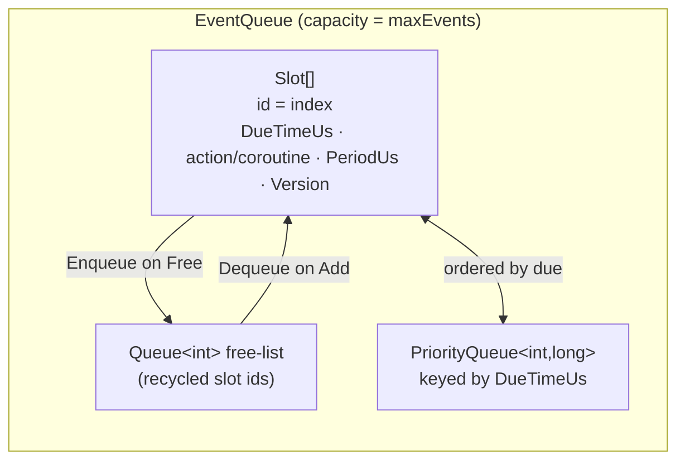
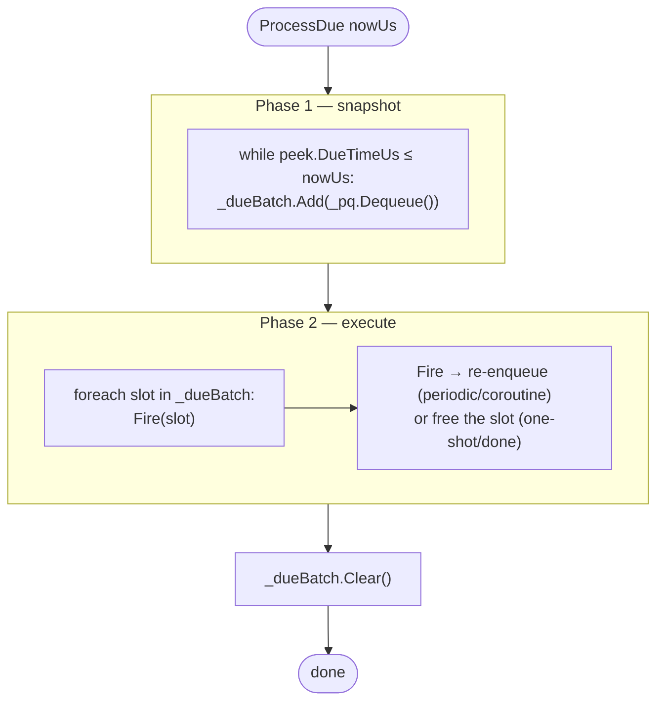
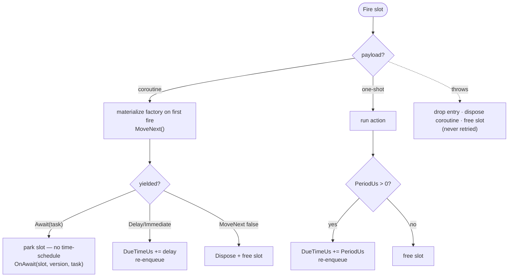

# The event queue & scheduling

Each [SimSite](#/guide/simsites-and-actors) owns exactly one
[`EventQueue`](#/api/type/SimulaSharp.Kernel.Services.EventQueue). It is the scheduling core: the structure that holds
pending work ordered by *when it is due*, and fires it as the [horizon](#/guide/time-and-clock) sweeps past. This chapter
is how it works — the verbs you call, the model of "due", the two-phase firing pass, and the one behaviour that most
distinguishes it: **absolute periodic re-arm**.

Everything here runs on the site's own thread. The queue is deliberately **not** thread-safe; cross-thread work reaches
it only after being marshalled through the site's [inbox](#/guide/simsites-and-actors). See that chapter for the
threading model; this one assumes single-threaded access throughout.

## Three verbs to schedule work

You schedule through [`IScheduler`](#/api/type/SimulaSharp.Kernel.Services.IScheduler) (which a `SimSite` implements).
There are three kinds of work, each with a relative-delay form and a mission-time sibling:

| Verb | Relative form | Mission-time form | Fires… |
|---|---|---|---|
| **One-shot** | `AddEvent(action, delayUs)` | `AddEventAtMission(action, missionUs)` | once, then the slot is freed |
| **Periodic** | `AddPeriodicEvent(action, periodUs)` | `AddPeriodicEventAtMission(action, missionUs, periodUs)` | first after one period (or at the mission instant), then every `periodUs` |
| **Coroutine** | `AddCoroutine(factory, delayUs)` | `AddCoroutineAtMission(factory, missionUs)` | stepped at the delay, then per its yields — see [coroutines](#/guide/coroutines) |

**Delays are relative µs, measured from the clock's current time.** The site converts a delay into an *absolute* due
time the instant you call, by reading the horizon:

```csharp
public int AddEvent(Action action, long delayUs) =>
    _events.AddEvent(action, _clock.SimNowUs + delayUs);
```

**Actions receive no time argument.** When a fired action needs to know "now", it reads `IClock.SimNowUs` itself (or
`TimeKeeper.SimNowUs` on `ModelBase`). This keeps the fired action's notion of *now* honest: it sees the horizon at
*firing* time, not at *scheduling* time.

### Return value: an id, or -1

Every `Add*` returns an **event id** — which is literally the slot index in the backing array — or **-1** when it can't
schedule. You get -1 when:

- the **queue is full** (no free slot), or
- the resulting due time is **negative** (a negative delay), or for periodic, a **non-positive period**, or
- for the mission-time forms, the instant is **already in the past** (`MissionDueUs` returns -1 for a past instant).

```csharp
int id = Scheduler.AddPeriodicEvent(Tick, periodUs: 10_000);
if (id < 0) { /* queue full — surface it; don't silently drop the work */ }
```

Hold the id if you might cancel: `RemoveEvent(id)` cancels a still-pending event. It's a no-op if the id is unknown, the
event already fired, or it's currently in the due-batch mid-pass (it can't be pulled out of a pass in flight).

### Mission-time scheduling

The `*AtMission` forms take an **absolute** mission time (µs since the mission epoch, against `IClock.MissionNowUs`)
rather than a relative delay — for "do this at 12:00:00 UTC", not "in 5 seconds". The site converts once, from a single
consistent [`TimeSnapshot`](#/api/type/SimulaSharp.Kernel.Primitives.TimeSnapshot) so the sim/mission pair can't tear:

```csharp
private long MissionDueUs(long missionTimeUs)
{
    TimeSnapshot t = _clock.Now();               // one horizon read → matched pair
    return missionTimeUs < t.MissionTimeUs
        ? -1                                     // already past → refuse
        : t.SimTimeUs + (missionTimeUs - t.MissionTimeUs);
}
```

For periodic-at-mission the *first* firing is mission-anchored; the period thereafter is a plain relative interval.

## The due model: absolute time in a priority queue

Internally the queue is three cooperating pieces, sized to a fixed `maxEvents` capacity so steady-state scheduling
**allocates nothing**:



- **`Slot[]`** — a fixed array of entries. Each slot holds its **absolute** `DueTimeUs`, the payload (a one-shot/periodic
  `Action`, or a coroutine `Factory`/live `Coroutine`), a `PeriodUs`, and a `Version`. **The slot index is the event
  id.**
- **`Queue<int>` free-list** — ids available for reuse; `Add` dequeues one, freeing a slot enqueues it back. No
  per-schedule allocation.
- **`PriorityQueue<int,long>`** — orders pending slot ids by due time, so the earliest-due entry is always at the peek.

`PeekNextDueTime()` returns the earliest pending due time (or -1 if empty) without dequeuing — the queue's answer to
"when is my next work?".

## ProcessDue: two phases, on purpose

The run loop calls `ProcessDue(nowUs)` every pass with the current horizon. It fires everything due at or before `nowUs`
— but in **two distinct phases**, and that split is the source of an important guarantee.



```csharp
public void ProcessDue(long nowUs)
{
    // Phase 1 — snapshot the due set (in due-time order).
    while (_pq.Count > 0 && _slots[_pq.Peek()].DueTimeUs <= nowUs)
        _dueBatch.Add(_pq.Dequeue());

    // Phase 2 — execute. Each entry re-enqueues itself or frees its slot.
    foreach (int slot in _dueBatch)
        Fire(slot);

    _dueBatch.Clear();
}
```

**Why snapshot first?** Because firing an entry can *schedule more work* — a periodic re-arms itself, a coroutine
continuation re-enqueues, a zero-delay `SimYield.Immediate` re-enqueues for "now", brand-new events get added. If the
loop re-read the priority queue as it went, a coroutine that keeps yielding `Immediate` (due == now) would be re-picked
in the same pass forever and **starve the loop** — the site could never get back to draining its inbox or re-reading the
horizon.

The two-phase split fixes exactly that:

> **Consequence for design.** Work (re)scheduled *during* a pass — periodic re-arms, coroutine continuations, zero-delay
> yields, brand-new events — always runs on the **next** pass, never the current one. A tight coroutine yields the CPU
> back to the site every step, so a busy site stays responsive: it always returns to drain the inbox and re-check time.
> "Next pass" is typically nanoseconds later, so this costs you nothing in latency.

## Firing one entry

`Fire(slot)` does the right thing per payload type, always with **exception isolation** and **guaranteed slot cleanup**:



- A **one-shot** runs, then its slot is freed.
- A **periodic** runs, then re-arms (below).
- A **coroutine** is materialized on first fire, stepped once, and either re-scheduled by its yield, parked on an
  `Await`, or disposed when it completes — see [coroutines](#/guide/coroutines).
- If an entry **throws**, it is dropped — never retried — its coroutine (if any) is disposed so no iterator resources
  leak, and its slot is reclaimed. One misbehaving event can't take down the site or wedge the queue.

## Periodic re-arm is absolute — so it bursts to catch up

This is the queue's headline behaviour. When a periodic fires, it does **not** schedule "now + period". It advances its
own due time by exactly one period:

```csharp
s.DueTimeUs += s.PeriodUs;   // ABSOLUTE re-arm, off the last scheduled due — not off "now"
_pq.Enqueue(slot, s.DueTimeUs);
```

The re-arm is anchored to the **scheduled** due time, not the **actual** firing time. When the site is keeping up these
are the same and a 10 ms periodic fires at 10, 20, 30, … ms — no drift, ever, because each due is computed from an ideal
grid, not accumulated from real firings.

The interesting case is **lag**. Suppose the site was busy (a long event, a GC pause, a cross-site stall) and the horizon
jumped from 8 ms to 34 ms between passes. A 10 ms periodic scheduled for 10, 20, 30 is now *three* periods overdue. What
happens?

```mermaid
sequenceDiagram
  participant H as horizon
  participant Q as periodic slot (period 10ms)
  Note over Q: due = 10ms
  H->>Q: pass at 34ms — due 10 ≤ 34, fire
  Note over Q: re-arm: due = 10+10 = 20ms
  H->>Q: same batch? NO — next pass
  Note over Q: pass at ~34ms — due 20 ≤ 34, fire
  Note over Q: re-arm: due = 30ms
  Note over Q: pass at ~34ms — due 30 ≤ 34, fire
  Note over Q: re-arm: due = 40ms — now &gt; 34, waits
  Note over H: caught up: 3 firings, one per pass, then back on the 10ms grid
```

Because re-arm is absolute, a lagging periodic **replays its backlog — one firing per pass — until it catches up to the
ideal grid**, then resumes ticking exactly on schedule. It does **not** coalesce the missed ticks into one, and it does
**not** slip the phase forward. (Each catch-up firing lands on a separate pass, thanks to the two-phase rule, so the
burst can't monopolise a single pass.)

Contrast that with the naive alternative — re-arming off "now":

| | **Absolute re-arm** (what SimulaSharp does) | **Relative re-arm** (`now + period`, hypothetical) |
|---|---|---|
| Steady state | Fires on the ideal grid 10, 20, 30, … | Fires ~every 10 ms; small errors accumulate |
| After a stall | **Bursts** the missed ticks, then back on grid | Silently **drops** the missed ticks |
| Long-run count | Exactly `elapsed / period` firings | Fewer than that — count drifts down |
| Phase | Never slips | **Slips forward** by the stall duration, permanently |
| Good for | Integrators, counters, sampled control — anything where *number of ticks* and *phase* matter | Nothing here; it quietly loses work |

> **Consequence for design.** A periodic you register is a promise to fire `elapsed / period` times, on phase, no matter
> what. If your handler must not run "late" work — e.g. it drives an actuator where a stale command is wrong — make it
> read the current horizon and decide, rather than assuming it fired on time. The burst is a feature: it makes tick
> **counts and phase** exact. But it means a handler can be called several times in quick succession after a stall, so
> keep periodic handlers cheap and idempotent-friendly.

## Capacity and the `Version` guard

Two smaller details worth knowing:

- **Capacity** is fixed at `maxEvents` (the `SimSite` constructor default is `1024`). Once every slot is live, further
  `Add*` calls return **-1** until something frees a slot. Size it for your peak concurrent pending count; a full queue
  is a real condition your model code should handle, not ignore.
- The **`Version`** counter on each slot guards against a **stale re-arm**. When a coroutine parks on an `Await`, the
  site later calls `ReArm(slot, version, now)` from a task continuation. If, in the meantime, the slot was freed and
  reused for something else, its `Version` will have been bumped and the `ReArm` no-ops — so a completing task can never
  resurrect or corrupt a recycled slot. (More on this in [coroutines](#/guide/coroutines).)

## Worked example: a periodic in `Configure()`

A model registers its recurring work once, typically in `Configure()`, using its own `Scheduler`:

```csharp
public sealed partial class Pump : ModelBase
{
    private int _tickId = -1;

    public override void Configure()
    {
        // Sample and integrate flow every 10 ms, on phase, for the life of the run.
        _tickId = Scheduler.AddPeriodicEvent(Step, periodUs: 10_000);
        if (_tickId < 0)
            throw new InvalidOperationException("Pump: event queue full at Configure().");
    }

    private void Step()
    {
        long now = TimeKeeper.SimNowUs;   // actions get no time arg — read the horizon
        // ... update state using `now`; called once per elapsed 10 ms period,
        //     bursting to catch up after any stall so the integral stays exact.
    }

    // If you ever need to stop it:  Scheduler.RemoveEvent(_tickId);
}
```

## What this means for you

| You want to… | Use |
|---|---|
| Do something once, `d` µs from now | `AddEvent(action, d)` |
| Do something every `p` µs, on phase | `AddPeriodicEvent(action, p)` |
| Do something at an absolute mission instant | `AddEventAtMission(action, missionUs)` |
| Run a long, time-stepped process | `AddCoroutine(factory, delay)` → [coroutines](#/guide/coroutines) |
| Cancel pending work | keep the returned id; `RemoveEvent(id)` |
| Know your next-due time | `PeekNextDueTime()` |
| React to a full queue | check for a **-1** return and handle it |

Next: the process abstraction that rides on this queue — **[coroutines (SimYield)](#/guide/coroutines)**.
