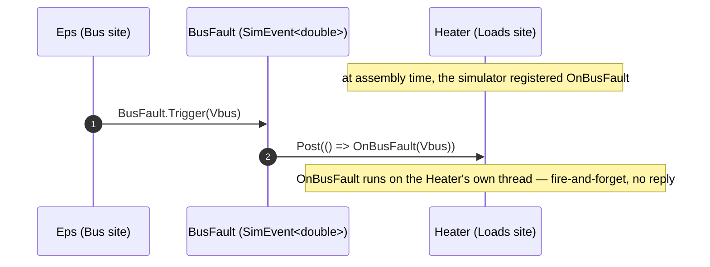

# Global events

Some notifications belong to no one. "The bus faulted." "A safing command arrived." "The scene went into eclipse."
Any number of models want to hear it, any number of places might raise it, and there is no single actor whose job it is
to own the channel. A [`[ServiceEvent]`](#/guide/services) can't express that — it is owned by one service and only that
service may fire it. A **global event** (`SimEvent`) is the answer: a **scheduler-less, ownerless pub/sub primitive**,
decoupled from services, that **any thread may trigger** and that every subscriber handles **on its own site**.

## What a global event is, and the gap it fills

A global event is the lightest of SimulaSharp's cross-site notification mechanisms. It has no thread, no serial
executor, no state — it costs **nothing at rest**. It is **multi-producer**: unlike a `[ServiceEvent]`, which only its
owning service can fire, *any* model (indeed any thread) holding a trigger handle can raise it. When it fires, each
subscriber's handler is **posted onto that subscriber's own site**, fire-and-forget — so a handler always runs on the
subscriber's thread and touches its state lock-free, even when the producer fired from a different site.

Registration is **synchronous, at assembly time** — the generated simulator wires every subscriber before the run
starts — so the stock event needs no locking on its subscriber list.

Where it sits among the three shared-notification tools:

| | **Global event** (`SimEvent`) | **`[ServiceEvent]`** | **Service** |
|---|---|---|---|
| Owner | none — ownerless | one service | it *is* an actor |
| Producers | **many** (any thread) | one (the owning service) | — |
| Backing thread / executor | **none** (no thread at rest) | the service's site | its own site |
| State | none | the service's | the service's |
| Handler runs on | each **subscriber's** site | each **subscriber's** site | the **service's** site |
| Result | fire-and-forget | fire-and-forget | optional (`Task`/`Task<T>`) |
| Reach for it when… | a notification belongs to no one and many things raise it | a single service broadcasts "something changed" | a stateful capability many models share |

Like a `[ServiceEvent]`, triggering is an immediate `Post`, **not** a sim-time-scheduled event. So a global event lives
on the framework's **real-time edge** — alongside services and loosely-coupled I/O — **not** the deterministic sim-time
core. If you need the delivery to be ordered against the simulation clock, schedule an event on a
[scheduler](#/guide/event-queue-and-scheduling) instead; a global event is for out-of-band "this just happened" fan-out.

> **A faulty handler can't take the site down.** Because delivery is a `Post` onto the subscriber's own site, a handler
> that throws is caught and logged **there** — by the site that ran it (under the `SimulatorThreads.<site>` logger) —
> then dropped. One misbehaving subscriber never crashes the site or stops the other subscribers.

## The two attributes

A model touches a global event through exactly one of two member-level attributes — never both. A **producer** holds a
trigger handle; a **consumer** exposes a handler method. (Producers can't subscribe, and subscribers get no way to
fire — the split is deliberate.)

### `[EventHandler]` — subscribe (consumer)

[`[EventHandler]`](#/api/type/SimulaSharp.Kernel.Attributes.EventHandlerAttribute) marks a model **or service** **method**
as a subscription target. The assembly's `Subscriptions` block binds it to a named event; the simulator registers it
during wiring, and the method thereafter runs on **the subscriber's own site** whenever the event fires.

The method must be `void` and take **either no parameters** (for an argless event) **or a single parameter** of the
event's payload type:

```csharp
public partial class Heater(IClock c, IScheduler s, ILogger l) : ModelBase(c, s, l), IPowerConsumer
{
    private PowerMode _mode = PowerMode.Full;

    // Wired by the assembly's Subscriptions block to the BusFault event. Runs on the heater's OWN site,
    // even though the EPS fired the event from another site — the event posted it here.
    [EventHandler]
    public void OnBusFault(double busVoltage) => _mode = PowerMode.Off;
}
```

### `[EventReference]` — trigger (producer)

[`[EventReference]`](#/api/type/SimulaSharp.Kernel.Attributes.EventReferenceAttribute) marks a **settable property or
field** typed as the trigger-only capability —
[`ISimEventInvocator`](#/api/type/SimulaSharp.Kernel.Events.ISimEventInvocator) (argless) or
[`ISimEventInvocator<T>`](#/api/type/SimulaSharp.Kernel.Events.ISimEventInvocator`1) (carries a `T`). The assembly's
`Triggers` block binds it, and the simulator fills the member with the shared event during wiring. The producer holds
**only** the trigger capability — it cannot register handlers.

```csharp
[EventReference]
public ISimEventInvocator<double> BusFault { get; set; } = null!;   // filled by the assembly's Triggers block

private void OnOverdraw(double vbus) => BusFault.Trigger(vbus);      // any thread may fire it
```

## The runtime types

All live in **`SimulaSharp.Kernel.Events`**. They come in an argless family and a payload-carrying family:

| Type | Role |
|---|---|
| [`ISimEventInvocator`](#/api/type/SimulaSharp.Kernel.Events.ISimEventInvocator) · [`ISimEventInvocator<T>`](#/api/type/SimulaSharp.Kernel.Events.ISimEventInvocator`1) | The **producer** capability — `Trigger()` / `Trigger(T arg)`, nothing else. What an `[EventReference]` is typed as. |
| [`ISimEvent<TSub>`](#/api/type/SimulaSharp.Kernel.Events.ISimEvent`1) · [`ISimEvent<TSub, T>`](#/api/type/SimulaSharp.Kernel.Events.ISimEvent`2) | The **full event** — the producer capability plus `Register(TSub subscriber, IDispatcher subDispatcher, Action handler)` / `Register(TSub subscriber, IDispatcher subDispatcher, Action<T> handler)`. `TSub` (unconstrained) is the subscriber-identity type a custom event may key on for routing; `subDispatcher` is where its handler runs (the stock event posts there and ignores the identity). A subscriber may be a model or a service. |
| [`SimEvent`](#/api/type/SimulaSharp.Kernel.Events.SimEvent) · [`SimEvent<T>`](#/api/type/SimulaSharp.Kernel.Events.SimEvent`1) | The **stock, logic-free** events (`ISimEvent<object>` / `ISimEvent<object, T>`) — the YAML default. Uniform delivery to every subscriber; they ignore `TSub`. |

The `TSub` type parameter matters only to a **custom** event (below). The stock `SimEvent` uses `object`, so it accepts
every subscriber — model or service — uniformly.

## Wiring it in the assembly

A global event is declared once, under a top-level **`Events:`** block (a sibling of `Services:` under `Simulator:`),
then wired to producers and consumers per model instance:

- a model **or service** instance's **`Triggers:`** block binds an `[EventReference]` producer member to an event;
- a model **or service** instance's **`Subscriptions:`** block binds an `[EventHandler]` consumer method to an event.

```yaml
Simulator:
  Events:
    - Name: BusFault
      ArgType: System.Double        # optional; omit → an argless SimEvent
      Type: Demo.RoutingEvent       # optional; default is SimEvent / SimEvent<ArgType>
  Sites:
    - Name: Bus
      Models:
        - Name: Eps
          Type: DemoSim.Power.Eps
          Triggers:                  # producer: [EventReference] member ← event
            - BusFault: BusFault
    - Name: Loads
      Models:
        - Name: Heater
          Type: DemoSim.Power.Heater
          Subscriptions:             # consumer: [EventHandler] method ← event
            - OnBusFault: BusFault
```

Both `Triggers` and `Subscriptions` are lists of single-key maps — `{ <member>: <eventName> }` — so one instance can
wire several. The generator **strict-types every wiring at build time**: the event must be declared, the handler must be
a `void` `[EventHandler]` of matching arity, the producer member must be a matching `[EventReference]`, and (for a
custom event) the subscriber must be assignable to `TSub`. See the [diagnostics](#diagnostics-sim023sim028) below and
the full [Assembly YAML reference](#/guide/assembly-yaml-reference).

## The `BusFault` example, end to end

The `DemoSim` sample wires a genuine cross-site fault broadcast. The **EPS** lives on the `Bus` site and, when demand
outstrips the power budget, fires a `BusFault` carrying the failing voltage; the **Heater** lives on the `Loads` site
and sheds load on receipt. Neither knows the other; the event carries the notification across the site boundary.

The producer — `Eps` — declares a trigger handle and fires it:

```csharp
[EventReference]
public ISimEventInvocator<double> BusFault { get; set; } = null!;   // filled by Triggers

public double Rebalance(double totalW)
{
    double drawW = /* … sum the consumers' draw … */ 0.0;
    // If demand outstrips the shared budget, broadcast the fault carrying the current voltage.
    if (drawW > totalW) BusFault.Trigger(Vbus);
    return drawW;
}
```

The consumer — `Heater` — declares the handler:

```csharp
[EventHandler]
public void OnBusFault(double busVoltage) => _mode = PowerMode.Off;   // runs on the Heater's own site
```

And the assembly ties them together — `Eps` on `Bus`, `Heater` on `Loads`, so the trigger on one thread lands as a
`Post` on the other:

```yaml
Simulator:
  Events:
    - Name: BusFault
      ArgType: System.Double
  Sites:
    - Name: Bus
      Models:
        - { Name: Eps,    Type: DemoSim.Power.Eps,    Triggers:      [ { BusFault: BusFault } ] }
    - Name: Loads
      Models:
        - { Name: Heater, Type: DemoSim.Power.Heater, Subscriptions: [ { OnBusFault: BusFault } ] }
```



## Stock vs custom events

The **stock** `SimEvent` / `SimEvent<T>` is logic-free: it registers every subscriber uniformly and, on `Trigger`,
posts to all of them. That is what you get when the YAML `Events:` entry omits a `Type:`, and it is the right choice
almost always.

You reach for a **custom** event only when the *routing* itself carries logic — a bus or router that must deliver to
*some* subscribers and not others, keyed on their identity. You implement the interface directly, choosing a narrower
`TSub`, and own your locking (your event may be registered against from your own code paths, not just at assembly time):

```csharp
// A router keyed on the subscribing node — delivers a transfer only to the addressed node.
public sealed class RoutingEvent : ISimEvent<IBusNode, TransferStruct>
{
    public void Register(IBusNode subscriber, IDispatcher subDispatcher, Action<TransferStruct> handler) { /* index by node id + dispatcher */ }
    public void Trigger(TransferStruct t) { /* route to the addressed node(s) only */ }
}
```

Declare it with `Type: Demo.RoutingEvent` in the `Events:` block. Because its `TSub` is `IBusNode` (not the stock
`object`), every subscriber **must** be an `IBusNode` — the generator enforces it ([SIM026](#diagnostics-sim023sim028)),
and a `Type` that doesn't implement `ISimEvent<…>` or disagrees with the declared `ArgType` is [SIM028](#diagnostics-sim023sim028).

## Diagnostics — SIM023–SIM028

Every global-event wiring problem is a **build error**, emitted by the simulator generator. On any error the simulator
is not emitted — fix the reported id and rebuild.

| ID | Meaning | Fix |
|---|---|---|
| **SIM023** | Unknown event. | A `Subscriptions`/`Triggers` entry names an event not declared under `Events:` — add it or correct the name. |
| **SIM024** | Invalid event handler. | The `Subscriptions` method is missing, not `[EventHandler]`, or not `void` — mark a `void` method with `[EventHandler]`. |
| **SIM025** | Handler signature mismatch. | Wrong arity/payload — an argless event needs a 0-parameter handler; a typed event needs a single parameter the payload is assignable to. |
| **SIM026** | Wrong subscriber type. | The subscriber isn't assignable to the event's `TSub` — the stock event accepts all (`object`); a custom event's `TSub` may be narrower. |
| **SIM027** | Invalid event reference. | The `Triggers` member isn't `[EventReference]`, or isn't typed as the matching `ISimEventInvocator` / `ISimEventInvocator<T>`. |
| **SIM028** | Invalid event type. | A custom `Type` doesn't implement `ISimEvent<…>`, or disagrees with the declared `ArgType` — align the type and its argument. |

## Where to go next

- **[Services](#/guide/services)** — the owned, stateful sibling: `[ServiceEvent]` (single-producer broadcast) and
  `[ServiceRequest]` (request/response).
- **[Interaction patterns](#/guide/interaction-patterns)** — putting notifications and requests together into real flows.
- **[The assembly](#/guide/the-assembly)** — declaring events and wiring `Triggers`/`Subscriptions`.
- **[Assembly YAML reference](#/guide/assembly-yaml-reference)** — the exhaustive schema and the full diagnostics table.
