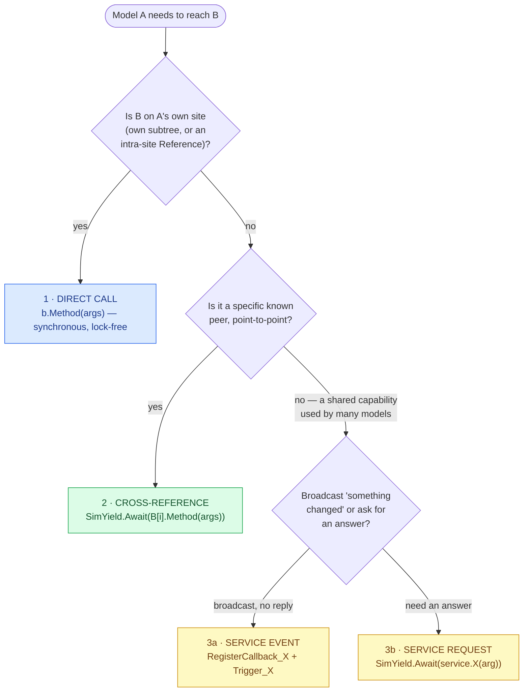
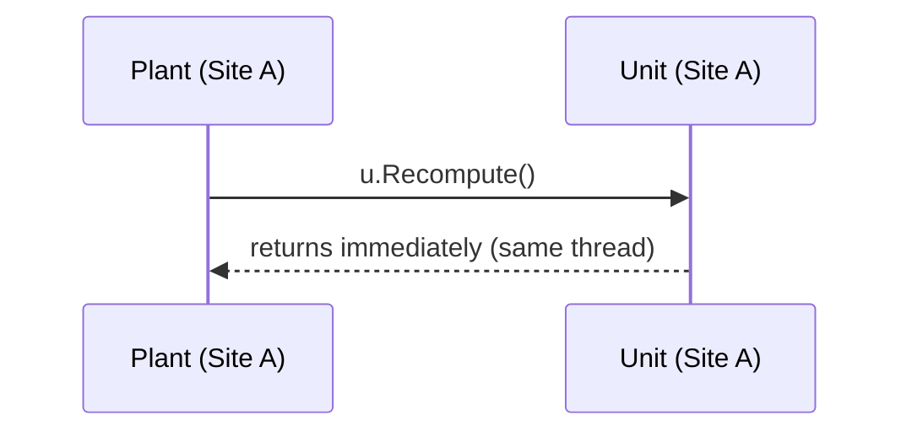
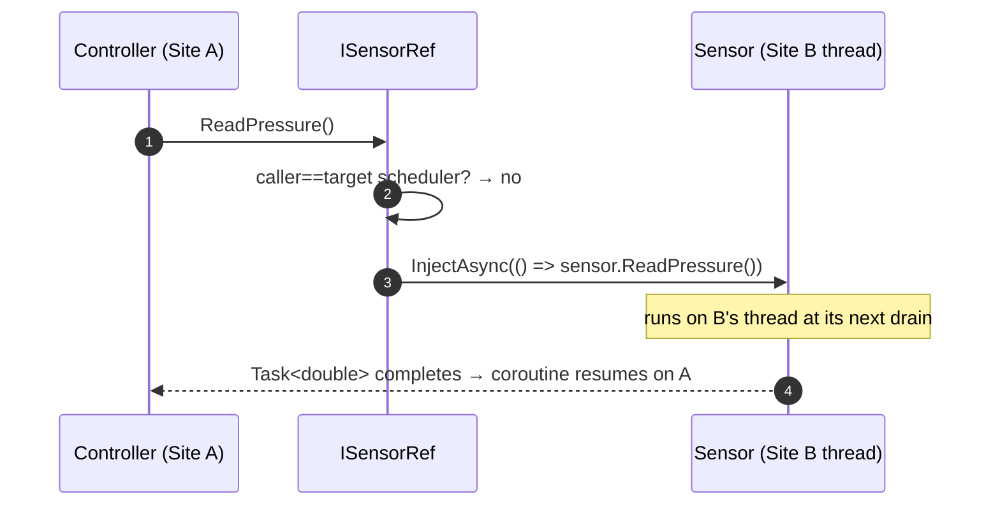
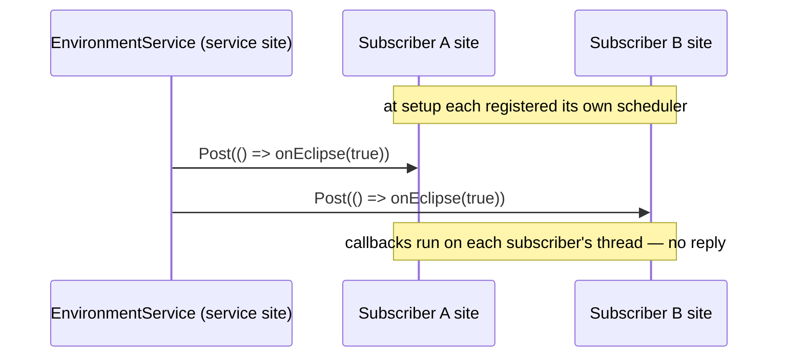
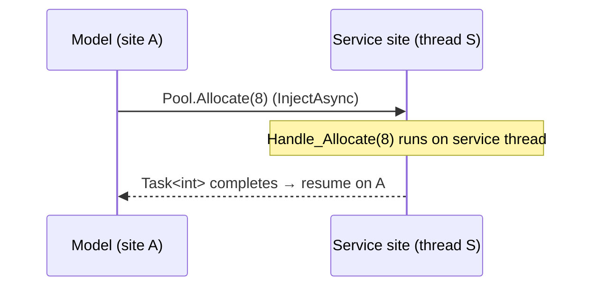
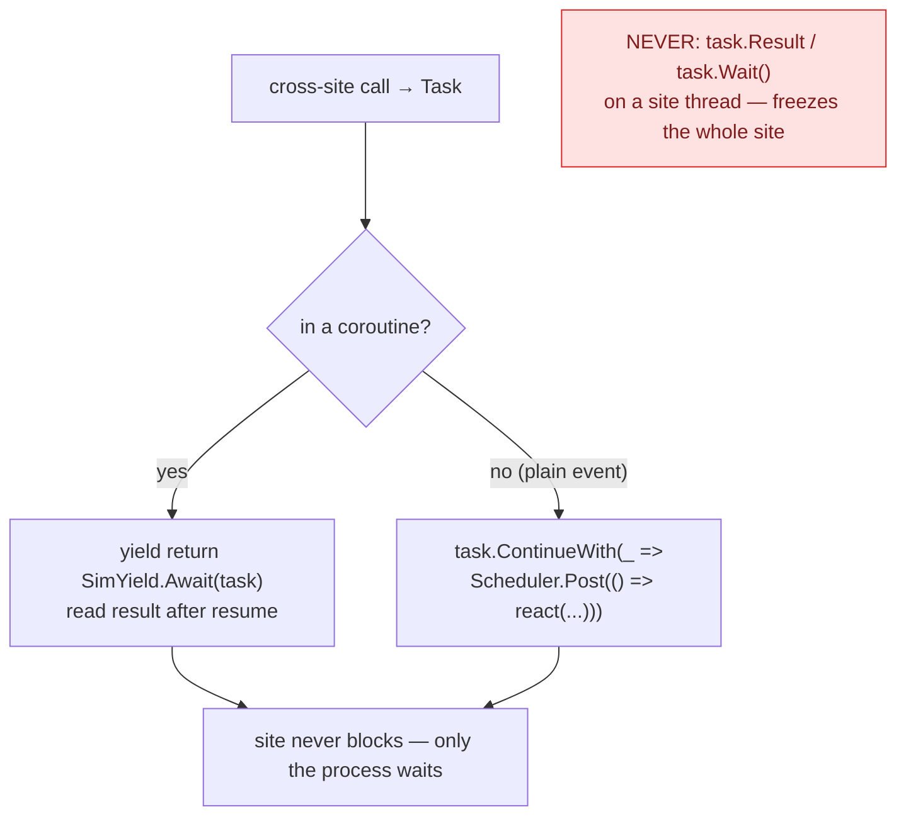

# Interaction patterns

Models rarely act alone — they read each other, command each other, react to shared events. SimulaSharp gives you
**three** ways for one model to talk to another, and choosing among them is a design decision with real consequences for
coupling, cost, and how you write the call.

| # | Pattern | Coupling | Thread | Cost | Result | Reach for it when… |
|---|---|---|---|---|---|---|
| 1 | **Intra-site direct call** | tight (same site) | caller's own | a method call | immediate return | the callee is in your [containment subtree](#/guide/models-and-containment), or a `[Reference<T>]` on your site |
| 2 | **Cross-site `[CrossReference<T>]`** | point-to-point link | target's | a marshal | a `Task` (or fire-and-forget, or a gauge read) | a specific peer on another site |
| 3 | **Service** ([`[ServiceEvent]`](#/guide/services)/[`[ServiceRequest]`](#/guide/services)) | many-to-one, decoupled | service's | a marshal | fire-and-forget or `Task` | a shared capability many models use |

## Choosing among the three



The first question is always *where does the callee live* — because that decides whether you can call it directly or
must marshal. That, in turn, is set by your [topology](#/guide/choosing-a-topology). Get the partition right and the
*frequent* calls fall into pattern 1.

---

## 1. Intra-site direct call

The cheapest interaction — and the reward for putting tightly-coupled models on one site. Same site, one thread, so
it's a plain synchronous method call. No marshal, no `Task`, no `await`, no lock.

```csharp
[Contains<Unit>("Units")]
public sealed partial class Plant(IClock c, IScheduler s, ILogger l) : ModelBase(c, s, l)
{
    private void Supervise()
    {
        foreach (Unit u in Units)      // Units share the Plant's site
            u.Recompute();             // direct, synchronous, lock-free
    }
}
```



The callee does not have to be your child. Another root on the **same** site is reached through an intra-site
[`[Reference<T>("Name")]`](#/guide/associations): the generated accessor is an `IReadOnlyList<T>` of the target
instances themselves (YAML `Refs:`), so the call is just as direct. The generator checks that every target really is
on your site (SIM017 if not).

```csharp
[Reference<Battery>("Batteries")]        // targets share this model's site
public sealed partial class PowerManager(IClock c, IScheduler s, ILogger l) : ModelBase(c, s, l)
{
    private double TotalSoC() => Batteries.Sum(b => b.SoC);   // direct, synchronous
}
```

Use it whenever you can. If your hottest call path *isn't* a direct call, reconsider the [topology](#/guide/choosing-a-topology).

---

## 2. Cross-site `[CrossReference<T>]`

A point-to-point link to a specific model that may live on another site. You declare it with
[`[CrossReference<T>("Name")]`](#/guide/associations); the target **must be an interface**. The generator gives you a
read-only `<I>Ref` accessor of that name whose per-member methods **capture the schedulers at construction** — so calls
take **no per-call scheduler argument** — and return a `Task`. The accessor auto-dispatches: same-site → runs directly
and the `Task` is already complete; cross-site → marshalled via `InjectAsync` onto the target's thread.

```csharp
[CrossReference<ISensor>("Sensors")]     // cross-references target an interface; accessor is ISensorRef
public sealed partial class Controller(IClock c, IScheduler s, ILogger l) : ModelBase(c, s, l)
{
    private IEnumerator<SimYield> Loop()
    {
        while (true)
        {
            Task<double> reading = Sensors[0].ReadPressure();            // schedulers captured at construction
            yield return SimYield.Await(reading);                         // park the coroutine
            double p = reading.GetAwaiter().GetResult();                  // complete by now
            Actuate(p);
            yield return SimYield.Delay(100_000);
        }
    }
}
```



The same source line is direct or marshalled depending only on where the target resolves — you write it once. Wire the
targets in the YAML under `CRefs:`.

That is the default **request/response** tier: every method and property of the interface becomes a `Task`-returning
call on the Ref (a property `P` becomes `GetP()` / `SetP(value)`). Two lighter tiers are chosen by attributes on the
**interface**:

| Interface member | On the Ref | Same-site | Cross-site |
|---|---|---|---|
| plain method / property (default) | `Task` / `Task<T>` | runs inline, completed `Task` | `InjectAsync` / `InjectVoidAsync` |
| `[Triggerable]` `void` method | `void` — fire-and-forget | runs inline | `Post`, returns at once |
| `[VolatileAccess]` get-only property | plain synchronous getter | reads the target directly | reads the target directly — no marshal |

```csharp
public interface ISensor
{
    double ReadPressure();                      // request/response → Task<double> ReadPressure()
    [Triggerable] void Calibrate(double zero);  // fire-and-forget  → void Calibrate(double)
    [VolatileAccess] double Pressure { get; }   // live gauge       → double Pressure { get; }
}
```

A `[Triggerable]` method must return `void` (SIM019). A `[VolatileAccess]` property must be get-only and of a type that
reads atomically — a word-size primitive, an enum or a reference (SIM021); the target should back it with a volatile
field, which a `partial` knob or plottable property already is. A gauge read is not ordered against `[Triggerable]`
calls — it bypasses the dispatcher. Full mechanics: [associations](#/guide/associations).

---

## 3. Service — a shared capability

When *many* models depend on one capability — a bus, an environment, a resource pool — route through a
[service](#/guide/services). It has its **own** site, so every call is cross-thread. Two directions:

### 3a. Event — broadcast, fire-and-forget

The service publishes; subscribers react on their own site. No reply. Best for "something changed" fan-out. The service
declares `[ServiceEvent("EclipseChanged", typeof(bool))]` and calls the generated `Trigger_EclipseChanged(value)`; a
model holds the service in a `[ServiceRef]` member (bound by the YAML `Deps:` block) and subscribes through the
generated `RegisterCallback_EclipseChanged(dispatcher, callback)`.

```csharp
// in the model's Configure():
Environment.RegisterCallback_EclipseChanged(Scheduler, OnEclipse);   // MY scheduler → callback on MY site
private void OnEclipse(bool inEclipse) => _inEclipse = inEclipse;    // runs on my thread; cache it
```



Caching the pushed value locally and reading the cache in your periodic step is the idiomatic way to avoid a round-trip
per tick.

### 3b. Request — ask for an answer

The model calls; the handler runs on the **service's** thread and returns a `Task`/`Task<T>`. Best for "give me a value"
or "reserve this." The service writes the handler `[ServiceRequest] int Handle_Allocate(int want)`, and the generator
emits the public `Task<int> Allocate(int want)` caller. A handler takes at most one parameter (SIM022).

```csharp
private IEnumerator<SimYield> AcquireLoop()
{
    Task<int> req = Pool.Allocate(want: 8);      // marshalled onto the service site
    yield return SimYield.Await(req);            // park; the site keeps serving others
    int got = req.GetAwaiter().GetResult();
    Use(got);
}
```



> **Consequence for design.** A service serializes all its clients on one thread, so it's a natural bottleneck if every
> model hammers it synchronously each tick. Prefer **event push + local cache** for state many models read, and reserve
> **request/response** for when a model genuinely needs a fresh answer.

---

## Reading a reply without blocking the site

Patterns 2 and 3b hand you a `Task` that completes **later, on another thread**. The single most important rule in the
framework applies: **never block a site thread waiting for it.** No `.Result`, no `.Wait()`, no `Thread.Sleep` — a
stuck site freezes *every* model on it, stops draining its inbox, and stalls anyone waiting on *it*. There are two
correct ways to read the reply.

### Option A — coroutine `Await` (preferred)

Inside a [coroutine](#/guide/coroutines), `yield return SimYield.Await(task)` parks the **coroutine**, not the thread.
The site keeps spinning; when the task completes, the coroutine resumes on its own thread and the result is sitting
ready. This reads top-to-bottom, like a story.

```csharp
Task<double> t = Sensors[0].ReadPressure();
yield return SimYield.Await(t);                 // site stays live; only THIS process waits
double p = t.GetAwaiter().GetResult();          // safe — complete by now, won't block
```

If the peer may be slow or gone, bound the wait. Pass a fresh `SimAwaitToken`; the coroutine resumes when the task
completes **or** the sim-time timeout passes, whichever is first, and the token tells you which:

```csharp
var tok = new SimAwaitToken();
Task<double> t = Sensors[0].ReadPressure();
yield return SimYield.Await(t, timeoutUs: 5_000, tok);
if (tok.TimedOut) { /* gave up — the task is still running; don't read it */ }
else Actuate(t.GetAwaiter().GetResult());
```

A bounded await uses one extra slot in your site's event queue for the deadline.

### Option B — `ContinueWith` + `Post`

From a non-coroutine event where you can't yield, don't await inline — attach a continuation that **posts the follow-up
back onto your own site**, so the reaction runs on your thread with no blocking:

```csharp
Task<double> t = Sensors[0].ReadPressure();
t.ContinueWith(done =>
    Scheduler.Post(() => Actuate(done.Result)),  // hop back onto MY site to touch state
    TaskScheduler.Default);
// the current event returns immediately — the site never blocks
```



Both keep the thread free; both make the reaction run on *your* site so it can touch your state lock-free. (In option B,
`done.Result` is safe because the task is complete; if the request faulted it rethrows, and your site logs and drops
that posted work.) The blocking `task.Result` form is the classic trap — see [pitfalls](#/guide/pitfalls). So is a C#
`await` in model code: its continuation resumes on a pool thread, not on your site.

## What this means for you

| You want to… | Use |
|---|---|
| Call a model in your own subtree | direct method call — synchronous, lock-free |
| Call another root on your own site | an intra-site [`[Reference<T>]`](#/guide/associations) — still a direct call |
| Call a specific peer on another site | a [`[CrossReference<T>]`](#/guide/associations) accessor: `B[i].M(…)` |
| Tell a peer something, no reply | a `[Triggerable]` `void` method on its interface |
| Read a peer's live scalar cheaply | a `[VolatileAccess]` get-only property on its interface |
| Broadcast "something changed" to many models | a [`[ServiceEvent]`](#/guide/services) + local cache |
| Ask a shared capability for an answer | a [`[ServiceRequest]`](#/guide/services): `svc.X(arg)` → `Task` |
| Read a cross-thread reply from a process | `yield return SimYield.Await(task)` in a [coroutine](#/guide/coroutines) (optionally with a timeout) |
| React to a reply from a plain event | `task.ContinueWith(_ => Scheduler.Post(() => …))` |
| Wait on a reply from *on* a site thread | **never** `.Result`/`.Wait()` — see [pitfalls](#/guide/pitfalls) |

For an ownerless "this just happened" broadcast that *any* model or service can raise — decoupled from any service — see
**[global events](#/guide/events)**.

Next: deciding whether a thing should be a model or a service at all — **[model vs service](#/guide/model-vs-service)**.
