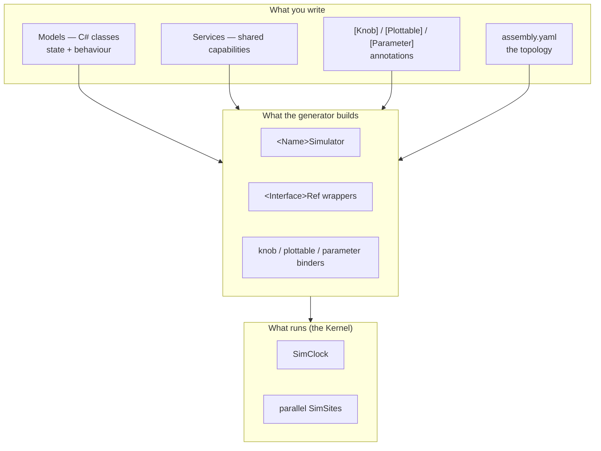

# Introduction

**SimulaSharp** is a C#/.NET 10 framework for building **hard-real-time, discrete-event simulations** as a set of
**parallel actors**. It exists to let you model a system — a satellite, a plant, a vehicle, a rig — the way you think
about it: a tree of *components*, each with its own state and behaviour, running *concurrently*, talking to each other,
and observable from the outside.

You write the components as plain C# classes, annotate the values you want to see and control, describe how the
components fit together in a small YAML file, and a **source generator** compiles all of that into a strongly-typed,
runnable, observable **simulator**. There is no reflective runtime engine interpreting your model — your simulation
*is* compiled code.

The name is a nod to **SIMULA**, the 1960s language that introduced *classes* and *coroutine-based process modelling*.
That heritage is explicit here: a model's long-running behaviour can be written as a **coroutine** — an
`IEnumerator<SimYield>` that `yield`s to advance simulated time — exactly the "process" abstraction SIMULA pioneered.

## What makes it different

Three commitments shape everything in this guide:

- **Hard real time, not fast-as-possible.** Simulated time advances at **1:1 with the wall clock**. A model that
  schedules work "100 ms from now" runs 100 ms of real time later. There is no speed-up knob and no "run to
  completion" — the simulation *is* a real-time system, suitable for hardware-in-the-loop and operator interaction.
- **Actors, not shared state.** The system is partitioned into independent **SimSites**, each running on its own
  thread. Work inside a site is serialized and lock-free; work *between* sites is passed as messages. You never write
  a lock.
- **Compile-time wiring, not runtime reflection.** Associations, cross-actor calls, observability, parameter binding,
  global events, and the whole assembly are **generated at build time**. Mistakes in your topology are *compile errors*, not runtime
  surprises, and the shipped product carries no YAML parser or reflection.

## The three parts

SimulaSharp is delivered as three pieces. As an author you touch the first two directly; the third is where your
finished simulator eventually runs. You do not reference the first two one by one: the single **`SimulaSharp`**
meta-package brings in both (see [project setup](#/guide/project-setup)). Hosting is a separate package, needed only
by a host.

| Part | Assembly | Role |
|------|----------|------|
| **Kernel** | `SimulaSharp.Kernel` | The runtime: the real-time [`SimClock`](#/api/type/SimulaSharp.Kernel.Services.SimClock), parallel single-threaded [`SimSite`](#/api/type/SimulaSharp.Kernel.Services.SimSite)s, per-site [event queues](#/guide/event-queue-and-scheduling), [coroutines](#/guide/coroutines), [associations](#/guide/associations), [services](#/guide/services), [global events](#/guide/events), [knobs & plottables](#/guide/observability), [parameters](#/guide/configuration), and logging. |
| **CodeGen** | `SimulaSharp.CodeGen` | Roslyn source generators that turn your annotated models + the YAML assembly into wiring: the `<Name>Simulator`, the guarded `<Interface>Ref` wrappers for cross-site references, service plumbing, knob/plottable/parameter binders — all validated at build time (`SIM001`–`SIM030`). |
| **Hosting** | `SimulaSharp.Hosting` | Loads a *packed* simulator (a `.nupkg`) into a collectible context so a host — ultimately the MMI — can run, observe, and hot-reload it. |

## Who this guide is for

This is the **definitive guide to *designing* a simulator** — the person building the models and deciding the
topology. It assumes you're comfortable with modern C# (records, `partial`, `async`/`await`) and have the .NET 10 SDK.
It does **not** cover operating a running simulation from a UI, or building the MMI itself — those come later.

## How to read it

- If you're brand new, read **[The big picture](#/guide/big-picture)** next, then **[The authoring
  model](#/guide/authoring-model)** — together they give you the whole mental model in two pages.
- The **Concepts** chapters go deep on one idea each, with diagrams. Read them in order for a thorough grounding, or
  jump to what you need.
- The **Designing a simulator** chapters are about *judgement* — how to choose a topology, when to reach for a service,
  what to expose, and the traps to avoid.
- The **Scenarios** are worked end-to-end builds; the last one, a
  **[satellite topology](#/guide/scenario-satellite)**, is the shape a real multi-subsystem simulator takes.

When you're ready to build, **[Getting started](#/guide/prerequisites)** gets a project compiling and running.
