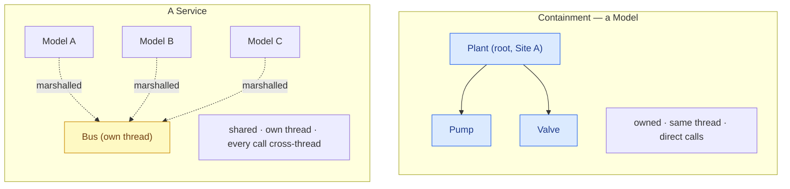
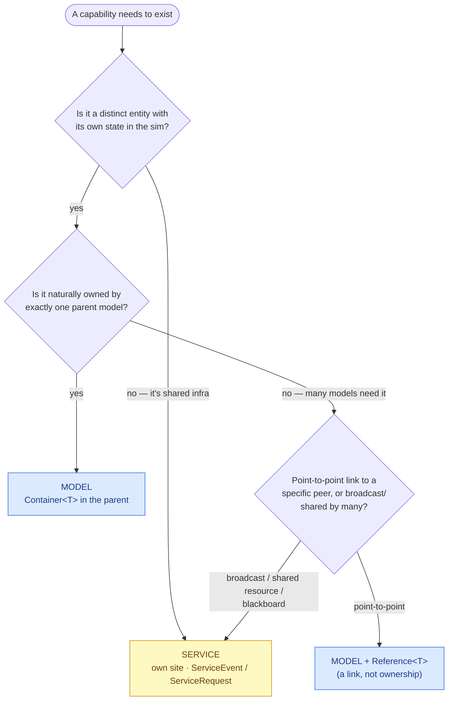

# Model vs service

You've decided some capability needs to exist. The next question is *what kind of artifact* it should be — a
[**Model**](#/guide/models-and-containment) or a [**Service**](#/guide/services). They look similar (both derive a base,
both have `Configure()`, both run on a SimSite) but they answer different questions and have opposite threading
contracts. Choosing wrong makes your topology awkward; choosing right makes it obvious.

## The one-line test

> A **Model** is a *simulated entity* — a thing in the tree with its own state, owned by whatever contains it.
> A **Service** is a *shared capability* — a thing on its own thread that many models reach, owned by no one.

If you can point at the thing and say "the plant *has* a pump," it's a model, contained. If you say "everyone *uses* the
bus," it's a service.

## The two shapes, side by side

- A **Model** lives in a [containment subtree](#/guide/models-and-containment) and shares that subtree's thread. Its
  owner calls it **directly**. It is *part of* one thing.
- A **Service** has its **own** SimSite and is never in a subtree, so **every** model↔service call is
  [marshalled](#/guide/services) — there is no same-site fast path. It is *shared by* many things.

## The decision table

| Question | → Model | → Service |
|---|---|---|
| Is it *owned by* one parent, or *shared by* many? | owned by one | shared by many |
| Does it have its own state that others read/mutate? | state belongs to its subtree | central state many models depend on |
| Who calls it? | mostly its container/subtree | lots of unrelated models |
| Is it point-to-point or many-to-one? | point-to-point | many-to-one / broadcast |
| Does "contained by X" describe it naturally? | yes | no — it floats above the tree |
| Would putting it in one subtree force *everyone else* to cross into that subtree? | no | yes — that's the smell of a service |
| Fan-out broadcast to subscribers? | no primitive for it | `[ServiceEvent]` is exactly this |

The last two rows are the tell. If making something a model would force half the tree to hold a cross-site
`[References<T>]` into one subtree just to reach it, it wants to be a service. And if you need *broadcast* — "range
updated," "eclipse started" — only a service's [`[ServiceEvent]`](#/guide/services) gives you fan-out.

## Decision flow

There's a middle option worth naming: a thing can be a **model reached by `[References<T>]`** — still an owned entity in
*some* subtree, but linked to point-to-point from elsewhere. Reach for a full service only when the capability is
genuinely *shared by many* and *owned by none*.

## Worked examples

| The thing | Model or service? | Why |
|---|---|---|
| A **pump** in a plant | **Model**, contained | owned by the plant; its state is the plant's |
| A **valve** the pump commands | **Model**, same subtree | owned; direct lock-free calls |
| A **sensor** a controller on another site reads | **Model** + `[References<T>]` | still owned by its subsystem; just linked cross-site |
| A **data bus** every subsystem talks on | **Service** | shared by all; owned by none; needs broadcast |
| An **environment / FES blackboard** (orbit, weather, sun) | **Service** | many models sample it; it's the world, not a part |
| A **shared resource pool** (channels, tokens) | **Service** | central state, allocated to many; `[ServiceRequest]` |
| A **comms relay** fanning messages out | **Service** | many-to-many broadcast — `[ServiceEvent]` |
| A **reaction wheel** on a satellite | **Model**, contained by ADCS | a physical part of one subsystem |

The environment/blackboard case is the clearest service: it's the *shared world state* every subsystem reads. Making it
a model would mean picking one subsystem to "own the universe" and forcing all the others to reach into it — exactly the
smell the table flags.

## Cost and consequence

> **Consequence for design.** A service centralizes shared state on **one thread** — which is its whole value (a natural
> serialization point, no locks in its handlers) and its whole risk (a **bottleneck** if every model round-trips through
> it each tick). Two habits keep it healthy: prefer fire-and-forget [`[ServiceEvent]`](#/guide/services) broadcasts
> ("something changed") over synchronous [`[ServiceRequest]`](#/guide/services) round-trips, and let subscribers **cache**
> the pushed value locally instead of re-requesting it. A model, by contrast, has no inherent bottleneck — it shares its
> owner's thread — but it can't be shared or broadcast to.

## What this means for you

| You have… | Make it a… |
|---|---|
| An entity owned by one parent | **Model** in a `Container<T>` |
| An entity owned by one subtree but read by a specific peer elsewhere | **Model** + `[References<T>]` link |
| A capability many unrelated models depend on | **Service** |
| Shared world/environment state everyone samples | **Service** (blackboard) |
| Broadcast "something changed" to subscribers | **Service** with `[ServiceEvent]` |
| A shared resource to allocate on request | **Service** with `[ServiceRequest]` |

Related reading: [services](#/guide/services) (the mechanics), [associations](#/guide/associations) (`Container<T>` vs
`[References<T>]`), [choosing a topology](#/guide/choosing-a-topology) (where the sites fall), and the
[shared-service scenario](#/guide/scenario-shared-service) (a worked build).
