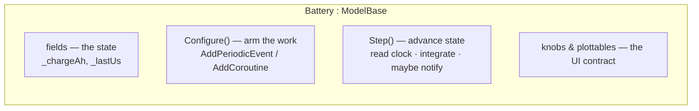
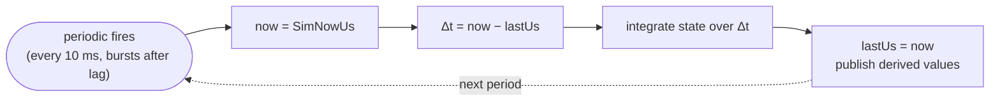

# Modeling a subsystem

Here is how you build one stateful model well — the everyday act of SimulaSharp authoring. We'll build a **battery**: it
holds state (charge), it's driven by a periodic tick, it integrates over time, and it exposes what an operator wants to
see and set. Every pattern here generalizes to a tank, a thermal mass, a motor, a filter.

## The anatomy of a model



Four parts: **fields** hold state, **`Configure()`** arms the recurring work, a **step method** advances the state each
time it fires, and **[knobs/plottables](#/guide/observability)** expose it. Let's build them.

## State lives in plain fields

Because a model and its whole subtree run on **one thread** ([SimSites & actors](#/guide/simsites-and-actors)), state is
just ordinary fields. **No `lock`, no `volatile`, no `Interlocked`, no concurrent collections** — two events on the same
site are never in flight at once, so plain fields are correct by construction.

```csharp
using SimulaSharp.Kernel.Logging;
using SimulaSharp.Kernel.Model;
using SimulaSharp.Kernel.Services;

public sealed partial class Battery(IClock c, IScheduler s, ILogger l) : ModelBase(c, s, l)
{
    private double _chargeAh;      // state: charge in amp-hours
    private long   _lastUs = -1;   // when we last integrated (µs); -1 = not yet
    private double _loadA;         // current draw (amps) — set elsewhere / by a knob
}
```

The only concurrency in the whole system is the [inbox boundary](#/guide/simsites-and-actors) between sites, and the
kernel handles that for you. Inside the model, you write single-threaded code.

## Arm the work in `Configure()`, never the constructor

`ModelBase` has exactly two hooks: `Configure()` and `Dispose()`. There is deliberately **no `OnTick`** — a model reacts
to *scheduled events*, not a per-frame callback. `Configure()` runs once, **after** the tree is built, references are
wired, and config is filled — so it's the earliest point the model is whole. Arm your recurring work there:

```csharp
public override void Configure()
{
    // Integrate charge every 10 ms of real time, on phase, for the life of the run.
    int id = Scheduler.AddPeriodicEvent(Step, periodUs: 10_000);
    if (id < 0)
        throw new InvalidOperationException("Battery: event queue full at Configure().");
}
```

> **Consequence for design.** Don't arm events in the constructor — references and config aren't populated yet there.
> And because there is [no reset](#/guide/time-and-clock), a model never un-configures itself to run again: a second run
> is a brand-new simulator with brand-new instances. `Configure()` sets up; `Dispose()` releases; nothing in between
> needs teardown logic.

The scheduler ([`IScheduler`](#/api/type/SimulaSharp.Kernel.Services.IScheduler)) gives you three kinds of work — pick by
shape:

| The behaviour is… | Use | See |
|---|---|---|
| "do this every *p* µs, forever" (sampling, integration, heartbeat) | `AddPeriodicEvent(action, p)` | [event queue](#/guide/event-queue-and-scheduling) |
| "do this once, *d* µs from now" | `AddEvent(action, d)` | [event queue](#/guide/event-queue-and-scheduling) |
| "a sequence of steps and waits" (spin-up, handshake, protocol) | `AddCoroutine(factory, delay)` | [coroutines](#/guide/coroutines) |

## Reading the clock and integrating over your own Δt

This is the part that trips people up: **a fired action receives no `Δt`**. Time is [published, not
pushed](#/guide/time-and-clock) — the action reads the current horizon from the clock and computes the interval since it
last ran, itself. That keeps "now" honest (it's the horizon at *firing* time) and is exactly what you want for
integration:

```csharp
private void Step()
{
    long now = TimeKeeper.SimNowUs;          // read the horizon — never advance it

    if (_lastUs >= 0)
    {
        double dtSeconds = (now - _lastUs) / 1_000_000.0;   // µs → s
        double drawnAh   = _loadA * dtSeconds / 3600.0;     // A·s → A·h
        _chargeAh = Math.Max(0, _chargeAh - drawnAh);       // integrate
    }

    _lastUs = now;                            // stamp for next time
    SoC = _chargeAh / CapacityAh;             // publish a derived knob/plottable (below)
}
```

Two things make this robust:

- **Compute `Δt` from the horizon, not from the period.** If you assumed a fixed 10 ms you'd drift whenever the site
  lagged. Reading `now - _lastUs` integrates over the *actual* elapsed span — always exact.
- **Absolute periodic re-arm has your back on lag.** After a stall the periodic [bursts to catch
  up](#/guide/event-queue-and-scheduling) — one firing per pass until it's back on the ideal grid — so your integral
  still accumulates `elapsed / period` firings and loses nothing. Because you integrate over the real `Δt`, a burst of
  short-interval catch-up steps sums to exactly the right charge. Keep the step **cheap and re-entrant-friendly** so a
  catch-up burst stays fast.



## Expose the operator contract: knobs and plottables

State the operator should **see** or **set** becomes a knob; a numeric time-series you want **graphed** becomes a
plottable. A property can be both. You declare them on `partial` properties; the generator materializes a lock-free
`volatile` backing field, so a UI can read/write safely while the site runs. Full detail:
[observability](#/guide/observability) and [designing observability](#/guide/observability-design).

```csharp
using SimulaSharp.Kernel.Attributes;

public sealed partial class Battery(IClock c, IScheduler s, ILogger l) : ModelBase(c, s, l)
{
    // Set once by the assembly; a fixed parameter, not operator-driven.
    [Config] public double CapacityAh { get; set; }

    // Operator-settable input: the load, as a slider 0–50 A.
    [FloatKnob("Load", Min = 0, Max = 50, DecimalPlaces = 1)]
    public partial double Load { get; set; }

    // Model-driven readout AND a graphed series — one backing field, both roles.
    [FloatKnob("State of charge", Min = 0, Max = 1, DecimalPlaces = 3, IsReadOnly = true)]
    [Plottable("SoC")]
    public partial double SoC { get; set; }

    // A button: recharge to full.
    [TriggerKnob("Recharge")]
    protected void Handle_Recharge() => _chargeAh = CapacityAh;
}
```

Note the split of concerns:

- **`[Config]`** — a build-time parameter from the [assembly](#/guide/the-assembly) (`CapacityAh: 100`), not an operator
  control.
- **read/write knob** (`Load`) — the operator drives it; the model reads it in `Step()` as `_loadA` (or just reference
  `Load` directly — it's a normal typed property).
- **read-only knob + plottable** (`SoC`) — the model drives it; the operator watches it and the chart graphs it.
- **trigger** (`Recharge`) — a button whose handler runs **on this model's site thread**, so it touches `_chargeAh`
  lock-free.

## The whole model

```csharp
using SimulaSharp.Kernel.Attributes;
using SimulaSharp.Kernel.Logging;
using SimulaSharp.Kernel.Model;
using SimulaSharp.Kernel.Services;

public sealed partial class Battery(IClock c, IScheduler s, ILogger l) : ModelBase(c, s, l)
{
    private double _chargeAh;
    private long   _lastUs = -1;

    [Config] public double CapacityAh { get; set; }

    [FloatKnob("Load", Min = 0, Max = 50, DecimalPlaces = 1)]
    public partial double Load { get; set; }

    [FloatKnob("State of charge", Min = 0, Max = 1, DecimalPlaces = 3, IsReadOnly = true)]
    [Plottable("SoC")]
    public partial double SoC { get; set; }

    public override void Configure()
    {
        _chargeAh = CapacityAh;                          // start full
        if (Scheduler.AddPeriodicEvent(Step, 10_000) < 0)
            throw new InvalidOperationException("Battery: queue full.");
    }

    private void Step()
    {
        long now = TimeKeeper.SimNowUs;
        if (_lastUs >= 0)
        {
            double dt = (now - _lastUs) / 1_000_000.0;
            _chargeAh = Math.Max(0, _chargeAh - Load * dt / 3600.0);
        }
        _lastUs = now;
        SoC = CapacityAh > 0 ? _chargeAh / CapacityAh : 0;
    }

    [TriggerKnob("Recharge")]
    protected void Handle_Recharge() => _chargeAh = CapacityAh;
}
```

## When the step needs a peer or a service

If the step needs data from another model, *how* you fetch it depends on where that model lives:

- **Same subtree** → a direct method call. Nothing special; it's one thread.
- **Another site** → a [`Reference<T>`](#/guide/associations) accessor returning a `Task`. Don't block on it from the
  step — if you need the reply, do the work in a [coroutine](#/guide/coroutines) and `SimYield.Await` the task, or
  subscribe to a [service event](#/guide/services) and keep a local cached copy the step reads. Full menu:
  [interaction patterns](#/guide/interaction-patterns).

> **Consequence for design.** Keep the periodic step **synchronous and local**. It should read fields (and cached copies
> of remote data), integrate, and publish — never `await`, never block, never do I/O. Anything that has to *wait* on
> another thread belongs in a coroutine or an event callback, not in the tick.

## What this means for you

| You want to… | Do this |
|---|---|
| Hold state | plain fields — no locking, ever, within a site |
| Run recurring work | `AddPeriodicEvent(Step, periodUs)` in `Configure()` |
| Know the elapsed interval | read `TimeKeeper.SimNowUs`, subtract your own `_lastUs` |
| Survive lag without losing integral | integrate over real `Δt`; the periodic bursts to catch up for you |
| Let the operator watch a value | read-only `[*Knob]` (add `[Plottable]` to graph it too) |
| Let the operator set a value | read/write `[*Knob]` |
| Give the operator a button | `[TriggerKnob]` on a `Handle_<Name>()` method |
| Take a fixed build-time parameter | `[Config]` property, set in the assembly |

Next: how models **talk** — **[interaction patterns](#/guide/interaction-patterns)**. Or see this scaled up in the
[integrator scenario](#/guide/scenario-integrator).
