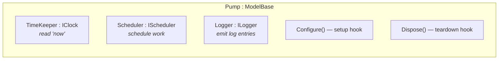
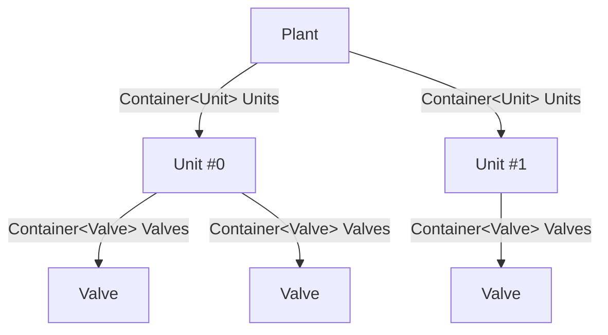
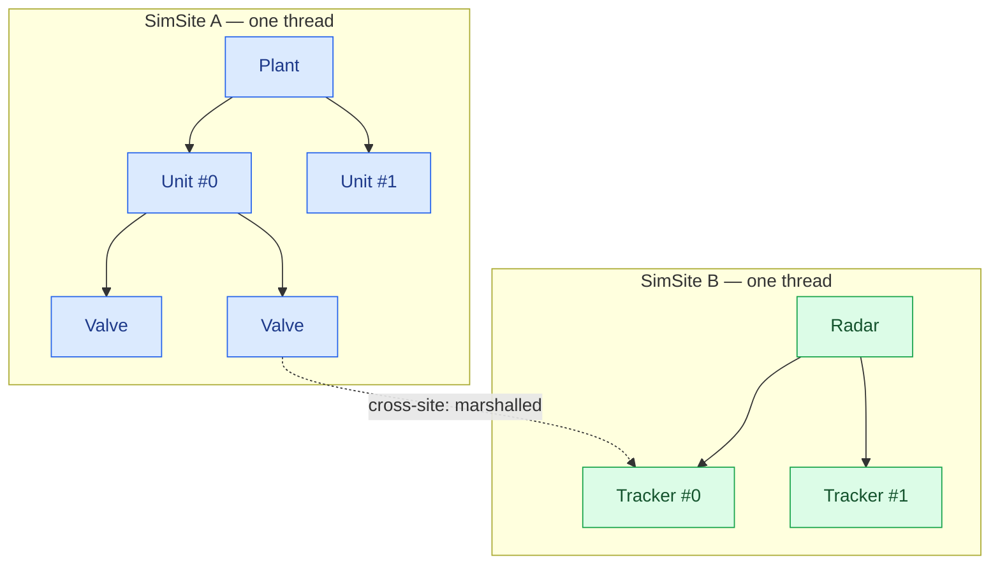

# Models & containment

A **model** is the atom of a SimulaSharp simulation: a simulated entity with state and behaviour, written as a plain
C# class. You describe how models *nest* — a plant contains pumps, a satellite contains subsystems — and the generator
turns that nesting into a runnable tree. This page is about the model itself and the one containment decorator,
[`[Contains<T>]`](#/api/type/SimulaSharp.Kernel.Attributes.ContainsAttribute`1).

## A model is a `ModelBase` subclass

Every model derives from [`ModelBase`](#/api/type/SimulaSharp.Kernel.Model.ModelBase) (which implements
[`IModel`](#/api/type/SimulaSharp.Kernel.Model.IModel)). The framework injects three things through the constructor —
you pass them straight to the base:

```csharp
using SimulaSharp.Kernel.Logging;
using SimulaSharp.Kernel.Model;
using SimulaSharp.Kernel.Services;

public sealed class Pump(IClock c, IScheduler s, ILogger l) : ModelBase(c, s, l)
{
    // your state and behaviour go here
}
```

Those three constructor arguments become the three properties you live off of:

| Injected | Property | What it is |
|---|---|---|
| [`IClock`](#/api/type/SimulaSharp.Kernel.Services.IClock) | `TimeKeeper` | The shared simulation clock. **Read** it for "now" (`TimeKeeper.SimNowUs`). You never advance it. |
| [`IScheduler`](#/api/type/SimulaSharp.Kernel.Services.IScheduler) | `Scheduler` | The **SimSite** this model runs on. You schedule work on it. |
| [`ILogger`](#/api/type/SimulaSharp.Kernel.Logging.ILogger) | `Logger` | This model's component-scoped logger. |



- **Key point.** A model is *given* its clock, scheduler and logger. It does not create them, choose them, or share
  them by accident — the generated simulator constructs every model with the right instances. You just derive and use.

## `Configure()` and `Dispose()` — the only two hooks

`ModelBase` has exactly two overridable lifecycle hooks. There is deliberately **no `OnStart`, no `OnReset`, no
`OnTick`** — those belong to a different framework. A SimulaSharp model reacts to *scheduled events*, not to a
per-frame callback.

- **`virtual void Configure()`** — called once by the framework **after** construction, assembly wiring and config
  filling are all complete. This is where a model registers its long-running work on the scheduler, precomputes
  values, subscribes to services, and does any other setup. Everything is wired by the time it runs.
- **`virtual void Dispose()`** — deinitialization. Called during teardown, *after* the site threads have stopped.
  Release resources here.

```mermaid
sequenceDiagram
  participant Sim as Generated simulator
  participant M as Model
  Note over Sim,M: construction — build tree, wire refs, apply params
  Sim->>M: Configure()
  Note over M: arm scheduled events here
  Note over Sim,M: Start — sites + clock run; events fire on the site thread
  Note over Sim,M: … simulation runs …
  Note over Sim,M: Stop — site threads halt
  Sim->>M: Dispose()
```

> **Consequence for design.** Do not arm events in your constructor — references and config are not yet populated
> there. `Configure()` is the earliest point at which the model is whole. And because there is no reset, a model never
> has to *un*-configure itself to run again: a second run is a brand-new simulator with brand-new instances.

## Behaviour is scheduled work, and actions take no Δt

A model does not run a loop. It **registers events** on its `Scheduler` in `Configure()`, and the SimSite fires them
when they come due. The scheduling verbs are relative-to-now delays; the action you hand over receives **no time
argument** — when it needs "now", it reads the clock.

```csharp
public sealed class Pump(IClock c, IScheduler s, ILogger l) : ModelBase(c, s, l)
{
    private double _flow;

    public override void Configure()
    {
        // Arm a periodic tick: every 10 ms of real time, re-evaluate flow.
        Scheduler.AddPeriodicEvent(Step, periodUs: 10_000);
    }

    private void Step()
    {
        long now = TimeKeeper.SimNowUs;      // read time — never advance it
        _flow = ComputeFlow(now);
        Logger.Trace($"flow={_flow:F2} @ {now}us");
    }

    private double ComputeFlow(long nowUs) => /* … */ 0.0;
}
```

The scheduler ([`IScheduler`](#/api/type/SimulaSharp.Kernel.Services.IScheduler)) offers one-shots
(`AddEvent`), periodics (`AddPeriodicEvent`), coroutine processes (`AddCoroutine`), and mission-time–anchored variants
(`AddEventAtMission`, …). All return an event id you can `RemoveEvent`. See
[the event queue & scheduling](#/guide/event-queue-and-scheduling) and [coroutines](#/guide/coroutines) for the full
surface.

- **Key point.** Actions are *timeless callbacks*. There is no `dt` parameter because time is published, not pushed
  (see [time & the clock](#/guide/time-and-clock)). If you need the elapsed interval, stamp the last time yourself and
  subtract.

## Models that use codegen must be `partial`

Any model that touches a code-generated attribute — a knob, a `[Parameter]`, a `[References<T>]` (whose accessor is
generated) — must be declared `partial`, so the generator can weave its half into your class. A model with *no*
generated members can be `sealed` with no `partial`. When in doubt, mark it `partial`; it costs nothing.

```csharp
[Contains<Unit>("Units")]                                     // containment (below) — no field needed
public partial class Plant(IClock c, IScheduler s, ILogger l) : ModelBase(c, s, l)
{
    [Parameter(0)] public int Capacity { get; set; }              // generated config binding
}
```

## Containment: `[Contains<T>]` builds the tree

A parent model expresses "I own these sub-models" with a
[`[Contains<T>("Name")]`](#/api/type/SimulaSharp.Kernel.Attributes.ContainsAttribute`1) attribute on the class. The
generator emits a read-only [`Container<T>`](#/api/type/SimulaSharp.Kernel.Primitives.Container`1) accessor of that
name — there is no field for you to declare:

```csharp
[Contains<Unit>("Units")]                                     // the Plant owns a list of Units
public partial class Plant(IClock c, IScheduler s, ILogger l) : ModelBase(c, s, l)
{
}
```

The generated `Units` accessor is an [`IReadOnlyList<T>`](#/api/type/System.Collections.Generic.IReadOnlyList`1) —
you index it, enumerate it, and walk the tree — but there is **no `Add`**: it is `init`-only, filled once by the
generated simulator while building the tree from the [assembly](#/guide/the-assembly), and immutable to your model
thereafter.

- **Key point.** The `[Contains<T>("Name")]` decorator *is* the declaration — no container field, no `_`-prefixed
  sibling. `T` may be a concrete model **or a framework-pure interface** (there is no `IModel` constraint); the
  generator checks every wired child is a model assignable to `T`. Ownership is expressed with `[Contains]`, exactly
  as a non-owning link is expressed with `[References<T>]` (see [associations](#/guide/associations)).



## One subtree, one SimSite, one thread

This is the load-bearing rule. **A root model owns a SimSite, and its entire containment subtree shares that one
site** — the generated simulator constructs every model in the subtree with the *same* `Scheduler`. There is nothing
to propagate: `Scheduler` is just handed to each child's constructor.



Because the whole subtree lives on one thread:

- **Intra-subtree calls are direct and lock-free.** A `Plant` calling into one of its `Unit`s (or a `Unit` calling a
  sibling reached through the tree) is a plain synchronous method call on the same thread. No message, no marshalling,
  no lock — you never write a lock inside a subtree.
- **Cross-subtree calls are marshalled.** Reaching a model on *another* site (the blue → green dotted arrow above) goes
  through that site's inbox. That is what `[References<T>]` and its generated accessors are for — covered in
  [associations](#/guide/associations).

| Call | Same subtree (same site) | Different subtree (different site) |
|---|---|---|
| Mechanism | direct method call | message into target's inbox |
| Concurrency | serialized on the one thread | runs on the *target's* thread |
| Cost | a call | a `Post`/`InjectAsync` marshal |
| Locking | none, ever | none — the site serializes for you |

> **Consequence for design.** Where you draw subtree boundaries *is* your parallelism and *is* your locking story.
> Models that chatter constantly want to be in the same subtree (cheap direct calls); models that are naturally
> independent want to be separate roots (parallel sites, marshalled at the seams). This is the core judgement call —
> see [choosing a topology](#/guide/choosing-a-topology).

## Putting it together

A minimal parent-with-children, end to end:

```csharp
using SimulaSharp.Kernel.Logging;
using SimulaSharp.Kernel.Model;
using SimulaSharp.Kernel.Primitives;
using SimulaSharp.Kernel.Services;

[Contains<Unit>("Units")]
public partial class Plant(IClock c, IScheduler s, ILogger l) : ModelBase(c, s, l)
{
    public override void Configure()
    {
        // A supervisory heartbeat, once a second of real time.
        Scheduler.AddPeriodicEvent(Supervise, periodUs: 1_000_000);
    }

    private void Supervise()
    {
        // Same subtree ⇒ direct, lock-free calls into each contained Unit.
        foreach (Unit u in Units)
            u.Recompute();
    }
}

public partial class Unit(IClock c, IScheduler s, ILogger l) : ModelBase(c, s, l)
{
    [Parameter(0.0)] public double Rate { get; set; }
    public void Recompute() { /* runs on the same thread as Plant */ }
}
```

The `Plant` never constructs a `Unit`, never fills `Units`, and never picks a scheduler — the
[assembly](#/guide/the-assembly) declares the tree and the generated simulator does all three, handing every model in
the subtree the same site.

## Where to go next

- **[Associations: containment vs reference](#/guide/associations)** — the sibling primitive, `[References<T>]`, and how
  cross-site calls are generated and dispatched.
- **[The assembly](#/guide/the-assembly)** — who fills the container, and how you declare the tree and its sites.
- **[Choosing a topology](#/guide/choosing-a-topology)** — how to decide subtree boundaries, i.e. how to parallelize.
- **[SimSites & the actor model](#/guide/simsites-and-actors)** — what a site actually is under the hood.
