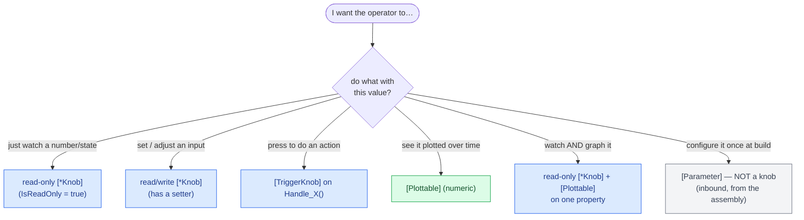
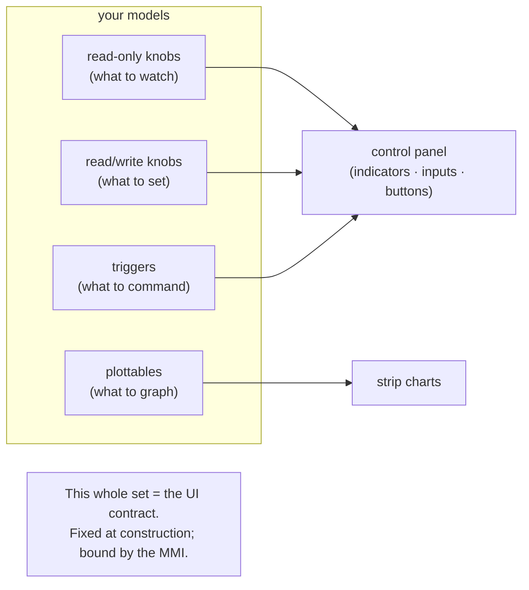

# Designing observability

The [observability chapter](#/guide/observability) covers the *mechanics* — how knobs and plottables are declared,
generated, discovered, and delivered. This page is about **judgement**: *what* to expose, in *which* form, and where to
draw the line. The set of knobs and plottables you declare **is the UI contract** — the entire surface an operator or
MMI has on your simulation. Design it deliberately.

## Two channels, and what each is for

| | **Knob** | **Plottable** |
|---|---|---|
| Purpose | observe **and** control | telemetry to **graph** |
| Direction | read, or read/write, or trigger | read-only, numeric |
| Delivery | push-on-change + read on demand | pulled by the consumer, one stamp per sweep |
| Shape | rich per-item metadata (labels, ranges, widgets) | a single `double` sample |
| Binds to | indicators, inputs, sliders, buttons | strip charts |

They're different shapes on purpose. A knob is for a *control panel*; a plottable is for a *chart*. A value can be
**both** — a read-only knob for the current reading *and* a plottable for its history — sharing one backing field. Pick
the shape(s) that match how the value is consumed.

## "I want to…" → which attribute



| I want to… | Use | Notes |
|---|---|---|
| Show a number the model computes | read-only `[IntegerKnob]`/`[FloatKnob]` | `IsReadOnly = true` (or no setter) |
| Show an on/off state | read-only `[TickBoxKnob]` | renders as an indicator lamp |
| Show a status string | read-only `[TextKnob]` | renders as a label |
| Let the operator set a number | read/write `[IntegerKnob]`/`[FloatKnob]` | give `Min`/`Max`; pick `Input`/`Slider`/`Rotary` |
| Let the operator toggle something | read/write `[TickBoxKnob]` | a switch |
| Let the operator type a value | read/write `[TextKnob]` | `MaxLength`, `AllowEmpty`, `AllowNewLine` |
| Give the operator a button | `[TriggerKnob]` on `Handle_<Name>()` | runs on the model's site thread |
| Graph a numeric series | `[Plottable]` | numeric/`bool`/`enum` → `double` |
| Watch **and** graph a value | read-only knob **+** `[Plottable]` on one property | one backing field, both roles |
| Fix a parameter at build time | `[Parameter]` | not observability — set in the [assembly](#/guide/the-assembly) |

The last row matters: **`[Parameter]` is not a knob.** Config is inbound, filled once from the assembly; a knob is an
*operator-facing* surface. A tunable an operator adjusts at runtime is a read/write knob; a fixed build parameter is
`[Parameter]`. Some values are sensibly both (a `[Parameter]` default the operator can then override via a knob) — but decide
the intent per value.

## Read-only vs read/write: who drives it?

The `IsReadOnly` flag (and whether the property has a setter) decides ownership of the value:

- **Read-only** — the *model* drives it; the operator only watches. Use for everything derived or measured: a state of
  charge, a temperature, a mode. A read-only `TickBox` becomes an indicator; a read-only `Text` a label.
- **Read/write** — *both* the model and the operator can change it. Use only for genuine *inputs*: a setpoint, an enable
  switch, a commanded load.

> **Consequence for design.** Default to **read-only**. A read/write knob is a promise that an operator can set the
> value *at any time, from another thread*, and your model will behave. If a value is really an output — the model
> computes it — making it writable invites the operator to fight the model for control of it. Expose write access only
> where an external input genuinely belongs.

## Triggers run on your thread — lean on that

A `[TriggerKnob]` marks a parameterless `Handle_<Name>()` method. When the operator presses the button, the generated
wrapper is **posted onto the model's own site thread** — so inside the handler you touch model state directly, no lock:

```csharp
[TriggerKnob("Recharge")]
protected void Handle_Recharge()
{
    // Runs on THIS model's site thread — safe to mutate state.
    _chargeAh = CapacityAh;
    Logger.Info("recharged");
}
```

Use triggers for *commands* — reset, arm, jettison, inject-fault — not for setting values (that's a read/write knob).

## Naming and paths

Every knob and plottable is discovered under a **full dotted instance path** the simulator stamps at
[construction](#/guide/observability): `Plant.Plant1.UnitA.Setpoint`. You control the last segment (the member) and
the human **label** (the attribute's first argument); the path prefix comes from the assembly's instance names. So:

- **Name instances well in the assembly** — the path an operator sees is `Site → Model names → member`. Meaningful
  `Name:` values pay off here.
- **Give every knob/plottable a clear `Label`** — it's what the widget shows. `[FloatKnob("Bus voltage")]`, not
  `[FloatKnob("Vbus")]`, unless the audience speaks the jargon.
- **Set units on plottables** — `[Plottable("Bus voltage", Unit = "V")]` so the chart axis is labelled.
- **Give numeric knobs `Min`/`Max`** — they bound sliders and validate inputs.

## Don't over-expose

The temptation is to slap `[Plottable]` on every field and `[Knob]` on every property "just in case." Resist it.

> **Consequence for design.** Every knob and plottable is a **stable, public contract** — discovered once at
> construction and fixed for the life of the simulator, bound to by a UI you may not control. Each one is also a small
> ongoing cost (a discovery entry, a change subscription, a sample per sweep). Expose the values that an operator
> genuinely needs to **see, set, or graph** — the ones that would appear on a real console for this subsystem. Keep
> internal intermediates as plain fields. A focused set of well-labelled knobs is a better contract than a wall of
> auto-exposed noise, and it's the difference between a usable panel and an unreadable one.

A useful filter: *would this appear on the real hardware's control panel or telemetry stream?* If yes, expose it. If
it's a scratch variable, leave it a field.

## The set as a contract



Because the set is fixed at construction and the MMI binds to it, treat adding/renaming a knob like changing a public
API. Design the panel you'd want to operate, then expose exactly that.

## What this means for you

| You want to… | Do this |
|---|---|
| Let an operator watch a value | read-only knob (add `[Plottable]` to graph it too) |
| Let an operator change an input | read/write knob with sensible `Min`/`Max` |
| Give an operator a command button | `[TriggerKnob]` on a `Handle_<Name>()` method |
| Graph a numeric series | `[Plottable]` with a `Unit` |
| Fix a parameter at build | `[Parameter]`, in the [assembly](#/guide/the-assembly) — not a knob |
| Keep an internal value private | leave it a plain field — don't expose it |
| Make paths readable | name instances meaningfully in the assembly |

For the how — lock-free volatile access, the push/pull split, discovery, the channel — read
[observability](#/guide/observability). For inbound configuration, [configuration](#/guide/configuration).
