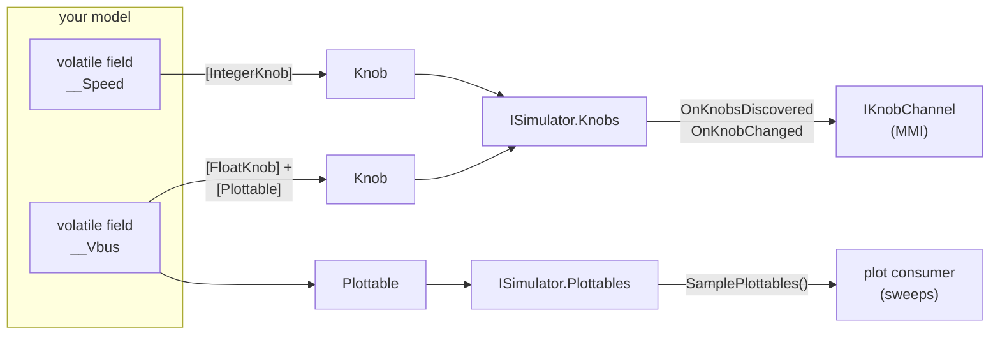
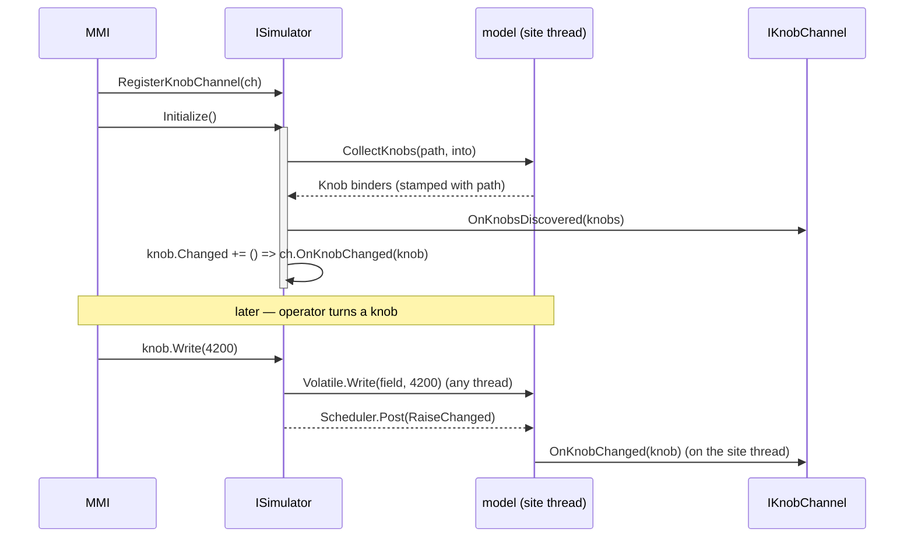
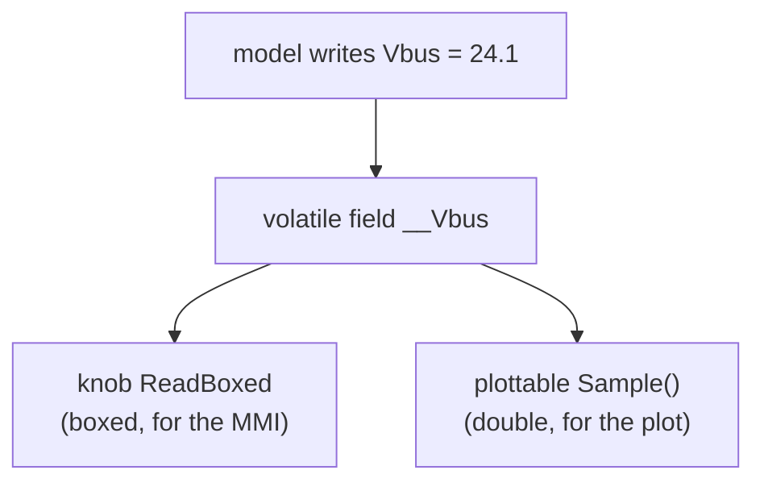
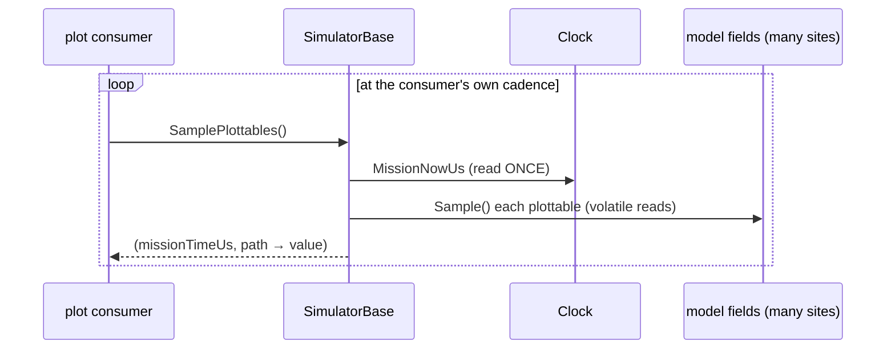

# Observability: knobs & plottables

A simulation you cannot see into is a black box. SimulaSharp gives you **two outward channels**, and only two, for
reaching into a running model tree from the outside:

- **Knobs** — the unit of *observation and control*. A named value you can **read**, sometimes **write**, or a
  **trigger** you can fire.
- **Plottables** — the unit of *plot telemetry*. A named **numeric sample** a plot consumer sweeps over time.

Both are declared the same way — an attribute on a model member — and both are **discovered automatically** when the
simulator initializes. Neither is pushed by the kernel: a knob channel is *notified* on change, and a plot consumer
*pulls* at its own cadence. Everything crosses the thread boundary through **lock-free volatile reads and writes**, so
observing a model never blocks the site running it.



This page is the *authoring* view: which attribute produces which surface, and how the generated binders behave. For
the reasoning behind the two-channel split — why control is push-notified but telemetry is pulled — see
[observability by design](#/guide/observability-design). For the exhaustive attribute options, see the
[attribute reference](#/guide/attribute-reference).

---

## Knobs

A **knob** is the MMI's unit of observation and control. Concretely it is a
[`Knob`](#/api/type/SimulaSharp.Kernel.Knobs.Knob) — a thin *binder*: rendering metadata plus typed read/write
delegates the generator supplies, plus a `Changed` event. You never construct one; you **declare** it by attributing a
member, and the [`KnobGenerator`](#/api/type/SimulaSharp.CodeGen.KnobGenerator) materializes both the member and its
binder.

### The five attributes

There are five knob attributes. Four sit on a `partial` **property** and expose a value; one sits on a **method** and
exposes a trigger. All of them derive from
[`KnobAttribute`](#/api/type/SimulaSharp.Kernel.Attributes.KnobAttribute) and share two options: **`Label`** (the
display text) and **`IsReadOnly`** (display-only vs. read/write).

| Attribute | Target | `KnobKind` | Distinctive options |
|---|---|---|---|
| `[TickBoxKnob("…")]` | `partial bool` property | `Bool` | — |
| `[IntegerKnob("…")]` | `partial` integer property | `Number` | `Min`, `Max` (`long`), `KnobType` |
| `[FloatKnob("…")]` | `partial` float/double property | `Number` | `Min`, `Max` (`float`), `DecimalPlaces` (default 2), `KnobType` |
| `[TextKnob("…")]` | `partial string` property | `Text` | `MaxLength` (default `int.MaxValue`), `AllowEmpty` (default `true`), `AllowNewLine` (default `false`) |
| `[TriggerKnob("…")]` | `void Handle_X()` method | `Trigger` | — |

`KnobType` is a [`NumberKnobType`](#/api/type/SimulaSharp.Kernel.Attributes.NumberKnobType) — `Input` (a plain field),
`Slider`, or `Rotary` — a hint to the UI carried onto the knob's `Style`. Bounds and formatting options travel onto the
knob as `Min`/`Max`/`DecimalPlaces`/`MaxLength`/… so a renderer can build the right control without knowing the model.

> **Consequence for design.** A knob's kind is fixed by *which attribute* you chose, not by the field's CLR type alone.
> A `bool` becomes a `Bool` knob only under `[TickBoxKnob]`; a `double` becomes a `Number` knob under `[FloatKnob]`.
> The attribute is the contract; pick it for the control you want, not just the type you have.

### Read-only vs. read/write

Every value knob is either **read/write** (the operator *and* the model can drive it) or **read-only** (a
label/indicator — the model drives it, the MMI can only watch). A knob is writable only when **its property has a setter
*and* `IsReadOnly` is not set**:

```csharp
[IntegerKnob("Charge current (mA)", Min = 0, Max = 5000, KnobType = NumberKnobType.Slider)]
public partial int ChargeCurrent { get; set; }          // read/write — operator can command it

[FloatKnob("Bus voltage", DecimalPlaces = 3, IsReadOnly = true)]
public partial double Vbus { get; set; }                // read-only — the model drives it
```

For a read-only knob the generator leaves the knob's `WriteBoxed` delegate **null**, so
[`Knob.Write`](#/api/type/SimulaSharp.Kernel.Knobs.Knob) is a silent no-op — the read-only contract lives in the
binder, not in a convention the MMI has to honour.

### What the generator materializes

For each value knob the `KnobGenerator` emits three things on your partial class:

1. a **private volatile backing field** (`__Speed`);
2. the **partial property body** — a volatile *get*, and (if you declared a setter) a volatile *set* that also raises
   the knob's `Changed`;
3. a **`Knob` binder**, built inside an explicit
   [`IKnobProvider.CollectKnobs`](#/api/type/SimulaSharp.Kernel.Knobs.IKnobProvider) the simulator calls during
   discovery.

```csharp
// generated (sketch) for [IntegerKnob("Speed", Min = 0, Max = 100)] public partial int Speed { get; set; }
private int __Speed = default!;
private Knob? __SpeedKnob;

public partial int Speed
{
    get => Volatile.Read(ref __Speed);
    set { Volatile.Write(ref __Speed, value); __SpeedKnob?.RaiseChanged(); }
}

void IKnobProvider.CollectKnobs(string prefix, ICollection<Knob> into)
{
    __SpeedKnob = new Knob
    {
        Path = prefix + ".Speed",       // e.g. "Plant.Plant1.Speed"
        Label = "Speed", Kind = KnobKind.Number, IsReadOnly = false,
        ValueType = "System.Int32", Min = 0, Max = 100,
        ReadBoxed  = () => Volatile.Read(ref __Speed),
        WriteBoxed = v => { Volatile.Write(ref __Speed, (int)v!); Scheduler.Post(() => __SpeedKnob!.RaiseChanged()); },
    };
    into.Add(__SpeedKnob);
}
```

Two subtleties worth internalizing:

- **The model's own property is unboxed.** Your model code reads and writes `Speed` as a plain `int` straight off the
  field. Only the MMI path (`ReadBoxed`/`WriteBoxed`) boxes. You pay for boxing only when the outside world looks.
- **A write from the MMI marshals its notification.** `WriteBoxed` does the atomic volatile write *immediately* (from
  any thread), but `Scheduler.Post`s the `Changed` notification onto the **model's own site thread**. So any model
  logic subscribed to the change runs where all that model's work runs — lock-free, on its one thread.

### Model-side reaction to a knob change

Alongside the property, the generator emits a `protected event Action <Name>Changed` you can subscribe to for cascaded
logic. Because the notification is posted onto the site thread, your handler runs there — safe to touch model state.
Subscribe in `Configure()`:

```csharp
public override void Configure()
{
    SpeedChanged += () => Log.Info($"speed is now {Speed}");   // runs on the site thread
}
```

### Triggers

A **trigger knob** exposes a *method*, not a value. You write a parameterless `void Handle_X()` and attribute it; the
generator emits a public `X()` that runs your handler and raises the "triggered" notification, plus a `Trigger`-kind
`Knob` whose `Invoke` posts `X()` onto the site thread.

```csharp
[TriggerKnob("Reset")]
protected void Handle_Reset() => Vbus = 0;
// generator emits:  public void Reset() { Handle_Reset(); __ResetKnob?.RaiseChanged(); }
```

Firing it from the MMI ([`Knob.Trigger`](#/api/type/SimulaSharp.Kernel.Knobs.Knob)) posts `Reset()` onto the model's
site; the handler runs there, then every knob channel is notified — so a trigger *lights up* in the UI regardless of who
fired it (operator, or the model calling `Reset()` directly). Triggers carry no `ValueType`, `ReadBoxed`, or
`WriteBoxed`.

### A model exposing all four surfaces

```csharp
public partial class Battery(IClock c, IScheduler s, ILogger l) : ModelBase(c, s, l)
{
    // read/write number, presented as a slider
    [IntegerKnob("Charge current (mA)", Min = 0, Max = 5000, KnobType = NumberKnobType.Slider)]
    public partial int ChargeCurrent { get; set; }

    // read/write toggle
    [TickBoxKnob("Heater")]
    public partial bool Heater { get; set; }

    // read-only float that is ALSO a plottable — one field, two surfaces (see below)
    [FloatKnob("Bus voltage", DecimalPlaces = 3, IsReadOnly = true)]
    [Plottable("Bus voltage", Unit = "V")]
    public partial double Vbus { get; set; }

    // trigger
    [TriggerKnob("Reset")]
    protected void Handle_Reset() => Vbus = 0;
}
```

---

## Discovery and the knob channel

Knobs are **discovered at `Initialize()`**. As the generated `OnInitialize` builds the model tree, it calls
`CollectKnobsFrom(model, fullPath)` on each instance; models that declare knobs implement `IKnobProvider` and stamp
each binder with the instance's **full dotted path** (`SimName.Path.To.Instance.Member`). The results accumulate into
[`ISimulator.Knobs`](#/api/type/SimulaSharp.Kernel.Services.ISimulator).

The MMI plugs in an [`IKnobChannel`](#/api/type/SimulaSharp.Kernel.Knobs.IKnobChannel) via `RegisterKnobChannel`. You
may register **before or after** `Initialize()`:

- register **before** → the channel receives `OnKnobsDiscovered` the moment discovery completes;
- register **after** → it receives them immediately, since discovery has already happened.

Either way the simulator hands the channel the full knob list once, then subscribes it to every knob's `Changed`, so it
gets an `OnKnobChanged(knob)` on each change.



> **Consequence for design.** `OnKnobsDiscovered` and `OnKnobChanged` both run on a **model's site thread**. A channel
> implementation must be **non-blocking — enqueue and return.** If it blocks, it stalls the site, and a stalled site
> stops firing that subsystem's events. The MMI's job here is to marshal into its own world, not to do work in the
> callback.

---

## Plottables

A **plottable** is the plot consumer's unit of telemetry: a named numeric series sampled over time. Declare it with
`[Plottable("label", Unit = "V")]` on a `partial` numeric property; the
[`PlottableGenerator`](#/api/type/SimulaSharp.CodeGen.PlottableGenerator) builds a
[`Plottable`](#/api/type/SimulaSharp.Kernel.Plotting.Plottable) binder whose `Sample` delegate is a **volatile read
projected to `double`**.

Supported member types:

| Source type | Projection to `double` |
|---|---|
| any numeric (`int`, `long`, `float`, `double`, `decimal`, …) | read as-is |
| `bool` | `true → 1.0`, `false → 0.0` |
| `enum` | its underlying numeric value |

Anything else is a **build error** —
[`SIM020`](#/guide/attribute-reference): *"[Plottable] member must be a readable numeric, bool, or enum property."*
This is caught at compile time, not discovered mid-sweep.

### Knobs and plottables coexist on one field

A property may carry **both** a knob attribute and `[Plottable]` at once. They **share the single volatile backing
field**: the knob generator materializes the field and the volatile get/set (with change-notify), and the plottable
generator simply *references* the same volatile getter for its `Sample`. This is exactly the `Vbus` case above — a
read-only knob for the operator to watch and a plottable for the graph, backed by one write from the model.



When `[Plottable]` sits on a partial property with **no** knob attribute, the plottable generator materializes the
volatile get/set itself (no change-notify — a plottable is observe-only).

### Sampling: one mission-time stamp per sweep

The kernel does **not** push plottable frames. The plot consumer pulls, at whatever cadence it wants, via
[`SamplePlottables()`](#/api/type/SimulaSharp.Kernel.Services.ISimulator):

```csharp
(long MissionTimeUs, IReadOnlyDictionary<string, double> Values) frame = sim.SamplePlottables();
```

One sweep reads [`Clock.MissionNowUs`](#/api/type/SimulaSharp.Kernel.Services.IClock) **exactly once**, then samples
every plottable against that single stamp — so every point in a frame shares a consistent x-axis, even though the
underlying fields are being written concurrently by many site threads.



> **Consequence for design.** Telemetry resolution is the **consumer's** choice, not the model's. A model never
> "emits a sample"; it just keeps a field current. Sampling faster gives a finer plot at the cost of more sweeps; the
> model is unaffected either way. Keep plottable fields cheap to read — a `Sample` that did real work would run on the
> consumer's thread at the consumer's rate.

Plottables, like knobs, are discovered at `Initialize()` (`CollectPlottablesFrom`) and keyed by full dotted path in
[`ISimulator.Plottables`](#/api/type/SimulaSharp.Kernel.Services.ISimulator).

---

## Knobs vs. plottables at a glance

| | Knob | Plottable |
|---|---|---|
| Purpose | observe **and** control | plot telemetry (observe only) |
| Declared with | `[TickBox/Integer/Float/Text/Trigger Knob]` | `[Plottable]` |
| Direction | read, read/write, or trigger | read only |
| Delivery | **push** — `IKnobChannel` notified on change | **pull** — consumer calls `SamplePlottables()` |
| Value shape | typed (bool/number/text) or a method | projected to `double` |
| Cross-thread access | lock-free volatile read/write | lock-free volatile read |
| Exposed on | `ISimulator.Knobs` | `ISimulator.Plottables` |
| Discovered | at `Initialize()` | at `Initialize()` |

Both are surfaces on the shared [`ISimulator`](#/api/type/SimulaSharp.Kernel.Services.ISimulator) / `SimulatorBase` —
never on the generated `<Name>Simulator`. That is deliberate: the MMI binds to one stable type regardless of which
simulator it loaded. Next: **[observability by design](#/guide/observability-design)** — when to reach for a knob, when
for a plottable, and how to keep the surface honest.
