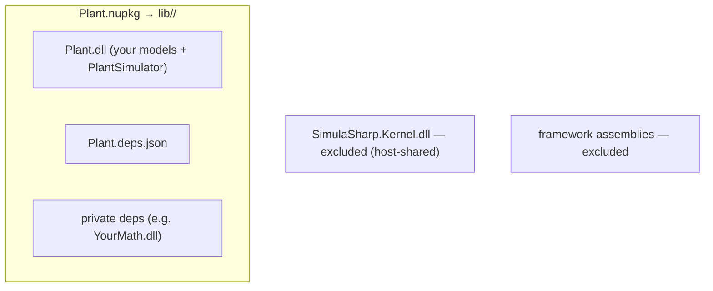
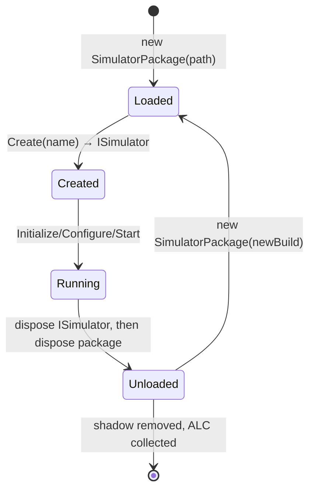
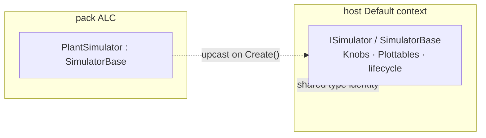

# Packing & hosting

A finished simulator is a class library — your models, your services, the generated `<Name>Simulator`. To let a host
*load, run, and reload* it without restarting, SimulaSharp does two things: it **packs** that library into a
self-contained `.nupkg`, and it **loads** the pack into a collectible, isolated assembly context. The eventual host is
the MMI; the loader is [`SimulatorPackage`](#/api/type/SimulaSharp.Hosting.SimulatorPackage) in `SimulaSharp.Hosting`.

```mermaid
flowchart LR
  BUILD["your class library<br/>models + generated PlantSimulator"] -->|"dotnet pack"| PKG["Plant.nupkg<br/>self-contained"]
  PKG -->|"SimulatorPackage(path)"| LOAD["shadow-copy + collectible ALC<br/>+ shared SimulaSharp.*"]
  LOAD -->|"reflection scan"| DISC["Simulators: [\"Plant\"]"]
  DISC -->|"Create(\"Plant\")"| SIM["ISimulator"]
```

Hosting is downstream of authoring — you rarely touch it while *designing* a simulator — but knowing the seam explains
several design rules that show up earlier in this guide. For the worked end-to-end flow, see
[scenario: pack & load](#/guide/scenario-pack-and-load).

---

## Packing

You pack with the ordinary SDK command:

```bash
dotnet pack -c Release
```

`dotnet pack` already puts your project's assembly in `lib/<tfm>/`, but **not** its runtime `.deps.json` or its private
dependency DLLs — which the host loader needs to resolve dependencies. The CodeGen package ships an MSBuild pack target
(`_SimulaSharpAddPackPayload`) that adds them, so the `.nupkg` is **self-contained and restore-free to load**:

- every private dependency DLL beside the build output, **excluding**
- the main assembly itself (already packed), and
- the shared **`SimulaSharp.*`** framework assemblies (loaded from the host, never from the pack), and
- framework assemblies;
- plus the project's `<AssemblyName>.deps.json`.



> **Consequence for design.** The pack deliberately **omits** `SimulaSharp.*`. Those assemblies come from the host at
> load time so that `ISimulator`, `Knob`, `Plottable`, `LogEntry` and friends have **one type identity** across the
> boundary. If the pack shipped its own copy of the Kernel, the host's `ISimulator` and the pack's `ISimulator` would
> be *different types* and nothing would bind.

---

## Loading

`new SimulatorPackage(path)` loads a pack. `path` may be a **`.nupkg`** (its `lib/<tfm>/` payload is extracted), a
**build-output directory**, or a single **`.dll`**. Whatever the form, the loader:

1. **Shadow-copies** the payload to a fresh temp folder — so the original build can be rebuilt while a copy is loaded.
2. Loads the main assembly into a **collectible `AssemblyLoadContext`** (`PackLoadContext`) backed by an
   `AssemblyDependencyResolver` driven by the pack's `.deps.json`.
3. **Shares every `SimulaSharp.*` assembly from the host's Default context** — the ALC's `Load` returns `null` for any
   name starting with `SimulaSharp`, deferring to Default; everything else resolves from the pack's own folder.
4. **Discovers simulators by reflection scan**: public, non-abstract, non-interface subclasses of
   [`SimulatorBase`](#/api/type/SimulaSharp.Kernel.Services.SimulatorBase) that have a **parameterless constructor** —
   exactly the generated `<Name>Simulator` types. The **display name** is the type name minus a trailing `Simulator`
   (`PlantSimulator` → `Plant`).

```mermaid
flowchart TB
  SRC[".nupkg / folder / .dll"] --> SHADOW["shadow-copy to temp"]
  SHADOW --> ALC["collectible PackLoadContext<br/>+ AssemblyDependencyResolver"]
  ALC -->|"name starts with SimulaSharp?"| SHARE["yes → load from host Default<br/>(single type identity)"]
  ALC -->|"otherwise"| PRIV["no → resolve from the pack folder"]
  ALC --> SCAN["scan for SimulatorBase subclasses<br/>with a parameterless ctor"]
  SCAN --> NAMES["Simulators = [\"Plant\", …]"]
```

The discovered names are on `package.Simulators`; you create an instance by name:

```csharp
using var package = new SimulatorPackage("out/Plant.nupkg");
foreach (var name in package.Simulators) Console.WriteLine(name);   // "Plant"

ISimulator sim = package.Create("Plant");    // a fresh PlantSimulator, typed as ISimulator
// drive it: Initialize → Configure → Start → Stop → Dispose  (see the lifecycle page)
```

`Create` news up the type via its parameterless ctor and hands it back as `ISimulator`. An unknown name throws
`ArgumentException`; creating from a disposed pack throws `ObjectDisposedException`.

---

## Unload and reload

Because the ALC is **collectible**, the whole pack can be unloaded. `package.Dispose()` unloads the context, drops the
`Type` references that would pin it, nudges the GC, and removes the shadow copy. Reloading is not an in-place swap — it
is single-use all the way down, mirroring the simulator's own [no-reset lifecycle](#/guide/simulator-lifecycle):

1. **Dispose the `ISimulator`** you created (tears down its sites, services, models, clock).
2. **Dispose the `SimulatorPackage`** (unloads the ALC, removes the shadow).
3. **Construct a new `SimulatorPackage`** on the new build, and `Create` again.



> **Consequence for design.** Reload replaces a *whole simulator instance*, never mutating a live one. That is why the
> whole framework is single-use and reset-free: fresh state per run falls out of the loading model. A hot-reloading MMI
> is built directly on this seam — dispose, unload, load the rebuilt pack, create.

---

## The one hard rule for authors

Everything the host touches must live on the **shared** `ISimulator` / `SimulatorBase`, never on the generated
`<Name>Simulator`. The host only ever sees `ISimulator`; the concrete type is discovered by reflection and immediately
upcast. Any capability you bolt onto the generated subclass is invisible across the boundary.



That is the entire hosting story: pack self-contained, load isolated-but-framework-shared, discover, create, and
reload by replacement. The MMI is the eventual host and is deferred; when it lands, it drives exactly this API. For the
full worked flow — building, packing, loading, and swapping a scenario — continue to
[scenario: pack & load](#/guide/scenario-pack-and-load).
