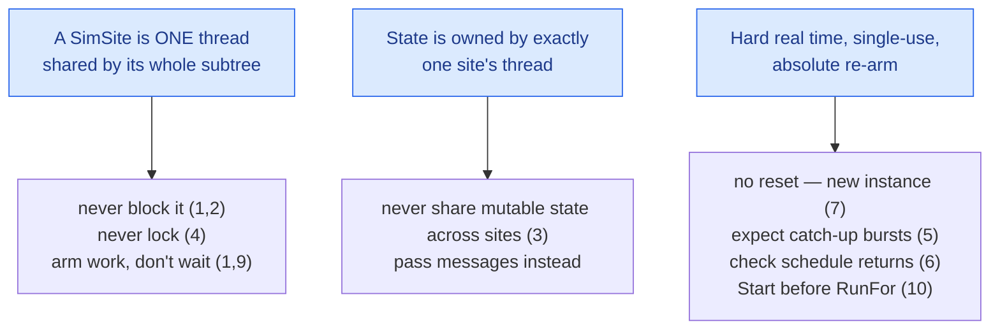

# Pitfalls

Almost every SimulaSharp mistake is a variation on **one** theme: *fighting the single-thread-per-site, hard-real-time
model instead of working with it*. This page catalogues the traps — each with the **symptom** you'll see, the **cause**,
and the **fix**. Most reduce to two rules:

> **Never block a site thread. Never share mutable state across sites.**

Keep those and the rest fall away.

## At a glance

| Pitfall | Symptom | Fix |
|---|---|---|
| Blocking a site thread | whole site freezes — no events fire, inbox stops draining | schedule/yield instead of sleeping |
| `.Result`/`.Wait()` on a cross-site call *from* a site thread | deadlock or a frozen site | coroutine `Await`, or `ContinueWith + Post` |
| Sharing mutable state across sites | data races, torn reads, heisenbugs | pass messages; each site owns its state |
| Taking a lock | you don't need one — and it can deadlock a site | delete it; a site is single-threaded |
| Assuming relative periodic re-arm | surprised by a catch-up burst after a stall | it's absolute — expect bursts; keep handlers cheap |
| Scheduling in the past / a full queue | `Add*` returns **-1**, work silently never runs | check the return; raise the site's `MaxEvents` |
| Expecting reset | second run reuses stale state / throws | build a **new** simulator |
| Over-exposing knobs | unreadable panel; brittle contract | expose only what an operator needs |
| Arming events in the constructor | refs/config not yet wired — nulls, wrong values | arm in `Configure()` |
| `RunFor` without `Start` | the clock advances but nothing fires | `Configure()`, then `Start()`, then `RunFor(…)` |
| A handler or coroutine throws | it's caught, logged, and dropped — the site keeps running, but a throwing **periodic** is not re-armed | look in the `SimulatorThreads.<site>` error log (a service logs under its own name) |

---

## 1. Blocking a site thread

**The cardinal sin.** A [SimSite](#/guide/simsites-and-actors) is one thread shared by every model in its subtree. While
that thread is stuck, **every** model on it stops: no events fire, no coroutines step, the inbox isn't drained, and any
cross-site caller waiting on a `Task` from it stalls too.

**Symptom:** a subsystem goes dead — its plottables flatline, its knobs stop updating — and possibly the sites talking
to it stall behind it.

**Cause:** anything blocking on the site thread — `Thread.Sleep`, synchronous I/O, a spin-wait, a `lock` another thread
holds.

```csharp
// BAD — freezes the whole site for 100 ms of real time
private void Step()
{
    Thread.Sleep(100);          // ← the entire site is dead for 100 ms
    DoWork();
}
```

**Fix:** never *wait* on the thread — *schedule* the future instead. To do something later, use an
[event](#/guide/event-queue-and-scheduling) or yield time from a [coroutine](#/guide/coroutines):

```csharp
// GOOD — the site stays live; the follow-up fires in 100 ms
private void Step()
{
    DoWork();
    Scheduler.AddEvent(Continue, delayUs: 100_000);
}

// or, in a coroutine:
private IEnumerator<SimYield> Process()
{
    DoWork();
    yield return SimYield.Delay(100_000);   // 100 ms passes; site keeps serving others
    Continue();
}
```

> **The one legitimate blocking read.** Genuinely external I/O — a socket to real hardware, a HIL link — *does* need a
> blocking read that lives **outside** sim time. That is what a [`LooselyCoupledServiceBase`](#/guide/services) is for:
> the service starts its own reader thread (in `OnRunStarted`, stopped in `OnRunStopped`) and `Post`s inbound work to
> its clock-ungated dispatcher ([`LooselyCoupledSite`](#/guide/sites-and-dispatch)), never a SimSite, so the blocking
> read never freezes a subtree.
> Never put external/blocking I/O on a SimSite; put it there instead.

---

## 2. `.Result` / `.Wait()` on a cross-site call from a site thread

The specific, common form of pitfall #1. A [`[CrossReference<T>]`](#/guide/associations) accessor or a
[service request](#/guide/services) returns a `Task` that completes **later, on another thread**. Blocking on it *from a
site thread* is a trap and often a **deadlock**: the target may need to `Post` a completion back through *your* site's
inbox — which you're no longer draining, because you're blocked.

**Symptom:** a hang, or a site frozen forever waiting on a task that can never complete.

```csharp
// BAD — blocks the site thread on a cross-site reply; can deadlock
private void Step()
{
    double p = Sensors[0].ReadPressure().Result;    // ← never do this on a site thread
    Actuate(p);
}
```

**Fix:** don't block — hand the reply back to your own thread asynchronously. In a coroutine, `Await`; in a plain event,
`ContinueWith` + `Post`:

```csharp
// GOOD (coroutine) — parks the process, not the thread
Task<double> t = Sensors[0].ReadPressure();
yield return SimYield.Await(t);
Actuate(t.GetAwaiter().GetResult());        // complete by now, won't block

// GOOD (plain event) — react on my own site, no blocking
Sensors[0].ReadPressure()
    .ContinueWith(d => Scheduler.Post(() => Actuate(d.Result)), TaskScheduler.Default);
```

A C# `await` in model code is the same trap in disguise: it does not block, but the code after it resumes on a pool
thread, not on your site, and then touches your state from the wrong thread. Use `SimYield.Await` instead.

> **The one exception.** `InjectXxx(...).Wait()` from a **non-site** thread (a test driver, a host thread) is fine — you
> aren't holding a site hostage. But note it only completes **while the target site is running**: a paused clock
> [parks the site](#/guide/simsites-and-actors), so a `.Wait()` against a paused (or never started) simulation waits
> forever. `Start()` the simulator (or `RunFor` after `Start`) around it.

---

## 3. Sharing mutable state across sites

The actor model's payoff is that **the only way data crosses a thread boundary is by running code on the owning
thread**. Smuggle a reference to another site's mutable object and you've reintroduced exactly the shared-memory races
the design eliminates.

**Symptom:** intermittent wrong values, torn reads, heisenbugs that vanish under a debugger.

**Cause:** capturing another site's model, field, array, or collection and touching it from your thread — often via a
closure passed to `Post`, or a raw model reference stashed in a field.

```csharp
// BAD — two sites mutating the same object; classic data race
otherSiteModel.Buffer.Add(sample);   // ← Buffer belongs to another site's thread
```

**Fix:** pass a **message**, not a reference. Marshal the work onto the owning site (via a `[CrossReference<T>]` Ref
or a service), so it runs on that site's thread and touches its own state:

```csharp
// GOOD — the append runs on the owner's thread
// (on the target interface: [Triggerable] void Append(double sample);)
Other[0].Append(sample);           // Ref accessor → Posted onto the owner's site, fire-and-forget
```

Within a single site, sharing is fine — it's one thread. The rule is only about crossing **site** boundaries. The one
sanctioned cross-site read is a `[VolatileAccess]` gauge: a get-only, atomically-readable property the owner writes
through a volatile field and you only read.

---

## 4. Taking a lock

**Symptom:** a `lock` in model code — and eventually a deadlock, or just needless contention.

**Cause:** a habit from multithreaded code. But a site is **single-threaded**: two events on the same site never run at
once, so there is nothing to protect. Across sites you never share memory (pitfall #3), so there's nothing to lock there
either.

**Fix:** delete the lock. If you *feel* you need one, it's a sign you're sharing state across sites — fix *that*
(pitfall #3) instead. The only synchronization in the system is the kernel's [inbox](#/guide/simsites-and-actors), and
it's already handled. Knob backing fields use `volatile` for lock-free cross-thread reads — also handled by the
generator, not you.

---

## 5. Assuming relative periodic re-arm

**Symptom:** after a stall (a long handler, a GC pause, a cross-site delay) a periodic handler fires **several times in
quick succession**, surprising code that assumed one-tick-per-call-at-the-nominal-rate.

**Cause:** periodic re-arm is [**absolute**](#/guide/event-queue-and-scheduling), not `now + period`. A lagging periodic
**bursts** to replay its backlog — one firing per pass — until it's back on the ideal grid. This is usually exactly what
you want (tick *counts* and *phase* stay exact — integrators and counters love it), but it must not surprise you.

**Fix:** design handlers to tolerate a burst:

- Integrate over the **actual** `Δt` you compute from the horizon (see [modeling a
  subsystem](#/guide/modeling-a-subsystem)), so a burst of short intervals sums correctly.
- Keep periodic handlers **cheap and idempotent-friendly**, so catching up is fast.
- If a handler drives something where a *stale* action is wrong (an actuator command), have it read `TimeKeeper.SimNowUs`
  and decide whether the work is still relevant, rather than assuming it fired on time.

---

## 6. Scheduling in the past, or into a full queue

**Symptom:** work you scheduled **never runs**, silently.

**Cause:** every `Add*` returns an **event id, or -1**. You get -1 when the site's queue is full, when a periodic's
period is not positive, when a negative delay would land before sim time zero, or — for the mission-time forms
(`AddEventAtMission`, `AddPeriodicEventAtMission`, `AddCoroutineAtMission`) — when the instant is **already in the
past**. Ignore the return and the work just vanishes.

The queue is fixed-size **per site**: every pending periodic, one-shot and coroutine on the site holds one slot, and a
bounded `SimYield.Await(task, timeoutUs, token)` holds one more for its deadline. The default is **64**; raise it with
`MaxEvents:` on the site in the [assembly](#/guide/the-assembly).

```csharp
// BAD — silently drops the work if the queue is full or the time is past
Scheduler.AddPeriodicEvent(Step, 10_000);

// GOOD — surface it
int id = Scheduler.AddPeriodicEvent(Step, 10_000);
if (id < 0) throw new InvalidOperationException("event queue full or invalid period");
```

**Fix:** check the return of every `Add*` that matters, and handle -1 — don't ignore it. If it is the queue, size
`MaxEvents` for the site's real load. For mission-time scheduling, remember a past instant is refused by design; anchor
to a future mission time or use a relative delay.

---

## 7. Expecting reset

**Symptom:** a second run behaves oddly — stale state, an already-disposed error, a clock that won't restart from zero.

**Cause:** there is [**no reset**](#/guide/time-and-clock). A simulator (and its clock) is **single-use**. `Stop`
freezes the run and `Start` resumes the *same* run; nothing rewinds to zero.

**Fix:** to rerun from zero, **build a new simulator**. Fresh instances give clean state for free — which is the whole
reason reset doesn't exist. In tests, construct a new `PlantSimulator()` per case.

```csharp
// GOOD — each scenario is a fresh instance
using (var sim = new PlantSimulator()) { sim.Configure(); sim.Start(); sim.RunFor(1_000_000); }
using (var sim = new PlantSimulator()) { /* clean state, second scenario */ }
```

---

## 8. Over-exposing knobs and plottables

**Symptom:** an unreadable control panel; a fragile UI contract that churns every time you touch a model.

**Cause:** decorating every field with `[Plottable]` and every property with `[Knob]` "just in case." The knob/plottable
set is a **public contract**, fixed in the constructor and bound by a UI you may not control.

**Fix:** expose only what an operator genuinely needs to **see, set, or command** — the values that would appear on the
real subsystem's console. Keep scratch variables as plain fields. See [designing
observability](#/guide/observability-design).

---

## 9. Arming events in the constructor

**Symptom:** an **empty** `[CrossReference<T>]` accessor, or a model that reads *default* config values, during setup.

**Cause:** the constructor runs **before** the simulator wires references and fills [`[Parameter]`](#/guide/configuration).
A `[CrossReference<T>]`'s generated accessor is still an empty list and your `[Parameter]` properties aren't populated yet.

The same goes for `[ServiceRef]` members (still null) and for a knob's generated `<Name>Changed` event (its binder is
not built yet, so subscribing throws).

**Fix:** do all setup in [`Configure()`](#/guide/models-and-containment) — the earliest point the model is whole
(constructed, wired, configured). Arm events, subscribe to services and knob changes, and precompute there, never in
the constructor.

```csharp
// BAD
public Battery(...) : base(...) { Scheduler.AddPeriodicEvent(Step, 10_000); }  // ← config not filled yet

// GOOD
public override void Configure() { Scheduler.AddPeriodicEvent(Step, 10_000); }
```

---

## 10. `RunFor` without `Start`

**Symptom:** a scripted run or a test does nothing — no events fire, no log lines — yet `RunFor` waits the full time.

**Cause:** `RunFor(durationUs)` only drives the **clock**: it starts it, waits for the duration, and pauses it. The site
threads are started by the simulator's `Start()`. Without `Start()` the clock advances over sites that were never
started, so nothing runs.

**Fix:** follow the [lifecycle](#/guide/simulator-lifecycle) order — `Configure()`, then `Start()`, then `RunFor(…)`:

```csharp
using var sim = new PlantSimulator();
sim.Configure();
sim.Start();
sim.RunFor(1_000_000);   // ~1 s of real time, then pause
```

---

## The two rules, restated

Every pitfall above is a corollary of two facts about the runtime:



Internalize *one thread per site* and *state is owned by its site*, and you'll write correct SimulaSharp code without
consulting this list. Related: [SimSites & actors](#/guide/simsites-and-actors),
[interaction patterns](#/guide/interaction-patterns), [time & determinism](#/guide/time-and-determinism).
