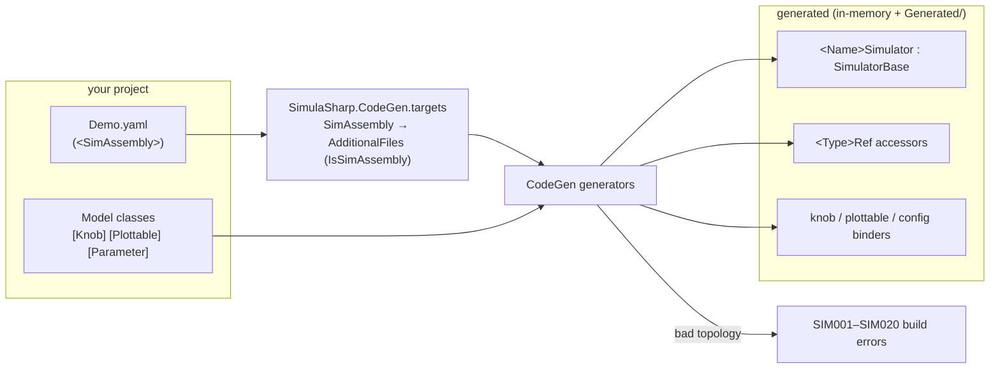

# Project setup

A simulator lives in an ordinary .NET **class library** that references the **Kernel** (the runtime) and the
**CodeGen** generator (as an analyzer), and carries one or more **assembly** YAML files. This page walks the setup
step by step; the finished `.csproj` is shown at the end.

## 1. Create the project

```powershell
dotnet new classlib -n MyPlant -f net10.0
cd MyPlant
```

A class library is the right shape: the output is meant to be **packed and loaded by a host**, not launched
directly. (For a throwaway experiment you can use `OutputType=Exe` and a `Main` that drives the lifecycle, but the
shipping shape is a library.)

## 2. Reference the Kernel and the generator

Add two `ProjectReference`s. The **Kernel** is a normal runtime reference. The **generator** is referenced as an
**analyzer** — `OutputItemType="Analyzer"` makes the compiler load it as a source generator, and
`ReferenceOutputAssembly="false"` keeps its `netstandard2.0` assembly out of your runtime output.

```xml
<ItemGroup>
    <ProjectReference Include="$(SimulaSharp_Root)\Kernel\Kernel.csproj" />
    <ProjectReference Include="$(SimulaSharp_Root)\CodeGen\SimulaSharp.CodeGen.csproj"
                      OutputItemType="Analyzer" ReferenceOutputAssembly="false" />
</ItemGroup>
```

`$(SimulaSharp_Root)` is the path to your SimulaSharp checkout — set it as an environment variable (or an MSBuild
property) once, and the references resolve wherever your project lives (unlike brittle `..\` relative paths). In an
MSBuild file you read it as `$(SimulaSharp_Root)`, not `%SimulaSharp_Root%`.

> In a real consumer these become two `PackageReference`s (`SimulaSharp.Kernel` and `SimulaSharp.CodeGen`); the
> generator package sets `analyzer`/`build` assets automatically, and no root path is needed.

## 3. Add your assembly file as a `<SimAssembly>`

The YAML that describes your topology is a **first-class build item**. Tag it `<SimAssembly>` so the generator
sees it and the IDE recognizes it as a build action:

```xml
<ItemGroup>
    <SimAssembly Include="Demo.yaml" />
</ItemGroup>
```

The file can be named **anything** (`Demo.yaml` here) — the `<SimAssembly>` tag is what registers it, not the name. A
`.simassembly.yaml` suffix is a common convention that makes the file easy to spot, but it carries no special meaning:
the tag is the single way in. See the **[Assembly YAML reference](#/guide/assembly-yaml-reference)** for the schema.

## 4. Import the generator targets

The `<SimAssembly>` item is defined by a targets file that also bridges it to what the generator can read (an
`AdditionalFiles` item with compiler-visible metadata). A **`ProjectReference` does not auto-import package build
targets**, so import it explicitly — *after* the `<SimAssembly>` items so they are populated:

```xml
<Import Project="$(SimulaSharp_Root)\CodeGen\build\SimulaSharp.CodeGen.targets" />
```

NuGet consumers get this import for free (`build/SimulaSharp.CodeGen.targets` is auto-imported from the package).

## 5. (Optional) Emit the generated code to disk

By default the generated sources exist only in-memory. To read them — the `<Name>Simulator`, the `<Type>Ref`
accessors, the knob/plottable binders — dump them to a folder and exclude that folder from compilation (the
compiler already has the in-memory copy):

```xml
<PropertyGroup>
    <EmitCompilerGeneratedFiles>true</EmitCompilerGeneratedFiles>
    <CompilerGeneratedFilesOutputPath>Generated</CompilerGeneratedFilesOutputPath>
</PropertyGroup>

<ItemGroup>
    <Compile Remove="Generated/**/*.cs" />
</ItemGroup>
```

## The full csproj

Putting it together — the references are anchored to `$(SimulaSharp_Root)` (step 2), and `OutputType` is shown for a
runnable example that drives the lifecycle from a `Main`; drop it for a shipping library:

```xml
<Project Sdk="Microsoft.NET.Sdk">

    <PropertyGroup>
        <TargetFramework>net10.0</TargetFramework>
        <OutputType>Exe</OutputType>
        <Nullable>enable</Nullable>
        <ImplicitUsings>enable</ImplicitUsings>
        <EmitCompilerGeneratedFiles>true</EmitCompilerGeneratedFiles>
        <CompilerGeneratedFilesOutputPath>Generated</CompilerGeneratedFilesOutputPath>
    </PropertyGroup>

    <ItemGroup>
        <!-- Generated/ is a dump for inspection only; the generator also produces these in-memory. -->
        <Compile Remove="Generated/**/*.cs" />
        <!-- The <SimAssembly> item — the file need not be named *.simassembly.yaml. -->
        <SimAssembly Include="Demo.yaml" />
    </ItemGroup>

    <ItemGroup>
        <ProjectReference Include="$(SimulaSharp_Root)\Kernel\Kernel.csproj" />
        <ProjectReference Include="$(SimulaSharp_Root)\CodeGen\SimulaSharp.CodeGen.csproj"
                          OutputItemType="Analyzer" ReferenceOutputAssembly="false" />
    </ItemGroup>

    <!-- ProjectReference doesn't auto-import package build targets, so import them explicitly
         (after the <SimAssembly> items so they're populated). NuGet consumers get this for free. -->
    <Import Project="$(SimulaSharp_Root)\CodeGen\build\SimulaSharp.CodeGen.targets" />

</Project>
```

## What the build wires up

At build time the generator reads your annotated models and each `<SimAssembly>` file and emits the wiring:



With the project set up, move on to **[Build, run & test](#/guide/build-run-test)**.
