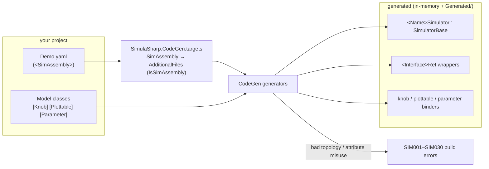

# Project setup

A simulator lives in an ordinary .NET **class library** that references the **`SimulaSharp`** NuGet package and carries
one or more **assembly** YAML files. One package reference brings the whole toolchain — the runtime *and* the
source-generator — so setup is short. This page walks it step by step; the finished `.csproj` is at the end.

## 1. Point NuGet at the SimulaSharp feed

SimulaSharp ships as **NuGet packages** — you don't build it from source to use it. If you restore from nuget.org,
there is nothing to configure: skip to step 2. To use another feed, you decide where the packages come from: a
machine-wide NuGet source, or a `nuget.config` next to your project. A folder feed is the simplest:

```xml
<!-- nuget.config (next to your .csproj) -->
<configuration>
  <packageSources>
    <add key="nuget.org" value="https://api.nuget.org/v3/index.json" />
    <add key="simulasharp" value="C:\path\to\simulasharp\artifacts" />
  </packageSources>
</configuration>
```

Point the `simulasharp` source at wherever the `.nupkg` files live — the `artifacts` folder that the framework's
`pack.ps1` produced, an internal NuGet server, GitHub Packages, etc. (A `nuget.config.sample` in the framework repo
mirrors this.)

## 2. Create the project

```powershell
dotnet new classlib -n MyPlant -f net10.0
cd MyPlant
```

A class library is the right shape: the output is meant to be **packed and loaded by a host**, not launched directly.
(For a throwaway experiment you can use `OutputType=Exe` and a `Main` that drives the lifecycle, but the shipping shape
is a library.)

## 3. Reference SimulaSharp — one package

```xml
<ItemGroup>
    <PackageReference Include="SimulaSharp" Version="0.5.3" />
</ItemGroup>
```

That's the whole reference. `SimulaSharp` is a **meta-package** that pulls in:

- **`SimulaSharp.Kernel`** — the runtime (referenced normally),
- **`SimulaSharp.CodeGen`** — the source-generator, brought in as an **analyzer** with its `<SimAssembly>` build support,
  automatically (it flows through the meta-package as `buildTransitive`). You don't set `OutputItemType="Analyzer"`, and
  you don't import any targets by hand — the package does both.

`SimulaSharp.Hosting` is **not** part of the meta-package: only a host that loads packed simulators needs it.

## 4. Add your assembly file as a `<SimAssembly>`

The YAML that describes your topology is a **first-class build item**. Tag it `<SimAssembly>` so the generator sees it
and the IDE recognizes it as a build action:

```xml
<ItemGroup>
    <SimAssembly Include="Demo.yaml" />
</ItemGroup>
```

The `<SimAssembly>` item type (and the bridge that hands it to the generator) comes from the package, so it just works
after step 3. The file can be named **anything** — the tag is what registers it, not the name; a `.simassembly.yaml`
suffix is a common convention with no special meaning. See the **[Assembly YAML reference](#/guide/assembly-yaml-reference)**
for the schema.

## 5. (Optional) Emit the generated code to disk

By default the generated sources exist only in-memory. To read them — the `<Name>Simulator`, the `<Interface>Ref`
wrappers, the knob/plottable/parameter binders — dump them to a folder and exclude that folder from compilation (the compiler
already has the in-memory copy):

```xml
<PropertyGroup>
    <EmitCompilerGeneratedFiles>true</EmitCompilerGeneratedFiles>
    <CompilerGeneratedFilesOutputPath>Generated</CompilerGeneratedFilesOutputPath>
</PropertyGroup>

<ItemGroup>
    <Compile Remove="Generated/**/*.cs" />
</ItemGroup>
```

## The full csproj

```xml
<Project Sdk="Microsoft.NET.Sdk">

    <PropertyGroup>
        <TargetFramework>net10.0</TargetFramework>
        <OutputType>Exe</OutputType>   <!-- drop for a shipping library -->
        <Nullable>enable</Nullable>
        <ImplicitUsings>enable</ImplicitUsings>
        <EmitCompilerGeneratedFiles>true</EmitCompilerGeneratedFiles>
        <CompilerGeneratedFilesOutputPath>Generated</CompilerGeneratedFilesOutputPath>
    </PropertyGroup>

    <ItemGroup>
        <PackageReference Include="SimulaSharp" Version="0.5.3" />
    </ItemGroup>

    <ItemGroup>
        <!-- Generated/ is a dump for inspection only; the generator also produces these in-memory. -->
        <Compile Remove="Generated/**/*.cs" />
        <!-- The <SimAssembly> item — the file need not be named *.simassembly.yaml. -->
        <SimAssembly Include="Demo.yaml" />
    </ItemGroup>

</Project>
```

> **Building against source instead?** Framework contributors (or a mono-repo) can `ProjectReference`
> `Kernel/Kernel.csproj` normally and `CodeGen/SimulaSharp.CodeGen.csproj` with `OutputItemType="Analyzer"
> ReferenceOutputAssembly="false"`, then `<Import>` `CodeGen/build/SimulaSharp.CodeGen.targets` explicitly (a `ProjectReference` doesn't auto-import package
> build targets). The package path above is what a normal consumer uses.

## What the build wires up

At build time the generator reads your annotated models and each `<SimAssembly>` file and emits the wiring:



With the project set up, move on to **[Build, run & test](#/guide/build-run-test)**.
