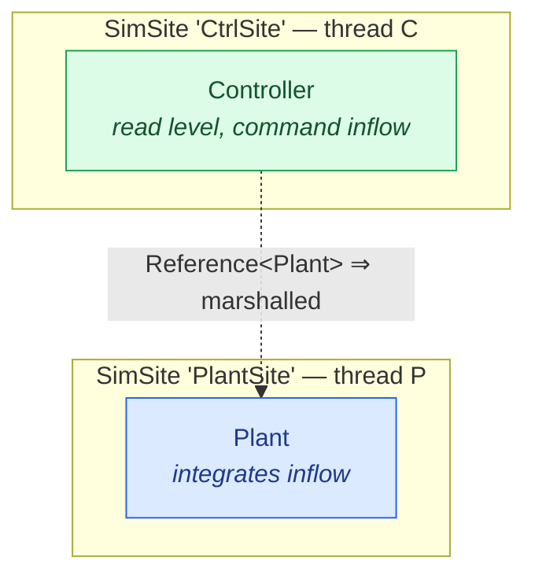
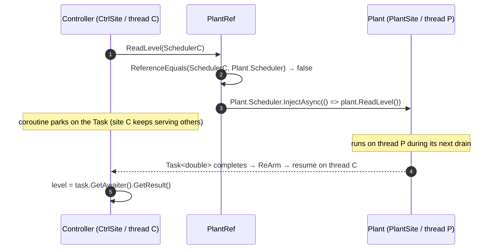

# Controller & plant (cross-site)

Two models, **two sites, two threads**: a **Plant** that integrates an inflow, and a **Controller**
that reads the plant's level and commands its inflow — *across a site boundary*. This is the first
scenario where a call is **marshalled**, and where you must never block a site thread waiting for a
reply. The tool is a [`[References<Plant>]`](#/api/type/SimulaSharp.Kernel.Attributes.ReferencesAttribute`1) reference
and its generated `PlantRef`.

## Topology

The Controller does not *own* the Plant — they are independent roots on separate sites. The link is
a **reference** (non-owning), drawn as a dotted, marshalled edge.



## The plant

An ordinary integrator (see [the integrator scenario](#/guide/scenario-integrator)) with two public
members reachable across sites: `ReadLevel()` and `SetInflow(rate)`. Every public member is surfaced
on the generated `PlantRef`.

```csharp
using System;
using SimulaSharp.Kernel.Attributes;
using SimulaSharp.Kernel.Logging;
using SimulaSharp.Kernel.Model;
using SimulaSharp.Kernel.Services;

namespace Ctrl;

public partial class Plant(IClock c, IScheduler s, ILogger l) : ModelBase(c, s, l)
{
    private long _lastUs;
    private double _inflow;

    [FloatKnob("Level", Min = 0, Max = 10, DecimalPlaces = 2, IsReadOnly = true)]
    [Plottable("Level", Unit = "m")]
    public partial double Level { get; set; }

    public override void Configure()
    {
        _lastUs = TimeKeeper.SimNowUs;
        Scheduler.AddPeriodicEvent(Integrate, periodUs: 50_000);   // 20 Hz plant
    }

    private void Integrate()
    {
        long now = TimeKeeper.SimNowUs;
        double dt = (now - _lastUs) / 1_000_000.0;
        _lastUs = now;
        Level = Math.Max(0.0, Level + _inflow * dt);
    }

    // Surfaced on PlantRef as ReadLevel(callerScheduler) / SetInflow(callerScheduler, rate).
    public double ReadLevel() => Level;
    public void SetInflow(double rate) => _inflow = rate;
}
```

## The controller

The Controller declares `[References<Plant>("Plant")]`; the
[`ReferenceGenerator`](#/api/type/SimulaSharp.CodeGen.ReferenceGenerator) adds a read-only
`IReference<PlantRef> Plant`. You call the plant **through** `Plant`, passing your
**own** `Scheduler` as the caller identity — the accessor decides direct-vs-marshalled from it.

Because the plant is on another site the reply comes back as a `Task`. **Never block the site thread
awaiting it.** The clean pattern is a [coroutine](#/guide/coroutines) that `Await`s the task: the
coroutine parks while the site keeps serving everything else.

```csharp
using System;
using System.Collections.Generic;
using System.Threading.Tasks;
using SimulaSharp.Kernel.Attributes;
using SimulaSharp.Kernel.Logging;
using SimulaSharp.Kernel.Model;
using SimulaSharp.Kernel.Primitives;
using SimulaSharp.Kernel.Services;

namespace Ctrl;

[References<Plant>("Plant")]
public partial class Controller(IClock c, IScheduler s, ILogger l) : ModelBase(c, s, l)
{
    [Parameter(5.0)] public double Target { get; set; }

    public override void Configure()
        => Scheduler.AddCoroutine(ControlLoop, delayUs: 0);

    private IEnumerator<SimYield> ControlLoop()
    {
        while (true)
        {
            // Cross-site read → a Task. Pass MY Scheduler; the accessor marshals it onto PlantSite.
            Task<double> read = Plant[0].ReadLevel(Scheduler);
            yield return SimYield.Await(read);              // park the coroutine, NOT the thread
            double level = read.GetAwaiter().GetResult();   // complete by now — won't block

            double command = Math.Clamp(Target - level, -1.0, 1.0);

            // Command is fire-and-forget: no reply to wait for.
            _ = Plant[0].SetInflow(Scheduler, command);

            yield return SimYield.Delay(100_000);           // 10 Hz control
        }
    }
}
```

> **Not using a coroutine?** The other non-blocking option is
> `Plant[0].ReadLevel(Scheduler).ContinueWith(t => Scheduler.Post(() => Act(t.Result)))` — the
> continuation `Post`s the result back onto *your* site so `Act` runs on your thread. The coroutine
> form just reads better. Either way, **you never `.Result`/`.Wait()` on a site thread.**

## The cross-site call

The single `Plant[0].ReadLevel(Scheduler)` line resolves by comparing schedulers. Here the caller
is on CtrlSite and the target on PlantSite, so it marshals:



## The assembly

Two sites, each with one root model. The Controller's `Refs:` block binds its `Plant` reference to
the plant's dotted instance path, `Loop.Tank` (simulator name + model name).

```yaml
# loop.simassembly.yaml
Simulator:
  Name: Loop
  Sites:
    - Name: PlantSite
      Models:
        - Name: Tank
          Type: Ctrl.Plant
    - Name: CtrlSite
      Models:
        - Name: Ctl
          Type: Ctrl.Controller
          Config: { Target: 5.0 }
          Refs:
            - Plant:
                - Loop.Tank      # <-- dotted instance path of the referenced model
```

Running is the usual lifecycle; the two sites run in parallel and the reference does the rest:

```csharp
using var sim = new LoopSimulator();
sim.Configure();
sim.Start();
sim.Clock.RunFor(5_000_000);     // ~5 s: the level converges toward Target
```

## What to notice

- **Caller-site dispatch.** You always pass **your own** `Scheduler` to a `Ref` call. The accessor
  compares it to the target's: same site → a direct, already-completed `Task`; different site →
  `InjectAsync` onto the target's thread. The *same source line* works either way — correctness
  never depends on where the target lives. See [associations](#/guide/associations).
- **Never block a site thread.** A site is a single thread serving every model on it. Blocking on a
  cross-site `Task` deadlocks that whole site. Park a coroutine (`SimYield.Await`) or `ContinueWith`
  + `Post` instead — the site stays live while the reply is in flight.
- **Ownership vs linkage is a decorator choice.** The Controller uses `[References<Plant>]` (non-owning),
  not `[Contains<Plant>]` — the plant is a peer on another site, not a child in the controller's
  subtree. That single choice *is* the threading decision.
- **This split is a topology decision.** Putting plant and controller on separate sites buys
  parallelism at the cost of a marshal per call. If they chattered every microsecond you'd co-locate
  them; because control is a slow 10 Hz loop, the split is cheap. See
  [choosing a topology](#/guide/choosing-a-topology).

Next: a capability shared by *many* models — **[a shared service](#/guide/scenario-shared-service)**.
