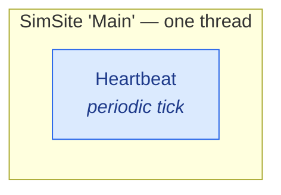
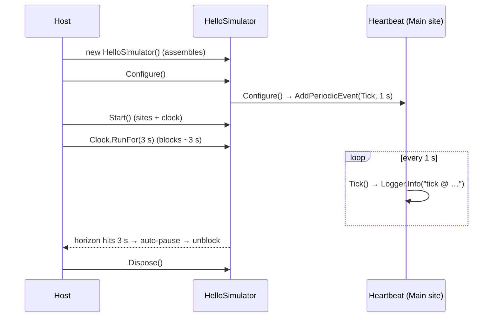

# Hello sim (one model)

The smallest thing that runs: **one model that logs a tick once a second**. No knobs, no
services, no references — just a `ModelBase`, a one-line `Configure()`, and the generated simulator.
This is the skeleton every other scenario grows from.

## Topology

One site, one model. There is nothing to marshal and nothing to wire.



## The model

A model with **no** generated members needs no `partial` and can be `sealed`. It derives
[`ModelBase`](#/api/type/SimulaSharp.Kernel.Model.ModelBase), takes the three injected
dependencies, and arms its work in [`Configure()`](#/guide/models-and-containment).

```csharp
using SimulaSharp.Kernel.Logging;
using SimulaSharp.Kernel.Model;
using SimulaSharp.Kernel.Services;

namespace Hello;

public sealed class Heartbeat(IClock c, IScheduler s, ILogger l) : ModelBase(c, s, l)
{
    // Called once, after the tree is built and wired. Register long-running work here —
    // never in the constructor (see models & containment).
    public override void Configure()
        => Scheduler.AddPeriodicEvent(Tick, periodUs: 1_000_000);   // every 1 s of real time

    // A scheduled action gets NO Δt argument. When it needs "now", it reads the clock.
    private void Tick()
        => Logger.Info($"tick @ {TimeKeeper.SimNowUs} us");
}
```

There is no loop and no `OnTick(dt)` callback: the model **registers** an event and the
[SimSite](#/guide/simsites-and-actors) fires it when the horizon says it is due. Time is *read*
([`TimeKeeper.SimNowUs`](#/api/type/SimulaSharp.Kernel.Services.IClock)), never advanced.

## The assembly

One [`Simulator`](#/guide/the-assembly), one site, one model. The `Name` becomes the generated
class `HelloSimulator`.

```yaml
# hello.simassembly.yaml
Simulator:
  Name: Hello
  Sites:
    - Name: Main
      Models:
        - Name: Beat
          Type: Hello.Heartbeat
```

## The project wiring

The dev project is a **class library** that references the Kernel and runs the CodeGen generator
as an analyzer. The `<SimAssembly>` item registers the assembly file (any name; the `.simassembly.yaml`
suffix is just a convention).

```xml
<Project Sdk="Microsoft.NET.Sdk">
  <PropertyGroup>
    <TargetFramework>net10.0</TargetFramework>
    <Nullable>enable</Nullable>
    <ImplicitUsings>enable</ImplicitUsings>
  </PropertyGroup>

  <ItemGroup>
    <SimAssembly Include="hello.simassembly.yaml" />
  </ItemGroup>

  <ItemGroup>
    <PackageReference Include="SimulaSharp" Version="0.4.0" />
  </ItemGroup>
</Project>
```

> The one `SimulaSharp` meta-package brings the Kernel runtime and the CodeGen analyzer (with its `<SimAssembly>`
> support) automatically. You need a NuGet source that has the packages — see [Project setup](#/guide/project-setup).

## Running it

The generated `HelloSimulator` is an [`ISimulator`](#/api/type/SimulaSharp.Kernel.Services.ISimulator)
with a parameterless constructor. From a test or a throwaway host, walk the
[lifecycle](#/guide/simulator-lifecycle) and drive the [clock](#/guide/time-and-clock) for a bounded run:

```csharp
using var sim = new HelloSimulator();

sim.Configure();                // run each model's Configure() — arms the tick
sim.Start();                    // bring the sites + clock up

sim.Clock.RunFor(3_000_000);    // ~3 s of real time → ~3 ticks, then auto-pause (blocks caller)

// leaving the `using` block Disposes the simulator — it is single-use.
```



## What to notice

- **`Configure()` arms the tick.** Setup lives there, not in the constructor — by the time it runs
  the model is fully built, wired, and configured.
- **Hard real time, 1:1.** `RunFor(3_000_000)` takes *about three seconds of wall-clock time* and
  produces about three ticks. There is no fast-forward — see [time & the clock](#/guide/time-and-clock).
- **`Start()` brings the sites up; `RunFor` bounds the run.** The sites only fire events while
  started; `RunFor` then blocks the caller and auto-pauses at the target horizon.
- **Single-use.** `Dispose()` tears it down for good. To run again, build a **new** `HelloSimulator`
  — there is no reset.

Next: give the model some internal dynamics — **[a stateful integrator](#/guide/scenario-integrator)**.
