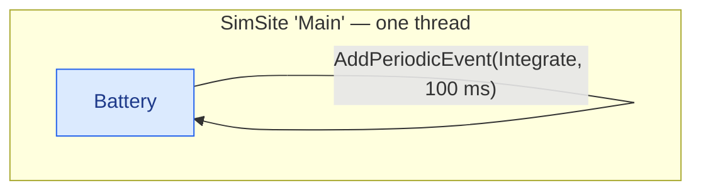
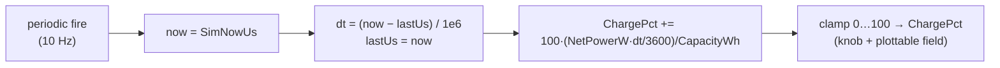

# A stateful integrator

A model with **internal dynamics**: a battery whose charge integrates a net power over time. It
computes its own **Δt** from the clock, exposes the level as a **read-only knob** the operator can
watch, and as a **plottable** the host can graph — the two sharing one backing field.

## Topology

Still one model on one site — the interest is *inside* it: a periodic step that reads the clock,
measures the interval since last time, and advances the state.





## The model

Because it carries generated members (`[Parameter]`, a knob, a plottable) the model is **`partial`**.
The knob property is a `partial` declaration with **no body** — the
[`KnobGenerator`](#/api/type/SimulaSharp.CodeGen.KnobGenerator) materializes the volatile backing
field, and the `[Plottable]` reuses that *same* field.

```csharp
using System;
using SimulaSharp.Kernel.Attributes;
using SimulaSharp.Kernel.Logging;
using SimulaSharp.Kernel.Model;
using SimulaSharp.Kernel.Services;

namespace Power;

public partial class Battery(IClock c, IScheduler s, ILogger l) : ModelBase(c, s, l)
{
    [Parameter(500.0)] public double CapacityWh { get; set; }   // full-charge energy, from the assembly
    [Parameter(-40.0)] public double NetPowerW { get; set; }    // + charging, − draining, from the assembly

    private long _lastUs;                              // your own last-time, to integrate

    // Charge %, driven by the model. Read-only KNOB (operator watches) AND a PLOTTABLE
    // (host graphs). Both attributes share the one volatile backing field the generator emits.
    [NumberKnob<double>("Charge", Min = 0, Max = 100, DecimalPlaces = 1, IsReadOnly = true)]
    [Plottable("Charge", Unit = "%")]
    public partial double ChargePct { get; set; }

    public override void Configure()
    {
        _lastUs = TimeKeeper.SimNowUs;                 // seed the integrator's clock
        ChargePct = 50.0;                              // initial state
        Scheduler.AddPeriodicEvent(Integrate, periodUs: 100_000);   // 10 Hz
    }

    private void Integrate()
    {
        long now = TimeKeeper.SimNowUs;
        double dtSec = (now - _lastUs) / 1_000_000.0;  // <-- compute Δt yourself; no arg is passed
        _lastUs = now;

        double deltaWh = NetPowerW * dtSec / 3600.0;
        double pct = ChargePct + 100.0 * deltaWh / CapacityWh;
        ChargePct = Math.Clamp(pct, 0.0, 100.0);
    }
}
```

## The assembly

`Config` values are filled by the assembly before `Configure()` runs. Here the battery starts with
a 500 Wh cell draining at 40 W.

```yaml
# power.simassembly.yaml
Simulator:
  Name: Power
  Sites:
    - Name: Main
      Models:
        - Name: Batt
          Type: Power.Battery
          Config: { CapacityWh: 500.0, NetPowerW: -40.0 }
```

## Running it — and sampling

`RunFor` pauses at each boundary; a paused clock is simply resumed by the next `RunFor`. That makes
a clean **run-a-bit, sample, repeat** loop. Each sweep of
[`SamplePlottables()`](#/api/type/SimulaSharp.Kernel.Services.ISimulator) reads mission time **once**
and snapshots every plottable against it.

```csharp
using var sim = new PowerSimulator();
sim.Configure();
sim.Start();

for (int i = 0; i < 5; i++)
{
    sim.Clock.RunFor(1_000_000);                       // advance ~1 s of real time, then pause
    var (missionUs, values) = sim.SamplePlottables();  // one consistent, mission-stamped frame
    Console.WriteLine($"{missionUs} us  charge={values["Power.Batt.ChargePct"]:F1} %");
}
```

The plottable is keyed by its **full dotted path**, `Power.Batt.ChargePct` — the simulator name,
the model instance name, then the member. The read-only knob of the same value is available on
`sim.Knobs` under the identical path, ready for an [`IKnobChannel`](#/guide/observability) to bind.

## What to notice

- **No Δt argument — ever.** A scheduled action is a *timeless callback*. To integrate, stamp
  `_lastUs` yourself and subtract on the next fire. This is a direct consequence of *time is
  published, not pushed* (see [time & the clock](#/guide/time-and-clock)).
- **Absolute-grid periodics don't drift.** `AddPeriodicEvent` re-arms on an absolute grid, so
  measuring `now − _lastUs` gives you the true elapsed interval even if a fire lands a hair late.
- **Knob and plottable coexist on one field.** The `[NumberKnob<double>]` materializes the volatile backing
  field; `[Plottable]` only *references* it for its `Sample` delegate — one source of truth, no
  duplication. A read-only float is thus an operator indicator *and* a graphed series at once.
- **Sampling is pull, not push.** The kernel never streams plot data. You sweep with
  `SamplePlottables()` at whatever cadence you like; a slow or absent consumer costs the sim nothing.
  See [observability](#/guide/observability).

Next: split the dynamics from its controller across two threads —
**[controller & plant](#/guide/scenario-controller-plant)**.
