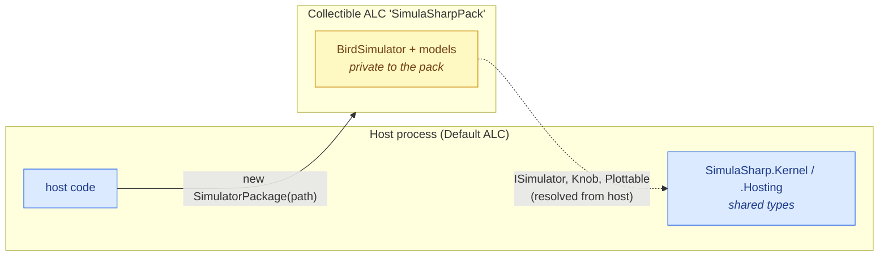
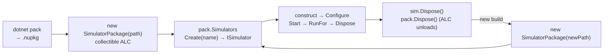

# Pack & load

A finished simulator is a class library. To hand it to a **host** — ultimately the MMI — you
**pack** it as a `.nupkg` and load it with
[`SimulatorPackage`](#/api/type/SimulaSharp.Hosting.SimulatorPackage), which drops it into a
*collectible* assembly load context so the host can discover it, create one, run the lifecycle, and
later **unload and reload** it without restarting. This is the mechanism a hot-reloading MMI is built
on.

## Topology

There is no model topology here — the "topology" is the host↔pack boundary: the pack's own code loads
privately into a collectible context, while the `SimulaSharp.*` framework types are **shared** from
the host so [`ISimulator`](#/api/type/SimulaSharp.Kernel.Services.ISimulator), `Knob`, `Plottable`
and `LogEntry` have one identity across the seam.



## Pack it

`dotnet pack` builds the library and its generated simulators into a NuGet package. The pack's
`lib/<tfm>/` payload is what `SimulatorPackage` extracts. A pack target that comes with the
`SimulaSharp` package adds the project's `.deps.json` and private dependency DLLs to that folder, and
leaves the `SimulaSharp.*` assemblies out (see [packing & hosting](#/guide/packing-and-hosting)).

```bash
dotnet pack Bird.csproj -c Release
#  → bin/Release/Bird.1.0.0.nupkg
#     lib/net10.0/Bird.dll
#     lib/net10.0/Bird.deps.json
```

The loader takes the main assembly name from the package id, so keep the `PackageId` equal to the
`AssemblyName` (the default).

## Load, discover, run

The host is a separate project. The loader lives in its own package, `SimulaSharp.Hosting`, which is
**not** part of the `SimulaSharp` meta-package; it brings `SimulaSharp.Kernel` with it.

```xml
<ItemGroup>
  <PackageReference Include="SimulaSharp.Hosting" Version="0.5.3" />
</ItemGroup>
```

`SimulatorPackage` accepts a `.nupkg`, a build-output **directory**, or a single `.dll`. It scans for
public, non-abstract `SimulatorBase` subclasses with a parameterless constructor — the generated
`<Name>Simulator` types — and lists them by **name** (the type name minus the trailing `Simulator`).
`Create` looks the name up case-insensitively.

```csharp
using SimulaSharp.Hosting;
using SimulaSharp.Kernel.Services;

// 1 ── LOAD: shadow-copies the payload and loads it into a collectible ALC.
using var pack = new SimulatorPackage("bin/Release/Bird.1.0.0.nupkg");

// 2 ── DISCOVER: the simulators found in the pack, by name.
Console.WriteLine(string.Join(", ", pack.Simulators));   // e.g. "Bird"

// 3 ── CREATE: a fresh ISimulator instance. The caller owns its lifecycle.
ISimulator sim = pack.Create("Bird");

// 4 ── RUN: the usual lifecycle (register any log sinks / knob channel first,
//    and tune parameters with GetParams()/SetParam() before Configure()).
sim.RegisterLogSink(new ConsoleSink());   // your ILogSink
sim.Configure();
sim.Start();
sim.RunFor(5_000_000);              // a bounded ~5 s run; blocks, then the clock pauses

// 5 ── TEAR DOWN: dispose the simulator (single-use) BEFORE the pack.
sim.Dispose();
// leaving the `using` disposes `pack`, which unloads the ALC and removes the shadow copy.
```

## Reload

Reload is aligned with the framework's **single-use** rule: there is no in-place model swap. You
dispose the old simulator, dispose the pack (unloading its ALC), then construct a **new**
`SimulatorPackage` over the new build and create afresh.

```csharp
ISimulator sim  = pack.Create("Bird");
// … construct → Configure → Start → RunFor → Dispose …
sim.Dispose();          // 1. dispose the simulator you created
pack.Dispose();         // 2. dispose the pack → ALC unloads, shadow copy removed

// 3. a new build arrives; load it into a brand-new context
using var pack2 = new SimulatorPackage("bin/Release/Bird.1.0.1.nupkg");
ISimulator sim2 = pack2.Create("Bird");
// … run the fresh instance …
sim2.Dispose();
```



## What to notice

- **Collectible ALC.** The pack loads into a collectible
  `AssemblyLoadContext`; `pack.Dispose()` unloads it, forces a few GC passes, and deletes the shadow
  copy (`pack.ShadowDirectory`). The payload is **shadow-copied** to a temp folder first, so the
  original build can be rebuilt while a copy runs. If something still pins the context, the delete
  keeps failing and the shadow folder is left behind.
- **Shared framework types.** Every `SimulaSharp.*` assembly resolves from the host's Default context,
  not the pack. That is what gives `ISimulator`/`Knob`/`Plottable`/`LogEntry` a **single type
  identity** across the boundary — the host can hold the `ISimulator` the pack created and call it
  directly.
- **Ordering matters on teardown.** Dispose the **simulator first**, then the pack. A live
  `ISimulator` keeps the context pinned until it is collected; the shadow dll stays locked on Windows
  until the unload completes.
- **Single-use reload.** There is no reset and no hot-swap of a running model tree — reload is
  *dispose old, load new*, exactly mirroring the [clock's](#/guide/time-and-clock) single-use
  discipline. A fresh instance gives you clean state for free.

That closes the loop: you authored [models](#/guide/models-and-containment) and
[services](#/guide/services), described a [topology](#/guide/the-assembly), the generator built a
simulator, and packing makes it something a host can load, run, and reload. For the deeper hosting
story see [packing & hosting](#/guide/packing-and-hosting).
