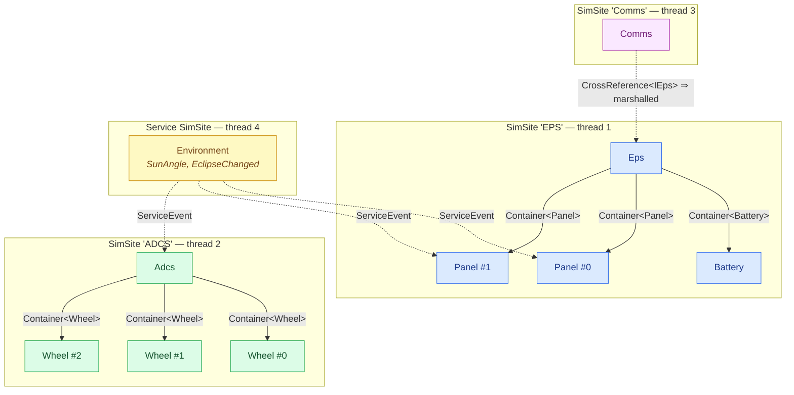

# A satellite topology

The capstone. Everything so far — containment, references, services, knobs, plottables — assembled
into the shape a **real** multi-subsystem simulator takes: a small satellite with an **EPS** (power)
subsystem, an **ADCS** (attitude) subsystem, a **Comms** subsystem, and a shared **Environment**
service. The point of this page is not new API; it is **judgement** — how you partition a system
into sites, and what you expose.

## Topology

Three model subtrees, each a root on its own site (its own thread), plus one service on its own
thread. Coloured by site; ownership edges are solid, cross-site references dotted.



## The model set (elided)

The full bodies are the same integrator/subscriber/reference patterns from the earlier scenarios;
here are the shapes and what each exposes. Every model and service is **`partial`** — the generator
adds code to each of them, and a non-`partial` one is a build error (`SIM029`).

```csharp
namespace Bird;

// ── EPS subtree (site 'EPS') ──────────────────────────────────────────────────
// Cross-references target an interface: the surface reached across sites lives on IEps.
public interface IEps { double ReadStateOfCharge(); }

[Contains<Battery>("Batteries")]                            // owned, same site → direct calls
[Contains<Panel>("Panels")]
public partial class Eps(IClock c, IScheduler s, ILogger l) : ModelBase(c, s, l), IEps
{
    [NumberKnob<double>("Bus voltage", Min = 0, Max = 32, DecimalPlaces = 2, IsReadOnly = true)]
    [Plottable("Vbus", Unit = "V")]
    public partial double Vbus { get; set; }

    // Reached across sites by Comms via IEpsRef.
    public double ReadStateOfCharge() => Batteries[0].ChargePct;

    public override void Configure() =>
        Scheduler.AddPeriodicEvent(Balance, periodUs: 100_000);   // sum panels − loads, drive Vbus

    private void Balance() { /* direct, lock-free calls into Batteries / Panels (same subtree) */ }
}

public partial class Battery(IClock c, IScheduler s, ILogger l) : ModelBase(c, s, l)
{
    [Parameter(1500.0)] public double CapacityWh { get; set; }
    [NumberKnob<double>("Charge", Min = 0, Max = 100, DecimalPlaces = 1, IsReadOnly = true)]
    [Plottable("Charge", Unit = "%")]
    public partial double ChargePct { get; set; }        // integrates net power (see the integrator scenario)
}

public partial class Panel(IClock c, IScheduler s, ILogger l) : ModelBase(c, s, l)
{
    [ServiceRef] public Environment Environment { get; set; } = null!;
    [Plottable("Generated", Unit = "W")] public partial double GeneratedW { get; set; }
    // Configure(): Environment.RegisterCallback_SunAngle(Scheduler, a => GeneratedW = …);
}

// ── ADCS subtree (site 'ADCS') ────────────────────────────────────────────────
[Contains<Wheel>("Wheels")]
public partial class Adcs(IClock c, IScheduler s, ILogger l) : ModelBase(c, s, l)
{
    [ServiceRef] public Environment Environment { get; set; } = null!;   // reacts to eclipse
    [NumberKnob<int>("Mode", Min = 0, Max = 3)] public partial int Mode { get; set; }   // read/write
    [Plottable("Rate error", Unit = "deg/s")] public partial double RateError { get; set; }
}

public partial class Wheel(IClock c, IScheduler s, ILogger l) : ModelBase(c, s, l)
{
    [Parameter(0.02)] public double Inertia { get; set; }
    [NumberKnob<double>("RPM", Min = -6000, Max = 6000, IsReadOnly = true)]
    [Plottable("RPM")] public partial double Rpm { get; set; }
}

// ── Comms subtree (site 'Comms') ──────────────────────────────────────────────
[CrossReference<IEps>("Power")]                      // cross-site link → IEpsRef
public partial class Comms(IClock c, IScheduler s, ILogger l) : ModelBase(c, s, l)
{
    [TickBoxKnob("Transmit")] public partial bool Transmit { get; set; }
    // Configure(): a coroutine that Awaits Power[0].ReadStateOfCharge() before keying up.
}

// ── Environment service (its own site) ────────────────────────────────────────
[ServiceEvent("SunAngle", typeof(double))]
[ServiceEvent("EclipseChanged", typeof(bool))]
public partial class Environment(IClock c, ILogger l) : ServiceBase(c, l, "Environment")
{
    [ServiceRequest] protected double Handle_CurrentAngle() => /* … */ 0.0;
}
```

## The assembly

The full structure, showing every kind of node — services, nested sites, containment (`Models:`
lists of `{ containerName: [children] }`), a cross-site reference (`CRefs:`), service bindings
(`Deps:`), and parameter values (`Config:`).

```yaml
# bird.simassembly.yaml
Simulator:
  Name: Bird
  MissionStart: 2027-03-01T00:00:00      # mission epoch for MissionNowUs; default is the Unix epoch
  Services:
    - Name: Environment
      Type: Bird.Environment
  Sites:
    - Name: EPS
      MaxEvents: 2048                     # bump the queue for a busy subtree
      Models:
        - Name: Power
          Type: Bird.Eps
          Models:
            - Batteries:
                - Name: Batt0
                  Type: Bird.Battery
                  Config: { CapacityWh: 1500.0 }
            - Panels:
                - Name: PanelPX
                  Type: Bird.Panel
                  Deps: [ { Environment: Environment } ]
                - Name: PanelNX
                  Type: Bird.Panel
                  Deps: [ { Environment: Environment } ]

    - Name: ADCS
      Models:
        - Name: Attitude
          Type: Bird.Adcs
          Deps: [ { Environment: Environment } ]
          Models:
            - Wheels:
                - { Name: WheelX, Type: Bird.Wheel, Config: { Inertia: 0.02 } }
                - { Name: WheelY, Type: Bird.Wheel, Config: { Inertia: 0.02 } }
                - { Name: WheelZ, Type: Bird.Wheel, Config: { Inertia: 0.02 } }

    - Name: Comms
      Models:
        - Name: Radio
          Type: Bird.Comms
          CRefs:
            - Power:
                - Bird.Power              # cross-site reference to the Eps root
```

Running it is the plain [lifecycle](#/guide/simulator-lifecycle); all four threads run in parallel:

```csharp
using Bird;

using var sim = new BirdSimulator();
sim.Configure();
sim.Start();
sim.RunFor(60_000_000);                  // one real minute of flight
```

## Why this partition

The site boundaries *are* the design. Each choice is a threading and coupling decision:

- **EPS is one subtree** (Eps → Batteries + Panels). The power balance reads every panel and battery
  many times a step; those must be **cheap, direct, lock-free** calls, so they share a site. See
  [modeling a subsystem](#/guide/modeling-a-subsystem).
- **ADCS is a separate root.** Attitude runs a fast control loop on wheels that has *nothing* to do
  with the power balance — independent work, so give it its **own thread** and run it in parallel.
- **Comms is a third root** and links to EPS with a `[CrossReference<IEps>]`, not containment: it merely
  *asks* the power state before transmitting. That is an occasional, marshalled cross-site call — the
  right cost for a loose, infrequent coupling. Contrast with the tight EPS-internal calls above.
- **Environment is a service, not a model.** Sun angle and eclipse are shared by panels *and* ADCS,
  owned by none — the textbook case for a [service](#/guide/services). Broadcasting via
  `[ServiceEvent]` fans one update out to every subscriber's own thread. (A notification with no
  owning service at all, raised from many places, is a [global event](#/guide/events) instead.)

The rule of thumb: **things that chatter share a site; things that are independent get their own;
things shared by many with a life of their own become a service.** The full reasoning is in
[choosing a topology](#/guide/choosing-a-topology).

## What to expose

- **Plottables** for anything you'd chart over time: `Vbus`, each battery's `ChargePct`, wheel
  `Rpm`, `RateError`, panel `GeneratedW`. They cost nothing until swept.
- **Read-only knobs** for live indicators the operator watches but cannot set (`Vbus`, `Charge`,
  `Rpm`).
- **Read/write knobs** for the few things an operator drives: ADCS `Mode`, Comms `Transmit`.
- **Parameters** (`[Parameter]`, set from the `Config:` block) for build-time constants that vary
  per instance: battery `CapacityWh`, wheel `Inertia`. They are listed by `sim.GetParams()` and can
  be overridden with `sim.SetParam(...)` before `Configure()`.

## What to notice

- **This is the shape a real port takes.** A subsystem tree, a couple of independent control loops on
  their own threads, a loose cross-site link, and a shared environment. Nothing here is new — it is
  the earlier scenarios composed.
- **Boundaries are your parallelism *and* your locking story.** You never write a lock; you *choose*
  a partition, and the framework serializes each site for you.
- **The generator checks the whole thing.** An unknown type (`SIM004`), a container/element mismatch
  (`SIM008`), a dangling `CRefs:` path (`SIM011`), a `Deps:` entry naming a missing service
  (`SIM014`) — each is a **compile error** (the full range is `SIM001`–`SIM030`), not a runtime
  surprise.

Next: ship it — **[pack & load](#/guide/scenario-pack-and-load)**.
