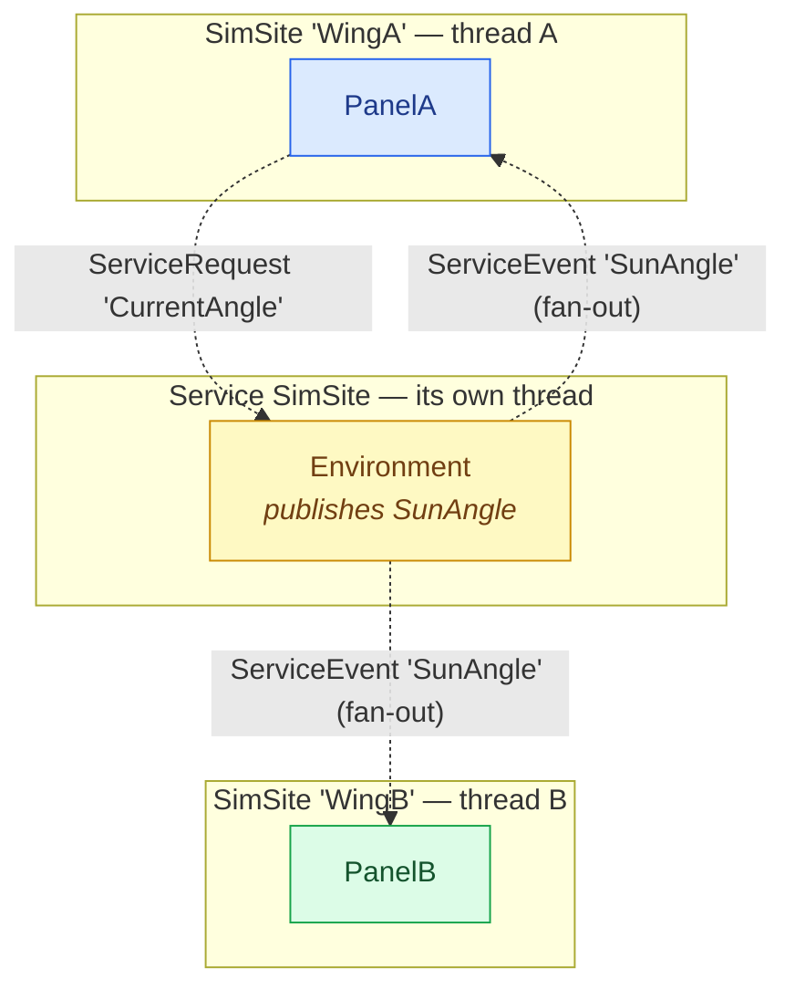

# A shared service

Some state belongs to *no single model*. Here an **Environment** service publishes a slowly-changing
sun angle that **several panels** — on different sites — react to, plus a request/response for models
that want to *ask* the current value. This is the [service](#/guide/services) pattern: a capability
on its own thread, reached only by marshalled calls, wired to models by name.

## Topology

The service is **not** in any model subtree; it owns its own SimSite. Every model↔service call is
cross-thread, always. Two panels on two sites both subscribe.



## The service

A service derives [`ServiceBase`](#/api/type/SimulaSharp.Kernel.Model.ServiceBase) (ctor takes the
clock, a logger, and a diagnostic **name**) and is **`partial`** so the
[`ServiceGenerator`](#/api/type/SimulaSharp.CodeGen.ServiceGenerator) can weave in the plumbing. It
declares a publish channel with a class-level `[ServiceEvent]` and a request entry point with a
method-level `[ServiceRequest]`.

```csharp
using SimulaSharp.Kernel.Attributes;
using SimulaSharp.Kernel.Logging;
using SimulaSharp.Kernel.Model;
using SimulaSharp.Kernel.Services;

namespace Env;

[ServiceEvent("SunAngle", typeof(double))]     // publish OUT: pub/sub, fire-and-forget
public partial class Environment(IClock c, ILogger l) : ServiceBase(c, l, "Environment")
{
    private double _angle;

    public override void Configure()
        => Scheduler.AddPeriodicEvent(Advance, periodUs: 500_000);   // 2 Hz update

    private void Advance()
    {
        _angle = (_angle + 5.0) % 360.0;
        Trigger_SunAngle(_angle);              // generated: Posts to every subscriber's site
    }

    // Request IN: a model may ASK for the current value and get an answer back.
    [ServiceRequest]                            // -> public Task<double> CurrentAngle()
    protected double Handle_CurrentAngle() => _angle;
}
```

For `[ServiceEvent("SunAngle", typeof(double))]` the generator emits a public
`RegisterCallback_SunAngle(IScheduler, Action<double>)` (subscribers call it with **their own**
scheduler) and a protected `Trigger_SunAngle(double)` (the service calls it to publish). For the
request it emits a public `CurrentAngle()` that marshals onto the service's own site.

## A client model

A model gets its handle through a **settable** [`[ServiceRef]`](#/guide/services) member, bound by
the assembly's `Deps:` — *by service name*. In `Configure()` it subscribes, passing its **own**
`Scheduler` so the callback lands on its site; it may also make requests.

```csharp
using System;
using System.Collections.Generic;
using System.Threading.Tasks;
using SimulaSharp.Kernel.Attributes;
using SimulaSharp.Kernel.Logging;
using SimulaSharp.Kernel.Model;
using SimulaSharp.Kernel.Primitives;
using SimulaSharp.Kernel.Services;

namespace Env;

public partial class Panel(IClock c, IScheduler s, ILogger l) : ModelBase(c, s, l)
{
    [ServiceRef] public Environment Environment { get; set; } = null!;   // wired by the assembly, by name

    [NumberKnob<double>("Output", Min = 0, Max = 1, DecimalPlaces = 2, IsReadOnly = true)]
    [Plottable("Output", Unit = "kW")]
    public partial double Output { get; set; }

    public override void Configure()
    {
        // Subscribe: pass MY scheduler so OnSunAngle runs on MY site.
        Environment.RegisterCallback_SunAngle(Scheduler, OnSunAngle);
        Scheduler.AddCoroutine(Poll, delayUs: 1_000_000);   // also demonstrate a request
    }

    // Delivered on the Panel's OWN site thread — free to touch model state.
    private void OnSunAngle(double angleDeg)
        => Output = Math.Max(0.0, Math.Cos(angleDeg * Math.PI / 180.0));

    private IEnumerator<SimYield> Poll()
    {
        while (true)
        {
            Task<double> req = Environment.CurrentAngle();   // marshalled onto the service site
            yield return SimYield.Await(req);
            double angle = req.GetAwaiter().GetResult();
            Logger.Trace($"polled angle = {angle:F0} deg");
            yield return SimYield.Delay(2_000_000);
        }
    }
}
```

## The fan-out

When the service triggers the event, the channel `Post`s each subscriber's callback onto **that
subscriber's** site — so `OnSunAngle` runs on the panel's thread, never the service's.

```mermaid
sequenceDiagram
  autonumber
  participant Env as Environment (service site)
  participant Ch as ServiceEventChannel&lt;double&gt;
  participant A as PanelA (WingA)
  participant B as PanelB (WingB)
  Note over A,B: at Configure(), each registered ITS OWN scheduler
  A->>Ch: RegisterCallback_SunAngle(SchedulerA, OnSunAngle)
  B->>Ch: RegisterCallback_SunAngle(SchedulerB, OnSunAngle)
  Note over Env: on the service thread, 2 Hz
  Env->>Ch: Trigger_SunAngle(angle)
  Ch->>A: SchedulerA.Post(() => OnSunAngle(angle))
  Ch->>B: SchedulerB.Post(() => OnSunAngle(angle))
  Note over A: runs on thread A
  Note over B: runs on thread B
```

## The assembly

Services are declared under `Services:` (name + fully-qualified type). Each model binds its
`[ServiceRef]` member to a service **by name** in its `Deps:` block. Here both panels depend on the
one `Environment`.

```yaml
# env.simassembly.yaml
Simulator:
  Name: Sat
  Services:
    - Name: Environment
      Type: Env.Environment
  Sites:
    - Name: WingA
      Models:
        - Name: PanelA
          Type: Env.Panel
          Deps:
            - Environment: Environment    #  <ServiceRef member> : <service Name>
    - Name: WingB
      Models:
        - Name: PanelB
          Type: Env.Panel
          Deps:
            - Environment: Environment
```

## What to notice

- **A service is its own actor.** It owns a SimSite, so **every** model↔service call is cross-thread
  and marshalled — there is no same-site fast path the way there is for a `[CrossReference<T>]`. That is the
  price of a capability any number of models can share safely.
- **Two directions, two mechanisms.** `[ServiceEvent]` is publish/subscribe, **fire-and-forget**
  (no result) — perfect for "something changed", fanned out to many. `[ServiceRequest]` is
  request/response, optionally returning `Task<T>` — for when a model needs an *answer*. Prefer the
  event for broadcast; reserve the request for genuine round-trips.
- **You pass your own scheduler to subscribe.** `RegisterCallback_*` records *(your scheduler, your
  callback)*, which is how delivery lands on *your* site. The callback then runs on your thread, so
  it can touch your model's state lock-free.
- **A service centralizes — so it can bottleneck.** All requests serialize on the one service thread.
  Broadcast with events; don't have every model hammer a synchronous request each tick. See
  [interaction patterns](#/guide/interaction-patterns) and [model vs service](#/guide/model-vs-service).

Next: put it all together — **[a satellite topology](#/guide/scenario-satellite)**.
