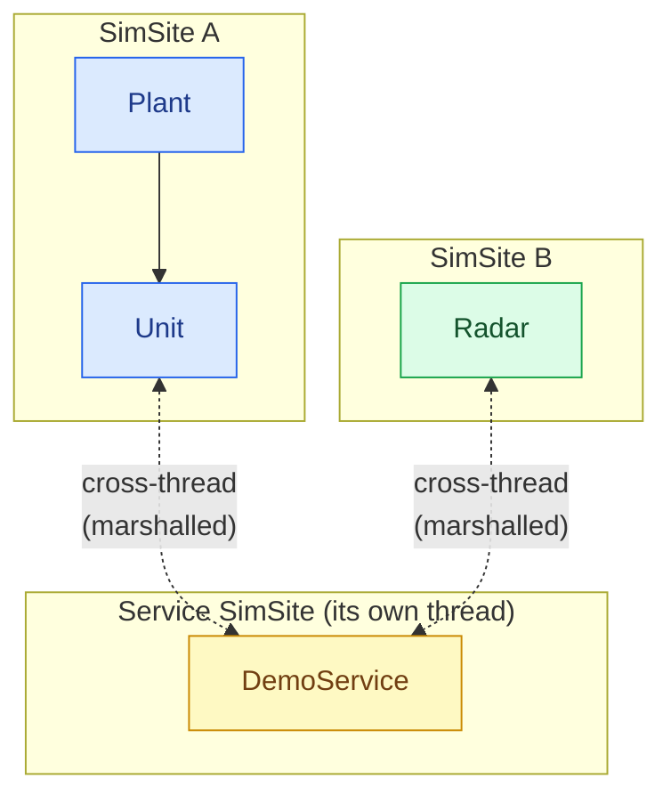
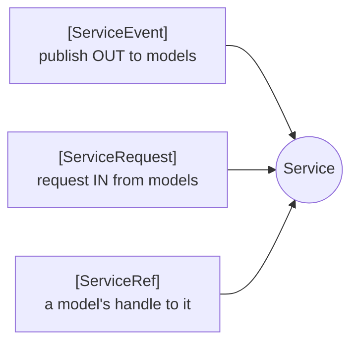
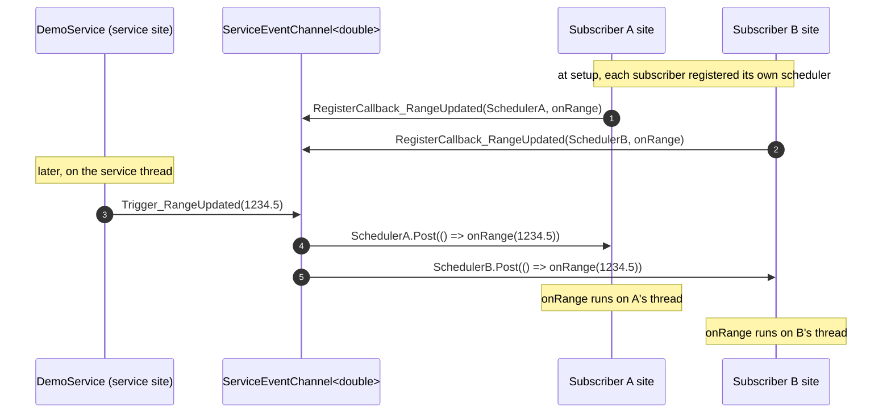
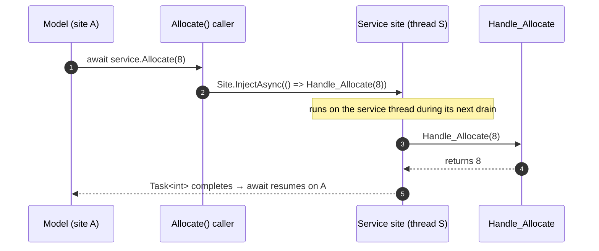
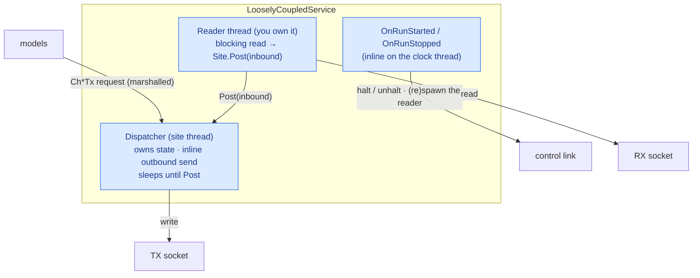

# Services

Some capabilities do not belong to any one model. A shared bus, a central catalogue, an environment provider, a
comms relay — things that *many* models depend on, that have their own state and their own life. In SimulaSharp those
are **services**: a distinct authoring artifact from a model, with a distinct threading contract.

## What a service is, and when to reach for one

A service is a reusable capability that models depend on. It derives from
[`ServiceBase`](#/api/type/SimulaSharp.Kernel.Model.ServiceBase) (implementing
[`IService`](#/api/type/SimulaSharp.Kernel.Model.IService)) and — this is the defining fact — it owns its **own
SimSite**, created from the clock in its constructor. It is not part of any model subtree.



- **Key point.** Because a service is *never* in a model's subtree, **every model↔service call is cross-thread** and
  marshalled — always. There is no "same-site fast path" the way there is for a `[References<T>]`. That is the price and
  the point: a service is a genuinely independent actor that any number of models can share safely.

Reach for a service when a capability is **shared by many models** and has a **life of its own**. Reach for a plain
model (owned via `Container<T>`) or a `[References<T>]` when the thing is really part of one subtree, or a point-to-point
link. The full judgement call is in [model vs service](#/guide/model-vs-service).

## `ServiceBase`

The base takes the clock, a logger, and a **name** (diagnostic, used for its SimSite), and optionally the site's
queue capacity. It creates the site for you:

```csharp
using SimulaSharp.Kernel.Attributes;
using SimulaSharp.Kernel.Logging;
using SimulaSharp.Kernel.Model;
using SimulaSharp.Kernel.Services;

public partial class DemoService : ServiceBase
{
    public DemoService(IClock c, ILogger l) : base(c, l, name: "demo") { }

    public override void Configure() { /* arm long-running work on Scheduler */ }
}
```

| Member | What it is |
|---|---|
| `TimeKeeper` | The shared simulation clock (read "now" — read-only, a service cannot control it). |
| `Logger` | The service's component-scoped logger. |
| `Site` | The service's **own** site, as an [`IDispatcherSite`](#/api/type/SimulaSharp.Kernel.Services.IDispatcherSite) — its **marshalling** surface. Every call into the service is marshalled onto it. It is what the generated `[ServiceRequest]`/`[ServiceEvent]` plumbing targets. |
| `Scheduler` | *(protected)* the **same** site seen as an [`IScheduler`](#/api/type/SimulaSharp.Kernel.Services.IScheduler) — its sim-time facet. Arm long-running events here in `Configure()`. Only the service author sees it; callers only ever get `Site`. |
| `Configure()` / `Dispose()` | Same hooks as a model — setup after wiring, deinit after the site stops. |

> **Why two facets of one site?** `Site` (an `IDispatcherSite`) exposes only *marshalling* — `Post`/`Inject*` — and
> the lifecycle the simulator drives; `Scheduler` (an `IScheduler`) adds the sim-time queue and is **protected**, so a
> caller holding a service can marshal work to it but can neither schedule on nor start/stop its site. This is the same
> capability-segregation split described in [sites & dispatch](#/guide/sites-and-dispatch).

Like a model that uses codegen, a service **must be `partial`** — the
[`ServiceGenerator`](#/api/type/SimulaSharp.CodeGen.ServiceGenerator) weaves the interaction plumbing into it. The
service never starts, stops or disposes its own site; the simulator owns every site's lifecycle.

A service talks to the world through three class-level, generator-owned attributes:



## `[ServiceEvent]` — publish out to models

[`[ServiceEvent("Name", typeof(T)?)]`](#/api/type/SimulaSharp.Kernel.Attributes.ServiceEventAttribute) is a class-level,
**repeatable** attribute declaring a **fire-and-forget publish point** — a pub/sub channel *from the service out to
models*. The service author writes no plumbing; the generator emits all of it, backed by a
[`ServiceEventChannel`](#/api/type/SimulaSharp.Kernel.Services.ServiceEventChannel).

```csharp
[ServiceEvent("Tick")]                    // payload-less
[ServiceEvent("RangeUpdated", typeof(double))]   // carries a double
public partial class DemoService : ServiceBase
{
    public DemoService(IClock c, ILogger l) : base(c, l, "demo") { }

    public override void Configure()
        => Scheduler.AddPeriodicEvent(() => Trigger_RangeUpdated(NextRange()), 100_000);

    private double NextRange() => /* … */ 0.0;
}
```

For `[ServiceEvent("RangeUpdated", typeof(double))]` the generator emits:

```csharp
public void RegisterCallback_RangeUpdated(IDispatcher dispatcher, Action<double> callback);  // subscribers call this
protected void Trigger_RangeUpdated(double value);                                           // the service calls this
```

- **`RegisterCallback_<Name>`** is **public** — a subscriber calls it, **passing its own dispatcher**. A model just
  passes its `Scheduler` (an `IScheduler` *is* an [`IDispatcher`](#/api/type/SimulaSharp.Kernel.Services.IDispatcher)).
  The channel remembers `(subscriberDispatcher, callback)`. That is how delivery lands on the *subscriber's* site.
- **`Trigger_<Name>`** is **protected** — the service calls it to publish. It `Post`s each subscriber's callback onto
  *that subscriber's* dispatcher, fire-and-forget.
- Payload-less events (`[ServiceEvent("Tick")]`) generate the argument-free forms:
  `RegisterCallback_Tick(IDispatcher, Action)` and `Trigger_Tick()`.

Events are **always fire-and-forget** — they carry no result. A result would force synchronous cross-thread execution,
which the design does not allow; if a model needs to send something back, it uses a `[ServiceRequest]` instead.

### Fan-out of a `[ServiceEvent]`



The subscriber list is copy-on-write, so triggering is lock-free and registration is safe from any thread.

## `[ServiceRequest]` — request into the service

[`[ServiceRequest(name?)]`](#/api/type/SimulaSharp.Kernel.Attributes.ServiceRequestAttribute) is a **method-level**
attribute marking a **request/response entry point** — a channel *from models into the service*. You write the handler,
named `Handle_<RequestName>`; the generator strips the `Handle_` prefix (unless `name` overrides it) and emits the
public caller.

```csharp
public partial class DemoService : ServiceBase
{
    // handlers run on the SERVICE's site
    [ServiceRequest]                                   // request "Register"
    protected void Handle_Register(int unitId) { /* mutate service state */ }

    [ServiceRequest]                                   // request "Allocate"
    protected int Handle_Allocate(int want) => want;   // may return a value
}
```

The generator emits public callers that marshal onto the service's own site:

```csharp
public Task Register(int unitId) => Site.InjectVoidAsync(() => Handle_Register(unitId));
public Task<int> Allocate(int want) => Site.InjectAsync(() => Handle_Allocate(want));
```

- The handler may take **at most one argument** (a single optional context) and may **return a value** — a handler with
  more than one parameter is a build error ([SIM022](#/guide/assembly-yaml-reference)).
- A `void` handler → a `Task`-returning caller (via `InjectVoidAsync`); a value handler → a `Task<T>`-returning caller
  (via `InjectAsync`).
- The caller marshals onto **`Site`** — the *service's* own site (via the common `IDispatcher` facet) — so the handler
  always runs on the service thread regardless of which model called it. No locks in the handler. Marshalling through
  `Site` (not the sim-time `Scheduler`) is exactly why the same plumbing works on a
  [loosely-coupled service](#loosely-coupled-io-services) too, whose site has no sim-time queue.

### A `[ServiceRequest]` round-trip



## `[ServiceRef]` — how a model gets a handle

A model does not `new` a service or fish it out of a registry. It declares a **settable** member marked
[`[ServiceRef]`](#/api/type/SimulaSharp.Kernel.Attributes.ServiceRefAttribute), and the
[assembly](#/guide/the-assembly)'s `Deps` block binds it **by service name**. The generated simulator sets the member
to the named service instance during assembly, before `Configure()`.

```csharp
public partial class Plant(IClock c, IScheduler s, ILogger l) : ModelBase(c, s, l)
{
    [ServiceRef] public DemoService Tracker { get; set; } = null!;   // wired by the assembly, by name

    public override void Configure()
    {
        // Subscribe: pass MY scheduler so the callback lands on MY site.
        Tracker.RegisterCallback_RangeUpdated(Scheduler, OnRange);
    }

    private void OnRange(double range) { /* runs on the Plant's site */ }

    public async Task Kick()
    {
        await Tracker.Register(unitId: 1);              // marshalled onto the service site
        int got = await Tracker.Allocate(want: 8);      // request/response, awaited
    }
}
```

- **Key point.** The member is typed as the concrete service (`DemoService`), so once wired, the model calls the
  generated interaction surface directly: `RegisterCallback_*` to subscribe to events, and the `X(..)` callers to make
  requests. The `[ServiceRef]` must be settable because the simulator assigns it during wiring.

### Services can depend on services — even cyclically

A `[ServiceRef]` is not a model-only member: **a service can hold one to another service**, declared with a `Deps`
block on its own `Services:` entry, exactly as a model does. Because every model↔service and service↔service call is
already cross-thread and marshalled, a service simply calls its dependency's generated surface like any other caller.

**Cycles are allowed** — service A may reference B while B references A. The simulator constructs *every* service before
it binds *any* dependency, so a cycle resolves cleanly by setter injection; neither constructor needs the other to exist
yet. Do the actual wiring-dependent work (subscribing to the peer's events, first requests) in `Configure()`, which runs
only after every ref is bound.

```yaml
Services:
  - Name: A
    Type: Demo.SvcA
    Deps:
      - Peer: B        # SvcA.[ServiceRef] Peer ← service B
  - Name: B
    Type: Demo.SvcB
    Deps:
      - Peer: A        # SvcB.[ServiceRef] Peer ← service A  (the cycle)
```

## The whole picture

```mermaid
flowchart TB
  subgraph model ["Model (its own site)"]
    direction TB
    reg["Configure():<br/>RegisterCallback_X(Scheduler, cb)"]
    call["await service.Request(arg)"]
    cb["cb(payload) runs here"]
  end
  subgraph service ["Service (its own site)"]
    direction TB
    trig["Trigger_X(payload)"]
    handle["Handle_Request(arg)"]
  end
  reg -->|"subscribe (with my scheduler)"| trig
  trig -->|"Post → my site"| cb
  call -->|"InjectAsync → service site"| handle
  handle -->|"Task result"| call
```

Two directions, two mechanisms, both always cross-thread:

| Direction | Attribute | Generated | Runs on | Result? |
|---|---|---|---|---|
| Service → models | `[ServiceEvent]` | `Trigger_X` (protected) · `RegisterCallback_X` (public) | each **subscriber's** site | no (fire-and-forget) |
| Models → service | `[ServiceRequest]` | `X(..)` caller (public) over `Handle_X` | the **service's** site | optional (`Task`/`Task<T>`) |
| Model **or service** gets handle | `[ServiceRef]` | assembly binds the member by name (service→service allowed, incl. cycles) | — | — |

> **Consequence for design.** A service centralizes shared state on one thread, so it is a natural serialization point
> — and a natural **bottleneck** if every model hammers it synchronously. Prefer fire-and-forget events for broadcast
> ("something changed"), and reserve `[ServiceRequest]` round-trips for when a model genuinely needs an answer back.

## Loosely-coupled (I/O) services

A `ServiceBase` lives on a **sim-paced** SimSite: when the clock pauses, its site parks, and its scheduled work stops
with the sim. That is exactly right for a service that models the *simulated* world. But some services own a link to the
*outside* world — a socket to real hardware, an out-of-process feed, a hardware-in-the-loop debug probe — that must keep
running **outside** simulation time and act on the run's **start/stop** (e.g. an EGSE that halts and unhalts a real
on-board computer in lockstep with the sim). Parking that on a clock pause would freeze the very link you use to *drive*
the pause.

For those, derive [`LooselyCoupledServiceBase`](#/api/type/SimulaSharp.Kernel.Model.LooselyCoupledServiceBase). Its
[`LooselyCoupledSite`](#/api/type/SimulaSharp.Kernel.Services.LooselyCoupledSite) is **not** driven by the clock — it is
a **dispatcher**: a serial-executor thread that runs the work marshalled to it and sleeps when idle. See
[sites & dispatch](#/guide/sites-and-dispatch) for the site model.

### The model: an actor with its own I/O threads

There is **no author-written loop**. A loosely-coupled service is three cleanly-separated pieces, so every socket and
all service state stays single-threaded without a lock:



- **Dispatcher** (the site thread): runs marshalled `[ServiceRequest]`/`[ServiceEvent]` work and anything you `Post`,
  serially. It owns the service's state and does **outbound sends inline** from a request handler — over a *different*
  socket than the reader, so a send never contends with a read.
- **Reader thread** — you spin it (a blocking socket read) and hand inbound work back to the dispatcher via
  `Site.Post(...)`. Tie it to the run with a `CancellationTokenSource`: (re)spawn in `OnRunStarted`, cancel + join in
  `OnRunStopped`.
- **Control plane** — `OnRunStarted`/`OnRunStopped` fire **inline on the clock thread** (not the dispatcher), so a
  halt/unhalt over an independent control link is *immediate*, never queued behind data work.

### The author surface

| Member | What it is |
|---|---|
| `protected virtual void OnRunStarted()` | Clock started/resumed — inline on the clock thread. Unhalt the hardware and (re)spawn the reader thread. |
| `protected virtual void OnRunStopped()` | Clock paused — inline on the clock thread. Halt the hardware and cancel + join the reader thread. |
| `public virtual void Configure()` | After wiring; open sockets here (the dispatcher hasn't started yet). |
| `public virtual void Dispose()` | Final teardown — close sockets, cancel/join the reader. |
| `Site` (an `IDispatcherSite`) | The dispatcher. Your generated `Ch*Tx` handlers marshal onto it (inline send); your reader `Post`s inbound onto it. |

The canonical shape, as an EGSE would write it:

```csharp
public partial class Egse : LooselyCoupledServiceBase
{
    private ILink _link = null!;
    private CancellationTokenSource? _rx;
    private Thread? _rxThread;

    public Egse(IClock c, ILogger l) : base(c, l, name: "egse") { }

    public override void Configure() => _link = Connect();     // open sockets; OBC halted

    protected override void OnRunStarted()                     // clock thread: unhalt + start reading
    {
        _link.Unhalt();
        _rx = new CancellationTokenSource();
        _rxThread = new Thread(() => ReadLoop(_rx.Token)) { IsBackground = true };
        _rxThread.Start();
    }
    protected override void OnRunStopped()                     // clock thread: halt + stop reading
    {
        _link.Halt(); _rx?.Cancel(); _link.WakeReader(); _rxThread?.Join();
    }

    [ServiceRequest] protected void Handle_Ch0Tx(byte[] frame) // dispatcher thread: inline send
        => _link.Write(0, frame);

    private void ReadLoop(CancellationToken ct)
    {
        while (!ct.IsCancellationRequested && _link.TryRead(out var ch, out var frame))
            Site.Post(() => Route(ch, frame));                 // hand inbound to the dispatcher
    }
    private void Route(int ch, byte[] frame) { /* runs on the dispatcher; routes/publishes to models */ }

    public override void Dispose() { OnRunStopped(); _link.Close(); }
}
```

- **`Site`** is still an `IDispatcherSite`, so the **same** `[ServiceEvent]`/`[ServiceRequest]`/`[ServiceRef]` plumbing
  works unchanged — a model marshals a request in exactly as it would to a sim-paced service; it just runs on the
  dispatcher. There is **no `Scheduler`**: a loosely-coupled site has no sim-time queue.
- The link's **read and write paths must be independent** (separate sockets) — the reader thread and the dispatcher
  touch them concurrently.
- The **assembly declares it like any other service** (a `Services:` entry); the generator routes it to the clock-ungated
  registration automatically by recognising the base type. Nothing special in the YAML.

> **When to reach for it.** Only when a service owns I/O that genuinely lives *outside* sim time and must react to the
> run starting/stopping — real hardware links, HIL probes, external feeds. Everything that models the simulated world —
> including a poll-style request/response device — stays an ordinary sim-paced `ServiceBase`. This is the one place a
> blocking read is legitimate, because it runs on its **own** reader thread, never a SimSite; see
> [pitfalls](#/guide/pitfalls).

## Where to go next

- **[Model vs service](#/guide/model-vs-service)** — the judgement call: when a capability should be a service at all.
- **[Associations](#/guide/associations)** — the other cross-thread partner, `[References<T>]`, and its same-site fast
  path (which services never have).
- **[The assembly](#/guide/the-assembly)** — declaring services and binding `[ServiceRef]` deps by name.
- **[Interaction patterns](#/guide/interaction-patterns)** — putting events and requests together into real flows.
