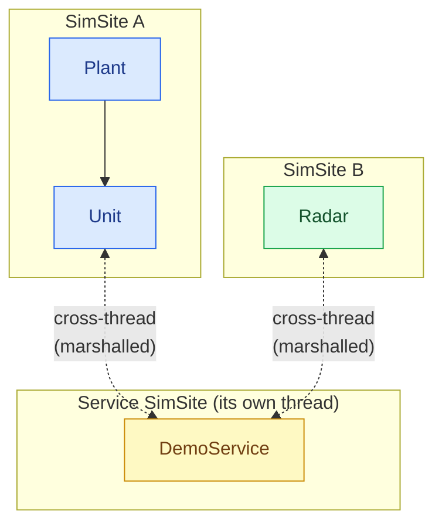
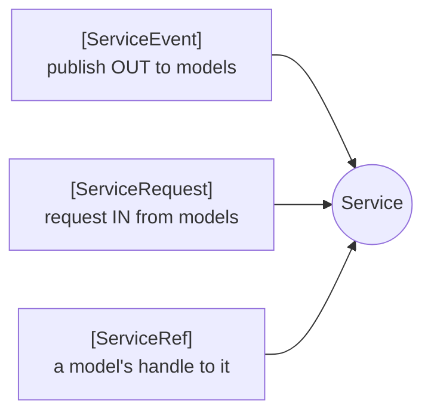
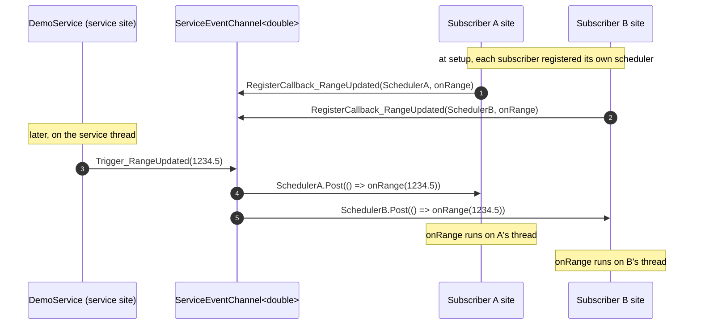
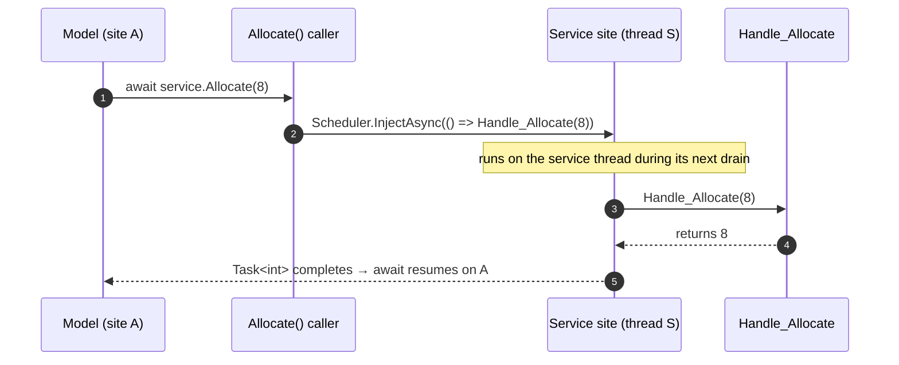

# Services

Some capabilities do not belong to any one model. A shared bus, a central catalogue, an environment provider, a
comms relay — things that *many* models depend on, that have their own state and their own life. In SimulaSharp those
are **services**: a distinct authoring artifact from a model, with a distinct threading contract.

## What a service is, and when to reach for one

A service is a reusable capability that models depend on. It derives from
[`ServiceBase`](#/api/type/SimulaSharp.Kernel.Model.ServiceBase) (implementing
[`IService`](#/api/type/SimulaSharp.Kernel.Model.IService)) and — this is the defining fact — it owns its **own
SimSite**, created from the clock in its constructor. It is not part of any model subtree.



- **Key point.** Because a service is *never* in a model's subtree, **every model↔service call is cross-thread** and
  marshalled — always. There is no "same-site fast path" the way there is for a `Reference<T>`. That is the price and
  the point: a service is a genuinely independent actor that any number of models can share safely.

Reach for a service when a capability is **shared by many models** and has a **life of its own**. Reach for a plain
model (owned via `Container<T>`) or a `Reference<T>` when the thing is really part of one subtree, or a point-to-point
link. The full judgement call is in [model vs service](#/guide/model-vs-service).

## `ServiceBase`

The base takes the clock, a logger, and a **name** (diagnostic, used for its SimSite), and optionally the site's
queue capacity. It creates the site for you:

```csharp
using SimulaSharp.Kernel.Attributes;
using SimulaSharp.Kernel.Logging;
using SimulaSharp.Kernel.Model;
using SimulaSharp.Kernel.Services;

public partial class DemoService : ServiceBase
{
    public DemoService(IClock c, ILogger l) : base(c, l, name: "demo") { }

    public override void Configure() { /* arm long-running work on Scheduler */ }
}
```

| Member | What it is |
|---|---|
| `TimeKeeper` | The shared simulation clock (read "now"). |
| `Logger` | The service's component-scoped logger. |
| `Scheduler` | The service's **own** SimSite. Every call into the service is marshalled onto this. |
| `Configure()` / `Dispose()` | Same hooks as a model — setup after wiring, deinit after the site stops. |

Like a model that uses codegen, a service **must be `partial`** — the
[`ServiceGenerator`](#/api/type/SimulaSharp.CodeGen.ServiceGenerator) weaves the interaction plumbing into it. The
service never starts, stops or disposes its own site; the simulator owns every site's lifecycle.

A service talks to the world through three class-level, generator-owned attributes:



## `[ServiceEvent]` — publish out to models

[`[ServiceEvent("Name", typeof(T)?)]`](#/api/type/SimulaSharp.Kernel.Attributes.ServiceEventAttribute) is a class-level,
**repeatable** attribute declaring a **fire-and-forget publish point** — a pub/sub channel *from the service out to
models*. The service author writes no plumbing; the generator emits all of it, backed by a
[`ServiceEventChannel`](#/api/type/SimulaSharp.Kernel.Services.ServiceEventChannel).

```csharp
[ServiceEvent("Tick")]                    // payload-less
[ServiceEvent("RangeUpdated", typeof(double))]   // carries a double
public partial class DemoService : ServiceBase
{
    public DemoService(IClock c, ILogger l) : base(c, l, "demo") { }

    public override void Configure()
        => Scheduler.AddPeriodicEvent(() => Trigger_RangeUpdated(NextRange()), 100_000);

    private double NextRange() => /* … */ 0.0;
}
```

For `[ServiceEvent("RangeUpdated", typeof(double))]` the generator emits:

```csharp
public void RegisterCallback_RangeUpdated(IScheduler scheduler, Action<double> callback);  // subscribers call this
protected void Trigger_RangeUpdated(double value);                                          // the service calls this
```

- **`RegisterCallback_<Name>`** is **public** — a subscriber calls it, **passing its own scheduler**. The channel
  remembers `(subscriberScheduler, callback)`. That is how delivery lands on the *subscriber's* site.
- **`Trigger_<Name>`** is **protected** — the service calls it to publish. It `Post`s each subscriber's callback onto
  *that subscriber's* site, fire-and-forget.
- Payload-less events (`[ServiceEvent("Tick")]`) generate the argument-free forms:
  `RegisterCallback_Tick(IScheduler, Action)` and `Trigger_Tick()`.

Events are **always fire-and-forget** — they carry no result. A result would force synchronous cross-thread execution,
which the design does not allow; if a model needs to send something back, it uses a `[ServiceRequest]` instead.

### Fan-out of a `[ServiceEvent]`



The subscriber list is copy-on-write, so triggering is lock-free and registration is safe from any thread.

## `[ServiceRequest]` — request into the service

[`[ServiceRequest(name?)]`](#/api/type/SimulaSharp.Kernel.Attributes.ServiceRequestAttribute) is a **method-level**
attribute marking a **request/response entry point** — a channel *from models into the service*. You write the handler,
named `Handle_<RequestName>`; the generator strips the `Handle_` prefix (unless `name` overrides it) and emits the
public caller.

```csharp
public partial class DemoService : ServiceBase
{
    // handlers run on the SERVICE's site
    [ServiceRequest]                                   // request "Register"
    protected void Handle_Register(int unitId) { /* mutate service state */ }

    [ServiceRequest]                                   // request "Allocate"
    protected int Handle_Allocate(int want) => want;   // may return a value
}
```

The generator emits public callers that marshal onto the service's own site:

```csharp
public Task Register(int unitId) => Scheduler.InjectVoidAsync(() => Handle_Register(unitId));
public Task<int> Allocate(int want) => Scheduler.InjectAsync(() => Handle_Allocate(want));
```

- The handler may take **at most one argument** and may **return a value**.
- A `void` handler → a `Task`-returning caller (via `InjectVoidAsync`); a value handler → a `Task<T>`-returning caller
  (via `InjectAsync`).
- The caller marshals onto **`Scheduler`** — the *service's* own site — so the handler always runs on the service
  thread regardless of which model called it. No locks in the handler.

### A `[ServiceRequest]` round-trip



## `[ServiceRef]` — how a model gets a handle

A model does not `new` a service or fish it out of a registry. It declares a **settable** member marked
[`[ServiceRef]`](#/api/type/SimulaSharp.Kernel.Attributes.ServiceRefAttribute), and the
[assembly](#/guide/the-assembly)'s `Deps` block binds it **by service name**. The generated simulator sets the member
to the named service instance during assembly, before `Configure()`.

```csharp
public partial class Plant(IClock c, IScheduler s, ILogger l) : ModelBase(c, s, l)
{
    [ServiceRef] public DemoService Tracker { get; set; } = null!;   // wired by the assembly, by name

    public override void Configure()
    {
        // Subscribe: pass MY scheduler so the callback lands on MY site.
        Tracker.RegisterCallback_RangeUpdated(Scheduler, OnRange);
    }

    private void OnRange(double range) { /* runs on the Plant's site */ }

    public async Task Kick()
    {
        await Tracker.Register(unitId: 1);              // marshalled onto the service site
        int got = await Tracker.Allocate(want: 8);      // request/response, awaited
    }
}
```

- **Key point.** The member is typed as the concrete service (`DemoService`), so once wired, the model calls the
  generated interaction surface directly: `RegisterCallback_*` to subscribe to events, and the `X(..)` callers to make
  requests. The `[ServiceRef]` must be settable because the simulator assigns it during wiring.

## The whole picture

```mermaid
flowchart TB
  subgraph model ["Model (its own site)"]
    direction TB
    reg["Configure():<br/>RegisterCallback_X(Scheduler, cb)"]
    call["await service.Request(arg)"]
    cb["cb(payload) runs here"]
  end
  subgraph service ["Service (its own site)"]
    direction TB
    trig["Trigger_X(payload)"]
    handle["Handle_Request(arg)"]
  end
  reg -->|"subscribe (with my scheduler)"| trig
  trig -->|"Post → my site"| cb
  call -->|"InjectAsync → service site"| handle
  handle -->|"Task result"| call
```

Two directions, two mechanisms, both always cross-thread:

| Direction | Attribute | Generated | Runs on | Result? |
|---|---|---|---|---|
| Service → models | `[ServiceEvent]` | `Trigger_X` (protected) · `RegisterCallback_X` (public) | each **subscriber's** site | no (fire-and-forget) |
| Models → service | `[ServiceRequest]` | `X(..)` caller (public) over `Handle_X` | the **service's** site | optional (`Task`/`Task<T>`) |
| Model gets handle | `[ServiceRef]` | assembly binds the member by name | — | — |

> **Consequence for design.** A service centralizes shared state on one thread, so it is a natural serialization point
> — and a natural **bottleneck** if every model hammers it synchronously. Prefer fire-and-forget events for broadcast
> ("something changed"), and reserve `[ServiceRequest]` round-trips for when a model genuinely needs an answer back.

## Where to go next

- **[Model vs service](#/guide/model-vs-service)** — the judgement call: when a capability should be a service at all.
- **[Associations](#/guide/associations)** — the other cross-thread partner, `Reference<T>`, and its same-site fast
  path (which services never have).
- **[The assembly](#/guide/the-assembly)** — declaring services and binding `[ServiceRef]` deps by name.
- **[Interaction patterns](#/guide/interaction-patterns)** — putting events and requests together into real flows.
