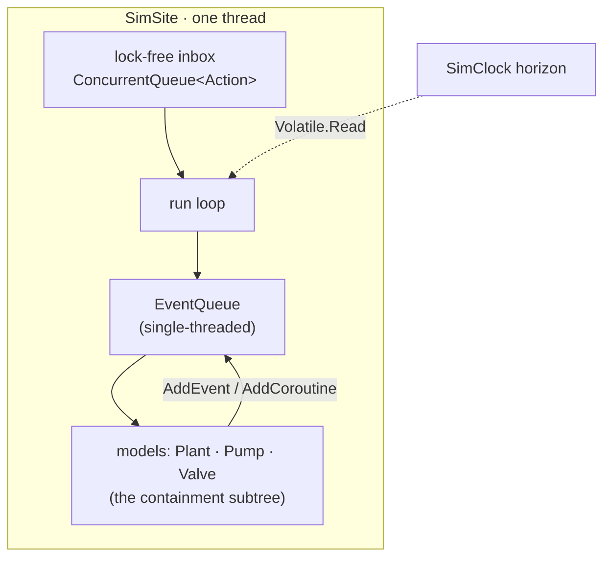
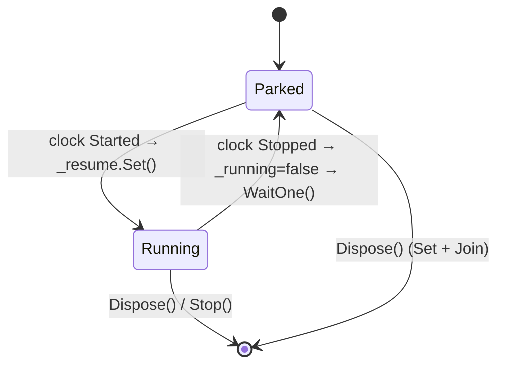
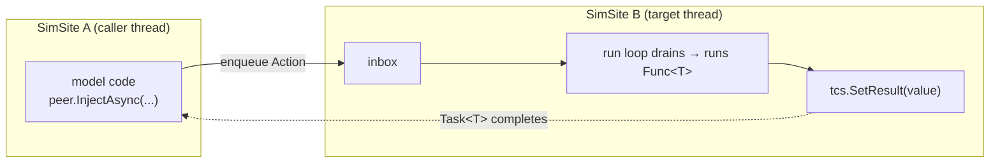
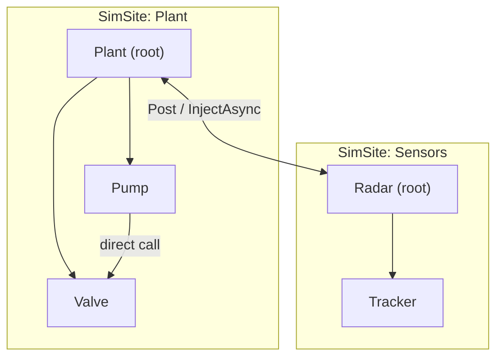

# SimSites & the actor model

The [clock](#/guide/time-and-clock) publishes time; it never runs your code. **SimSites** do. A
[`SimSite`](#/api/type/SimulaSharp.Kernel.Services.SimSite) is where your models actually execute — and the way sites
are built is the single most important thing to understand about how a SimulaSharp simulation behaves at runtime.

The rule is short: **one thread, one event queue, per site.** Everything else in this chapter follows from it.

## What a SimSite is

A SimSite is an **independent scheduling domain**. It owns:

- **one OS thread** (`SimSite-<name>`, a background thread),
- **one [`EventQueue`](#/api/type/SimulaSharp.Kernel.Services.EventQueue)** — the per-site scheduling structure (see
  [the event queue & scheduling](#/guide/event-queue-and-scheduling)),
- **one lock-free inbox** — a `ConcurrentQueue<Action>` for work arriving from *other* threads.

It implements [`IScheduler`](#/api/type/SimulaSharp.Kernel.Services.IScheduler), which is the surface your models use to
schedule work. A model doesn't know or care that its scheduler *is* a site; it just calls `AddEvent`, `AddPeriodicEvent`,
`AddCoroutine`.



The key consequence: because a site is *one thread*, everything that happens inside it is **serialized**. Two events on
the same site never run at the same instant. Two models on the same site never touch shared state concurrently. There is
nothing to lock, because there is nothing to race.

## The run loop: park when idle, woken on time

While the clock runs, the site's thread does the same thing forever — drain the inbox, fire everything due — then,
instead of spinning a core waiting for the next event, it **parks** and lets the clock wake it exactly when that event
comes due:

```mermaid
flowchart TB
  START([running?]) -->|no| PARK["_resume.WaitOne&#40;&#41;<br/>park — 0% CPU"]
  PARK --> START
  START -->|yes| DRAIN["drain inbox:<br/>while TryDequeue&#40;work&#41; work&#40;&#41;"]
  DRAIN --> PROC["_events.ProcessDue&#40;clock.SimNowUs&#41;"]
  PROC --> NEXT{"next event?"}
  NEXT -->|"≤ 200 µs away"| SPIN["Thread.SpinWait&#40;1&#41;"] --> START
  NEXT -->|"further off / none"| IDLE["publish next-due,<br/>_resume.WaitOne&#40;backstop&#41;<br/>park — 0% CPU"] --> START
```



The heart of it, straight from the source:

```csharp
_events.ProcessDue(_clock.SimNowUs);              // fire everything now due
if (!_inbox.IsEmpty) continue;                    // work landed while processing — go again

long nextDueUs = _events.PeekNextDueTime();       // -1 when nothing is scheduled
long waitUs = nextDueUs < 0 ? BackstopMs * 1000L : nextDueUs - _clock.SimNowUs;
if (waitUs <= SpinBudgetUs)                        // event imminent (≤ 200 µs)
    Thread.SpinWait(1);                            //   spin for the tightest latency
else
{
    _nextWakeUs = nextDueUs;                       // tell the clock when to wake me
    _resume.WaitOne(backstop);                     // park — 0% CPU until then
}
```

**Who wakes a parked site — on time?** The **clock thread**. It is the sole, continuously advancing writer of the
[horizon](#/guide/time-and-clock), so it already knows the current sim time to the microsecond. Each tick, after it
publishes the horizon, it signals any site whose published `_nextWakeUs` has come due. That gives **sub-microsecond wake
precision without the site spinning** — the accuracy of a busy-spin, at the CPU cost of a sleep.

Three things release a park, so a site never sleeps through work:

- the **clock** signals it when its next scheduled event comes due (the on-time wake);
- a **`Post`/`Inject`** from another thread signals it immediately, so injected work is picked up at once;
- a **clock pause** signals it, so it observes the stop promptly.

The timed `WaitOne(backstop)` is only a safety net (capped at `BackstopMs`) so nothing can ever sleep blind. Work due
within `SpinBudgetUs` (200 µs) is spun for rather than parked, shaving even the wake latency off the most imminent
events — which also covers a manual/batch clock whose horizon is already at or past the due time.

> **Key points**
> - One thread per site ⇒ intra-site execution is serialized and lock-free.
> - **Idle sites park (0% CPU); the clock wakes them precisely on time.** You get µs-accurate firing *and* immediate
>   pickup of injected work, without a hot core per site — so many sites (and blocking-I/O service threads) coexist
>   without starving each other. The one continuously spinning thread is the clock itself.
> - Still choose your [topology](#/guide/choosing-a-topology) deliberately, but the old "a hot core per running site"
>   tax is gone.

## Parking while paused

Parking is also how a paused clock costs nothing. The site subscribes to the clock's `Started`/`Stopped` events at
`Start()`:

- On **`Stopped`**, `_running` flips to `false` and `_resume` is signalled; next time around the loop the thread calls
  `_resume.WaitOne()` and **parks** on an `AutoResetEvent`, consuming zero CPU.
- On **`Started`**, the handler sets `_running = true` and signals `_resume`, and the thread falls back into the loop.



The same `_resume` handle is used to tear the site down: `Stop()` sets `_disposed`, signals `_resume` to break the park,
and `Join()`s the thread. So a paused simulation costs nothing, and stopping it is prompt even mid-park.

## The inbox: crossing thread boundaries

Model code runs on the site's own thread and touches the `EventQueue` directly — that's the fast path, and it's why the
queue is deliberately **not** thread-safe. Anything coming from *another* thread must instead go through the inbox, which
the run loop drains at the top of every pass. Three verbs put work there:

| Verb | Signature | Returns | Use when |
|---|---|---|---|
| `Post` | `void Post(Action)` | nothing | Fire-and-forget: you don't need a result or completion signal. |
| `InjectVoidAsync` | `Task InjectVoidAsync(Action)` | a `Task` that completes on the target thread | You need to know *when* the work finished (or if it threw). |
| `InjectAsync<T>` | `Task<T> InjectAsync<T>(Func<T>)` | a `Task<T>` carrying the result | You need a value back. |

All three do the same core thing — enqueue an `Action` onto the target site's inbox — and the sender **never blocks**.
The difference is only what handle you get back. `Post` gives you nothing; the two `Inject*` variants wrap the work in a
`TaskCompletionSource` (created with `RunContinuationsAsynchronously`, so a continuation never hijacks the site thread)
and hand you the `Task`.



## A cross-site round-trip

Here's the full shape of an `InjectAsync` call and reply. Note that the caller's thread is free the whole time — it only
holds a `Task`.

```mermaid
sequenceDiagram
  participant CA as Site A thread (caller)
  participant IB as Site B inbox
  participant CB as Site B thread (target)
  CA->>IB: InjectAsync(() => b.ReadPressure())
  Note over CA: returns Task&lt;double&gt; immediately;<br/>A keeps spinning, never blocks
  loop B's run loop
    CB->>IB: TryDequeue → work
    CB->>CB: run ReadPressure() on B's thread
    CB->>CB: tcs.SetResult(pressure)
  end
  CB-->>CA: Task&lt;double&gt; completes
  Note over CA: A observes the result later<br/>(via a coroutine Await, or a continuation)
```

Because the target function runs **on B's thread**, it can freely touch B's models and B's event queue with no locking —
it *is* B, momentarily driven by A's request. And because A got a `Task` rather than a blocked call, A stays live for its
own real-time work. A model coroutine typically bridges the gap by `yield return`-ing
[`SimYield.Await(task)`](#/guide/coroutines) and reading the result after it resumes.

## Intra-site vs cross-site: the one table to remember

| | **Within a site** (same subtree) | **Across sites** |
|---|---|---|
| How you call | Direct method call | `Post` / `InjectVoidAsync` / `InjectAsync` |
| Runs on | Caller's (== callee's) thread | Target site's thread |
| Cost | A method call; synchronous | Enqueue + a later drain; asynchronous |
| Result | Return value, immediately | A `Task`, completed later |
| Concurrency | None — serialized on one thread | Two threads, marshalled through an inbox |
| Locking | Never | Never (the queue crossing is the inbox) |
| Ordering | Program order | FIFO per sender into the target inbox |

You never write a lock in either column. That is the actor model's payoff: the only way data crosses a thread boundary
is by *running code on the owning thread*, so shared-memory races simply don't arise.

## The serialization guarantee

Say it plainly, because it's what makes SimulaSharp models simple to write:

> A SimSite's `EventQueue`, and every model in its subtree, are touched by **exactly one thread — the site's own.** Model
> fields need no `lock`, no `volatile`, no `Interlocked`, no concurrent collections. Two events on the same site are
> never in flight simultaneously. Ordinary fields and plain method calls are correct by construction.

The only place concurrency exists is the *inbox boundary*, and the kernel handles that for you with a lock-free
`ConcurrentQueue` plus the drain step. You get parallelism *between* sites and simplicity *within* them.

## Closely-bound models share a site

How do models end up on the same site? By **containment**. A root model and its whole
[containment subtree](#/guide/models-and-containment) share **one** SimSite. That is a design lever, not an accident:

- Models that talk constantly — a `Plant` and its `Pump`s and `Valve`s — belong in the same subtree, so their
  interaction is direct, synchronous, and lock-free.
- Models that are loosely coupled — a `Plant` and a `Radar` — belong on **different** sites, so they run in parallel and
  only pay the marshalling cost on the occasional message between them.



So the boundaries of your sites *are* the boundaries of your parallelism, and you draw them by deciding what contains
what. That's the subject of [models & containment](#/guide/models-and-containment) and, at the judgement level,
[choosing a topology](#/guide/choosing-a-topology).

## Consequence for design: never block a site thread

> **Consequence for design.** A site thread is a shared, real-time resource: while it is stuck, **every model on that
> site stops** — no events fire, no coroutines step, the inbox isn't drained, and cross-site callers waiting on a `Task`
> from it stall too. So never do anything blocking on a site thread: no `Task.Wait()`/`.Result` on a not-yet-complete
> task, no `Thread.Sleep`, no synchronous I/O, no `lock` that another thread can hold. To "wait" in a model, schedule
> for later (`AddEvent`) or yield time from a [coroutine](#/guide/coroutines) (`SimYield.Delay`); to wait on a cross-site
> reply, `yield return SimYield.Await(task)` — which parks the *coroutine*, not the *thread*. See
> [pitfalls](#/guide/pitfalls) for the failure modes this prevents.

## What this means for you

| You want to… | Do this |
|---|---|
| Call another model in the same subtree | Just call it — direct, synchronous, lock-free |
| Call a model on another site, no result needed | `peer.Post(() => ...)` |
| Call another site and know when it's done | `await`/`Await` the `Task` from `InjectVoidAsync` |
| Call another site and get a value back | `InjectAsync<T>` + [`SimYield.Await`](#/guide/coroutines) the returned `Task` |
| Run parallel work | Put loosely-coupled subtrees on **different** sites |
| Keep two models lock-free and synchronous | Put them in the **same** containment subtree |

Next: how the per-site queue actually schedules and fires work — **[the event queue &
scheduling](#/guide/event-queue-and-scheduling)**.
