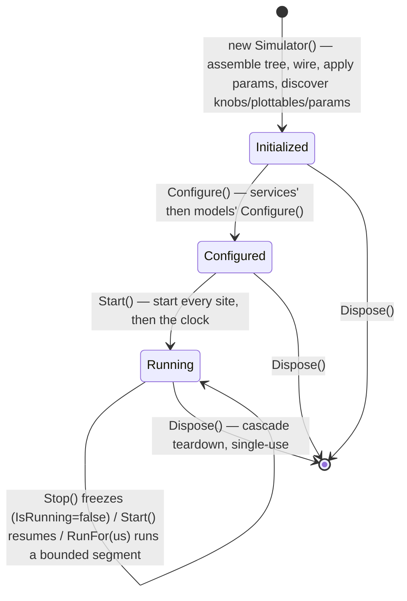
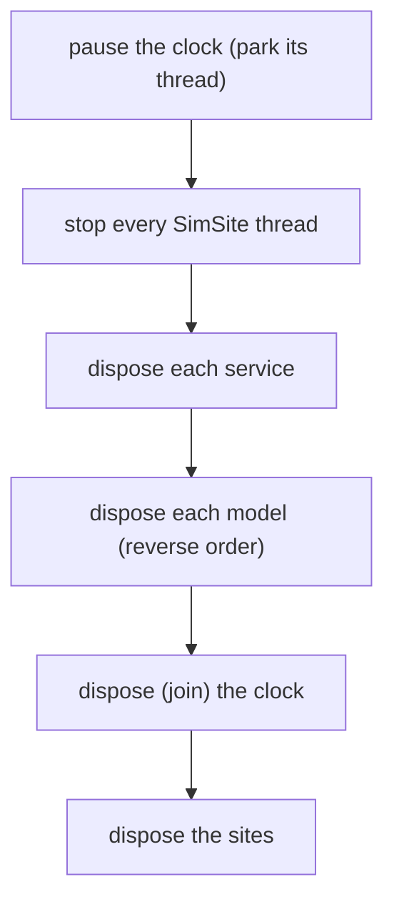

# The simulator lifecycle

A generated `<Name>Simulator` is an [`ISimulator`](#/api/type/SimulaSharp.Kernel.Services.ISimulator). Whatever drives
it — a CLI, a test, ultimately the MMI — walks it through a **short, strict lifecycle**: construct it (which
**assembles** the whole topology), optionally tune its parameters, configure it, run it, tear it down. It is
**single-use** — to run again, you make a new one.



The states are a [`SimulatorState`](#/api/type/SimulaSharp.Kernel.Services.SimulatorState) enum. A freshly-constructed
simulator is already **Initialized** (assembled by its constructor); from there it only moves forward:
**Initialized → Configured → Running**. There is no separate `Initialize()` step.

---

## The steps

| Step | Guard | What it does | State after |
|---|---|---|---|
| `new <Name>Simulator()` | — | The constructor **assembles**: constructs services, global events, sites, and the model tree; applies parameters (assembly values + defaults); wires containment, deps, events, references; **discovers knobs, plottables & parameters**. Throws `InvalidOperationException` if a `Required` parameter has no value. | `Initialized` |
| `RegisterLogSink(sink)` | none — any time | Adds a log destination to the router; entries after it fan out to it. | *(unchanged)* |
| `RegisterKnobChannel(ch)` | none — any time | Registers an MMI knob channel; attaches immediately (knobs are already discovered). | *(unchanged)* |
| `GetParams()` / `SetParam(p, v)` | `SetParam` requires **not yet `Configured`** | Read every per-instance parameter; override a value before the run is fixed. | *(unchanged)* |
| `Configure()` | requires `Initialized` | Runs every **service's** `Configure()` (in declaration order), then every **model's** (in registration order — children before their parent, since the tree is built bottom-up). Runs on the calling thread. | `Configured` |
| `Start()` | requires `Configured` | First call starts **every SimSite** thread; every call (re)starts the **clock**. | `Running` |
| `Stop()` | none | **Pauses the clock** — freezes the horizon. State stays `Running`; `IsRunning` goes false. Resume with `Start()`. A no-op when the clock is not running. | `Running` (frozen) |
| `RunFor(durationUs)` | none — call `Start()` first | Runs `durationUs` µs of sim time from now (still 1:1 with the wall clock), then freezes like `Stop()`, **blocking the caller** until it does. For scripted runs and tests. | `Running` (frozen) |
| `Dispose()` | none | Tears everything down (see below). **Single-use — no reset.** | *(disposed)* |

### The guards

Two things throw `InvalidOperationException`:

- `Start()` before `Configure()` → the run isn't configured.
- `SetParam(...)` after `Configure()` → parameters are fixed once the run is configured.

`Configure()` is **idempotent** — calling it again once past its state is a no-op. `Start()` is safe to call repeatedly
too: it only starts the sites once (on the transition into `Running`), and thereafter each call just restarts the
clock — which is exactly how **resume** works.

`RunFor()` has **no guard**: it drives the clock directly. Called before `Start()`, it advances the clock but no site
thread runs and the state does not move to `Running`. So always `Start()` first; `RunFor()` then runs one more bounded
segment and freezes, and you can call it again to run the next one.

> **Consequence for design.** Building happens in the **constructor**, so a freshly-`new`'d simulator is ready to
> inspect — you can `GetParams()`/`SetParam()` before anything runs. Parameters are populated before `Configure()`, so
> your model's `Configure()` can rely on them; and nothing runs on a site thread until `Start()`. Don't do work in
> *your model's* constructor that belongs in its `Configure()` — parameters aren't applied yet at that point.

---

## Start / Stop: freeze, don't reset

`Stop()` is not a shutdown — it calls `Clock.Pause()`, folding the current running segment into the accumulated base and
freezing the horizon exactly where it is. The simulator **stays in `Running`**; only `IsRunning` (the live clock
status) flips to false. A later `Start()` resumes seamlessly — no simulated time is lost or invented across the pause,
however long the wall-clock gap. This mirrors the clock's own [start/pause/resume model](#/guide/time-and-clock).

```mermaid
sequenceDiagram
  participant Host
  participant Sim as ISimulator
  participant Sites as SimSites
  participant Clock

  Host->>Sim: new <Name>Simulator()
  activate Sim
  Sim->>Sim: assemble — build tree, wire, apply params
  Sim->>Sim: discover knobs, plottables & parameters
  deactivate Sim
  Host->>Sim: RegisterLogSink(sink) / RegisterKnobChannel(ch)
  Host->>Sim: SetParam(p, v)  (before Configure)
  Host->>Sim: Configure()
  Sim->>Sites: services' then models' Configure()
  Host->>Sim: Start()
  Sim->>Sites: Start() (each site thread)
  Sim->>Clock: Start() (horizon advances)
  Note over Host,Clock: running — knobs live, plottables sweepable
  Host->>Sim: Stop()
  Sim->>Clock: Pause() (freeze; State stays Running)
  Host->>Sim: Start()
  Sim->>Clock: Start() (resume from frozen horizon)
  Host->>Sim: RunFor(us)
  Sim->>Clock: RunFor(us) — run, auto-pause, then return
  Host->>Sim: Dispose()
  Sim->>Clock: Pause() (park the clock thread)
  Sim->>Sites: Stop() all site threads
  Sim->>Sim: dispose services, then models (reverse)
  Sim->>Clock: Dispose() (join the clock thread)
  Sim->>Sites: dispose the sites
```

---

## Dispose: the teardown cascade

`Dispose()` tears the simulation down in a deliberate order, with **nothing executing** by the time the deinit runs.
The order matters because sites [park on idle](#/guide/simsites-and-actors) and are woken by the clock thread — so the
clock thread must be fully stopped before a site's wait handle is disposed:

1. **Pause the clock** — park its thread, so it stops waking sites (and the stop handlers run under control).
2. **Stop every SimSite thread** — so no model code is running.
3. **Dispose each service.**
4. **Dispose each model, in reverse registration order** — the bottom-up build registers children before their parent,
   so a parent is disposed before its children (and the last-built site's tree first).
5. **Dispose (join) the clock** — *before* the site handles, so no clock-thread wake can outlive them.
6. **Dispose the sites** — safe now that nothing can wake them.



There is **no reset**. A simulator (and the clock inside it) is single-use: to run a scenario again from zero, you
**build a new instance**. This sidesteps the genuinely hard problem — resetting every model's internal state — by
getting clean state for free from fresh objects. It also aligns with hosting: reloading a pack means disposing the old
simulator and creating a new one, never mutating one in place (see [packing & hosting](#/guide/packing-and-hosting)).

---

## Driving it from a host

A host loop over the shared `ISimulator` surface:

```csharp
using ISimulator sim = package.Create("Plant");   // a generated PlantSimulator, already assembled

sim.RegisterLogSink(new ConsoleSink());            // your ILogSink; any time — before or during the run
sim.RegisterKnobChannel(mmiChannel);               // knobs are already discovered → attaches now

foreach (var p in sim.GetParams())                 // inspect / tune before the run is fixed
    Console.WriteLine($"{p.Path} = {p.Read()}");
sim.SetParam(sim.GetParams().Single(p => p.Path == "Plant.Plant1.Capacity"), 8);

sim.Configure();    // run every service's then model's Configure() — parameters now fixed
sim.Start();        // start the sites, then the clock — time advances 1:1 with the wall clock

// ... observe & control while it runs ...
foreach (var knob in sim.Knobs) Console.WriteLine($"{knob.Path} = {knob.Read()}");
var frame = sim.SamplePlottables();                // one mission-time-stamped sweep

sim.Stop();         // freeze; State stays Running, IsRunning == false
sim.Start();        // resume seamlessly from the frozen horizon
sim.RunFor(1_000_000);   // run 1 s more of sim time, then freeze (blocks until then)

// `using` disposes here — pause the clock, stop sites, dispose services, models (reverse), clock, sites.
// To run again: create a NEW simulator. There is no reset.

sealed class ConsoleSink : ILogSink                  // the Kernel ships no sink; a host writes its own
{
    public void Submit(in LogEntry entry) => Console.WriteLine(entry);   // called from every site thread
}
```

Everything the host touches — `Clock`, `State`, `IsRunning`, `RegisterLogSink`, `Knobs`, `RegisterKnobChannel`,
`Plottables`, `SamplePlottables`, `GetParams`/`SetParam`, `RunFor`, and the lifecycle verbs — lives on `ISimulator` /
`SimulatorBase`, **never on the generated subclass**. That is what lets the MMI drive any simulator it loads through one
stable interface.

> **Consequence for design.** Because the simulator is single-use and driven only through `ISimulator`, a host never
> needs to know the concrete type or reach into the model tree to "clean up". Construct, tune, run, dispose — and if you
> need another run, create afresh. Statelessness across runs is a property you get for free.

Next: **[packing & hosting](#/guide/packing-and-hosting)** — how a finished simulator is packed and loaded so a host can
create, run, and reload it.
