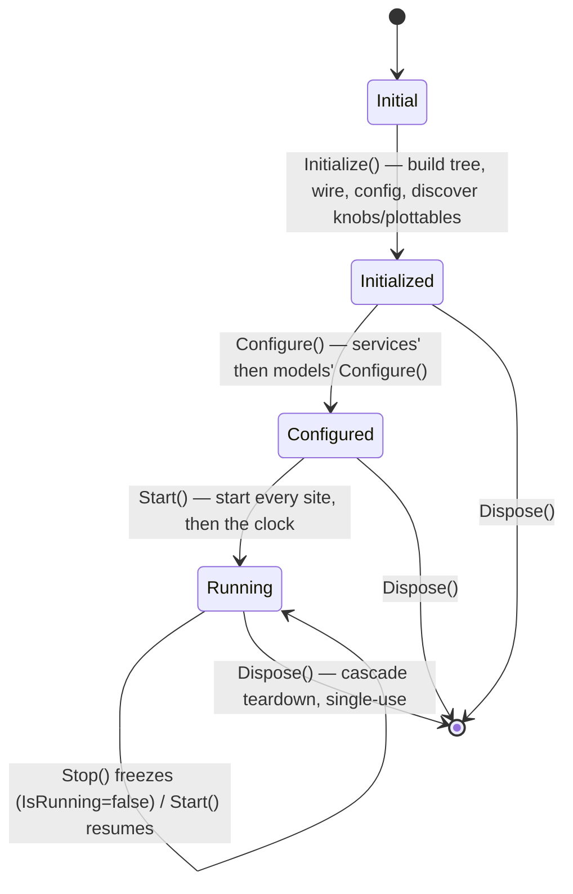
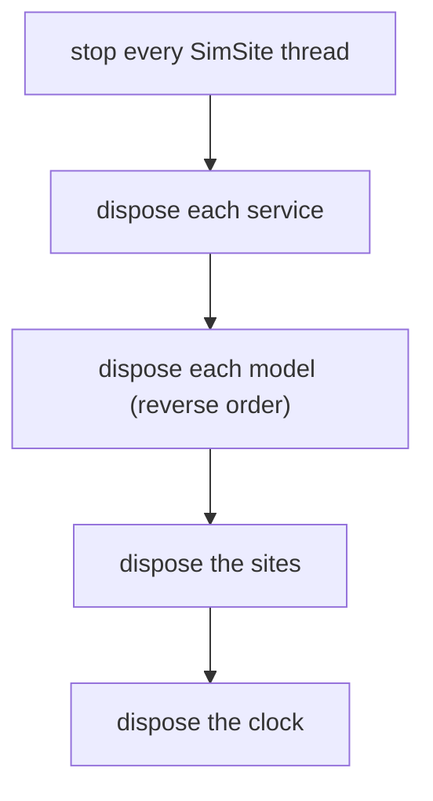

# The simulator lifecycle

A generated `<Name>Simulator` is an [`ISimulator`](#/api/type/SimulaSharp.Kernel.Services.ISimulator). Whatever drives
it — a CLI, a test, ultimately the MMI — walks it through a **short, strict lifecycle**: build it, configure it, run it,
tear it down. There are four states and four verbs, guarded so you cannot skip a step, and the whole thing is
**single-use** — to run again, you make a new one.



The states are a [`SimulatorState`](#/api/type/SimulaSharp.Kernel.Services.SimulatorState) enum:
**Initial → Initialized → Configured → Running**. They only ever move forward.

---

## The steps

| Step | Guard | What it does | State after |
|---|---|---|---|
| `RegisterLogSink(sink)` | none — any time | Adds a log destination to the router; entries after it fan out to it. | *(unchanged)* |
| `RegisterKnobChannel(ch)` | none — before or after `Initialize` | Registers an MMI knob channel; attaches immediately if knobs are already discovered. | *(unchanged)* |
| `Initialize()` | none (idempotent) | Runs the generated `OnInitialize`: constructs sites, services, and the model tree; applies config; wires containment, deps, references; **discovers knobs & plottables** and attaches any registered channels. | `Initialized` |
| `Configure()` | requires `Initialized` | Runs every **service's** then every **model's** `Configure()`. | `Configured` |
| `Start()` | requires `Configured` | First call starts **every SimSite** thread; every call (re)starts the **clock**. | `Running` |
| `Stop()` | none | **Pauses the clock** — freezes the horizon. State stays `Running`; `IsRunning` goes false. Resume with `Start()`. | `Running` (frozen) |
| `Dispose()` | none | Tears everything down (see below). **Single-use — no reset.** | *(disposed)* |

### The guards

Two transitions are guarded, and violating them throws `InvalidOperationException`:

- `Configure()` before `Initialize()` → *"Initialize() must run before Configure()."*
- `Start()` before `Configure()` → *"Configure() must run before Start()."*

`Initialize()` and `Configure()` are **idempotent** — calling them again once past their state is a no-op, they simply
return. `Start()` is safe to call repeatedly too: it only starts the sites once (on the transition into `Running`), and
thereafter each call just restarts the clock — which is exactly how **resume** works.

> **Consequence for design.** The four steps separate *building* (`Initialize`), *setting up* (`Configure`), and
> *running* (`Start`) into distinct phases. Config values are populated during `Initialize`, so your model's
> `Configure()` can rely on them; and nothing runs on a site thread until `Start()`. Don't do work in a constructor that
> belongs in `Configure()`.

---

## Start / Stop: freeze, don't reset

`Stop()` is not a shutdown — it calls `Clock.Pause()`, folding the current running segment into the accumulated base and
freezing the horizon exactly where it is. The simulator **stays in `Running`**; only `IsRunning` (the live clock
status) flips to false. A later `Start()` resumes seamlessly — no simulated time is lost or invented across the pause,
however long the wall-clock gap. This mirrors the clock's own [start/pause/resume model](#/guide/time-and-clock).

```mermaid
sequenceDiagram
  participant Host
  participant Sim as ISimulator
  participant Sites as SimSites
  participant Clock

  Host->>Sim: RegisterLogSink(sink)
  Host->>Sim: Initialize()
  activate Sim
  Sim->>Sim: OnInitialize() — build tree, wire, config
  Sim->>Sim: discover knobs & plottables, attach channels
  deactivate Sim
  Host->>Sim: Configure()
  Sim->>Sites: services' then models' Configure()
  Host->>Sim: Start()
  Sim->>Sites: Start() (each site thread)
  Sim->>Clock: Start() (horizon advances)
  Note over Host,Clock: running — knobs live, plottables sweepable
  Host->>Sim: Stop()
  Sim->>Clock: Pause() (freeze; State stays Running)
  Host->>Sim: Start()
  Sim->>Clock: Start() (resume from frozen horizon)
  Host->>Sim: Dispose()
  Sim->>Sites: Stop() all site threads
  Sim->>Sim: dispose services, then models (reverse)
  Sim->>Sites: dispose sites, then the clock
```

---

## Dispose: the teardown cascade

`Dispose()` tears the simulation down in a deliberate order, with **nothing executing** by the time the deinit runs:

1. **Stop every SimSite thread** — so no model code is running.
2. **Dispose each service.**
3. **Dispose each model, in reverse registration order** — children before parents, mirroring the depth-first build.
4. **Dispose the sites**, then **the clock**.



There is **no reset**. A simulator (and the clock inside it) is single-use: to run a scenario again from zero, you
**build a new instance**. This sidesteps the genuinely hard problem — resetting every model's internal state — by
getting clean state for free from fresh objects. It also aligns with hosting: reloading a pack means disposing the old
simulator and creating a new one, never mutating one in place (see [packing & hosting](#/guide/packing-and-hosting)).

---

## Driving it from a host

A host loop over the shared `ISimulator` surface:

```csharp
using ISimulator sim = package.Create("Plant");   // a generated PlantSimulator, as ISimulator

sim.RegisterLogSink(new ConsoleLogSink());         // any time — before or during the run
sim.RegisterKnobChannel(mmiChannel);               // before Initialize → gets knobs on discovery

sim.Initialize();   // build the tree, wire, apply config, discover knobs & plottables
sim.Configure();    // run every service's then model's Configure()
sim.Start();        // start the sites, then the clock — time advances 1:1 with the wall clock

// ... observe & control while it runs ...
foreach (var knob in sim.Knobs) Console.WriteLine($"{knob.Path} = {knob.Read()}");
var frame = sim.SamplePlottables();                // one mission-time-stamped sweep

sim.Stop();         // freeze; State stays Running, IsRunning == false
sim.Start();        // resume seamlessly from the frozen horizon

// `using` disposes here — stop sites, dispose services, models (reverse), sites, clock.
// To run again: create a NEW simulator. There is no reset.
```

Everything the host touches — `Clock`, `State`, `IsRunning`, `RegisterLogSink`, `Knobs`, `RegisterKnobChannel`,
`Plottables`, `SamplePlottables`, and the four lifecycle verbs — lives on `ISimulator` / `SimulatorBase`, **never on the
generated subclass**. That is what lets the MMI drive any simulator it loads through one stable interface.

> **Consequence for design.** Because the simulator is single-use and driven only through `ISimulator`, a host never
> needs to know the concrete type or reach into the model tree to "clean up". Run, dispose, and — if you need another
> run — create afresh. Statelessness across runs is a property you get for free.

Next: **[packing & hosting](#/guide/packing-and-hosting)** — how a finished simulator is packed and loaded so a host can
create, run, and reload it.
