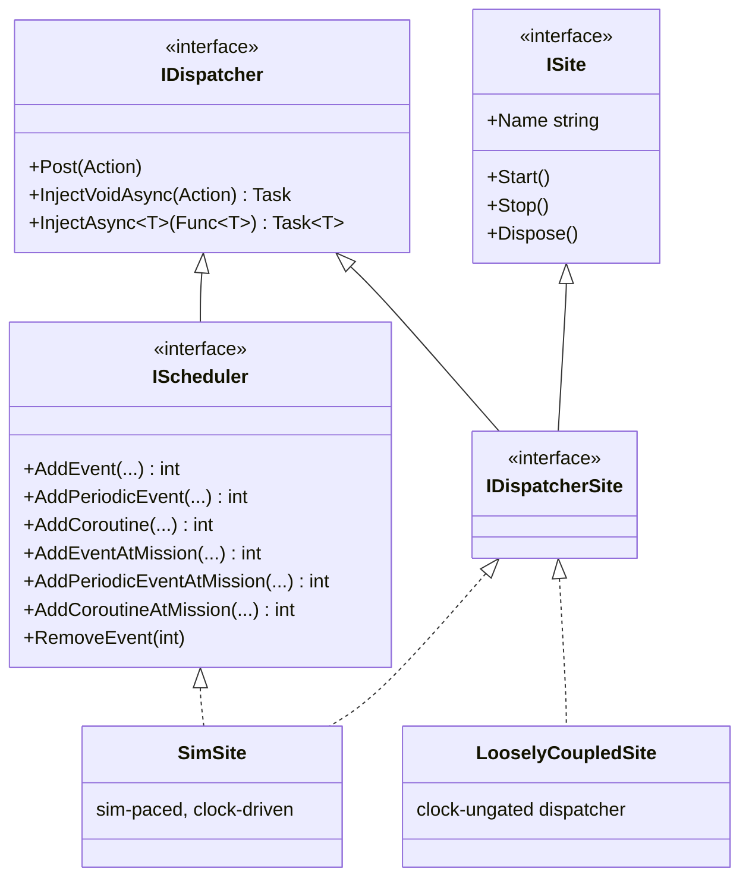

# Sites & dispatch

A [SimSite](#/guide/simsites-and-actors) does two quite different jobs. It is a **scheduling domain** — a sim-time event
queue you add work to — *and* it is a **thread with a lifecycle** the simulator starts, stops and disposes. Bundling
both behind one fat interface would hand every holder more power than it should have: a model that only needs to
*schedule* work would also be able to *stop* its own thread, or *dispose* the site the whole subtree runs on.

SimulaSharp splits those jobs into small, honest interfaces, and hands each holder only the facet it should use. This is
**capability segregation**: the type you hold *is* the set of things you're allowed to do.

## The four interfaces

| Interface | Members | The capability | Who holds it |
|---|---|---|---|
| [`IDispatcher`](#/api/type/SimulaSharp.Kernel.Services.IDispatcher) | `Post`, `InjectVoidAsync`, `InjectAsync` | **marshal** work onto the site's thread | the `[ServiceEvent]`/`[ServiceRequest]` plumbing; a [global event](#/guide/events) for each subscriber; anything that needs to hand work to a site |
| [`IScheduler`](#/api/type/SimulaSharp.Kernel.Services.IScheduler) `: IDispatcher` | `AddEvent`, `AddPeriodicEvent`, `AddCoroutine`, `…AtMission`, `RemoveEvent` | marshal **+ schedule** on sim time | a **model** (`Scheduler`), and a `ServiceBase` (protected `Scheduler`) |
| [`ISite`](#/api/type/SimulaSharp.Kernel.Services.ISite) `: IDisposable` | `Name`, `Start`, `Stop` | the **lifecycle** | the **simulator**, and nobody else |
| [`IDispatcherSite`](#/api/type/SimulaSharp.Kernel.Services.IDispatcherSite) `: IDispatcher, ISite` | *(the union)* | marshal + lifecycle, **no** sim-time queue | a service, as its public `Site` |

The two concrete sites pick from these:

- [`SimSite`](#/api/type/SimulaSharp.Kernel.Services.SimSite) implements **`IScheduler`** *and* **`IDispatcherSite`** — the
  full sim-paced site: marshalling, sim-time scheduling, and lifecycle.
- [`LooselyCoupledSite`](#/api/type/SimulaSharp.Kernel.Services.LooselyCoupledSite) implements only **`IDispatcherSite`** —
  marshalling + lifecycle, but **no sim-time queue**. It is [clock-ungated](#/guide/services): a pure Post-driven
  serial executor (a dispatcher) that runs marshalled work and sleeps when idle, never advancing on the horizon. It does
  not watch the clock, so it keeps running posted work while the clock is paused. Its thread is named
  `LooselyCoupled-<name>` (a `SimSite` thread is `SimSite-<name>`).

Who builds which: the simulator creates one `SimSite` per `Sites:` entry in the assembly YAML and hands it to the models
there as their `IScheduler`. A `ServiceBase` creates its own `SimSite`; a `LooselyCoupledServiceBase` creates its own
`LooselyCoupledSite`. Either way the simulator owns the lifecycle: it starts, stops and disposes every site.

## Why segregate — what each holder *cannot* do

The point is what the narrow types **withhold**:

- A **model** holds its site as an `IScheduler`. It can schedule and marshal — but `IScheduler` has no `Start`/`Stop` and
  is not `IDisposable`, so a model **cannot start, stop, or dispose** the site its whole subtree shares. Lifecycle is the
  simulator's alone.
- A **caller** that holds a service sees only its `Site` (an `IDispatcherSite`) — it can marshal a request in, but
  `IDispatcherSite` has no scheduling queue, so a caller **cannot schedule sim-time work on another component's site**.
  A `ServiceBase` keeps the sim-time facet to itself as a **protected** `Scheduler`.
- Nobody but the **simulator** is handed an `ISite`, so nothing else can drive the lifecycle.

The same principle governs the clock: a model's `TimeKeeper` is an [`IClock`](#/guide/time-and-clock) (read/observe only),
while control (`Start`/`Pause`/`RunFor`) lives on the concrete `SimClock` the simulator owns. In both cases the rule is
identical — **the type you hold is the authority you have**, and mistakes that would violate the actor model simply don't
compile.

## Marshalling is the common denominator

Every cross-thread hand-off in SimulaSharp — a `[ServiceRequest]` marshalled onto a service, a `[ServiceEvent]` delivered
to a subscriber, a `[CrossReference<T>]` accessor dispatching cross-site, a [global event](#/guide/events) delivered to
its subscribers — bottoms out at **`IDispatcher`**. Because both `SimSite` and `LooselyCoupledSite` are `IDispatcher`s,
the exact same generated plumbing drives both a sim-paced service and a [loosely-coupled one](#/guide/services): the
caller marshals through `Site`, and where and when that work runs is the site's business.

Global events show the split clearly. `SimEvent.Register(subscriber, subDispatcher, handler)` takes the subscriber's
*identity* and, separately, the `IDispatcher` its handler runs on: a model passes its `Scheduler`, a service passes its
public `Site`. Each trigger then `Post`s the handler onto that dispatcher. The event needs nothing more than
`IDispatcher`, so models and both kinds of service can subscribe the same way.

## Where to go next

- **[SimSites & the actor model](#/guide/simsites-and-actors)** — the sim-paced site in depth: one thread per subtree,
  the inbox, clock-driven draining.
- **[Services](#/guide/services)** — both service kinds, and the `[ServiceEvent]`/`[ServiceRequest]` plumbing that rides
  on `IDispatcher`.
- **[Time & the clock](#/guide/time-and-clock)** — the same read-vs-control split, applied to time.
