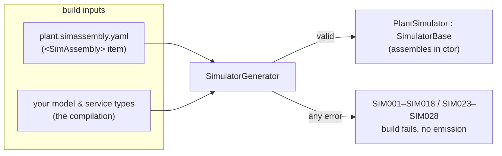
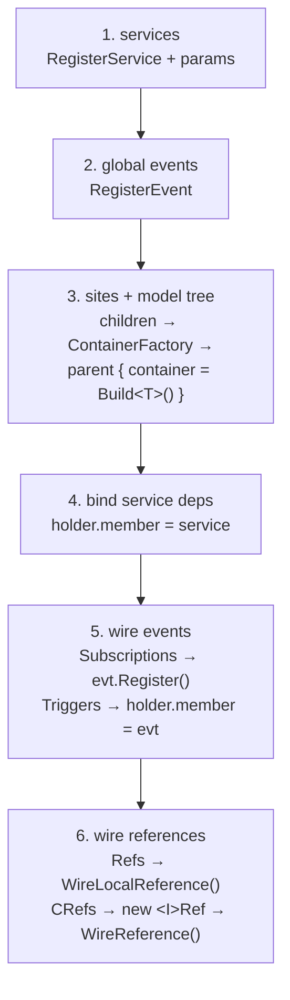

# The assembly

You have written models, marked their knobs and parameters, and decided how they relate. The **assembly** is the one
file that says *which instances exist, where they live, and how they connect*. It is a small YAML document, and at
build time a Roslyn generator reads it, **validates it against your real types**, and emits a strongly-typed simulator
that constructs the whole tree.

- **The assembly is topology, not behaviour.** No logic lives here — only names, types, containment, references,
  service bindings, global events, and config scalars.
- **It is checked at compile time.** An unknown type, a container/element mismatch, a dangling reference, a missing
  constructor, an unknown event — every one is a **compile error** (`SIM001`–`SIM018`, `SIM023`–`SIM028`), not a
  runtime failure. If it builds, the topology is sound.
- **The output is ordinary compiled code.** The generated `<Name>Simulator` carries no YAML parser and no reflection;
  the shipped product is just C#.



This page walks the structure and the generation. For the exhaustive field-by-field schema and every diagnostic, see
the [assembly YAML reference](#/guide/assembly-yaml-reference).

---

## How the file is recognized

You register an assembly by tagging it with the **`<SimAssembly>`** MSBuild item. The CodeGen targets bridge every
`<SimAssembly>` into an `AdditionalFiles` item carrying `IsSimAssembly=true`, and the
[`SimulatorGenerator`](#/api/type/SimulaSharp.CodeGen.SimulatorGenerator) reads it from the compiler's
**`AdditionalFiles`**. That tag is the single way to register an assembly:

```xml
<!-- in your .csproj -->
<ItemGroup>
  <PackageReference Include="SimulaSharp" Version="0.5.3" />
  <SimAssembly Include="plant.simassembly.yaml" />
</ItemGroup>
```

The file can be named **anything** — the `.simassembly.yaml` suffix is only a **human convention** that makes the file
easy to spot; the `<SimAssembly>` tag is what makes it a build input (so a plain `Demo.yaml` works fine). The item is
also a first-class, IDE-recognized build action. One simulator class is generated per assembly file.

---

## The structure

Here is the sandbox assembly, annotated. It declares one service, one global event, two sites, and a model tree with
containment, an intra-site and a cross-site reference, a service dependency, an event producer and subscriber, and
config:

```yaml
Simulator:
  Name: Plant                       # → generated class "PlantSimulator"
  MissionStart: 2026-01-01T00:00:00 # mission epoch (sim time 0); default = Unix epoch

  Services:                         # own-thread shared capabilities
    - Name: Tracker
      Type: Demo.DemoService        # fully-qualified; public ctor (IClock, ILogger)

  Events:                           # global pub/sub events (scheduler-less, ownerless)
    - Name: BusFault
      ArgType: System.Double        # payload type → SimEvent<double>; omit for an argless SimEvent

  Sites:                            # each site = one thread + one event queue
    - Name: Main
      # MaxEvents: 64               # optional per-site queue capacity (default 64)
      Models:
        - Name: Plant1
          Type: Demo.Plant          # fully-qualified; public ctor (IClock, IScheduler, ILogger)
          Config: { Capacity: 5 }   # scalars → [Parameter] members (see Configuration)
          Models:                   # containment: { <containerName>: [ children ] }
            - Units:
                - Name: UnitA
                  Type: Demo.Unit
                  Config: { Rate: 1.5 }
                  Refs:             # intra-site [Reference<T>]: { <name>: [ dotted.paths ] }
                    - Peers:
                        - Plant.Plant1.UnitB
                  CRefs:            # cross-site [CrossReference<T>]: { <name>: [ dotted.paths ] }
                    - Sinks:
                        - Plant.Plant2.Drain
                - Name: UnitB
                  Type: Demo.Unit
                  Config: { Rate: 2.5 }
          Deps:                     # service deps: { <serviceRefMember>: serviceName }
            - Tracker: Tracker
          Triggers:                 # event producers: { <eventReferenceMember>: eventName }
            - BusFault: BusFault
    - Name: Aux
      MaxEvents: 128
      Models:
        - Name: Plant2
          Type: Demo.Plant
          Models:
            - Units:
                - Name: Drain
                  Type: Demo.Drain  # a Unit that also implements Demo.IDrain
                  Subscriptions:    # event consumers: { <eventHandlerMethod>: eventName }
                    - OnBusFault: BusFault
```

### Simulator

The root. Fields:

| Field | Meaning |
|---|---|
| `Name` | Required. The class name becomes `<Name>Simulator` (here `PlantSimulator`). |
| `MissionStart` | Optional. An absolute instant parsed (invariant, assumed UTC) to the **mission epoch** — the wall-clock time mapped to sim time 0. Omitted → `DateTime.UnixEpoch`. |
| `Services` | Optional list of services. |
| `Events` | Optional list of global events. |
| `Sites` | The sites, each owning a model tree. |

### Services

Each entry is a `Name`, a fully-qualified `Type` (must implement `IService` and have a public `(IClock, ILogger)`
ctor), and an optional `Config` map. A service runs on its own site; models bind to it through `Deps`. A service may
also carry its own `Deps` (service→service, cycles allowed), `Triggers` and `Subscriptions`, with the same shapes as a
model node. A service deriving from `LooselyCoupledServiceBase` is registered through a separate entry point, but is
declared in the YAML exactly the same way.

### Events

Each entry declares one **global event**: a `Name`, an optional `ArgType` (the payload type), and an optional custom
`Type`. With no `Type`, the generator creates the stock `SimEvent` (argless) or `SimEvent<ArgType>`. Producers bind
to it with `Triggers`, consumers with `Subscriptions`; see [global events](#/guide/events).

### Sites

Each site is a `Name`, an optional `MaxEvents` (event-queue capacity, default **64**), and its root `Models`. A site
is one thread and one event queue; the whole subtree under it shares that site.

### Model nodes

A model node is the workhorse. Its fields:

| Field | Shape | Meaning |
|---|---|---|
| `Name` | scalar | The instance name; contributes to the dotted path. |
| `Type` | scalar | Fully-qualified type; must implement `IModel` with a public `(IClock, IScheduler, ILogger)` ctor. |
| `Config` | map | Scalars bound to `[Parameter]` members ([Configuration](#/guide/configuration)). |
| `Models` | list of `{ containerName: [children] }` | **Containment** — nests children into a `[Contains<T>]` container. |
| `Refs` | list of `{ referenceName: [dotted.paths] }` | **Intra-site references** — same-site links into a `[Reference<T>]`, by full instance path. |
| `CRefs` | list of `{ referenceName: [dotted.paths] }` | **Cross-site references** — links into a `[CrossReference<T>]`, by full instance path. |
| `Deps` | list of `{ serviceRefMember: serviceName }` | **Service bindings** — assigns a named service to a `[ServiceRef]` member. |
| `Triggers` | list of `{ eventReferenceMember: eventName }` | **Event producers** — fills an `[EventReference]` member with a named event. |
| `Subscriptions` | list of `{ eventHandlerMethod: eventName }` | **Event consumers** — registers an `[EventHandler]` method on a named event. |

The **full dotted path** of an instance is its ancestry joined by dots, rooted at the simulator name:
`Plant.Plant1.UnitA`. That path is the identity used everywhere — reference targets, knob/plottable/parameter paths,
and the logger issuer.

> **Consequence for design.** Containment (`Models`) is **ownership** — a child lives inside its parent's
> `Container<T>` and shares the parent's site. References are **links** — a pointer to an instance elsewhere in the tree,
> addressed by path. Intra-site links go in `Refs` (`[Reference<T>]`, same site, direct); cross-site links go in `CRefs`
> (`[CrossReference<T>]`, through a guarded `Ref`). Choose containment for "part of", a reference for "knows about". See
> [associations](#/guide/associations) for the full story.

---

## What the generator emits

The generator constructs everything in the **constructor**, depth-first, in a fixed order. Here is the **real**
generated output for the sandbox assembly above (comments added):

```csharp
public sealed class PlantSimulator : global::SimulaSharp.Kernel.Services.SimulatorBase
{
    public PlantSimulator() : base(new global::System.DateTime(639028224000000000L, global::System.DateTimeKind.Utc))
    {
        // 1. Services. __ApplyParameters is always called — with no Config it applies the attribute defaults.
        var __c0 = RegisterService(new global::Demo.DemoService(Clock, CreateLogger("Plant.Tracker")));
        __c0.__ApplyParameters(new global::System.Collections.Generic.Dictionary<string, string?> {});
        CollectParametersFrom(__c0, "Plant.Tracker");
        CollectKnobsFrom(__c0, "Plant.Tracker");
        CollectPlottablesFrom(__c0, "Plant.Tracker");
        // 2. Global events.
        var __c1 = RegisterEvent(new global::SimulaSharp.Kernel.Events.SimEvent<global::System.Double>());
        // 3. Sites + model trees. Containment is built bottom-up: the children go into a ContainerFactory
        //    before the parent exists.
        var __c2 = CreateSite("Main", 64);
        var __c3 = new global::SimulaSharp.Kernel.Primitives.ContainerFactory();
        var __c4 = Register(new global::Demo.Unit(Clock, __c2, CreateLogger("Plant.Plant1.UnitA")));
        __c4.__ApplyParameters(new global::System.Collections.Generic.Dictionary<string, string?> { ["Rate"] = "1.5" });
        CollectKnobsFrom(__c4, "Plant.Plant1.UnitA");
        CollectPlottablesFrom(__c4, "Plant.Plant1.UnitA");
        CollectParametersFrom(__c4, "Plant.Plant1.UnitA");
        __c3.Add(__c4);
        var __c5 = Register(new global::Demo.Unit(Clock, __c2, CreateLogger("Plant.Plant1.UnitB")));
        __c5.__ApplyParameters(new global::System.Collections.Generic.Dictionary<string, string?> { ["Rate"] = "2.5" });
        CollectKnobsFrom(__c5, "Plant.Plant1.UnitB");
        CollectPlottablesFrom(__c5, "Plant.Plant1.UnitB");
        CollectParametersFrom(__c5, "Plant.Plant1.UnitB");
        __c3.Add(__c5);
        // The parent is constructed with the frozen container handed in through its init accessor.
        var __c6 = Register(new global::Demo.Plant(Clock, __c2, CreateLogger("Plant.Plant1")) { Units = __c3.Build<global::Demo.Unit>() });
        __c6.__ApplyParameters(new global::System.Collections.Generic.Dictionary<string, string?> { ["Capacity"] = "5" });
        CollectKnobsFrom(__c6, "Plant.Plant1");
        CollectPlottablesFrom(__c6, "Plant.Plant1");
        CollectParametersFrom(__c6, "Plant.Plant1");
        var __c7 = CreateSite("Aux", 128);
        // ... Plant.Plant2 and its child Plant.Plant2.Drain (__c9), built the same way ...
        // 4. Service dependency binding.
        __c6.Tracker = __c0;
        // 5. Event wiring: subscribers first (the handler runs on the model's own Scheduler), then producer handles.
        __c1.Register(__c9, __c9.Scheduler, __c9.OnBusFault);
        __c6.BusFault = __c1;
        // 6. Reference wiring. Intra-site (Refs): the target instances go straight to WireLocalReference — no Ref.
        ((global::SimulaSharp.Kernel.Model.ILocalReferenceWiring)__c4).WireLocalReference("Peers", new global::System.Collections.Generic.List<global::SimulaSharp.Kernel.Model.IModel> { __c5 });
        // Cross-site (CRefs): each target wrapped in its interface's generated Ref, capturing both schedulers.
        var __c11 = new global::SimulaSharp.Kernel.Primitives.RefCollection();
        __c11.Add(new global::Demo.IDrainRef((global::Demo.IDrain)__c9, __c7, __c2));
        ((global::SimulaSharp.Kernel.Model.IReferenceWiring)__c4).WireReference("Sinks", __c11);
        OnAssembled();
    }
}
```

Read top to bottom, the generator's passes are:

1. **Services** — `RegisterService(new Svc(Clock, CreateLogger(path)))` (or `RegisterLooselyCoupledService(...)` for a
   `LooselyCoupledServiceBase`), then `__ApplyParameters`, then collect its parameters, knobs and plottables.
2. **Global events** — `RegisterEvent(new SimEvent<ArgType>())` (or `new SimEvent()`, or `new <Type>()` for a custom
   event), one per `Events` entry.
3. **Sites + model tree** — `CreateSite(name, maxEvents)`, then **bottom-up** per root: build each container's children
   into a `ContainerFactory` (`Register(new Model(...))`, `__ApplyParameters`, `CollectKnobsFrom`/
   `CollectPlottablesFrom`/`CollectParametersFrom`, `factory.Add(child)`), then construct the parent with
   `{ <container> = factory.Build<T>() }`.
4. **Service dependency binding** — after everything is constructed, `holder.<member> = service`, for model deps and
   service→service deps alike (so cycles resolve by setter injection).
5. **Event wiring** — each `Subscriptions` entry becomes `evt.Register(sub, sub.Scheduler, sub.Handler)` (a service
   passes `sub.Site`); each `Triggers` entry becomes `holder.<member> = evt`.
6. **Reference wiring** — for each intra-site `Refs` entry, hand the target instances to
   `((ILocalReferenceWiring)model).WireLocalReference("<name>", targets)` (no Ref). For each cross-site `CRefs` entry,
   build a `RefCollection` of `new <I>Ref((I)target, targetSched, callerSched)` and call
   `((IReferenceWiring)model).WireReference("<name>", refs)`.

Note the logger issuer for every component is its **full dotted path** (`Plant.Plant1.UnitA`), and the mission epoch is
baked into the base ctor as a `DateTime` tick count — no parsing at run time. `__ApplyParameters` is emitted for
**every** instance, even one with no `Config:` block, because it is also what stamps each parameter's attribute default.



---

## Validation: errors at build time, not run time

Before emitting a single line, the generator runs a **`Validator`** against the compilation's actual symbols. Every
type is resolved, every container/reference field is checked for the right generic shape, every child is checked
assignable to its container's element type, every reference target is checked to exist and be assignable, every service
dep is checked, and every event, subscription and trigger is checked against the event's shape. **On any error it
reports the diagnostic and skips emission entirely** — so you get the real topology error, not a cascade of downstream
compile errors against a half-built class.

| ID | Meaning |
|---|---|
| `SIM001` | Assembly YAML parse error |
| `SIM002` | Missing `Simulator.Name` |
| `SIM003` | Duplicate instance path |
| `SIM004` | Unknown type for an instance |
| `SIM005` | Type does not implement `IModel`/`IService` |
| `SIM006` | Type lacks the required public constructor |
| `SIM007` | Container name not found on the model (`[Contains<T>]`) |
| `SIM008` | Contained type not assignable to the container's element type |
| `SIM009` | Contained child is not a model (not `IModel`) |
| `SIM010` | Reference name not found on the model (`[Reference<T>]` for `Refs`, `[CrossReference<T>]` for `CRefs`) |
| `SIM011` | Reference targets an unknown instance path |
| `SIM012` | Referenced instance not assignable to the reference's element type |
| `SIM013` | Dependency member not found / not `[ServiceRef]` |
| `SIM014` | Dependency names an unknown service |
| `SIM015` | Service not assignable to the dependency member |
| `SIM016` | *(warning)* Config key with no matching `[Parameter]` member |
| `SIM017` | An intra-site `[Reference<T>]` targets an instance on a different site |
| `SIM018` | A `[CrossReference<T>]` targets a concrete type instead of an interface |
| `SIM023` | A `Subscriptions`/`Triggers` entry names an event not declared under `Events` |
| `SIM024` | The `Subscriptions` method is missing, not `[EventHandler]`, or not `void` |
| `SIM025` | The handler's parameters do not fit the event's payload |
| `SIM026` | The subscriber is not assignable to the event's subscriber type |
| `SIM027` | The `Triggers` member is not an `[EventReference]` of the matching `ISimEventInvocator` type |
| `SIM028` | An event's `ArgType`/`Type` cannot be resolved, or the custom type does not fit `ArgType` |

The other generators check the C# side of your types and report the remaining ids: `SIM019`/`SIM021` (cross-reference
interface members), `SIM020` (`[Plottable]` type), `SIM022` (`[ServiceRequest]` arity), `SIM029` (a model or service
not declared `partial`) and `SIM030` (`[EnumKnob]` on a non-enum).

> **Consequence for design.** The assembly is a **statically-checked wiring diagram**. You cannot ship a simulator whose
> tree does not typecheck against your models. When you rename a model field or change a type, the assembly fails to
> build until you fix it — the topology can never silently drift out of sync with the code.

For the complete grammar, every field's defaults, and the diagnostics in full, continue to the
[assembly YAML reference](#/guide/assembly-yaml-reference). To see how the built simulator is then driven, see
[the simulator lifecycle](#/guide/simulator-lifecycle).
