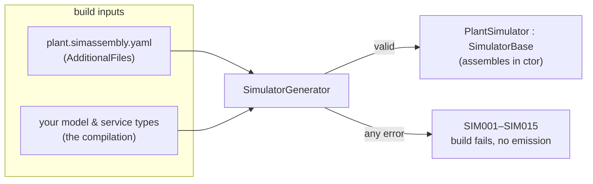
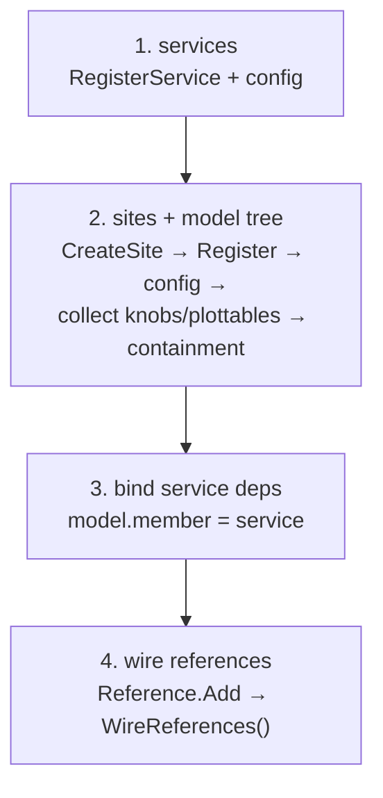

# The assembly

You have written models, marked their knobs and config, and decided how they relate. The **assembly** is the one file
that says *which instances exist, where they live, and how they connect*. It is a small YAML document, and at build time
a Roslyn generator reads it, **validates it against your real types**, and emits a strongly-typed simulator that
constructs the whole tree.

- **The assembly is topology, not behaviour.** No logic lives here — only names, types, containment, references,
  service bindings, and config scalars.
- **It is checked at compile time.** An unknown type, a container/element mismatch, a dangling reference, a missing
  constructor — every one is a **compile error** (`SIM001`–`SIM015`), not a runtime failure. If it builds, the topology
  is sound.
- **The output is ordinary compiled code.** The generated `<Name>Simulator` carries no YAML parser and no reflection;
  the shipped product is just C#.



This page walks the structure and the generation. For the exhaustive field-by-field schema and every diagnostic, see
the [assembly YAML reference](#/guide/assembly-yaml-reference).

---

## How the file is recognized

You register an assembly by tagging it with the **`<SimAssembly>`** MSBuild item. The CodeGen targets bridge every
`<SimAssembly>` into an `AdditionalFiles` item carrying `IsSimAssembly=true`, and the
[`SimulatorGenerator`](#/api/type/SimulaSharp.CodeGen.SimulatorGenerator) reads it from the compiler's
**`AdditionalFiles`**. That tag is the single way to register an assembly:

```xml
<!-- in your .csproj -->
<ItemGroup>
  <SimAssembly Include="plant.simassembly.yaml" />
</ItemGroup>
```

The file can be named **anything** — the `.simassembly.yaml` suffix is only a **human convention** that makes the file
easy to spot; the `<SimAssembly>` tag is what makes it a build input (so a plain `Demo.yaml` works fine). The item is
also a first-class, IDE-recognized build action. One simulator class is generated per assembly file.

---

## The structure

Here is the sandbox assembly, annotated. It declares one service, one site, and a three-model tree with containment, a
reference, a service dependency, and config:

```yaml
Simulator:
  Name: Plant                       # → generated class "PlantSimulator"
  MissionStart: 2026-01-01T00:00:00 # mission epoch (sim time 0); default = Unix epoch

  Services:                         # own-thread shared capabilities
    - Name: Tracker
      Type: Demo.DemoService        # fully-qualified; ctor (IClock, ILogger)

  Sites:                            # each site = one thread + one event queue
    - Name: Main
      # MaxEvents: 1024             # optional per-site queue capacity (default 1024)
      Models:
        - Name: Plant1
          Type: Demo.Plant          # fully-qualified; ctor (IClock, IScheduler, ILogger)
          Config: { Capacity: 5 }   # scalars → [Parameter] members (see Configuration)
          Models:                   # containment: { <containerFieldName>: [ children ] }
            - Units:
                - Name: UnitA
                  Type: Demo.Unit
                  Config: { Rate: 1.5 }
                  Refs:             # references: { <referenceFieldName>: [ dotted.paths ] }
                    - Peers:
                        - Plant.Plant1.UnitB
                - Name: UnitB
                  Type: Demo.Unit
                  Config: { Rate: 2.5 }
          Deps:                     # service deps: { <serviceRefMember>: serviceName }
            - Tracker: Tracker
```

### Simulator

The root. Fields:

| Field | Meaning |
|---|---|
| `Name` | Required. The class name becomes `<Name>Simulator` (here `PlantSimulator`). |
| `MissionStart` | Optional. An absolute instant parsed (invariant, assumed UTC) to the **mission epoch** — the wall-clock time mapped to sim time 0. Omitted → `DateTime.UnixEpoch`. |
| `Services` | Optional list of services. |
| `Sites` | The sites, each owning a model tree. |

### Services

Each entry is a `Name`, a fully-qualified `Type` (must implement `IService` and have an `(IClock, ILogger)` ctor), and
an optional `Config` map. A service runs on its own thread; models bind to it through `Deps`.

### Sites

Each site is a `Name`, an optional `MaxEvents` (event-queue capacity, default **1024**), and its root `Models`. A site
is one thread and one event queue; the whole subtree under it shares that site.

### Model nodes

A model node is the workhorse. Its fields:

| Field | Shape | Meaning |
|---|---|---|
| `Name` | scalar | The instance name; contributes to the dotted path. |
| `Type` | scalar | Fully-qualified type; must implement `IModel` with the `(IClock, IScheduler, ILogger)` ctor. |
| `Config` | map | Scalars bound to `[Parameter]` members ([Configuration](#/guide/configuration)). |
| `Models` | list of `{ containerName: [children] }` | **Containment** — nests children into a `[Contains<T>]` container. |
| `Refs` | list of `{ referenceField: [dotted.paths] }` | **References** — non-owning links into a `Reference<T>` field, by full instance path. |
| `Deps` | list of `{ serviceRefMember: serviceName }` | **Service bindings** — assigns a named service to a `[ServiceRef]` member. |

The **full dotted path** of an instance is its ancestry joined by dots, rooted at the simulator name:
`Plant.Plant1.UnitA`. That path is the identity used everywhere — reference targets, knob/plottable paths, and the
logger issuer.

> **Consequence for design.** Containment (`Models`) is **ownership** — a child lives inside its parent's
> `Container<T>` and shares the parent's site. References (`Refs`) are **links** — a pointer to an instance that exists
> somewhere else in the tree, addressed by path. Choose containment for "part of", references for "knows about". See
> [associations](#/guide/associations) for the full story.

---

## What the generator emits

The generator constructs everything in the **constructor**, depth-first, in a fixed order. Here is the **real** generated
output for the sandbox assembly above:

```csharp
public sealed class PlantSimulator : SimulatorBase
{
    public PlantSimulator() : base(new DateTime(639028224000000000L, DateTimeKind.Utc))  // MissionStart
    {
        var __c0 = RegisterService(new Demo.DemoService(Clock, CreateLogger("Plant.Tracker")));
        var __c1 = CreateSite("Main", 1024);
        var __c2 = Register(new Demo.Plant(Clock, __c1, CreateLogger("Plant.Plant1")));
        __c2.__ApplyParameters(new Dictionary<string, string?> { ["Capacity"] = "5" });
        CollectKnobsFrom(__c2, "Plant.Plant1");
        CollectPlottablesFrom(__c2, "Plant.Plant1");
        var __c3 = Register(new Demo.Unit(Clock, __c1, CreateLogger("Plant.Plant1.UnitA")));
        __c3.__ApplyParameters(new Dictionary<string, string?> { ["Rate"] = "1.5" });
        CollectKnobsFrom(__c3, "Plant.Plant1.UnitA");
        CollectPlottablesFrom(__c3, "Plant.Plant1.UnitA");
        __c2.Units.Add(__c3);                       // containment: parent.<field>.Add(child)
        var __c4 = Register(new Demo.Unit(Clock, __c1, CreateLogger("Plant.Plant1.UnitB")));
        __c4.__ApplyParameters(new Dictionary<string, string?> { ["Rate"] = "2.5" });
        CollectKnobsFrom(__c4, "Plant.Plant1.UnitB");
        CollectPlottablesFrom(__c4, "Plant.Plant1.UnitB");
        __c2.Units.Add(__c4);
        __c2.Tracker = __c0;                        // service dep binding
        __c3.Peers.Add(__c4);                       // reference population
        (__c2 as IReferenceWiring)?.WireReferences();   // reference accessors built
        (__c3 as IReferenceWiring)?.WireReferences();
        (__c4 as IReferenceWiring)?.WireReferences();
        OnAssembled();
    }
}
```

Read top to bottom, the generator's passes are:

1. **Services** — `RegisterService(new Svc(Clock, CreateLogger(path)))`, then apply service config.
2. **Sites + model tree** — `CreateSite(...)`, then depth-first per root: `Register(new Model(Clock, site,
   CreateLogger(fullPath)))`, `__ApplyParameters`, `CollectKnobsFrom`/`CollectPlottablesFrom`, then recurse into children
   and `parent.<containerField>.Add(child)`.
3. **Service dependency binding** — after everything is constructed, `model.<member> = service`.
4. **Reference wiring** — populate each `Reference<T>` (`model.<field>.Add(target)`), then
   `(model as IReferenceWiring)?.WireReferences()` builds the smart accessors.

Note the logger issuer for every component is its **full dotted path** (`Plant.Plant1.UnitA`), and the mission epoch is
baked into the base ctor as a `DateTime` tick count — no parsing at run time.



---

## Validation: errors at build time, not run time

Before emitting a single line, the generator runs a **`Validator`** against the compilation's actual symbols. Every
type is resolved, every container/reference field is checked for the right generic shape, every child is checked
assignable to its container's element type, every reference target is checked to exist and be assignable, every service
dep is checked. **On any error it reports the diagnostic and skips emission entirely** — so you get the real topology
error, not a cascade of downstream compile errors against a half-built class.

| ID | Meaning |
|---|---|
| `SIM001` | Assembly YAML parse error |
| `SIM002` | Missing `Simulator.Name` |
| `SIM003` | Duplicate instance path |
| `SIM004` | Unknown type for an instance |
| `SIM005` | Type does not implement `IModel`/`IService` |
| `SIM006` | Type lacks the required constructor |
| `SIM007` | Container name not found on the model (`[Contains<T>]`) |
| `SIM008` | Contained type not assignable to the container's element type |
| `SIM009` | Contained child is not a model (not `IModel`) |
| `SIM010` | Reference field not found / not a `Reference<T>` |
| `SIM011` | Reference targets an unknown instance path |
| `SIM012` | Referenced instance not assignable to the reference's element type |
| `SIM013` | Dependency member not found / not `[ServiceRef]` |
| `SIM014` | Dependency names an unknown service |
| `SIM015` | Service not assignable to the dependency member |
| `SIM016` | *(warning)* Config key with no matching `[Parameter]` member |

> **Consequence for design.** The assembly is a **statically-checked wiring diagram**. You cannot ship a simulator whose
> tree does not typecheck against your models. When you rename a model field or change a type, the assembly fails to
> build until you fix it — the topology can never silently drift out of sync with the code.

For the complete grammar, every field's defaults, and the diagnostics in full, continue to the
[assembly YAML reference](#/guide/assembly-yaml-reference). To see how the built simulator is then driven, see
[the simulator lifecycle](#/guide/simulator-lifecycle).
