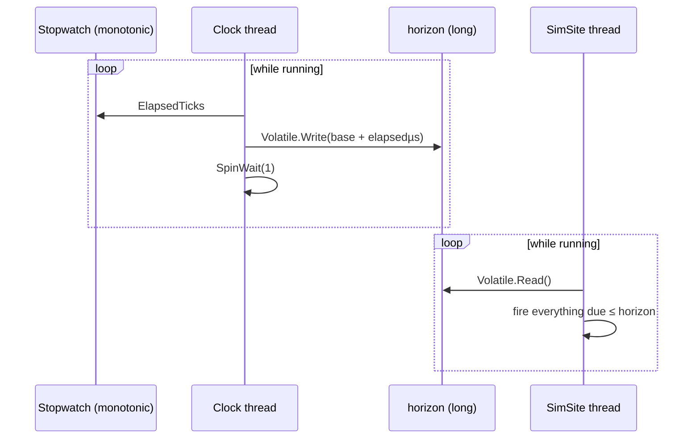
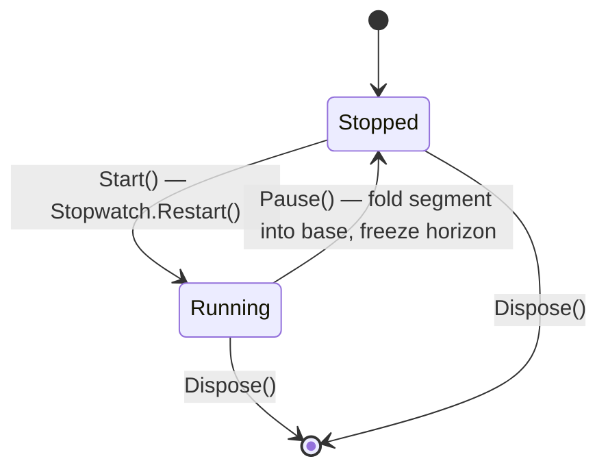
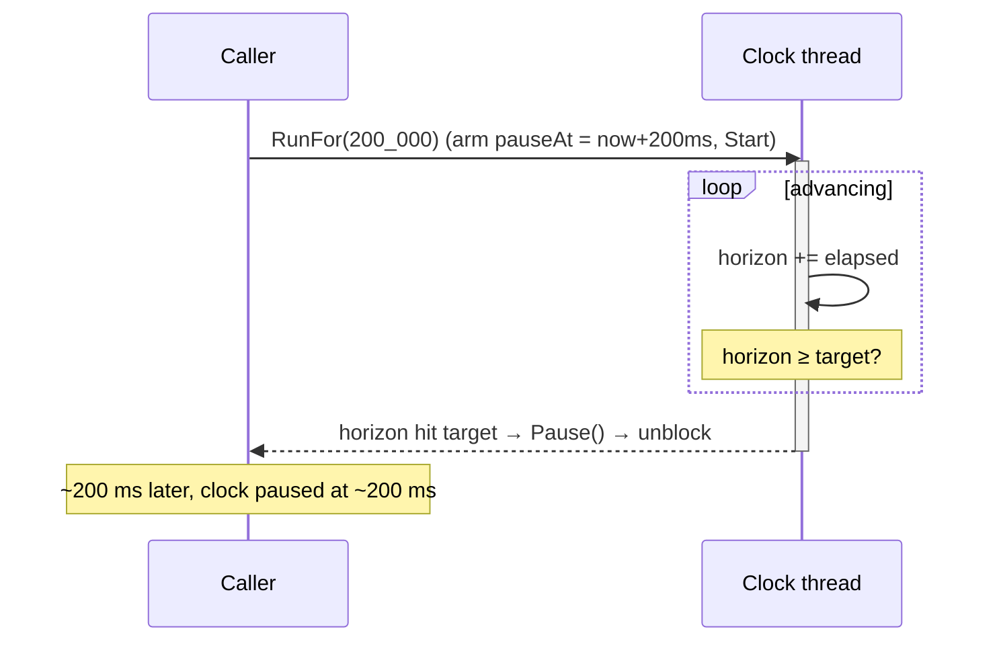

# Time & the clock

Everything in a SimulaSharp simulation is timed off one object: the
[`SimClock`](#/api/type/SimulaSharp.Kernel.Services.SimClock). Understanding it — what it does, what it deliberately
does *not* do — is the foundation for everything else.

## One writer, many readers

The clock owns a single 64-bit value, **the horizon**: elapsed simulation time in microseconds. A dedicated background
thread is the **only writer**; every SimSite is a reader. Publication is a plain `Volatile.Write`/`Volatile.Read` of a
naturally-aligned `long` — we need *visibility*, not the read-modify-write atomicity of `Interlocked`, because there is
exactly one writer.



The horizon is derived from the Stopwatch's **total** elapsed ticks each iteration — not accumulated per-tick deltas —
so it carries **no truncation drift**. Over an hour it is exactly as accurate as the underlying monotonic timer.

## Hard real time: 1:1, always

Simulated time advances at **exactly the rate of real time**. There is no speed factor, no fast-forward, no
run-to-completion. If a model schedules work 100 ms ahead, that work runs after ~100 ms of *wall-clock* time. This is a
deliberate design choice: a SimulaSharp simulation is a **real-time system**, fit for hardware-in-the-loop and live
operator interaction, where "faster than real time" would be meaningless or dangerous.

> **Consequence for design.** You cannot "speed through" a long scenario. To exercise hours of behaviour you either run
> for hours, or (for tests) run short and assert on rates. See [time & determinism](#/guide/time-and-determinism).

## Start, pause, resume — never reset

The clock has two control verbs and no third:

- **`Start()`** — begin (or resume) advancing. Raises `Started`.
- **`Pause()`** — freeze the horizon exactly where it is. Raises `Stopped`.

Pause/resume is seamless: on pause the clock folds the current running segment into an accumulated base and stops its
Stopwatch; on the next `Start()` it restarts the Stopwatch and keeps counting from that base. **No simulated time is
lost or invented across a pause**, however long the wall-clock gap.



There is **no reset**. A clock (and the whole simulation around it) is **single-use**: to run a scenario again from
zero, you build a new simulator. This sidesteps the genuinely hard problem — resetting every model's internal state —
by getting clean state for free from fresh instances.

## Two clocks in one: sim time and mission time

The clock exposes elapsed time and an absolute wall-clock instant, from the same horizon:

- **`SimNowUs`** — elapsed simulation microseconds (the horizon). Starts at 0.
- **`MissionNowUs`** — absolute mission time: a fixed **mission epoch** plus the horizon. The epoch is set once at
  construction (the assembly's `MissionStart`, default the Unix epoch).

Reading them separately can *tear* — two reads may straddle a horizon advance. When you need both consistently, take a
single snapshot:

```csharp
TimeSnapshot t = clock.Now();     // one horizon read → matched pair
// t.SimTimeUs and t.MissionTimeUs are guaranteed consistent
```

[`TimeSnapshot`](#/api/type/SimulaSharp.Kernel.Primitives.TimeSnapshot) is what the logging layer and the plottable
sweep use so every stamped record is internally consistent.

## Bounded runs: `RunFor` and `PauseAtSimUs`

For scripted runs and tests, the clock can **stop itself** at a target horizon. This is *not* a fast-forward — time
still advances at 1:1 — it is a clean, automatic boundary.

- **`PauseAtSimUs(target)`** — arm an auto-pause: when the horizon reaches `target`, the clock thread pauses itself.
  A manual `Pause()` disarms it (a freeze is never silently re-armed); pass a negative value to disarm.
- **`RunFor(durationUs)`** — arm `now + duration`, ensure the clock is started, and **block the caller** until the
  pause fires. It takes ~`durationUs` of real time — a controlled real-time run.



Because the **clock thread itself** performs the auto-pause, the caller never races the horizon writer. Overshoot is
bounded by the spin granularity (sub-microsecond to a few µs).

## What this means for you

| You want to… | Use |
|---|---|
| Read "what time is it now?" inside a model | `Clock.SimNowUs` (or `TimeKeeper.SimNowUs` on `ModelBase`) |
| Stamp an event with wall-clock/mission time | `Clock.MissionNowUs`, or `Clock.Now()` for a consistent pair |
| Start / freeze / resume a run | `Start()` / `Pause()` on the simulator (which drives the clock) |
| Run for a bounded span then stop (scripts, tests) | `RunFor(durationUs)` |
| Run a scenario again | build a **new** simulator (no reset) |

Models never *advance* time — they only *read* it and schedule work relative to it. How that scheduling works is the
next chapter: **[SimSites & the actor model](#/guide/simsites-and-actors)**.
