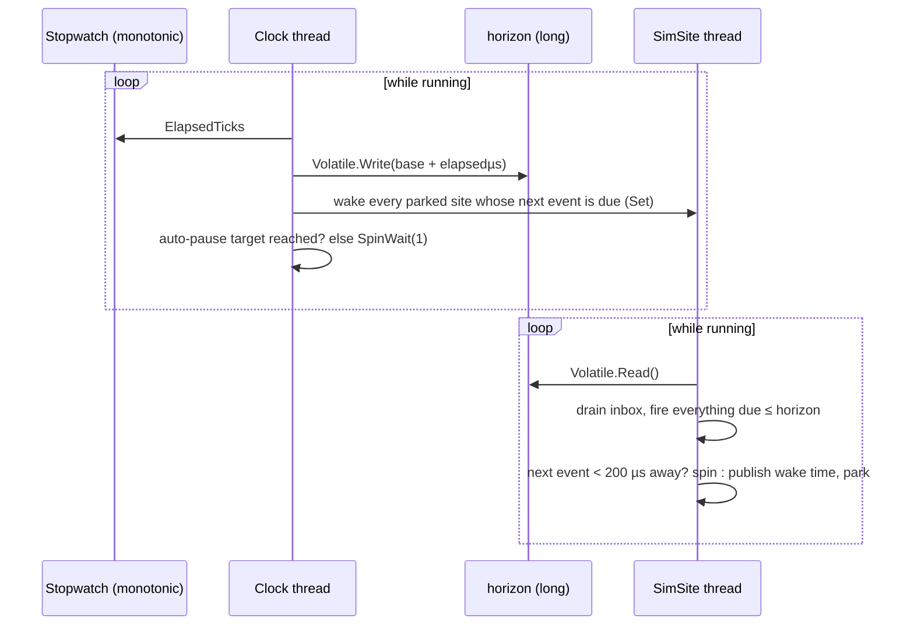
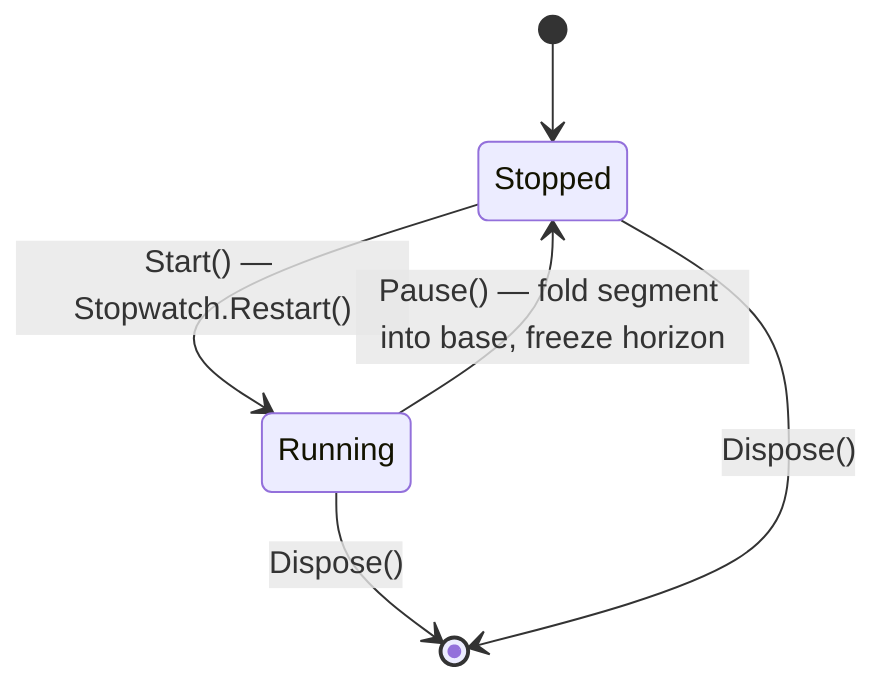
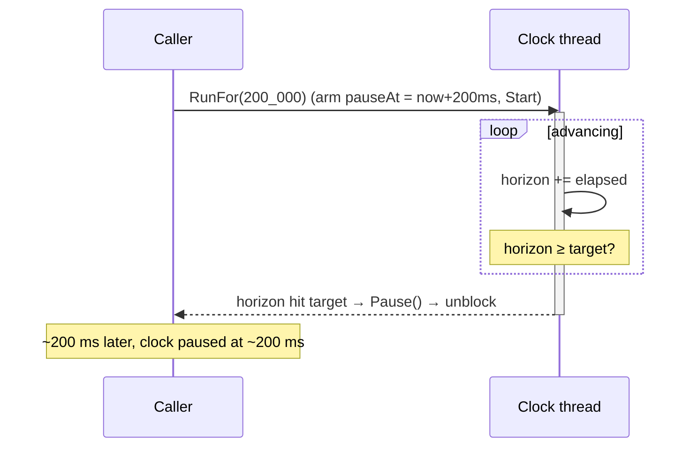

# Time & the clock

Everything in a SimulaSharp simulation is timed off one object: the
[`SimClock`](#/api/type/SimulaSharp.Kernel.Services.SimClock). Understanding it — what it does, what it deliberately
does *not* do — is the foundation for everything else.

## One writer, many readers

The clock owns a single 64-bit value, **the horizon**: elapsed simulation time in microseconds. A dedicated background
thread is the **only writer**; every SimSite is a reader. Publication is a plain `Volatile.Write`/`Volatile.Read` of a
naturally-aligned `long` — we need *visibility*, not the read-modify-write atomicity of `Interlocked`, because there is
exactly one writer.



The horizon is derived from the Stopwatch's **total** elapsed ticks each iteration — not accumulated per-tick deltas —
so it carries **no truncation drift**. Over an hour it is exactly as accurate as the underlying monotonic timer.

### The clock is also the waker

Only the clock thread spins. A site that falls idle does **not** busy-wait: it publishes the due time of its next event
and **parks** (0% CPU). Each sweep, the clock thread checks the registered sites and `Set()`s every one whose next event
has come due — the instant the horizon reaches it. Because the clock is the sole, continuously advancing horizon writer,
that wake is precise to well under a microsecond, and it does not depend on OS timer granularity (a stock Windows timed
wait can be ~15 ms off).

A parked site is also released early by cross-thread work arriving in its inbox and by a clock pause. Work due within
**200 µs** is spun for instead of parked, to shave the wake latency off imminent events. The park's own timed wait (at
most 1 s) is only a backstop. So an idle simulation costs one spinning core (the clock), not one per site.

## Hard real time: 1:1, always

Simulated time advances at **exactly the rate of real time**. There is no speed factor, no fast-forward, no
run-to-completion. If a model schedules work 100 ms ahead, that work runs after ~100 ms of *wall-clock* time. This is a
deliberate design choice: a SimulaSharp simulation is a **real-time system**, fit for hardware-in-the-loop and live
operator interaction, where "faster than real time" would be meaningless or dangerous.

> **Consequence for design.** You cannot "speed through" a long scenario. To exercise hours of behaviour you either run
> for hours, or (for tests) run short and assert on rates. See [time & determinism](#/guide/time-and-determinism).

## Read vs control: two facets of one clock

The clock is split by **capability**, so a model or service can *read and observe* time but never *control* it:

- [`IClock`](#/api/type/SimulaSharp.Kernel.Services.IClock) — the **read/observe** view: `SimNowUs`, `MissionNowUs`,
  `Now()`, `IsRunning`, the `Started`/`Stopped` events, and `SetMissionTimeProvider` (re-sources mission time — see
  below). This is what a model's `TimeKeeper` and a service's `TimeKeeper` are typed as. It has **no** `Start`/`Pause` —
  a model *cannot* freeze the simulation out from under its peers (re-sourcing mission time doesn't touch the horizon).
- [`SimClock`](#/api/type/SimulaSharp.Kernel.Services.SimClock) — the concrete clock, which **adds control**
  (`Start`/`Pause`/`PauseAtSimUs`/`RunFor`) and `IDisposable`. The **simulator owns it**; the run's driver reaches
  control through the simulator ([`ISimulator.Start`/`Stop`/`RunFor`](#/api/type/SimulaSharp.Kernel.Services.ISimulator)),
  and reads time through `ISimulator.Clock`, which is typed as `IClock` too. `Stop()` on the simulator is the clock's
  `Pause()`.

This is the same capability-segregation principle applied to sites — see [sites & dispatch](#/guide/sites-and-dispatch).

## Start, pause, resume — never reset

The clock has two control verbs and no third (on the concrete `SimClock`, driven by the simulator):

- **`Start()`** — begin (or resume) advancing. Raises `Started`. A no-op if already running.
- **`Pause()`** — freeze the horizon exactly where it is. Raises `Stopped`. A no-op if already paused.

Pause/resume is seamless: on pause the clock folds the current running segment into an accumulated base and stops its
Stopwatch; on the next `Start()` it restarts the Stopwatch and keeps counting from that base. **No simulated time is
lost or invented across a pause**, however long the wall-clock gap. While paused, the clock thread blocks (no CPU), and
so does every site: a paused site neither fires due events nor drains its inbox until the clock resumes.



There is **no reset**. A clock (and the whole simulation around it) is **single-use**: `Start()` after `Dispose()`
throws `ObjectDisposedException`, and to run a scenario again from zero, you build a new simulator. This sidesteps the genuinely hard problem — resetting every model's internal state —
by getting clean state for free from fresh instances.

## Two clocks in one: sim time and mission time

The clock exposes elapsed time and an absolute wall-clock instant, from the same horizon:

- **`SimNowUs`** — elapsed simulation microseconds (the horizon). Starts at 0.
- **`MissionNowUs`** — absolute mission time, in µs since the Unix epoch. By **default** it is a fixed **mission epoch**
  plus the horizon — so, like sim time, it is pinned to real time. It can instead be **driven by a provider** (see
  below).

The mission epoch is set once, when the simulator is constructed, from the assembly's optional `MissionStart:` key. The
generator parses it at build time as UTC (an ISO-8601 string such as `"2026-01-01T00:00:00Z"`); if it is missing or
cannot be parsed, the epoch is the Unix epoch, so `MissionNowUs` starts at 0.

```yaml
Simulator:
  Name: Plant
  MissionStart: "2026-01-01T00:00:00Z"   # MissionNowUs == 1767225600000000 at horizon 0
  Sites:
    # ...
```

Reading them separately can *tear* — two reads may straddle a horizon advance. When you need both consistently, take a
single snapshot:

```csharp
TimeSnapshot t = clock.Now();     // one horizon read → a coherent (sim, mission) pair
// default source: t.MissionTimeUs == epoch + t.SimTimeUs; with a provider, both are sampled together (see below)
```

[`TimeSnapshot`](#/api/type/SimulaSharp.Kernel.Primitives.TimeSnapshot) (a `readonly record struct` of `SimTimeUs` and
`MissionTimeUs`) is what the logging layer uses, so every log entry is internally consistent. The plottable sweep
(`ISimulator.SamplePlottables()`) reads `MissionNowUs` once and stamps the whole sweep with it, so all points share one
x-axis value.

### Mission time can be provider-driven

Mission time is the one clock you can **re-source at runtime**. A component installs an
[`IMissionTimeProvider`](#/api/type/SimulaSharp.Kernel.Services.IMissionTimeProvider) via
[`IClock.SetMissionTimeProvider`](#/api/type/SimulaSharp.Kernel.Services.IClock), and from then on `MissionNowUs` (and
the mission field of `Now()`) return **that** provider's value instead of `epoch + horizon`. Pass `null` to revert to
the default.

This exists because mission time and *real* time aren't always the same. Sim time is hard 1:1 and never warps — but a
mission clock might be **fast-forwarded between events**, e.g. an FES / HIL rig that skips ahead between ground-station
passes. Installing that rig's clock as the provider makes every component's mission time — uptime counters, RTCs,
mission-stamped telemetry — track the *mission* rather than the wall clock, with **no model changes**: models keep
reading `MissionNowUs` off the `IClock` they already hold.

```csharp
// inside the authority service (e.g. an FES service), once its clock is ready:
public override void Configure() => TimeKeeper.SetMissionTimeProvider(_fesClock);   // _fesClock : IMissionTimeProvider
```

The provider's `MissionNowUs` is read **cross-thread** on every mission-time access (any site, plus the plot sweep), so
it must be cheap and non-blocking — typically a `Volatile.Read` of a value the authority keeps current (optionally
interpolated from `SimNowUs`). One consequence: with a provider installed, **sim and mission become independent clocks** —
`Now()` still returns a coherent snapshot of both, but mission is no longer `epoch + sim`.

## Bounded runs: `RunFor` and `PauseAtSimUs`

For scripted runs and tests, the clock can **stop itself** at a target horizon. This is *not* a fast-forward — time
still advances at 1:1 — it is a clean, automatic boundary.

- **`PauseAtSimUs(target)`** — arm an auto-pause: when the horizon reaches `target`, the clock thread pauses itself.
  If the clock is running and already at or past `target`, it pauses at once. A manual `Pause()` disarms it (a freeze
  is never silently re-armed); pass a negative value to disarm.
- **`RunFor(durationUs)`** — capture `now + duration`, ensure the clock is started, arm the target, and **block the
  caller** until the clock pauses. It takes ~`durationUs` of real time — a controlled real-time run. A zero or negative
  duration pauses at once. Any pause (including a `Stop()` from another thread) releases the caller, and so does
  disposing the clock.

The release happens only after the `Stopped` handlers have run, so when `RunFor` returns, every site has been told to
stop. A site may still be finishing the pass it was in at that moment, so read cross-thread state with a short bounded
wait (see [time & determinism](#/guide/time-and-determinism)).

> **On the simulator, call `Start()` first.** `ISimulator.RunFor` drives the clock only. The site threads are started by
> the simulator's first `Start()`, so `Configure()` followed directly by `RunFor(...)` advances time while no model code
> runs. The usual sequence is `Configure()`, `Start()`, then `RunFor(...)` as often as needed.



Because the **clock thread itself** performs the auto-pause, the caller never races the horizon writer. Overshoot is
bounded by the spin granularity (sub-microsecond to a few µs).

## What this means for you

| You want to… | Use |
|---|---|
| Read "what time is it now?" inside a model or service | `TimeKeeper.SimNowUs` (the `IClock` on `ModelBase` / `ServiceBase`) |
| Stamp an event with wall-clock/mission time | `TimeKeeper.MissionNowUs`, or `TimeKeeper.Now()` for a consistent pair |
| Read time from the host | `sim.Clock` (an `IClock`) |
| Set the mission epoch | `MissionStart:` in the assembly YAML (UTC; default the Unix epoch) |
| Drive mission time from an external / fast-forwarded clock | install an `IMissionTimeProvider` via `TimeKeeper.SetMissionTimeProvider(...)` |
| Start / freeze / resume a run | `Start()` / `Stop()` on the simulator (which drives the clock) |
| Run for a bounded span then stop (scripts, tests) | `sim.Start()` once, then `sim.RunFor(durationUs)` |
| Run a scenario again | build a **new** simulator (no reset) |

Models never *advance* time — they only *read* it and schedule work relative to it. How that scheduling works is the
next chapter: **[SimSites & the actor model](#/guide/simsites-and-actors)**.
