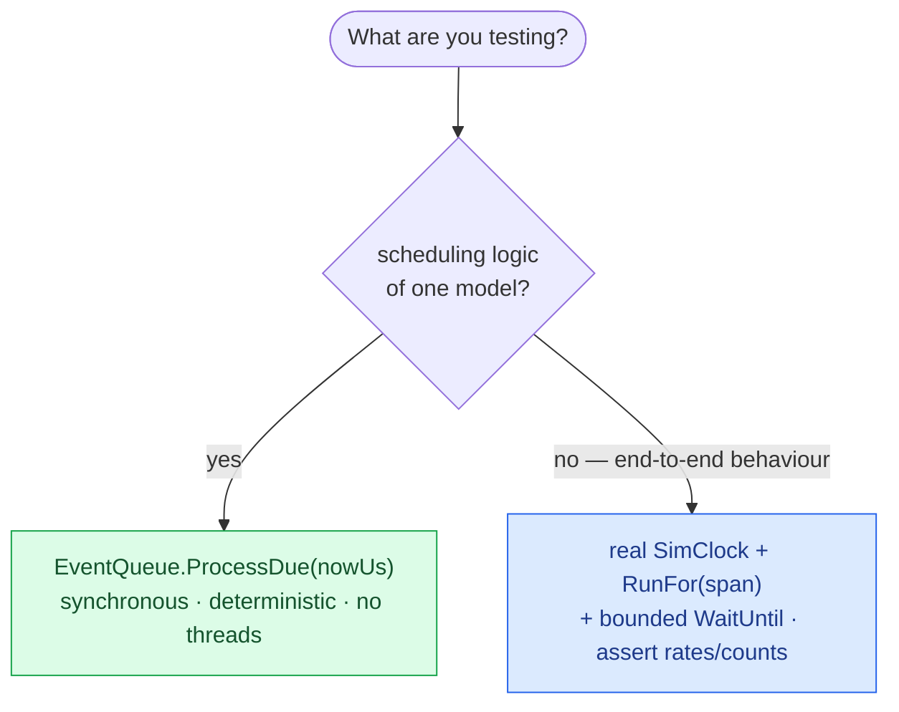

# Time & determinism

SimulaSharp is **hard real time**: simulated time advances at **1:1 with the wall clock**, always. There is no speed
factor, no fast-forward, no run-to-completion, and no reset. This chapter is about *designing around* that — sizing your
periods, running bounded spans, testing without a fake clock, and being honest about what you give up.

If you haven't read [time & the clock](#/guide/time-and-clock), read it first; this page is the design counterpart to
that mechanism.

## The commitment, and what follows from it

The [`SimClock`](#/api/type/SimulaSharp.Kernel.Services.SimClock) publishes a single horizon derived from a monotonic
`Stopwatch`, at 1:1. Two consequences shape everything you design:

- **You cannot "speed through" time.** Exercising an hour of behaviour takes an hour. To test long-horizon behaviour you
  either run long, or run short and assert on *rates* and *counts*.
- **There is no reset.** A clock — and the whole simulator around it — is **single-use**. To run a scenario again from
  zero, you build a **new** simulator. Fresh instances give clean state for free, sidestepping the genuinely hard
  problem of resetting every model.

```mermaid
stateDiagram-v2
  [*] --> Stopped
  Stopped --> Running: Start()
  Running --> Stopped: Pause() / auto-pause at target
  Running --> [*]: Dispose() — single-use
  Stopped --> [*]: Dispose()
  note right of Running: horizon advances 1:1 with real time
```

## Sizing periods: real time is the budget

Because a period is *real* time, choosing one is a real-time-systems decision, not a free knob.

- **A period is a promise the site can keep.** A 1 ms periodic asks the site to wake, run your handler, and return
  within ~1 ms of real time, forever. If the handler plus everything else on the site can't fit in the period, the site
  **lags** — and then [absolute re-arm bursts to catch up](#/guide/event-queue-and-scheduling), replaying the missed
  ticks one per pass. That keeps *counts and phase* exact, but it means your handler must be cheap enough to run in a
  burst.
- **Match the period to the physics, not to "fast."** Sample and integrate at the rate the dynamics need — a thermal
  mass at 10 Hz, a control loop at 100 Hz–1 kHz — not faster "to be safe." Every µs of period is a µs of real budget on
  that core.
- **Fewer, coarser periodics beat many fine ones.** Each running site busy-spins a core; each periodic is work in that
  core's budget. Consolidate where you can.

> **Consequence for design.** The sum of one site's periodic work, per unit real time, must fit in real time on one
> core. If it doesn't, the site lags and bursts. The fix is a cheaper handler, a longer period, or
> [splitting the subsystem onto its own site](#/guide/choosing-a-topology) — not a faster clock, because there isn't
> one.

## `RunFor`: bounded, scripted, repeatable

The primitive for scripted runs and tests is [`RunFor(durationUs)`](#/api/type/SimulaSharp.Kernel.Services.SimClock). It
arms an auto-pause at `now + duration`, starts the clock, and **blocks the caller** until the horizon reaches the
target, at which point the *clock thread itself* pauses. It is **not** a fast-forward — it takes ~`durationUs` of real
time — it's a clean, automatic boundary.

```mermaid
sequenceDiagram
  participant Caller
  participant Clock as Clock thread
  participant Sites as SimSites
  Caller->>Clock: RunFor(200_000)  (arm pauseAt=now+200ms, Start)
  activate Clock
  loop ~200 ms of real time
    Clock->>Clock: horizon += elapsed
    Sites->>Sites: fire due events on their threads
    Note over Clock: horizon ≥ target?
  end
  Clock-->>Caller: hit target → Pause() → unblock
  deactivate Clock
  Note over Caller,Sites: paused at ~200 ms; inspect state, assert, or RunFor again
```

You chain `RunFor` calls to script a run — advance 200 ms, poke a knob, advance another 500 ms, assert — each segment a
controlled real-time span. Because the clock thread performs the pause, the caller never races the horizon writer, and
overshoot is bounded to the spin granularity (sub-µs to a few µs). Under the hood `RunFor` builds on
`PauseAtSimUs(target)`; a manual `Pause()` disarms it.

## Why there is no manual/logical clock

Most discrete-event frameworks let you *jump* a logical clock to the next event — instant fast-forward. SimulaSharp
deliberately does not, and it's not an oversight:

> **Consequence for design.** A jumping clock is **unsound for multiple communicating sites**. Each site consumes a
> [discontinuous horizon at its own real speed](#/guide/simsites-and-actors); if the clock leapt forward, two sites
> would cross the gap at *different* wall-clock rates, and a cross-site message sent "at T" could arrive relative to a
> peer that's already at "T + jump" — corrupting cross-site message timing. Real time is the *only* shared reference all
> sites can consume consistently in parallel. So the clock advances continuously at 1:1, and the boundary you get is
> `RunFor`, which stops cleanly *at* a horizon rather than skipping *to* one.

The payoff of paying real time is that the simulation *is* a real-time system — fit for hardware-in-the-loop and live
operator interaction, where "faster than real time" would be meaningless or dangerous.

## Testing without a fake clock

You test against the **real** `SimClock`. There is no mock clock to inject — and you don't want one, because it would
reintroduce exactly the cross-site unsoundness above. Two complementary approaches:

### 1. Real clock + `RunFor` + a bounded `WaitUntil`

Run a real, short span and assert on the outcome. Because sites are asynchronous, don't assert the instant `RunFor`
returns state that a *cross-site* effect produced — spin on a condition with a **bounded** timeout so a failing test
fails fast instead of hanging:

```csharp
using var sim = new PlantSimulator();
sim.Initialize();
sim.Configure();

sim.RunFor(500_000);                    // advance 500 ms of real time, then pause

// Bounded wait for an async condition (no fake clock; fail fast if it never holds).
bool ok = WaitUntil(() => sim.Knobs.Read("Plant.Plant1.UnitA.SoC") < 0.9,
                    timeout: TimeSpan.FromSeconds(1));
Assert.True(ok, "SoC should have dropped within budget");

static bool WaitUntil(Func<bool> cond, TimeSpan timeout)
{
    var sw = Stopwatch.StartNew();
    while (!cond()) { if (sw.Elapsed > timeout) return false; Thread.SpinWait(64); }
    return true;
}
```

Assert on **rates and counts**, not on having simulated hours: run a few seconds, check that a 100 Hz integrator ticked
~the expected number of times, that a value moved in the right direction at the right rate. The [absolute-re-arm
guarantee](#/guide/event-queue-and-scheduling) makes tick *counts* exact even under load, which is what makes count-based
assertions reliable.

### 2. The event queue, synchronously

For unit-testing scheduling logic itself, you don't need the clock thread at all. The
[`EventQueue`](#/api/type/SimulaSharp.Kernel.Services.EventQueue) is testable **synchronously** via `ProcessDue(nowUs)`:
drive `nowUs` yourself and fire everything due at or before it, on the calling thread, deterministically.

```csharp
var q = new EventQueue(maxEvents: 64);
int fired = 0;
q.AddPeriodicEvent(() => fired++, periodUs: 10_000);

q.ProcessDue(9_999);    // nothing due yet
Assert.Equal(0, fired);
q.ProcessDue(35_000);   // 10/20/30 due — bursts one per pass
q.ProcessDue(35_000);
q.ProcessDue(35_000);
Assert.Equal(3, fired); // absolute re-arm replayed the backlog exactly
```

This is the deterministic core: no threads, no wall clock, exact control over "now." Use it to test the *scheduling*
behaviour of a model (does it re-arm, does it stop, does it handle a full queue), and use approach 1 to test the
*end-to-end* real-time behaviour.



## The honest trade-off

Real-time-only is a genuine constraint, and it's worth stating plainly:

| You give up | You get |
|---|---|
| Fast-forwarding a long scenario | a real-time system fit for HIL and live operators |
| A logical/manual clock to inject in tests | soundness across parallel communicating sites |
| In-place reset to rerun | clean state for free from fresh instances |
| Instant "run to completion" | `RunFor` bounded spans + synchronous `ProcessDue` for deterministic tests |

If your problem is *offline analysis at maximum speed* — Monte-Carlo over thousands of runs, faster-than-real batch — a
1:1 real-time kernel is the wrong tool, and that's fine. SimulaSharp optimizes for the *other* half: real-time fidelity,
hardware-in-the-loop, and an operator in the loop. Design within that and it costs you nothing you needed.

## What this means for you

| You want to… | Do this |
|---|---|
| Read "now" in a model | `TimeKeeper.SimNowUs` |
| Run a bounded, scripted span | `RunFor(durationUs)` — chain calls to script |
| Rerun a scenario from zero | build a **new** simulator (no reset) |
| Test end-to-end behaviour | real clock + `RunFor` + bounded `WaitUntil`; assert rates/counts |
| Test scheduling logic deterministically | `EventQueue.ProcessDue(nowUs)` — synchronous |
| Fit a subsystem's work in budget | cheaper handler, longer period, or [split its site](#/guide/choosing-a-topology) |

Next, the traps to avoid — most of them are about not fighting the real-time, single-thread-per-site model:
**[pitfalls](#/guide/pitfalls)**.
